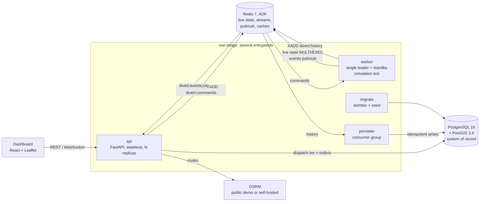

# DIVERT

**Dynamic Intelligent Vehicle Emergency Routing & Traffic** - real-time traffic-signal
pre-emption for emergency vehicles (a *moving green corridor*), with a faithful simulation
of Delhi, Kolkata and Bengaluru on real OpenStreetMap data, plus incident history and
analytics.



- **PostgreSQL + PostGIS** holds reference data (cities, stations, units, junction
  signals) and the full incident history (incidents, dispatches with route geometry,
  signal pre-emptions, timeline, sampled vehicle tracks), plus a transactional outbox.
  KNN station search and corridor detection run on GiST-indexed `geography` columns.
- **Redis** holds only hot, rebuildable state: per-vehicle live state, per-vehicle signal
  claims, the worker leader lock, the command/history streams and the per-city event
  channel feeding WebSockets.
- **OSRM** provides road routes; DIVERT layers its own speed/ETA and pre-emption model on top.

Docs: [architecture](docs/architecture.md) (components, dispatch sequence, tick loop,
history pipeline, failure modes) - [API contract](docs/api.md) -
[simulation model](docs/simulation-model.md) - [data model](docs/data-model.md) -
[data sources](docs/data-sources.md) - [deployment](docs/deployment.md) -
[runbook](docs/runbook.md) - [vision](docs/vision.md).

## Repository layout

```
backend/            Python 3.12 package `divert` (uv), Dockerfile, alembic.ini
  src/divert/       main.py (api), worker.py, persister.py, cli.py, config, logging, metrics
                    api/ (deps, errors, rate limit, middleware, WebSocket hub, v1 routers)
                    services/ (routing, speed_model, eta, preemption, dispatch, outbox,
                    simulation, reference), domain/ (geo math, enums, models, route),
                    db/ (models, repositories, seed), migrations/, store/ (Redis keys,
                    streams, locks, live state), cities/ (OSM snapshots + fetcher)
  scripts/          fetch_osm_data.py
  tests/            unit/ (no services), integration/ (real PostGIS + Redis), network/
frontend/           React 19 + TypeScript ops console (Vite, Tailwind, react-leaflet, zustand,
                    TanStack Query), nginx image serving the SPA and proxying /api + WebSocket
infra/              osrm/ (self-hosting), k8s/base (kustomize), observability/
docs/               design documents
```

## Quick start

Prerequisites: Docker, [uv](https://docs.astral.sh/uv/) (Python 3.12 is installed by uv), Node 22.

```bash
cp .env.example .env
docker compose up -d --build     # postgres, redis, migrate, api, worker x2, persister, frontend
curl localhost:8000/readyz       # {"ready": true, ... "worker": {"status": "ok"}}
curl -X POST localhost:8000/api/v1/cities/delhi/incidents \
     -H 'content-type: application/json' -d '{"type": "POLICE", "location": [28.6271, 77.2166]}'
open http://localhost:8080       # dashboard (nginx -> /api + WebSocket)
```

`DIVERT_SIM_TIME_SCALE=10 docker compose up -d worker` runs the simulation 10x faster.
`--profile observability` adds Prometheus + Grafana, `--profile osrm` a self-hosted OSRM.

## Backend

One image, four entrypoints (see [architecture](docs/architecture.md)):

| Service | What it does |
|---|---|
| `api` | FastAPI: validates and dispatches incidents (PostGIS KNN + OSRM + corridor via `ST_DWithin`, one transaction with `FOR UPDATE SKIP LOCKED` and a transactional outbox), serves history/analytics from PostgreSQL and live state from Redis, streams per-city WebSockets |
| `worker` | the simulation: one leader (Redis lease) + standby; consumes commands, moves vehicles with the speed model every 0.5 s, claims/releases/resolves signal pre-emptions per vehicle, writes each city's tick in one `MULTI/EXEC`, emits history events; rebuilds from PostgreSQL on take-over |
| `persister` | consumer group on `divert:history`: idempotent batch writes to PostgreSQL, DLQ after N failures, retention |
| `migrate` | `alembic upgrade head` + idempotent seed of the OSM reference data |

Development:

```bash
make infra                 # postgres + redis via compose
cd backend
uv sync
uv run divert migrate      # alembic upgrade head + idempotent seed
uv run uvicorn divert.main:create_app --factory --reload     # api on :8000
uv run python -m divert.worker                                # in another shell
uv run python -m divert.persister                             # in another shell
uv run pytest              # unit + integration (integration skips if PostGIS/Redis are down)
uv run pytest -m network tests/network -s                     # one real OSRM route per city
uv run ruff check src tests scripts && uv run ruff format --check src tests scripts && uv run mypy
uv run divert dlq          # inspect dead-lettered history events (--replay to re-queue)
```

`make help` lists all targets (`check` runs lint, mypy --strict and both test suites).

Tests: `tests/unit` (no services: fakeredis + respx; geo math, speed/ETA vs simulated
arrival, pre-emption rules, the three prototype regression guarantees, leader fail-over,
routing client), `tests/integration` (real PostGIS + Redis: migrations, seed, KNN/corridor
vs brute force, dispatch transaction + `SKIP LOCKED` contention, outbox relay, persister
idempotency + DLQ + retention, full API -> worker -> persister lifecycle, rebuild from
PostgreSQL, history/analytics, WebSocket), `tests/network` (public OSRM, opt-in).

## Frontend

The ops console (`frontend/`) talks only to its own origin: in development the Vite dev
server proxies `/api` (REST + WebSocket) to `http://localhost:8000`, in production the
nginx image does the same, so nothing is hard-coded to localhost.

| Tab | What it shows |
|---|---|
| Live | city map (CARTO tiles, OSM attribution; dark basemap toggle) with every junction signal as a canvas marker, stations by service (hollow = no free unit), active incidents, routes (travelled faded, remaining solid) and vehicles animated between 0.5 s ticks along the route by haversine distance; pre-empted junctions pulse green with ETA + lane advisory + approach arrow, conflicts are amber. Dispatch panel (Medical / Fire / Crime, click inside the dashed city bbox, haversine preview to the nearest station with a free unit, toasts for 422 / 409 / 503 / 429), incidents (status, cancel), fleet (ETA countdown, next signal + distance + claim state, est. time saved), operations stats + activity feed, stream status + simulation clock in city time |
| History | filterable (type, status, date range in city time), keyset-paginated incident table; detail drawer with timeline, predicted vs actual travel time, pre-emptions and a replay of the recorded track along the route |
| Analytics | per-city cards and charts for a selectable range: response time p50/p90 by type, incidents by type and status, pre-emptions / conflicts / busiest junctions, ETA error (MAPE), total est. time saved |

```bash
cd frontend
npm ci
npm run dev            # http://localhost:5173 (needs the API on :8000, e.g. docker compose up -d)
npm run lint && npm run typecheck && npm test && npm run build
npm run format         # prettier
```

Structure: `src/app` (shell, tab routing `#/{live|history|analytics}/{city}`, providers),
`src/api` (`types.ts` mirrors [docs/api.md](docs/api.md); REST client; reconnecting
WebSocket with exponential backoff + jitter, ping, no retry on 4404), `src/store` (zustand
live state + UI state), `src/features/*` (city-switcher, dispatch, incidents, fleet, map,
signals, stats, history, analytics), `src/components/ui`, `src/lib/geo.ts` (same haversine
model as the backend, R = 6371008.8 m; tests cross-check backend values). Optional build
args: `VITE_API_BASE_URL` (API on another origin; default same origin), `VITE_API_KEY`
(sent as `X-API-Key` on POST/DELETE; operators can also set it from the header).

## Configuration

Environment only, `DIVERT_` prefix (pydantic-settings) - see [.env.example](.env.example).
Key settings: `DIVERT_DATABASE_URL`, `DIVERT_REDIS_URL`, `DIVERT_OSRM_URL` (default: the
public OSRM demo, fair use only), `DIVERT_CORRIDOR_M` (30), `DIVERT_PREEMPT_LEAD_S` (45),
`DIVERT_PREEMPT_DISTANCE_M` (600), `DIVERT_SIM_TICK_S` (0.5), `DIVERT_SIM_TIME_SCALE` (1),
`DIVERT_SCENE_TIME_S` (120), `DIVERT_LEADER_LOCK_TTL_MS` (5000),
`DIVERT_POSITION_RETENTION_DAYS` (30), `DIVERT_API_KEY` (optional, mutating endpoints),
`DIVERT_RATE_LIMIT_PER_MIN` (60), `DIVERT_CORS_ORIGINS` (explicit list; wildcards rejected).

## Data and licences

Signals and stations: (c) OpenStreetMap contributors, ODbL (snapshot fetched 2026-11-17,
provenance inside each JSON file). City congestion profiles are approximations to be
calibrated - see [docs/data-sources.md](docs/data-sources.md).
