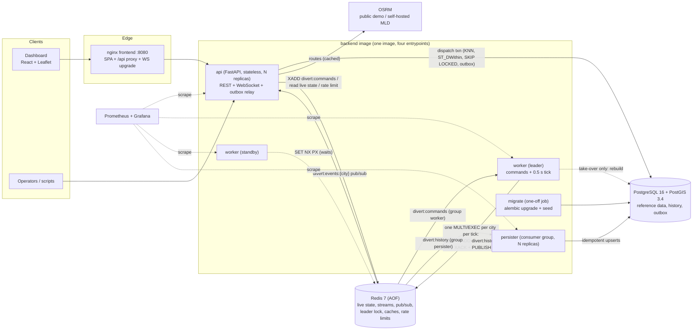
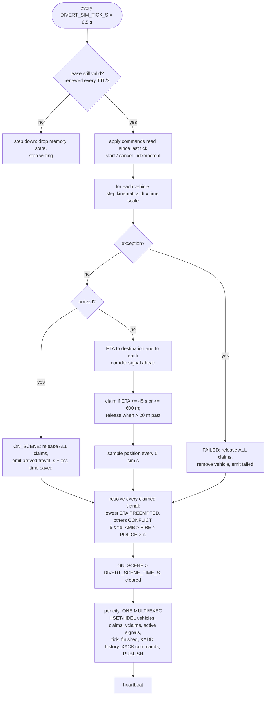
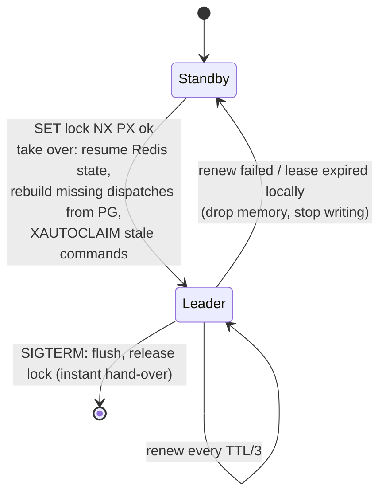

# DIVERT architecture

DIVERT dispatches the fastest free emergency unit to an incident, computes its road route
and the signalised junctions on it, and pre-empts those signals just ahead of the vehicle
(a *moving green corridor*). The simulation runs on real OpenStreetMap data for Delhi,
Kolkata and Bengaluru; every incident, dispatch, pre-emption and sampled position is kept
as history for analytics.

Design rules:

1. **One job per data store.** PostgreSQL/PostGIS is the system of record, Redis holds hot
   rebuildable state and messaging, OSRM routes. Nothing is stored in two places as truth.
2. **One writer per piece of state.** The API writes PostgreSQL (dispatch transaction) and
   never live state; the worker leader is the *only* writer of live Redis state; the
   persister is the only writer of history rows derived from the simulation.
3. **At-least-once delivery + idempotent consumers** everywhere (transactional outbox,
   consumer groups, deterministic event ids, forward-only status transitions).
4. **No hot-path database calls** in the simulation; no read-modify-write of shared state.

## 1. Components



| Service | Entrypoint | Scaling | State |
|---|---|---|---|
| api | `uvicorn divert.main:create_app --factory` | HPA on CPU, 2..10 | none (reference cache per process) |
| worker | `python -m divert.worker` | 2 replicas: 1 leader + hot standby | in-memory engine, mirrored to Redis every tick |
| persister | `python -m divert.persister` | N replicas (consumer group) | none |
| migrate | `divert migrate` | one-off before each rollout | none |
| frontend | nginx | N replicas | none |

## 2. Data stores - one clear job each

| Store | Job | Contents | Loss tolerance |
|---|---|---|---|
| PostgreSQL 16 + PostGIS 3.4 | system of record | cities, stations, units, signals (GiST); incidents, dispatches (route LineString), signal_preemptions, incident_events (timeline), vehicle_positions (BRIN), outbox | none: PITR backups |
| Redis 7 (AOF everysec, `noeviction`) | hot state + messaging | live vehicles, per-vehicle claims, active signals, leader lock, heartbeat, streams `divert:commands`, `divert:history`, `divert:history:dlq`, pub/sub `divert:events:{city}`, OSRM cache, rate-limit counters | rebuildable: live state is rebuilt from PG by the next leader |
| OSRM | routing | car profile on OSM | stateless; failure -> 503, nothing written |

Every Redis key is defined in `backend/src/divert/store/redis_store.py`:

| Key | Type | Writer | Purpose |
|---|---|---|---|
| `divert:{city}:vehicles` | HASH vehicle -> JSON | worker leader | live vehicle (one field per vehicle) |
| `divert:{city}:route:{vehicle}` | STRING JSON | worker leader | route + corridor of the dispatch |
| `divert:{city}:claims:{signal}` | HASH vehicle -> JSON | worker leader | per-vehicle claim on a signal |
| `divert:{city}:vclaims:{vehicle}` | SET of signals | worker leader | release-all index |
| `divert:{city}:signals:active` | HASH signal -> JSON | worker leader | resolved non-NORMAL signals |
| `divert:{city}:tick` | HASH | worker leader | last tick number / sim time |
| `divert:{city}:finished` | ZSET dispatch -> ts | worker leader | makes `start_dispatch` idempotent (24 h) |
| `divert:worker:leader` | STRING token, PX | any worker | leader lease |
| `divert:worker:heartbeat` | HASH | leader | `/readyz` worker check |
| `divert:sim:clock` | STRING | leader | sim time when `DIVERT_SIM_TIME_SCALE != 1` |
| `divert:commands` | STREAM (group `worker`) | api (outbox) | start/cancel dispatch commands |
| `divert:history` | STREAM (group `persister`) | worker leader | history events |
| `divert:history:dlq` | STREAM | persister | poison history events |
| `divert:events:{city}` | PUB/SUB | worker, api | WebSocket fan-out |
| `divert:osrm:driving:{sha}` | STRING, TTL | api | OSRM response cache |
| `divert:rl:{scope}:{client}:{window}` | STRING, TTL | api | fixed-window rate limit |

All per-city keys share the hash tag `{city}` so one city's live state is single-slot.

## 3. Dispatch (POST /api/v1/cities/{city}/incidents)

```mermaid
sequenceDiagram
    autonumber
    participant C as Client
    participant A as api
    participant PG as PostgreSQL/PostGIS
    participant O as OSRM
    participant R as Redis
    participant W as worker leader
    C->>A: POST {type, location [lat,lng]}
    A->>A: normalise type (POLICE->CRIME, HEALTH->MEDICAL...), bbox check
    Note over A: invalid -> 422, nothing touched
    A->>PG: KNN: 3 nearest stations of the service with AVAILABLE units (geom <-> point, GiST)
    par each candidate
        A->>R: GET route cache
        A->>O: /route/v1/driving (overview=full, steps, annotations) on miss
        A->>R: SET route cache (TTL)
    end
    Note over A: all routes failed -> 503, nothing written
    A->>PG: corridor: ST_DWithin(signal.geom, route, 30 m) (GiST) per route
    A->>R: GET divert:sim:clock (only when DIVERT_SIM_TIME_SCALE != 1; guarded)
    A->>A: along-route projection, lane advisory, ETA (speed model at the sim-clock hour); rank by ETA
    rect rgb(235, 245, 255)
    A->>PG: BEGIN
    A->>PG: SELECT unit ... FOR UPDATE SKIP LOCKED (best station, else next-best)
    Note over A,PG: none free -> ROLLBACK, 409
    A->>PG: INSERT incident, dispatch(route, corridor), incident_events x2, outbox(start_dispatch)
    A->>PG: UPDATE unit SET DISPATCHED, current_dispatch_id
    A->>PG: COMMIT
    end
    A-->>C: 201 {incident, vehicle{route, eta_s, station, corridor}}
    Note over A,R: after the response, in the background (never delays the 201)
    A->>R: XADD divert:commands (outbox row) then UPDATE outbox.sent_at
    A->>R: PUBLISH divert:events:{city} incident_updated
    R-->>W: XREADGROUP divert:commands
    W->>W: start vehicle in the engine
    W->>R: next tick MULTI/EXEC: vehicle + route + XADD en_route + XACK + PUBLISH vehicle_added
```

* The unit lock (`FOR UPDATE SKIP LOCKED`) plus the partial unique index
  `uq_dispatches_active_unit` make double-booking a unit impossible; concurrent requests
  for the same area take different units or get 409.
* **Transactional outbox**: the worker command is committed with the dispatch. If Redis
  is unreachable right after commit, the row stays unsent and the API's relay task
  (`FOR UPDATE SKIP LOCKED`, every `DIVERT_OUTBOX_RELAY_INTERVAL_S`) sends it later. No
  command is lost; duplicates are harmless (the worker is idempotent).
* **Redis is never on the critical path of a dispatch.** Every request-path Redis call
  (rate limit, OSRM cache, sim clock, post-commit XADD/PUBLISH, live reads) uses a client
  with short timeouts and no retries, wrapped in `store/guard.RedisGuard`: a hard deadline
  (`DIVERT_REDIS_REQUEST_TIMEOUT_S`, 0.5 s) plus a circuit breaker that skips Redis for
  `DIVERT_REDIS_CIRCUIT_COOLDOWN_S` (5 s) after a failure. The rate limiter and cache fail
  open, the sim clock falls back to wall time, the post-commit XADD runs in the
  background and the relay picks it up. With Redis down a dispatch therefore costs at most
  one deadline per cooldown (measured: two dispatches + readyz + reads in 0.5 s against a
  blackholed Redis), instead of socket timeouts x client retries (~47 s before).
* **ETA at the simulation clock**: congestion depends on the city-local hour. With
  `DIVERT_SIM_TIME_SCALE` != 1 the simulation clock runs ahead of the wall clock, so the
  API predicts the ETA at the hour of `divert:sim:clock` (written by the leader each tick)
  - the same hour the worker will simulate - and falls back to wall time without it.
* **Cancel** (`DELETE`): one transaction sets the incident CANCELLED and writes a
  `cancel_dispatch` outbox row. The unit is freed only when the worker confirms (the
  persister applies the worker's `cancelled` event), so a unit can never be re-dispatched
  while its previous vehicle is still moving.

## 4. Simulation tick (worker leader)



Why one transaction per city per tick: the live state, the history events that describe
it, the acknowledgements of the commands that caused it and the WebSocket messages all
commit together or not at all. If the write fails (Redis blip) the batch is kept and
merged into the next tick's batch; nothing is ever half-applied.

## 5. History pipeline

```mermaid
sequenceDiagram
    participant W as worker leader
    participant R as Redis divert:history
    participant P as persister (group)
    participant PG as PostgreSQL
    participant D as divert:history:dlq
    W->>R: XADD events (in the tick MULTI/EXEC), deterministic event_id
    loop every round
        P->>R: XAUTOCLAIM idle > DIVERT_PERSISTER_RETRY_IDLE_MS (crashed consumers, retries)
        P->>R: XREADGROUP > COUNT DIVERT_PERSISTER_BATCH BLOCK 1 s
        P->>PG: BEGIN; apply each event (ON CONFLICT DO NOTHING / guarded UPDATEs); COMMIT
        P->>R: XACK (only after COMMIT)
        alt batch fails
            P->>PG: retry each message in its own transaction
            P->>D: schema violation, or deliveries >= DIVERT_PERSISTER_MAX_RETRIES
            P->>R: XACK the dead-lettered message
        end
    end
    P->>PG: hourly (advisory lock): prune vehicle_positions > retention, relayed outbox > 7 d
```

| Event | PostgreSQL effect |
|---|---|
| `en_route` | incident EN_ROUTE + `en_route_at` |
| `vehicle_position` | `vehicle_positions` row (dispatch, ts) |
| `preemption_claimed` | `signal_preemptions` row keyed by the claim's event id |
| `preemption_conflict` | that row's state -> CONFLICT |
| `preemption_released` | that row's `released_at` (inserted with claim data if missing) |
| `arrived` | dispatch `arrived_at`, `actual_travel_s`, `est_time_saved_s`; incident ON_SCENE; unit ON_SCENE |
| `cleared` / `cancelled` / `failed` | dispatch ended (CLEARED/CANCELLED/FAILED); incident RESOLVED/CANCELLED/FAILED (+reason); unit AVAILABLE if still on this dispatch |

Every event except positions is also appended to `incident_events` (the timeline/audit),
keyed by `event_id` - the idempotency key. Status transitions only move forward and never
leave a terminal state, so out-of-order retries are harmless.

Code layout of the history side: writes are `db/repositories/history.HistoryWriter`
(driven by `persister.py`) plus the dispatch transaction in `services/dispatch.py`; reads
for the API (filters, keyset pagination, detail/timeline, tracks, analytics windows) go
through `services/history.HistoryService`, which wraps `db/repositories/incidents.py` and
`db/repositories/analytics.py`.

## 6. Live updates to browsers

Each API process holds **one** pub/sub subscription per city and fans messages out to
its WebSocket clients through bounded queues. On connect a client gets a `snapshot`
(vehicles with routes + active signals) built *after* subscribing, then raw `tick`,
`vehicle_added`, `vehicle_removed`, `incident_updated` messages. A client that cannot keep
up, or any client after a Redis reconnect, is closed with 1013 and reconnects to a fresh
snapshot - the API never buffers without bound.

## 7. The three regression guarantees (from the prototype)

| # | Guarantee | Where | Tests |
|---|---|---|---|
| 1 | `POLICE` is an alias of CRIME; type and bbox are validated before anything is created | `domain/enums.normalize_incident_type`, `services/dispatch.DispatchService.create_incident` | `tests/unit/test_regressions.py` (aliases, 422 with no dependency touched), `tests/integration/test_dispatch_api.py` (201 POLICE, 422 writes nothing) |
| 2 | every claim of a vehicle is released on arrival, error and cancel | `services/simulation.SimulationEngine._release_all` from `_arrive`, `_end` (cleared/cancelled/failed, incl. per-vehicle exception handler) | `test_regressions.py::test_arrival_next_to_a_signal_releases_every_claim`, `::test_exception_mid_route_...`, `::test_cancel_...` |
| 3 | no read-modify-write of shared Redis state | worker is the single writer; per-vehicle hash fields and per-(signal, vehicle) claim fields; `store/live.write_city_batch` = one MULTI/EXEC per city per tick | `test_regressions.py::test_concurrent_dispatches_never_lose_updates`, `::test_leaving_vehicle_keeps_junction_preempted_for_same_type_vehicle`, `::test_one_multi_exec_per_city_per_tick_and_no_reads` |

## 8. Failure modes and recovery



| Failure | Effect | Recovery |
|---|---|---|
| OSRM down / slow | POST returns 503 after retries (timeouts + backoff); nothing written | automatic when OSRM recovers; cached routes still work; self-host OSRM in prod |
| Redis blip at dispatch commit | dispatch committed, command unsent | outbox relay re-sends (min age 2 s); `divert_outbox_backlog` |
| Redis down (minutes) | API stays **ready** (`/readyz` checks PostgreSQL only, reports `degraded`); POST still 201 in well under a second (circuit breaker, outbox); history/analytics work; live views 503 / WS 1013; no ticks (the worker cannot hold its lease) | outbox relay sends the queued commands as soon as Redis answers; the leader resumes from AOF state or rebuilds from PG; `divert_redis_circuit_open` |
| Redis blip during a tick | that city's batch kept in memory | merged into the next tick's write; lease expiry stops a partitioned leader |
| Worker leader crash | no ticks until the lease expires (<= `DIVERT_LEADER_LOCK_TTL_MS`, 5 s); simulated time is frozen meanwhile | standby acquires the lock, resumes vehicles from Redis (and the per-city tick counter, so WS `tick` stays monotonic), reclaims un-acked commands; graceful SIGTERM hands over immediately |
| API container/pod recreated (new IP) | - | the frontend nginx re-resolves the API name every 10 s (variable `proxy_pass` + `resolver`), so it follows the new address and spreads over scaled replicas |
| Redis loses live state (no AOF / failover to empty replica) | vehicles vanish from the map | next leader rebuilds every active PG dispatch from its route, corridor, speeds and last persisted position + **simulated** elapsed time (`vehicle_positions.elapsed_s`; wall-clock gaps such as a no-leader freeze are not counted as travel time) - re-announced, deterministic event ids de-duplicate |
| Persister crash | history lags; live map unaffected | other replicas XAUTOCLAIM its pending messages; on restart it continues from the group |
| Poison history event | would block nothing (per-message fallback) | moved to `divert:history:dlq` after N deliveries; `divert dlq` / `divert dlq --replay` |
| PostgreSQL down | POST/history 503/500; `/readyz` 503; live sim continues (no PG on hot path); history buffers in the stream | persister catches up after recovery |
| API replica crash | WebSocket clients reconnect to another replica (snapshot) | stateless; HPA/ReplicaSet |
| Slow WebSocket client | its queue overflows | closed 1013, reconnects to a snapshot |
| Two leaders (pause > TTL) | bounded overlap window | local lease margin (TTL/5) stops the old leader first; per-field writes + idempotent events keep state consistent |

Live state survives a leader change because the leader mirrors its full in-memory state
(position, speed, elapsed time, claims, sample counter) to Redis on every tick, in the
same transaction as the events describing it.

## 9. Scaling notes

* API: stateless; reference data cached per process (TTL), live reads are O(vehicles in
  the city) HGETALLs. WebSocket fan-out is one Redis subscription per city per process.
* Worker: one leader simulates all cities; a tick costs O(vehicles x route knots) for the
  ETA integration and is measured by `divert_tick_duration_seconds`. Beyond one CPU,
  shard by city (one lock per city group - the key layout already isolates cities).
* Persister: horizontally via the consumer group; PostgreSQL writes are batched.
* PostgreSQL: GiST on every geography column, BRIN on `vehicle_positions.ts`, keyset
  pagination on `(city_id, reported_at DESC, id DESC)`.
* Redis Cluster: per-city keys are single-slot, but the tick transaction also XADDs to the
  global `divert:history` stream and XACKs `divert:commands`. Deployments use a
  single-primary Redis (managed, AOF, replica for HA); moving to Cluster means per-city
  hash-tagged history/command streams.
