# Data model

DIVERT keeps **one job per store**:

| Store | Role | Durability |
|---|---|---|
| PostgreSQL 16 + PostGIS 3.4 | System of record: reference data, incident history, analytics, transactional outbox | WAL + PITR backups |
| Redis 7 (AOF) | Hot, *rebuildable* live state + messaging (streams, pub/sub), caches, rate limits | AOF `everysec`; anything lost is rebuilt from PostgreSQL |
| OSRM | Road routing (stateless) | - |

Source of truth for the schema: `backend/src/divert/db/models.py` (SQLAlchemy 2.0 +
GeoAlchemy2) and `backend/src/divert/migrations/versions/` (Alembic). An integration test
diffs the two (`alembic check` equivalent), so they cannot drift.

## Conventions

- Spatial columns are `geography(Point|LineString, 4326)`: distances and buffers are in
  metres on the WGS84 spheroid. Every spatial column has a GiST index.
- Enumerations are `VARCHAR` + `CHECK` (not native PG enums) so adding a value is a
  one-line migration without `ALTER TYPE` locks.
- All timestamps are `timestamptz` (UTC). Constraint and index names follow a fixed
  convention (`pk_`, `fk_`, `uq_`, `ck_`, `ix_`).
- History tables carry a unique `event_id` produced by the worker, so the persister can
  write with `ON CONFLICT DO NOTHING` and redeliveries are harmless.
- Reference rows are never deleted (history points at them); the seed deactivates them.

## ER diagram

```mermaid
erDiagram
    cities ||--o{ stations : has
    cities ||--o{ signals : has
    cities ||--o{ units : has
    cities ||--o{ incidents : "reported in"
    stations ||--o{ units : "bases"
    incidents ||--o{ dispatches : "answered by"
    incidents ||--o{ incident_events : "timeline"
    units ||--o{ dispatches : "sent on"
    units |o--o| dispatches : "current_dispatch_id"
    stations ||--o{ dispatches : "from"
    dispatches ||--o{ dispatch_legs : "legs (seq)"
    stations ||--o{ dispatch_legs : "leg destination"
    stations |o--o{ incidents : "hospital"
    dispatches ||--o{ signal_preemptions : "claims"
    signals ||--o{ signal_preemptions : "claimed"
    dispatches ||--o{ vehicle_positions : "track"
    dispatches ||--o{ incident_events : "about"

    cities {
        varchar id PK "delhi | kolkata | bengaluru"
        varchar name
        varchar timezone "Asia/Kolkata"
        geography center "Point 4326"
        float8 bbox_south_west_north_east
        smallint zoom
        float8_array hourly_congestion "24 factors, CHECK len = 24"
        float8 avg_junction_delay_s
        jsonb data_meta "OSM provenance: queries, fetched_at, licence, counts"
    }
    stations {
        varchar id PK "H|F|P + n|w|r + OSM id"
        varchar city_id FK
        varchar service "AMBULANCE | FIRE_ENGINE | POLICE"
        varchar name
        varchar osm_type "UQ (osm_type, osm_id)"
        bigint osm_id
        geography geom "Point 4326, GiST"
        bool active
        varchar emergency "hospitals: OSM emergency yes | no | NULL"
        varchar healthcare "hospitals: OSM healthcare=*"
        text speciality "hospitals: OSM healthcare:speciality (raw)"
    }
    units {
        varchar id PK "callsign AMB-Hn123-1"
        varchar station_id FK
        varchar city_id FK
        varchar service
        smallint ordinal "UQ (station_id, ordinal)"
        varchar status "AVAILABLE | DISPATCHED | ON_SCENE | TRANSPORTING | AT_HOSPITAL | RETURNING | OUT_OF_SERVICE"
        uuid current_dispatch_id FK "set iff busy (CHECK)"
    }
    signals {
        varchar id PK "J + smallest member OSM node id"
        varchar city_id FK
        varchar name
        geography geom "Point 4326, GiST"
        bigint_array osm_node_ids "clustered traffic_signals nodes"
        bool active
    }
    incidents {
        uuid id PK
        varchar city_id FK
        varchar type "MEDICAL | FIRE | CRIME"
        varchar reported_type "raw input e.g. POLICE"
        geography geom "Point 4326, GiST"
        varchar status "OPEN..ON_SCENE | TRANSPORTING | AT_HOSPITAL | RESOLVED | CANCELLED | FAILED"
        timestamptz reported_at
        timestamptz dispatched_at
        timestamptz en_route_at
        timestamptz on_scene_at
        timestamptz resolved_at
        timestamptz cancelled_at
        timestamptz failed_at
        text failure_reason
        varchar hospital_station_id FK "MEDICAL: destination hospital"
        timestamptz transport_started_at
        timestamptz at_hospital_at
    }
    dispatches {
        uuid id PK
        uuid incident_id FK
        varchar unit_id FK "UQ where ended_at IS NULL"
        varchar station_id FK
        varchar city_id FK
        varchar service
        varchar status "DISPATCHED | ON_SCENE | TRANSPORTING | AT_HOSPITAL | RETURNING | COMPLETED | FAILED"
        geography route "LineString 4326, GiST (RESPONSE leg)"
        float8 distance_m
        float8 predicted_eta_s
        float8 actual_travel_s
        float8 est_time_saved_s "estimate"
        jsonb corridor "signals along route: id, along_m, lane"
        float8_array segment_speeds_mps "OSRM speed per segment (rebuild)"
        varchar eta_model "which ETA model predicted"
        timestamptz dispatched_at
        timestamptz arrived_at
        timestamptz ended_at "NULL while active"
        varchar end_reason "CLEARED | CANCELLED | FAILED"
    }
    dispatch_legs {
        bigint id PK
        uuid dispatch_id FK "UQ (dispatch_id, seq)"
        smallint seq "0 = RESPONSE"
        varchar kind "RESPONSE | TRANSPORT | RETURN"
        bool emergency "false: RETURN (obeys signals)"
        geography origin "Point 4326"
        geography destination "Point 4326"
        varchar destination_kind "SCENE | HOSPITAL | STATION"
        varchar destination_station_id FK "nullable"
        geography route "LineString 4326, GiST"
        float8 distance_m
        float8 predicted_eta_s "of record: at departure"
        float8_array segment_speeds_mps
        jsonb corridor
        jsonb route_choice
        jsonb hospital_choice "TRANSPORT only"
        varchar eta_model
        timestamptz planned_at
        timestamptz started_at
        timestamptz ended_at
        float8 actual_travel_s "simulated"
        varchar end_reason "ARRIVED | CANCELLED | FAILED | SUPERSEDED"
        smallint reroutes
        float8 started_trip_s "simulated s since dispatch"
        float8 ended_trip_s
    }
    signal_preemptions {
        bigint id PK
        varchar event_id UK
        uuid dispatch_id FK
        varchar signal_id FK
        varchar city_id FK
        varchar state "PREEMPTED | CONFLICT"
        varchar lane "L | C | R"
        float8 approach_bearing
        float8 eta_at_claim_s
        timestamptz claimed_at
        timestamptz released_at
        smallint leg_seq
        varchar movement "STRAIGHT .. U_TURN | ROUNDABOUT"
        smallint lane_index "from the kerb"
        smallint lanes_total
        bool free_left
        float8 required_lead_s
        float8 transition_s
        float8 queue_clear_s
        timestamptz green_at
        timestamptz crossed_at
        float8 waited_s
        varchar outcome "CLEARED | TIMEOUT | CANCELLED | REROUTED"
        varchar phase_state_at_claim "green_extend | red_truncate"
        smallint conflicts "times queued, CHECK >= 0"
    }
    incident_events {
        bigint id PK
        varchar event_id UK
        uuid incident_id FK
        uuid dispatch_id FK
        varchar type
        jsonb payload
        timestamptz ts
    }
    vehicle_positions {
        uuid dispatch_id PK
        timestamptz ts PK "BRIN"
        geography geom "Point 4326"
        float8 speed_mps
        float8 along_m
        float8 elapsed_s "simulated s since the LEG started (rebuild)"
        smallint leg_seq "the leg it was sampled on"
    }
    outbox {
        bigint id PK
        varchar topic
        jsonb payload
        timestamptz created_at
        timestamptz sent_at "partial index WHERE sent_at IS NULL"
        int attempts
        text last_error
    }
```



## Tables

### Reference data (seeded from the committed OSM snapshots)

| Table | Natural key used by `divert seed` | Notes |
|---|---|---|
| `cities` | `id` | bbox, centre, zoom, timezone, 24 hourly congestion factors, average junction delay, OSM provenance in `data_meta` |
| `stations` | `(osm_type, osm_id)` | hospitals -> AMBULANCE (named only), fire stations -> FIRE_ENGINE, police -> POLICE. Hospitals also carry OSM `emergency` (`yes` / `no` / NULL), `healthcare` and `speciality` (OSM `healthcare:speciality`, raw; upserted by the seed): TRANSPORT eligibility excludes `emergency=no`, `healthcare` in dentist / blood_bank / alternative / doctor / birthing_centre and - unless `emergency=yes` - hospitals whose every speciality cannot take an emergency patient (dental, eye, skin, fertility, physiotherapy, diagnostics, alternative medicine) or, untagged, whose name says so before the word "hospital" (Dental, Eye, Netra, ...; `domain/hospitals.py`) |
| `signals` | `id` = `J<smallest member node id>` | junction-level signals: OSM `traffic_signals` nodes clustered within 40 m |
| `units` | `(station_id, ordinal)` | `DIVERT_UNITS_PER_STATION` (default 2) per active station; re-seed inserts only missing units and never resets a live unit's status |

Seed semantics: upserts are idempotent (running twice changes nothing); stations/signals
that disappear from a newer snapshot are **deactivated**, and AVAILABLE units at a
deactivated station go OUT_OF_SERVICE. After a bulk load the seed runs `ANALYZE` so the
planner uses the GiST paths immediately.

### History

| Table | Written by | Purpose |
|---|---|---|
| `incidents` | API (create/cancel), persister (status transitions) | one row per reported incident; one timestamp column per status transition (`transport_started_at`, `at_hospital_at` for MEDICAL) and the destination `hospital_station_id` |
| `dispatches` | API (in the dispatch transaction), persister (arrival, travel time, status, end) | the whole trip of one unit: `status` moves forward only and ends `COMPLETED` when the unit is back in service (`end_reason` CLEARED / CANCELLED) or `FAILED`; `route` / `predicted_eta_s` / `corridor` / `actual_travel_s` are the RESPONSE leg (compatibility) |
| `dispatch_legs` | API (RESPONSE, seq 0, in the dispatch transaction), LegPlanner (TRANSPORT / RETURN, **one transaction with the outbox row** of its `leg_planned` command), persister (`started_at`, `ended_at`, `actual_travel_s`, `end_reason`, re-routes) | one row per leg, unique `(dispatch_id, seq)`; the planner answers a re-issued request from this row, so a planned leg is never lost or planned twice. `predicted_eta_s` is re-predicted at departure (the worker's `leg_started`); `*_trip_s` are simulated seconds since the dispatch |
| `signal_preemptions` | persister | one row per claim instance (a re-claim after a TIMEOUT, a re-route or on a later leg has its own `event_id`) with the design section 4.6 detail: leg, movement, lane (`L`/`C`/`R`, index from the kerb, total), free left, required lead and its parts, `green_at` / `crossed_at` / `released_at`, `waited_s`, `outcome`, `phase_state_at_claim`. `state` is the claim's final state (PREEMPTED = its phase was served, CONFLICT = still queued when released; the release sets it); `conflicts` counts how often it was queued behind another phase and only grows, so a contested claim that was served later stays contested (analytics `conflicts`) |
| `incident_events` | API + persister | append-only timeline/audit, idempotent by `event_id` |
| `vehicle_positions` | persister | sampled track (every `DIVERT_POSITION_SAMPLE_S` sim seconds), PK `(dispatch_id, ts)`, BRIN on `ts`, pruned after `DIVERT_POSITION_RETENTION_DAYS`. `ts` is wall clock; `elapsed_s` is the *simulated* time since the leg started and `leg_seq` the leg (sim time runs `DIVERT_SIM_TIME_SCALE`x and freezes while no worker leads), which the worker uses to rebuild a lost vehicle |
| `outbox` | API (same transaction as the dispatch / cancel), LegPlanner (same transaction as the leg; also `route_replaced`) | transactional outbox; a relay XADDs unsent rows to `divert:commands` and stamps `sent_at` |

### Invariants enforced by the database

- `ck_units_busy_has_dispatch`: a unit is DISPATCHED / ON_SCENE / TRANSPORTING /
  AT_HOSPITAL / RETURNING **iff** `current_dispatch_id` is set (it is freed only when its
  RETURN leg ends - `back_in_service` - or the dispatch fails).
- `uq_dispatch_legs_dispatch_id_seq`: one row per (dispatch, leg number).
- `uq_dispatches_active_unit`: at most one active dispatch (`ended_at IS NULL`) per unit -
  belt and braces behind `SELECT ... FOR UPDATE SKIP LOCKED`.
- `fk_units_current_dispatch_id_dispatches` is `DEFERRABLE INITIALLY DEFERRED`, so the
  dispatch transaction may insert the dispatch and mark the unit in either order.
- `ck_signal_preemptions_not_normal`: only non-NORMAL states are history.
- `ck_signal_preemptions_conflicts`: `conflicts` >= 0.
- `ck_cities_hourly_24`: exactly 24 congestion factors.

## Migrations

| Revision | Content |
|---|---|
| `0001_initial` | PostGIS extension, all tables, GiST/BRIN/partial indexes, constraints |
| `0002_dispatch_rebuild` | `dispatches.segment_speeds_mps` + `eta_model` (worker rebuild from PG), `ix_dispatches_city_dispatched` (analytics windows), `ix_outbox_sent_at` (retention) |
| `0003_position_elapsed` | `vehicle_positions.elapsed_s` (simulated elapsed time per sample, so a rebuild after failover does not count wall-clock gaps as travel time) |
| `0004_trip_legs` | `dispatch_legs`; unit / incident / dispatch statuses (`dispatches.status`); `incidents.hospital_station_id`, `transport_started_at`, `at_hospital_at`; `signal_preemptions` section 4.6 columns and lane `C`; `vehicle_positions.leg_seq`; `stations.emergency`, `healthcare`. Backfill: every existing dispatch gets its RESPONSE leg (seq 0) from its own columns (`route_choice` from its `dispatched` event); `dispatches.status` = COMPLETED / FAILED when ended, ON_SCENE when arrived, else DISPATCHED; preemption detail from the stage A release payloads, `outcome` from the release reason otherwise. Downgrade maps TRANSPORTING / AT_HOSPITAL / RETURNING back to ON_SCENE and lane C to NULL so the old CHECKs hold |
| `0005_contested_claims_speciality` | `signal_preemptions.conflicts` (smallint, NOT NULL DEFAULT 0, CHECK >= 0), backfilled from the `preemption_conflict` events of each claim (`payload.claim_event_id`), and 1 for a row still in CONFLICT without one; `stations.speciality` (text, NULL; filled by the next seed). Downgrade drops both |

All are reversible (`alembic downgrade base` is exercised in CI and in the integration
tests) and an integration test asserts the ORM models and the migrations do not drift.
`tests/integration/test_migration_0004.py` migrates stage-A-shaped rows (in-flight,
on-scene, cleared, cancelled, failed dispatches; a lane-C claim) through upgrade ->
downgrade -> upgrade and checks the backfill and the status mapping;
`test_migration_0005.py` checks the `conflicts` backfill (a claim queued twice then served
keeps 2) and the round trip.

## Key queries (in `db/repositories/reference.py`)

```sql
-- TRANSPORT candidates: the 6 nearest ELIGIBLE hospitals to the scene (KNN), see
-- nearest_hospitals(): service = 'AMBULANCE', named, active, emergency IS DISTINCT FROM
-- 'no', healthcare not in the non-acute list; the nearest 6 x 4 such rows are then
-- checked in Python (is_eligible: speciality / name keywords) and the first 6 kept

-- 3 nearest stations of a service that still have a free unit (KNN on the GiST index)
SELECT s.*, ST_Distance(s.geom, :pt) AS distance_m
FROM stations s
WHERE s.city_id = :city AND s.service = :svc AND s.active
  AND EXISTS (SELECT 1 FROM units u WHERE u.station_id = s.id AND u.status = 'AVAILABLE')
ORDER BY s.geom <-> :pt
LIMIT 3;

-- corridor candidates: signals within DIVERT_CORRIDOR_M (30 m) of the route line
SELECT g.*, ST_Distance(g.geom, :route) AS offset_m
FROM signals g
WHERE g.city_id = :city AND g.active AND ST_DWithin(g.geom, :route, :m)
ORDER BY ST_LineLocatePoint(:route::geometry, g.geom::geometry);

-- take one free unit without blocking on, or double-booking with, a concurrent dispatch
SELECT * FROM units
WHERE station_id = :station AND status = 'AVAILABLE'
ORDER BY ordinal LIMIT 1
FOR UPDATE SKIP LOCKED;
```

Precise along-route distances (for preemption timing) are recomputed in Python with the
same cumulative-haversine metric the simulation uses (`domain/geo.py`), so a signal's
`along_m` and a vehicle's `along_m` are directly comparable. Integration tests check
PostGIS against that math over every real signal/station.

## Redis keys (hot state; all defined in `store/redis_store.py`)

| Key | Type | Writer -> reader | Content |
|---|---|---|---|
| `divert:{city}:vehicles` | HASH vehicle -> JSON | worker -> api | live vehicle state (one field per vehicle; never a shared blob) incl. the trip: phase, leg, dwell, the pending leg request (re-issued by a new leader) |
| `divert:{city}:route:{vehicle}` | STRING | worker -> api | route geometry, cumulative distances, corridor |
| `divert:{city}:claims:{signal}` | HASH vehicle -> JSON | worker | per-vehicle signal claims |
| `divert:{city}:vclaims:{vehicle}` | SET | worker | signals a vehicle holds (release-all index) |
| `divert:{city}:signals:active` | HASH signal -> JSON | worker -> api | resolved non-NORMAL signal states |
| `divert:{city}:tick` | HASH | worker -> api | last tick number / sim time |
| `divert:{city}:finished` | ZSET dispatch -> ts | worker | dispatches that ended here (idempotent `start_dispatch`, 24 h) |
| `divert:{city}:junctions` | HASH signal -> JSON | worker | junction geometry (`legs`, `approach_bearings`, `source`) fixed on first use; a new leader seeds its registry from it so approaches keep their phases across failovers |
| `divert:worker:leader` | STRING (PX) | worker | leader lock token |
| `divert:worker:heartbeat` | HASH | worker -> api `/readyz` | instance, ts, tick, vehicles |
| `divert:sim:clock` | STRING | worker | simulation clock (survives failover) |
| `divert:commands` | STREAM, group `worker` | outbox relay / LegPlanner -> worker | `start_dispatch`, `cancel_dispatch`, `leg_planned` (keyed by dispatch + seq), `route_replaced` (dispatch + seq + re-route no) |
| `divert:history` (+ `:dlq`) | STREAM, group `persister` | worker -> persister | history events with unique `event_id` |
| `divert:events:{city}` | PUB/SUB | worker -> api WebSockets | tick, vehicle_added/removed, incident_updated, leg_changed, route_replaced |
| `divert:osrm:{profile}:{sha}` | STRING (TTL) | api | cached OSRM responses |
| `divert:rl:{scope}:{client}:{window}` | STRING (TTL) | api | fixed-window rate limit |

The `{city}` braces are a Redis Cluster hash tag: all of one city's live keys land in one
slot. The per-city tick `MULTI/EXEC` also XADDs to `divert:history` and XACKs
`divert:commands` so state, events and acks commit atomically - this needs a
single-primary Redis (as deployed); see architecture.md section 9 for Cluster.
Redis runs with `maxmemory-policy noeviction` - live state and streams must never be evicted;
caches carry TTLs.
