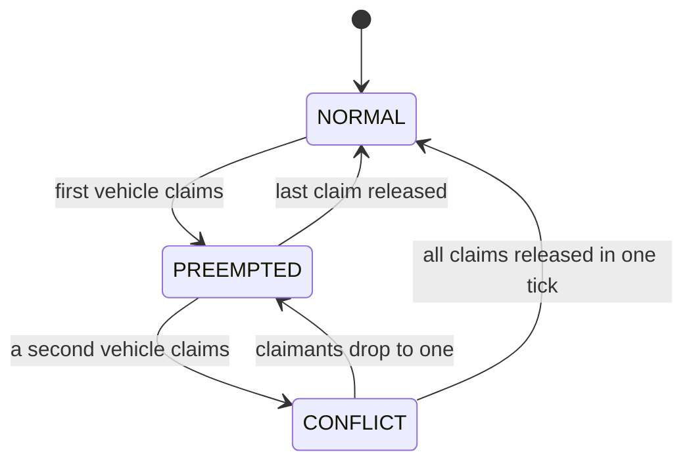
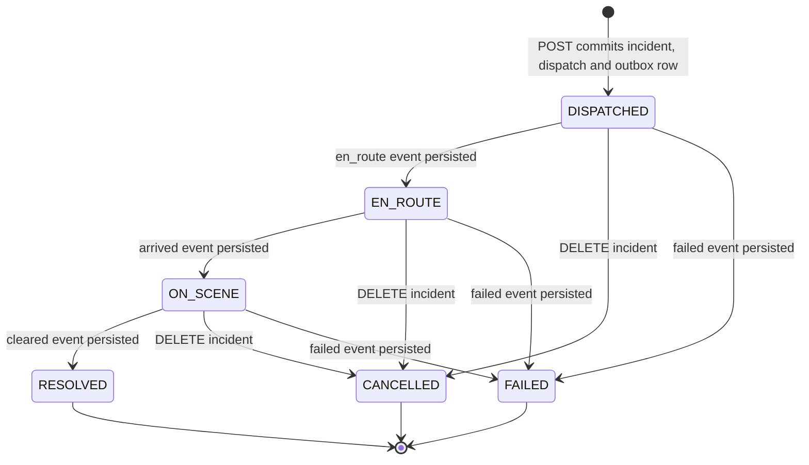
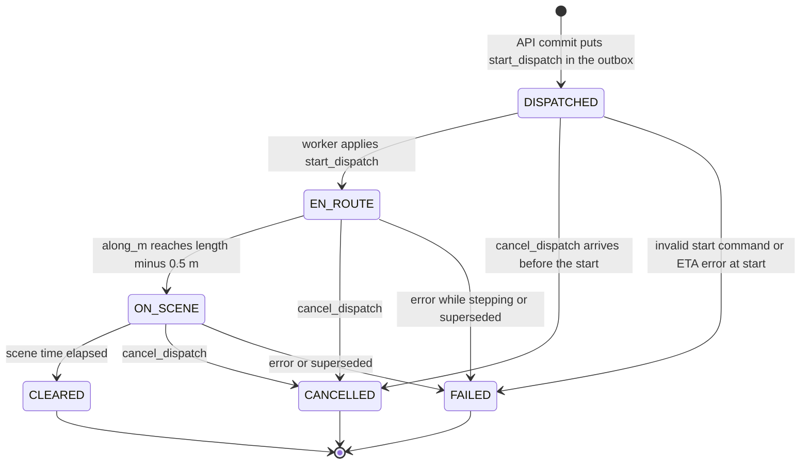
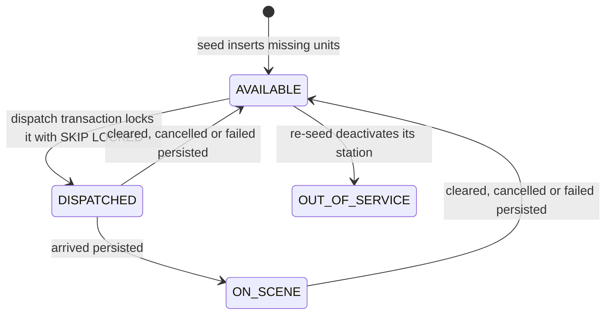

# 02 · Domain rules

**What this covers:** the business and simulation rules of DIVERT exactly as the code applies them: incident types and aliases, which service answers which incident, how a unit is chosen, vehicle profiles, the speed model, the ETA model, signal pre-emption and conflicts, the lane advisory for India's left-hand traffic, the lifecycle state machines, scene time, cancellation, the "estimated time saved" figure and the simulation clock. It ends with a worked numeric example that was produced by running the real engine code. Every number names the file and symbol it comes from. For the derivation of the motion maths see [simulation-model.md](../simulation-model.md); for where each rule runs at runtime see [Runtime workflows](07-runtime-workflows.md).

All model constants are **documented defaults, not measurements**. The congestion factors and junction delays in particular are hand-set approximations (see [Known limits](01-specification.md#10-known-limits-and-future-scope)).

## Contents

1. [Incident types, aliases and services](#1-incident-types-aliases-and-services)
2. [Choosing the unit](#2-choosing-the-unit)
3. [Corridor and lane advisory](#3-corridor-and-lane-advisory)
4. [Vehicle profiles](#4-vehicle-profiles)
5. [Speed model](#5-speed-model)
6. [ETA model](#6-eta-model)
7. [Signal pre-emption](#7-signal-pre-emption)
8. [Lifecycle state machines](#8-lifecycle-state-machines)
9. [Scene time, cancellation, time saved, simulation clock](#9-scene-time-cancellation-time-saved-simulation-clock)
10. [Worked example](#10-worked-example-one-ambulance-one-junction)

---

## 1. Incident types, aliases and services

An incident report carries a free-text `type`. The API resolves it with `normalize_incident_type` in `backend/src/divert/domain/enums.py`: the value is trimmed, upper-cased and looked up in `INCIDENT_TYPE_ALIASES`. Anything else is rejected.

| Accepted spelling (any case, surrounding spaces ignored) | Incident type (`IncidentType`) | Service (`SERVICE_FOR_INCIDENT`) | Station kind | Callsign prefix (`CALLSIGN_PREFIX`) |
|---|---|---|---|---|
| `MEDICAL`, `HEALTH`, `AMBULANCE` | `MEDICAL` | `AMBULANCE` | named hospital (`H…`) | `AMB` |
| `FIRE` | `FIRE` | `FIRE_ENGINE` | fire station (`F…`) | `FIRE` |
| `CRIME`, `POLICE` | `CRIME` | `POLICE` | police station (`P…`) | `PCR` |

Rules:

- **`POLICE` is an alias of `CRIME`.** It was the prototype dashboard's name for crime reports and broke there; keeping it working is regression guarantee 1 (comment on `INCIDENT_TYPE_ALIASES`).
- **Validate before anything is created.** `DispatchService.create_incident` (`backend/src/divert/services/dispatch.py`) checks the type, then that the location lies inside the city bounding box (`BBox.contains`, inclusive on all four edges, `backend/src/divert/domain/geo.py`). Both failures return `422 invalid_incident` before any database, routing or Redis call. The error lists `details.valid_types` (the sorted alias keys) or `details.bbox`.
- The normalised type is stored as `incidents.type`; the original spelling, trimmed and cut to 32 characters, is stored as `incidents.reported_type` (`IncidentRepository.create_dispatch`).
- The request body schema `IncidentCreate` (`backend/src/divert/schemas/incidents.py`) allows `type` up to 32 characters, `location` as `[lat, lng]` within ±90/±180, an optional `description` up to 1000 characters, and rejects unknown fields (`extra="forbid"`).
- History filters accept the same aliases (`parse_types` in `backend/src/divert/api/v1/history.py`).

## 2. Choosing the unit

`DispatchService._plans` and `DispatchService._dispatch` in `backend/src/divert/services/dispatch.py`:

1. **Candidates.** The `DIVERT_CANDIDATE_STATIONS` (default 3, range 1–10, `Settings.candidate_stations`) nearest *active* stations of the right service that have at least one `AVAILABLE` unit. Nearest is a PostGIS KNN (`<->`) on the geography GiST index (`ReferenceRepository.nearest_stations_with_free_units`). No candidate gives `409 no_unit_available`.
2. **Route each candidate** with OSRM, concurrently. A candidate whose route fails with `RoutingError` is skipped. If none can be routed the API returns `503 routing_unavailable` and writes nothing. There is no straight-line fallback.
3. **Rank by predicted ETA** from the ETA model ([section 6](#6-eta-model)), evaluated at the simulation clock. Ties fall back to straight-line distance, then station id: sort key `(eta_s, distance_m, station.id)`.
4. **Lock a unit in rank order.** Inside one transaction, `ReferenceRepository.lock_free_unit` takes the lowest-`ordinal` `AVAILABLE` unit of the best station with `FOR UPDATE SKIP LOCKED`. If another transaction took them all, it tries the next-ranked station. If every candidate is exhausted, `409 no_unit_available` ("all nearby … units were just taken").

One incident gets exactly one dispatch. There is no API to add a second unit to an incident.

Fleet: OSM has no fleet data, so the seed gives every active station `DIVERT_UNITS_PER_STATION` units (default 2, range 1–20, `Settings.units_per_station`; `seed_city` in `backend/src/divert/db/seed.py`). This is a modelling assumption.

## 3. Corridor and lane advisory

**Corridor.** The signals within `DIVERT_CORRIDOR_M` (default 30 m, range >0–200, `Settings.corridor_m`) of the route line are found with `ST_DWithin` on geography (`ReferenceRepository.corridor_candidates`). For each one, `build_corridor` (`backend/src/divert/services/dispatch.py`) computes:

| Field | Rule | Source |
|---|---|---|
| `along_m` | distance along the route to the signal's projection onto the polyline (cumulative haversine) | `project_onto_polyline` in `backend/src/divert/domain/geo.py` |
| `offset_m` | distance from the signal to the route line | same |
| `approach_bearing` | route bearing 5 m before the junction (`APPROACH_LOOKBACK_M = 5.0`) | `build_corridor` |
| `lane` | lane advisory, below | `lane_advisory` in `backend/src/divert/domain/route.py` |

The corridor is sorted by `(along_m, signal_id)`. Distances use a sphere of radius 6 371 008.8 m (`EARTH_RADIUS_M`, `backend/src/divert/domain/geo.py`).

**Lane advisory (India drives on the left).** `lane_advisory(along_m, maneuvers)`:

1. Ignore OSRM maneuvers of type `depart` and `arrive` (`IGNORED_MANEUVERS`).
2. Pick the maneuver nearest to the junction along the route, if it is within `LANE_MATCH_WINDOW_M = 40.0` m.
3. If its `modifier` is `left`, `slight left` or `sharp left` (`LEFT_MODIFIERS`), the advisory is **`L`** (left lane).
4. Otherwise (straight, any right turn, `uturn`, no modifier, or no maneuver within 40 m) it is **`R`** (the outer, overtaking lane). Other traffic is told to keep clear of that lane.

Only the modifier counts, not the maneuver type. Maneuvers are placed on the polyline by OSRM's cumulative step distance and snapped to the nearest vertex within `MANEUVER_SNAP_M = 250.0` m (`backend/src/divert/services/routing.py`).

## 4. Vehicle profiles

`PROFILES` and `VehicleProfile` in `backend/src/divert/services/speed_model.py`:

| Service | Max speed | Acceleration | Braking |
|---|---|---|---|
| `AMBULANCE` | 80 km/h (22.22 m/s) | 2.0 m/s² | 3.0 m/s² |
| `FIRE_ENGINE` | 60 km/h (16.67 m/s) | 1.0 m/s² | 3.0 m/s² |
| `POLICE` | 90 km/h (25.00 m/s) | 2.5 m/s² | 3.0 m/s² |

Braking is the same for every vehicle (`BRAKE_MPS2 = 3.0`).

## 5. Speed model

The speed model gives the highest allowed speed at every point of one route, for one vehicle, under one congestion factor and one set of pre-empted junctions (`SpeedProfile` in `backend/src/divert/services/speed_model.py`). The simulation moves vehicles with it and the ETA model integrates the same envelope, so prediction and simulation agree by construction.

### 5.1 Segment cap

For each route segment, with the OSRM free-flow speed `v_osrm` (OSRM `annotation.speed`; else that segment's distance/duration; else 0, which the floor below lifts to 1 m/s. If the annotations do not line up with the geometry, every segment gets the route's mean speed, or 10 m/s without a duration: `parse_osrm_route` in `backend/src/divert/services/routing.py`):

```text
segment_cap = max(1, min(v_max, max(1, v_osrm) × congestion(hour) × 1.3))   [m/s]
```

| Term | Value | Source |
|---|---|---|
| `v_max` | vehicle max speed | `PROFILES` |
| floor on OSRM speed and on the result | 1.0 m/s | `MIN_SEGMENT_SPEED_MPS` |
| emergency advantage (sirens, traffic yielding) | 1.3 | `EMERGENCY_ADVANTAGE` |
| `congestion(hour)` | the city's factor for the local hour of the **simulation clock** | `congestion_at` in `backend/src/divert/services/eta.py`, `TrafficProfile.factor_for_hour` in `backend/src/divert/domain/models.py` |

Implementation: `segment_cap_mps`. Factors must be in (0, 1.5] and there must be exactly 24 of them (`TrafficProfile.__post_init__`).

### 5.2 Hourly congestion factors

Share of OSRM free-flow speed that traffic allows in each local hour (`Asia/Kolkata` for all three cities). Source: `traffic.hourly_congestion` in `backend/src/divert/cities/data/<city>.json` (generated from `_DELHI_HOURLY`, `_KOLKATA_HOURLY`, `_BENGALURU_HOURLY` in `backend/src/divert/cities/osm.py`), seeded into the `cities` table, which is what the API and worker read. **Not OSM data, not measured** (`meta.traffic_profile_note`).

| Local hour | Delhi | Kolkata | Bengaluru |
|---:|---:|---:|---:|
| 00 | 0.90 | 0.88 | 0.88 |
| 01 | 0.92 | 0.90 | 0.91 |
| 02 | 0.93 | 0.92 | 0.92 |
| 03 | 0.93 | 0.92 | 0.92 |
| 04 | 0.92 | 0.91 | 0.90 |
| 05 | 0.88 | 0.86 | 0.84 |
| 06 | 0.80 | 0.76 | 0.72 |
| 07 | 0.68 | 0.64 | 0.58 |
| 08 | 0.56 | 0.52 | 0.47 |
| 09 | 0.50 | 0.46 | 0.43 |
| 10 | 0.52 | 0.47 | 0.46 |
| 11 | 0.58 | 0.52 | 0.52 |
| 12 | 0.60 | 0.55 | 0.55 |
| 13 | 0.60 | 0.55 | 0.55 |
| 14 | 0.59 | 0.54 | 0.53 |
| 15 | 0.57 | 0.52 | 0.50 |
| 16 | 0.54 | 0.49 | 0.46 |
| 17 | 0.49 | 0.45 | 0.42 |
| 18 | 0.46 | 0.43 | 0.40 |
| 19 | 0.48 | 0.46 | 0.43 |
| 20 | 0.56 | 0.53 | 0.50 |
| 21 | 0.66 | 0.63 | 0.60 |
| 22 | 0.76 | 0.73 | 0.72 |
| 23 | 0.85 | 0.82 | 0.82 |
| **Avg junction delay** (`traffic.avg_junction_delay_s`) | **35 s** | **40 s** | **40 s** |

The tightest hour in every city is 18:00 (PM peak); the AM trough is 09:00.

### 5.3 Junction caps

Every corridor junction is a point speed cap (`junction_cap_mps`):

| Situation at this junction | Cap | Constant |
|---|---|---|
| The vehicle holds a claim on it in state `PREEMPTED` | 35 km/h (9.72 m/s) | `JUNCTION_PREEMPTED_MPS` |
| Anything else: not yet claimed, or claimed but `CONFLICT` (another vehicle won) | 15 km/h (4.17 m/s) | `JUNCTION_NORMAL_MPS` |

The simulation rebuilds the vehicle's profile whenever the congestion factor or its set of `PREEMPTED` claims changes (`SimulationEngine._motion_profile` in `backend/src/divert/services/simulation.py`). A non-pre-empted junction is a slow-down to 15 km/h, **not a stop**: red-light waiting is not simulated.

### 5.4 Arrival and the braking envelope

- The route end is a stop: its limit is `ARRIVAL_SPEED_MPS = 1.0` m/s (a crawl, so the time to stop stays finite).
- A vehicle has arrived when `along_m >= length − 0.5 m` (`ARRIVAL_TOLERANCE_M = 0.5`).

Knots are the route vertices plus the junction positions. A backward pass turns the point caps into a braking envelope, so the vehicle slows *before* a junction (`SpeedProfile.__init__`):

```text
limit[n] = 1.0                                   (route end)
limit[k] = min( cap_out[k], cap_in[k], junction_cap(x[k]),
                sqrt(limit[k+1]² + 2·b·(x[k+1] − x[k])) )
allowed(x in interval k) = min( cap[k], sqrt(limit[k+1]² + 2·b·(x[k+1] − x)) )
```

`cap_in` applies from the second knot on, `b` is the braking rate, and on a knot the knot's own limit also applies (`SpeedProfile.allowed_speed`). Two junctions at the same position keep the lower cap.

### 5.5 Motion per tick

`SpeedProfile.step`, called once per vehicle per tick with `dt = DIVERT_SIM_TICK_S × DIVERT_SIM_TIME_SCALE` simulated seconds (`Worker.tick_once` in `backend/src/divert/worker.py`):

```text
v' = min(v + a·dt, allowed(x))
x' = min(length, x + (v + v')/2 · dt)
v' = max(0, min(v', allowed(x')))
```

The cap is checked at tick positions only. With `dt = 0.5 s` a vehicle can cross a junction slightly above its cap: in the [worked example](#10-worked-example-one-ambulance-one-junction) it crosses a 9.72 m/s junction at 10.52 m/s.

## 6. ETA model

`backend/src/divert/services/eta.py`:

| Element | What it is |
|---|---|
| `EtaQuery` | `route`, `service`, `city`, `corridor`, `along_m`, `speed_mps`, `at` (the simulation time; congestion uses the city-local hour of `at`) |
| `EtaEstimate` | `to_destination_s`, and `to_signals_s`: a map of signal id to ETA for corridor signals at or ahead of `along_m` |
| `EtaModel` | a `Protocol` with a `name` and `estimate(query) -> EtaEstimate`. It is the seam for a future learned model trained on `dispatches.predicted_eta_s` vs `actual_travel_s` |
| `KinematicEtaModel` | the shipped model, `name = "kinematic-v1"` (stored in `dispatches.eta_model`) |

`KinematicEtaModel.estimate`:

1. Builds the profile with **every corridor junction pre-empted for the vehicle** (`plan_profile`), because that is what DIVERT plans for. A vehicle that never loses a conflict therefore arrives close to the predicted time. A conflict (15 km/h through a contested junction) makes the actual time longer than predicted, by design.
2. Integrates the envelope analytically from the current `(along_m, speed_mps)` (`SpeedProfile.time_from`). Each interval is: accelerate at `a`, cruise at the cap, brake at `b` to the next knot's limit (`_interval_time`, closed form).
3. Returns the time to the destination and to every corridor signal ahead. A signal projected a few centimetres past the route end gets the arrival time, not 0, so it is not claimed from the first tick (regression test `test_target_past_the_route_end_gets_the_arrival_time_not_zero`).

Profiles are cached per route object and per congestion factor (`KinematicEtaModel._cache`, a `WeakKeyDictionary`).

Where it is called:

| Caller | When | Clock |
|---|---|---|
| `DispatchService._plans` | ranking candidates; the winner's value is stored as `predicted_eta_s` | `DispatchService.sim_clock`: the Redis key `divert:sim:clock` when the API's `DIVERT_SIM_TIME_SCALE ≠ 1`, else wall time; falls back to wall time if Redis or the key is unavailable |
| `SimulationEngine._refresh_eta` | at start and every tick for every moving vehicle; feeds `eta_s` and the per-signal ETAs used for claiming | the worker's simulation clock |

If the model returns a non-finite or negative ETA, the vehicle is failed (`_refresh_eta` raises, `tick` ends the vehicle as `failed`).

Accuracy target and evidence: see [NFR-02](01-specification.md#7-non-functional-requirements).

## 7. Signal pre-emption

Pure rules in `backend/src/divert/services/preemption.py`, applied by `SimulationEngine._update_claims` and `SimulationEngine._resolve_city` every tick.

### 7.1 Thresholds

| Rule | Condition | Default | Setting / constant |
|---|---|---|---|
| **Claim** a corridor signal not yet claimed | not past it **and** (`ETA_to_signal ≤ 45 s` **or** `signal.along_m − vehicle.along_m ≤ 600 m`) | 45 s, 600 m | `DIVERT_PREEMPT_LEAD_S`, `DIVERT_PREEMPT_DISTANCE_M`; `PreemptionRules.should_claim` |
| **Past** a signal | `vehicle.along_m − signal.along_m > 20 m` | 20 m | `DIVERT_PREEMPT_RELEASE_PAST_M`; `PreemptionRules.is_past` |
| **Release** a held claim | the vehicle is past it (reason `passed`) | | `_update_claims` |
| **Release all** claims | on arrival (`arrived`), cleared, cancel (`cancelled`), any error while stepping (`failed`) | | `SimulationEngine._release_all`, called by `_arrive` and `_end` |
| **Tie window** | claims whose ETA is within 5 s of the best ETA | 5 s | `DIVERT_CONFLICT_TIE_S`; `resolve` |

Notes:

- Both claim conditions use `≤`. A vehicle 0–20 m past an unclaimed signal can still claim it; beyond 20 m it never will.
- Claims are owned **per vehicle id, never per vehicle type**. Two ambulances on one junction are two separate claims.
- A signal skipped without a claim (passed by more than 20 m) is added to the vehicle's `passed` set and never considered again.

### 7.2 Conflict resolution

Every tick, for every signal with at least one claim (`resolve`):

1. The lowest current ETA among the claimants is the best ETA.
2. Claimants with `eta − best ≤ tie_s` are tied.
3. The winner is the tied claimant with the best service priority (`SERVICE_PRIORITY`: `AMBULANCE` 0 > `FIRE_ENGINE` 1 > `POLICE` 2), then the lowest vehicle id (string order).
4. The winner's claim is `PREEMPTED`; every other claim on that signal is `CONFLICT`.

Resolution reruns every tick with fresh ETAs, so the winner can change as vehicles move. Outside the tie window a lower ETA beats a higher priority: a police car 20 s away beats an ambulance 25.1 s away (`test_tie_break_priority_then_id`).

### 7.3 Signal states

| State (`SignalState`) | Meaning | Stored / streamed? |
|---|---|---|
| `NORMAL` | no claim | never stored or streamed; absent from `divert:{city}:signals:active` |
| `PREEMPTED` | exactly one claimant | yes |
| `CONFLICT` | two or more claimants; `vehicle_id` is the winner | yes |



### 7.4 Events

| Event (`HistoryEventType`) | When | event_id |
|---|---|---|
| `preemption_claimed` | first resolution of a new claim | `clm:<dispatch>:<signal>` |
| `preemption_conflict` | each time a claim enters `CONFLICT` (including a new claim that starts as `CONFLICT`) | `cfl:<dispatch>:<signal>:<n>` (n = 1, 2, …) |
| `preemption_released` | release, with `reason` `passed`, `arrived`, `cleared`, `cancelled` or `failed` | `rel:<dispatch>:<signal>` |

A claim created and released within the same tick was never resolved and emits no event. In history (`signal_preemptions`), one row per claim keeps state `CONFLICT` if the claim ever lost a conflict (`HistoryWriter._preemption`).

## 8. Lifecycle state machines

### 8.1 Incident status

`IncidentStatus` in `backend/src/divert/domain/enums.py`. The API creates the incident directly as `DISPATCHED` and cancels it directly. All other moves are made by the persister when it stores the worker's history event (`HistoryWriter._advance` in `backend/src/divert/db/repositories/history.py`).



Transitions only move forward and never leave a terminal status (`_FORWARD_FROM`):

| Target | Allowed from | Trigger | Timestamp set (first write wins) |
|---|---|---|---|
| `DISPATCHED` | (creation) | `POST …/incidents` | `reported_at` = `dispatched_at` = commit time |
| `EN_ROUTE` | `OPEN`, `DISPATCHED` | `en_route` | `en_route_at` |
| `ON_SCENE` | `OPEN`, `DISPATCHED`, `EN_ROUTE` | `arrived` | `on_scene_at` |
| `RESOLVED` | any non-terminal | `cleared` | `resolved_at` |
| `CANCELLED` | any non-terminal | `DELETE …/incidents/{id}` (API), or `cancelled` event | `cancelled_at` |
| `FAILED` | any non-terminal | `failed` (sets `failure_reason`, up to 2000 characters) | `failed_at` |

`OPEN` exists in the enum and is the database default, but **no code path writes it**: incidents are born `DISPATCHED`. Terminal statuses are `RESOLVED`, `CANCELLED`, `FAILED` (`TERMINAL_INCIDENT_STATUSES`).

### 8.2 Dispatch and vehicle status

The worker's in-memory vehicle has only `EN_ROUTE` and `ON_SCENE` (`VehicleStatus` in `backend/src/divert/services/simulation.py`). `DISPATCHED` is the status the POST response reports before the worker has started the vehicle. A dispatch ends with `dispatches.end_reason` `CLEARED`, `CANCELLED` or `FAILED`.



| Event | Emitted by | Effect in PostgreSQL |
|---|---|---|
| `en_route` (`enr:`) | `SimulationEngine._announce` when the start command is applied | incident `EN_ROUTE` |
| `arrived` (`arr:`) | `_arrive` | dispatch `arrived_at`, `actual_travel_s`, `est_time_saved_s`; incident `ON_SCENE`; unit `ON_SCENE` |
| `cleared` (`clr:`) | `_end(..., "cleared")` | dispatch ended `CLEARED`; incident `RESOLVED`; unit `AVAILABLE` |
| `cancelled` (`cxl:`) | `_end(..., "cancelled")` or `cancel_dispatch` for a dispatch never started | dispatch ended `CANCELLED`; incident `CANCELLED`; unit `AVAILABLE` |
| `failed` (`fail:`) | `_end(..., "failed")`, `Worker._fail_unstarted`, `Worker._rebuild_from_pg` | dispatch ended `FAILED`; incident `FAILED` with reason; unit `AVAILABLE` |

Failure reasons produced by the code: `simulation error: <exception>` (cut to 500 characters), `superseded by a new dispatch`, `invalid start command`, `rebuild failed: <exception>`.

`start_dispatch` is idempotent. A duplicate for a running dispatch, or for one listed in the per-city finished set (`divert:{city}:finished`, kept `DIVERT_FINISHED_DISPATCH_TTL_S` = 86 400 s), is only acknowledged (`SimulationEngine.start_dispatch`).

### 8.3 Unit status

`UnitStatus`. Writers: the API's dispatch transaction, the persister, and the seed.



| Move | Guard | Code |
|---|---|---|
| `AVAILABLE → DISPATCHED` | the row is `AVAILABLE` inside its own row lock; sets `current_dispatch_id` | `IncidentRepository.create_dispatch` |
| `DISPATCHED → ON_SCENE` | `current_dispatch_id` = this dispatch and status `DISPATCHED` | `HistoryWriter._arrived` |
| `→ AVAILABLE` | `current_dispatch_id` = this dispatch (a unit already on a newer dispatch is not touched); clears `current_dispatch_id` | `HistoryWriter._ended` |
| `AVAILABLE → OUT_OF_SERVICE` | its station vanished from the snapshot on re-seed | `seed_city` |

Known gap: **no code path moves a unit out of `OUT_OF_SERVICE`**. A re-seed reactivates a returning station but does not reset its units, because it never touches an existing unit's status.

On cancel, the unit stays `DISPATCHED`/`ON_SCENE` until the worker's `cancelled` event is persisted (`test_cancel_writes_cancel_command_and_is_idempotent`, `test_cancel_frees_the_unit_after_the_worker_confirms`).

## 9. Scene time, cancellation, time saved, simulation clock

### 9.1 Scene time

After arrival the vehicle stays `ON_SCENE`, accumulating `scene_s` by `dt` each tick. When `scene_s ≥ DIVERT_SCENE_TIME_S` (default 120 simulated seconds, `Settings.scene_time_s`, `SimConfig.scene_time_s`) it is ended as `cleared`: incident `RESOLVED`, unit `AVAILABLE`. Scene time is not sampled; a vehicle rebuilt from PostgreSQL after a failover resumes with `scene_s = min(scene time, wall time since arrival × time scale)` (`Worker._vehicle_from_pg`).

### 9.2 Cancellation

| Step | Rule | Code |
|---|---|---|
| API | Locks the incident row. Already `CANCELLED` → `200` with the same body (idempotent). `RESOLVED`/`FAILED` → `409 invalid_state`. Unknown id, or id from another city → `404 not_found`. | `DispatchService.cancel_incident` |
| API | Sets `CANCELLED` and `cancelled_at`, adds a `cancel_requested` event (`cxr:`). If the incident has an open dispatch (`ended_at IS NULL`), writes a `cancel_dispatch` command (`reason` "cancelled by operator") to the outbox in the same transaction. | `IncidentRepository.mark_cancelled` |
| Worker, vehicle running | Releases every claim, removes the vehicle, emits `cancelled` + `vehicle_removed` (reason `cancelled`). | `SimulationEngine.cancel_dispatch` → `_end` |
| Worker, already finished | Acknowledges only. | same |
| Worker, never started | Still emits `cancelled` (so the persister frees the unit) and marks the dispatch finished, so a late `start_dispatch` is ignored. | same |
| Persister | Ends the dispatch `CANCELLED`, frees the unit. | `HistoryWriter._ended` |

Cancelling an `ON_SCENE` incident is allowed; it ends the scene early.

### 9.3 Estimated time saved

```text
est_time_saved_s = preempted_passed × city.avg_junction_delay_s
```

- `preempted_passed` counts corridor junctions the vehicle **passed** (released with reason `passed`) while its claim on them was `PREEMPTED` (`SimulationEngine._release`). Claims released on arrival do not count, nor do claims in `CONFLICT`.
- `avg_junction_delay_s`: Delhi 35 s, Kolkata 40 s, Bengaluru 40 s ([table](#52-hourly-congestion-factors)).
- Computed at arrival (`SimulationEngine._arrive`), stored in `dispatches.est_time_saved_s`; the live value is `preempted_passed` on each vehicle.
- It is **always labelled an estimate**. It assumes each such junction would otherwise have cost the city's average delay. It is not derived from the speed model, which never simulates a red-light stop (see the [worked example](#10-worked-example-one-ambulance-one-junction): 35 s estimated vs about 2.9 s of modelled slow-down).

### 9.4 Simulation clock and time scale

| Rule | Detail | Code |
|---|---|---|
| Step size | `dt = DIVERT_SIM_TICK_S × DIVERT_SIM_TIME_SCALE` simulated seconds per tick. Defaults 0.5 s × 1. Ranges: tick >0–5 s, scale >0–100. | `Worker.tick_once`, `Settings` |
| Scale 1 | the simulation clock is the wall clock, read each tick; `divert:sim:clock` is not written | `Worker.tick_once`, `Worker._heartbeat` |
| Scale ≠ 1 | the clock advances by `dt` per tick and is written to `divert:sim:clock` (epoch seconds) every tick, so it survives failover; a new leader resumes from it, or from wall time if absent | `Worker._heartbeat`, `Worker._load_sim_clock` |
| Freeze | simulated time only advances while a leader ticks; during a leader change it is frozen | `Worker._lead` |
| Congestion | uses the city-local hour of the simulation clock, in the worker and in the API's dispatch ETA | `congestion_at` |
| Timestamps vs durations | event `ts`, `claimed_at`, `released_at` are **wall clock**; `elapsed_s`, `travel_s`, `scene_s` are **simulated seconds** | `SimulationEngine` |
| Position samples | one `vehicle_position` every `DIVERT_POSITION_SAMPLE_S` (default 5) simulated seconds, sample 0 at start | `SimulationEngine._sample` |
| Rebuild | a vehicle rebuilt from PostgreSQL resumes from the last sample's simulated `elapsed_s`, never from wall-clock differences | `Worker._vehicle_from_pg` |
| Tick number | one engine-wide counter, incremented once per tick, written per city to `divert:{city}:tick`; a new leader resumes from the highest stored value | `SimulationEngine.tick`, `last_tick_no` in `backend/src/divert/store/live.py` |

Caveat: the API decides whether to read `divert:sim:clock` from **its own** `DIVERT_SIM_TIME_SCALE` (`DispatchService.sim_clock`). Set the same scale on the API and the worker, otherwise predicted ETAs use the wall-clock hour while the worker simulates another hour.

Response time in analytics = (`dispatched_at − reported_at`) + `actual_travel_s` (`backend/src/divert/db/repositories/analytics.py`). Both timestamps are the same commit instant today, so the first term is 0.

## 10. Worked example: one ambulance, one junction

Produced by running `KinematicEtaModel` and `SimulationEngine` (no Redis, no database) on a stub route, with default settings. All numbers below are program output, rounded.

**Setup**

| Input | Value |
|---|---|
| City, clock | Delhi, simulation clock 02:30 IST, so hour 2, congestion 0.93 |
| Vehicle | `AMBULANCE`: max 22.22 m/s, accel 2.0 m/s², brake 3.0 m/s² |
| Route | 2000 m straight, 40 segments of 50 m, OSRM speed 15 m/s everywhere |
| Corridor | one junction `J1` at `along_m = 1500` |
| Tick | 0.5 s, time scale 1 |

**Derived caps**

| Quantity | Calculation | Result |
|---|---|---|
| Segment cap | min(22.22, 15 × 0.93 × 1.3) | **18.135 m/s** (65.3 km/h) |
| Junction cap if pre-empted | 35 km/h | 9.722 m/s |
| Junction cap if not | 15 km/h | 4.167 m/s |
| Braking starts (pre-empted) | (18.135² − 9.722²) / (2 × 3) = 39.1 m before J1 | at 1460.9 m |
| Braking starts (not pre-empted) | (18.135² − 4.167²) / (2 × 3) = 51.9 m before J1 | at 1448.1 m |
| Predicted ETA to J1 at dispatch | 9.07 s accelerating + 76.03 s cruising + 2.80 s braking | **87.90 s** |
| Predicted ETA to destination | 87.90 + 31.25 s for the last 500 m | **119.14 s** |

**What the simulation did**

| Tick | Sim time | `along_m` | Speed | What happened |
|---:|---:|---:|---:|---|
| 0 | 0 s | 0 | 0 | start command applied: `en_route` (`enr:…`) and position sample 0 (`pos:…:0`) |
| 1–19 | 0.5–9.5 s | 0.25 → 90.0 | 1.0 → 18.135 m/s | accelerates at 2 m/s² (1 m/s per tick) to the segment cap |
| 85 | 42.5 s | 688.5 | 18.135 | ETA to J1 = 45.40 s > 45 s and 811 m away > 600 m: no claim yet |
| **86** | 43.0 s | **697.6** | 18.135 | ETA to J1 = **44.90 s ≤ 45 s → claim**. `preemption_claimed`, state `PREEMPTED`, `eta_at_claim_s` 44.9. The ETA rule fired 802 m before J1, before the 600 m distance rule would have |
| 87–170 | | → 1459.2 | 18.135 | cruising; the profile now uses the 35 km/h cap at J1 |
| 171 | 85.5 s | 1468.3 | 16.875 | braking at 3 m/s² inside the envelope |
| 175 | 87.5 s | 1497.3 | 10.521 | last tick before J1 |
| 176 | 88.0 s | 1502.6 | 10.521 | crossed J1 at about 10.5 m/s: the cap is checked at tick positions, so it is slightly above 9.72 |
| 177–178 | | → 1514.1 | → 12.5 | accelerating again at 2 m/s²; still holding the claim (≤ 20 m past) |
| **179** | 89.5 s | **1520.6** | 13.521 | **20.6 m past J1 → release**. `preemption_released`, reason `passed`; `preempted_passed` = 1 |
| 237 | 118.5 s | 2000.0 | 0 | **arrived**: `travel_s` 118.5 s vs predicted 119.14 s (−0.5 %); `est_time_saved_s` = 1 × 35 = **35.0 s** |
| 477 | 238.5 s | 2000.0 | 0 | `scene_s` reaches 120 s (240 ticks on scene): `cleared` (`clr:…`), vehicle removed; once persisted, incident `RESOLVED` and unit `AVAILABLE` |

For comparison, the same ETA model with J1 **not** pre-empted predicts 122.0 s. In the model's own physics, pre-emption saved about 2.9 s here, while the labelled estimate says 35 s, because the estimate assumes a red-light wait the speed model never simulates.

Event ids in this run (dispatch id `00000000-0000-0000-0000-000000000001`, hyphens stripped): `clm:00000000000000000000000000000001:J1`, `rel:00000000000000000000000000000001:J1`, `arr:00000000000000000000000000000001`.

## Related

- [01 · Specification](01-specification.md): requirements that these rules implement
- [07 · Runtime workflows](07-runtime-workflows.md): when each rule runs (dispatch, tick, arrival, cancel, failover)
- [05 · Data stores](05-data-stores.md): where claims, signal states and history rows live
- [06 · Data flows](06-data-flows.md): how events move from the worker to PostgreSQL
- [11 · Configuration](11-configuration.md): every `DIVERT_*` setting named here
- [12 · Glossary](12-glossary.md): terms and ID formats
- [simulation-model.md](../simulation-model.md), [api.md](../api.md), [data-sources.md](../data-sources.md)
