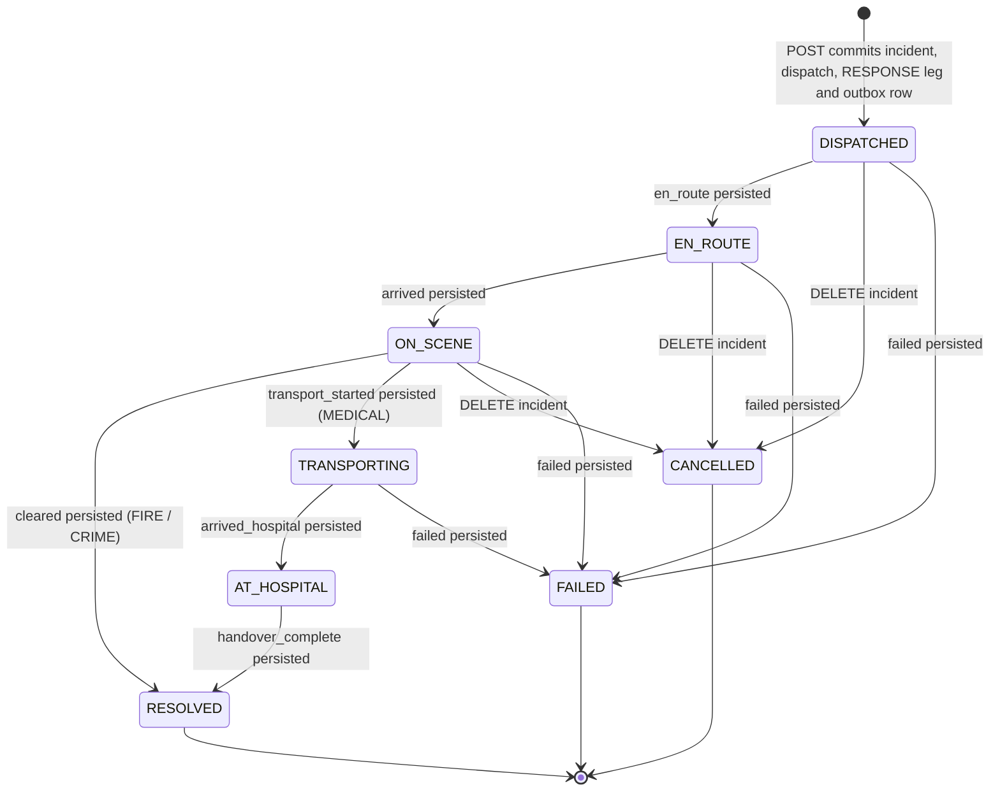
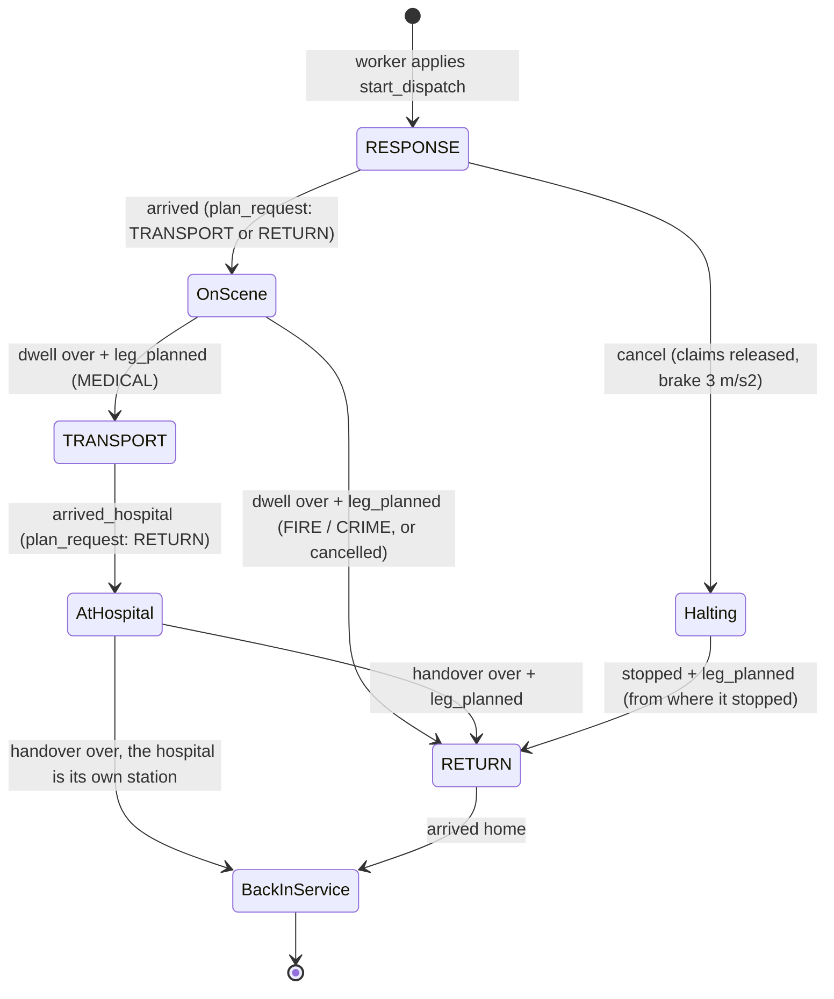
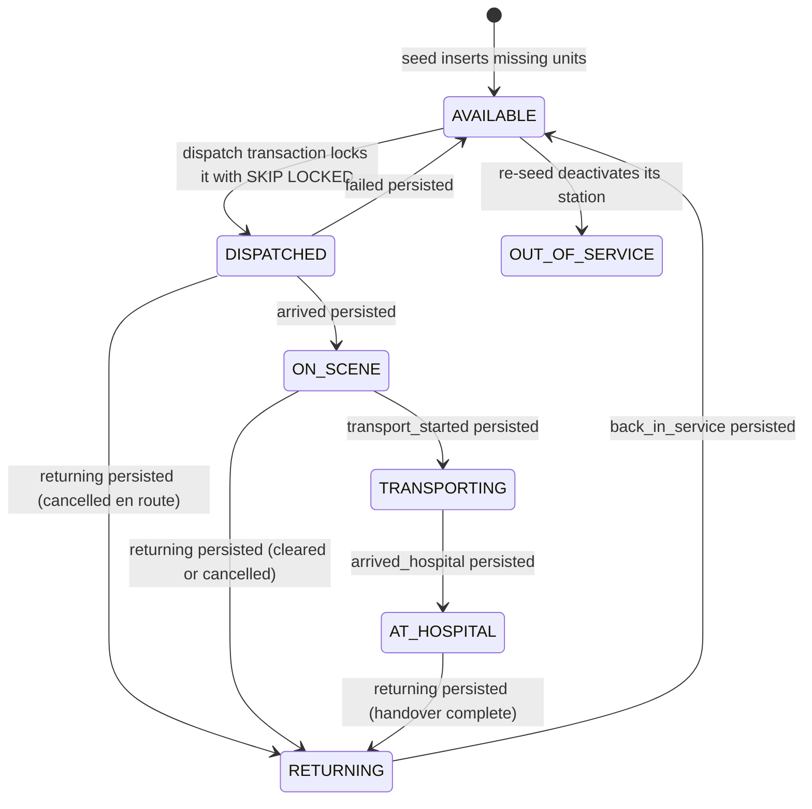

# 02 · Domain rules

**What this covers:** the business and simulation rules of DIVERT exactly as the code applies them: incident types and aliases, which service answers which incident, how a unit and its route are chosen (crowd-aware), vehicle profiles, the speed model, the ETA model, synthetic signal plans, dynamic pre-emption and conflicts, movements and lane advice for India's left-hand traffic, the lifecycle state machines, scene time, cancellation, the "estimated time saved" figure and the simulation clock. It ends with a worked numeric example that was produced by running the real engine code. Every number names the file and symbol it comes from. For the derivation of the motion maths see [simulation-model.md](../simulation-model.md); for where each rule runs at runtime see [Runtime workflows](07-runtime-workflows.md).

All model constants are **documented defaults, not measurements**. The congestion factors and junction delays in particular are hand-set approximations (see [Known limits](01-specification.md#10-known-limits-and-future-scope)).

## Contents

1. [Incident types, aliases and services](#1-incident-types-aliases-and-services)
2. [Choosing the unit and the route](#2-choosing-the-unit-and-the-route)
3. [Corridor, movements and lane advice](#3-corridor-movements-and-lane-advice)
4. [Vehicle profiles](#4-vehicle-profiles)
5. [Speed model](#5-speed-model)
6. [ETA model](#6-eta-model)
7. [Signals and pre-emption](#7-signals-and-pre-emption)
8. [Lifecycle state machines](#8-lifecycle-state-machines)
9. [Scene time, cancellation, time saved, simulation clock](#9-scene-time-cancellation-time-saved-simulation-clock)
10. [Worked example](#10-worked-example-one-ambulance-one-junction)

---

## 1. Incident types, aliases and services

An incident report carries a free-text `type`. The API resolves it with `normalize_incident_type` in `backend/src/divert/domain/enums.py`: the value is trimmed, upper-cased and looked up in `INCIDENT_TYPE_ALIASES`. Anything else is rejected.

| Accepted spelling (any case, surrounding spaces ignored) | Incident type (`IncidentType`) | Service (`SERVICE_FOR_INCIDENT`) | Station kind | Callsign prefix (`CALLSIGN_PREFIX`) |
|---|---|---|---|---|
| `MEDICAL`, `HEALTH`, `AMBULANCE` | `MEDICAL` | `AMBULANCE` | named hospital (`H…`) | `AMB` |
| `FIRE` | `FIRE` | `FIRE_ENGINE` | fire station (`F…`) | `FIRE` |
| `CRIME`, `POLICE` | `CRIME` | `POLICE` | police station (`P…`) | `PCR` |

Rules:

- **`POLICE` is an alias of `CRIME`.** It was the prototype dashboard's name for crime reports and broke there; keeping it working is regression guarantee 1 (comment on `INCIDENT_TYPE_ALIASES`).
- **Validate before anything is created.** `DispatchService.create_incident` (`backend/src/divert/services/dispatch.py`) checks the type, then that the location lies inside the city bounding box (`BBox.contains`, inclusive on all four edges, `backend/src/divert/domain/geo.py`). Both failures return `422 invalid_incident` before any database, routing or Redis call. The error lists `details.valid_types` (the sorted alias keys) or `details.bbox`.
- The normalised type is stored as `incidents.type`; the original spelling, trimmed and cut to 32 characters, is stored as `incidents.reported_type` (`IncidentRepository.create_dispatch`).
- The request body schema `IncidentCreate` (`backend/src/divert/schemas/incidents.py`) allows `type` up to 32 characters, `location` as `[lat, lng]` within ±90/±180, an optional `description` up to 1000 characters, and rejects unknown fields (`extra="forbid"`).
- History filters accept the same aliases (`parse_types` in `backend/src/divert/api/v1/history.py`).

## 2. Choosing the unit and the route

`DispatchService._plans` and `DispatchService._dispatch` in `backend/src/divert/services/dispatch.py`; scoring in `backend/src/divert/services/route_choice.py` (design §2, [trip-legs-and-dynamic-preemption.md](../design/trip-legs-and-dynamic-preemption.md)):

1. **Candidates.** The `DIVERT_CANDIDATE_STATIONS` (default 3, range 1–10, `Settings.candidate_stations`) nearest *active* stations of the right service that have at least one `AVAILABLE` unit. Nearest is a PostGIS KNN (`<->`) on the geography GiST index (`ReferenceRepository.nearest_stations_with_free_units`). No candidate gives `409 no_unit_available`.
2. **Crowding inputs.** The city's active incidents (`IncidentRepository.active_incident_zones`: status `OPEN`/`DISPATCHED`/`EN_ROUTE`/`ON_SCENE`) become incident zones; the live emergency vehicles' junction ETAs (`signal_etas` in each live vehicle document, one Redis `HGETALL`, skipped if Redis is down) feed corridor contention.
3. **Route alternatives per station**, concurrently (`OsrmRouter.alternatives`): OSRM `alternatives=DIVERT_ROUTE_ALTERNATIVES` (3); if fewer than 2 routes come back and the trip is longer than 1.5 km, up to `DIVERT_ROUTE_DETOURS` (2) via-point detours (via = the midpoint offset perpendicular by ±20 % of the straight distance, `continue_straight=true`; a detour that duplicates an earlier route is dropped). A station whose routing fails with `RoutingError` is skipped; none routable → `503 routing_unavailable`, nothing written. No straight-line fallback.
4. **Score every candidate** (`score_route`) and drop those longer than 1.6 × the shortest (`within_length`):

   `cost = ETA under the traffic model + junction delays + penalties`

   | Term | Rule |
   |---|---|
   | ETA | `KinematicEtaModel` with the per-segment traffic factors of [section 5.1](#51-segment-cap) (class-aware congestion × incident zones), at the simulation clock |
   | Junction delay (emergency) | STRAIGHT 0 s, SLIGHT 1 s, LEFT 3 s (0 for a free left), RIGHT 6 s, SHARP 8 s, U_TURN 12 s, ROUNDABOUT 4 + 2 × exit s (`TURN_DELAY_S`) |
   | Junction delay (non-emergency) | the same + the junction's expected signal wait `red_share × red / 2` |
   | Penalties | corridor contention: 10 s (`CONTENTION_DELAY_S`) per junction another live emergency vehicle is expected at within ±20 s |

5. **Pick per station** (`choose`): the cheapest; candidates within 5 % of it prefer fewer signalised RIGHT/SHARP_RIGHT/U_TURN, then fewer contested junctions, then the shorter distance. Then **rank the stations** by their chosen cost (ties: straight-line distance, station id).
6. **Record** `route_choice` (chosen label, reason, every candidate with distance, free-flow base time, congested time, junction delay, penalties, cost, crowd index = length-weighted mean of `1 − factor`, right turns, contested junctions, incident zones, most congested road, and `route`: its geometry simplified for drawing - Douglas-Peucker 10 m, tolerance doubled until ≤ 150 points, 5 decimals; `candidate_polyline` in `services/route_choice.py`, stage 5 fix-2). It rides in the `start_dispatch` command (outbox payload), the `dispatched` timeline event payload, the `POST` response (`vehicle.route_choice`) and the incident detail (`dispatches[].route_choice`). Reason examples: `Route B: 1.8 min faster than A (A: Ring Road congested, 2 extra right turns)`, `Route B: within 5% of A, shorter`.
7. **Lock a unit in rank order.** Inside one transaction, `ReferenceRepository.lock_free_unit` takes the lowest-`ordinal` `AVAILABLE` unit of the best station with `FOR UPDATE SKIP LOCKED`; if every unit was just taken it tries the next station; all exhausted → `409 no_unit_available`.

One incident gets exactly one dispatch. There is no API to add a second unit to an incident.

**Hospital for a TRANSPORT leg** (design section 1.1, `domain/hospitals.py`, `LegPlanner._to_hospital`):

1. eligible = active, named AMBULANCE stations (OSM `amenity=hospital`) except `emergency=no`, `healthcare` ∈ {dentist, blood_bank, alternative, doctor, birthing_centre} and - unless `emergency=yes` - facilities that cannot take an emergency patient (`is_eligible`, `non_emergency_facility`; stage 5 fix-2): every value of their OSM `healthcare:speciality` (`stations.speciality`) is dental, eye, skin / cosmetic, fertility, physiotherapy, diagnostics or alternative medicine (`NON_EMERGENCY_SPECIALITY_STEMS`); untagged, the name has such a word (`NON_EMERGENCY_NAME_WORDS`: Dental, Eye, Netra, Nethralaya, Ayurvedic, Unani, IVF, Diagnostic, ...) **before** the word "hospital" and no general-care words (multi / super speciality, general, medical, trauma, emergency). `ReferenceRepository.nearest_hospitals` applies the tag filters in SQL, reads 4 × the limit by KNN (`HOSPITAL_OVERFETCH`; the measured worst case needs 2 ×) and keeps the first `limit` that pass `is_eligible`;
2. the `DIVERT_HOSPITAL_CANDIDATES` (6) nearest to the scene (PostGIS KNN) are routed concurrently and scored with the crowd-aware cost; each keeps its best route;
3. the best `emergency=yes` hospital wins if its cost ≤ `max(180 s, 1.25 × best cost)` (read literally: a confirmed ED within 3 minutes, or within 1.25 × the best), else the cheapest overall; ties: cost, straight-line distance, id;
4. the choice and every hospital considered are stored as `dispatch_legs.hospital_choice` (`chosen`, `reason`, `ed_tolerance_s`, `candidates[]`).

Snapshot data (regenerated offline from the cached Overpass payloads; ids and counts unchanged): Delhi 847 hospitals (`emergency` yes 36 / no 11 / untagged 800), Kolkata 294 (31 / 5 / 258), Bengaluru 1,086 (108 / 29 / 949). `healthcare:speciality` is tagged on 71 / 54 / 87 of them; the speciality and name rules exclude 52 (Delhi), 57 (Kolkata, its eye-hospital cluster) and 118 (Bengaluru) hospitals that the tag filters let through.

Fleet: OSM has no fleet data, so the seed gives every active station `DIVERT_UNITS_PER_STATION` units (default 2, range 1–20, `Settings.units_per_station`; `seed_city` in `backend/src/divert/db/seed.py`). This is a modelling assumption.

## 3. Corridor, movements and lane advice

**Corridor** (`build_corridor` in `backend/src/divert/services/corridor.py`). The signals within `DIVERT_CORRIDOR_M` (default 30 m) of the route line are found with `ST_DWithin` on geography (`ReferenceRepository.corridor_candidates`). Each is projected onto the polyline once per **pass** (`project_passes`: runs of segments within the buffer, runs less than 200 m apart merged), so a route through the same junction twice gets two entries, `pass_no` 0 and 1, keys `J` and `J#1`. Per entry:

| Field | Rule | Code |
|---|---|---|
| `along_m`, `offset_m` | projection onto the polyline (cumulative haversine) | `project_passes` |
| `approach_bearing`, `exit_bearing`, `turn_deg` | chords over the 30 m before / after. OSRM intersections in the **junction span** win: first `bearings[in] + 180`, last `bearings[out]`. The span runs from the first to the last of the route's vertices that are member nodes of the signal cluster (OSRM `nodes` annotation, within 100 m along) and the OSRM intersections within 15 m (and 50 m along) | `junction_span`, `junction_movement` in `backend/src/divert/domain/movement.py` |
| `legs`, `junction_bearings` | road count and bearings of the span intersection with the most roads (ties: the entry); intersections with < 2 roads are OSRM's depart/arrive points and are ignored; `null` = unknown (4 assumed) | same |
| `movement` | below | same |
| `free_left` | below | same |
| `advice` | lane advice, below; `lane` = `advice.side` (`L`, `C` or `R`, kept for API compatibility) | `plan_lanes` in `backend/src/divert/domain/lanes.py` |

**Movement.** `δ = normalise(exit − approach)` in (−180°, 180°], negative = left: `|δ| ≤ 20` STRAIGHT, `≤ 45` SLIGHT_LEFT/RIGHT, `≤ 135` LEFT/RIGHT, `< 170` SHARP_LEFT/RIGHT, `≥ 170` U_TURN (`classify_turn`). The OSRM step maneuver within 40 m corroborates: within one class OSRM's modifier is used, more than one class apart the geometry wins (debug log). A `roundabout`/`rotary` maneuver (or the `exit …` step after one) makes it ROUNDABOUT with OSRM's exit number. A route that ends at the junction is STRAIGHT.

**Free left.** LEFT/SLIGHT_LEFT, the route's closest approach to the junction centre > 12 m, and the route already turning left 10 m before the junction (heading > 15° left of the approach 30–60 m back): a slip road that bypasses the signal. Free lefts are never claimed and cost no junction delay.

**Lane advice** (lanes numbered from the kerb: lane 1 = leftmost). Lanes per direction from the OSRM free-flow speed of the approach (the fastest segment in the 30 m before the junction): ≥ 75 km/h EXPRESSWAY 3; 50–75 ARTERIAL (3 if ≥ 60, else 2); 32–50 COLLECTOR 2; < 32 LOCAL 1.

| Movement | Lane |
|---|---|
| LEFT / SLIGHT_LEFT / SHARP_LEFT / free left / ROUNDABOUT exit 1 | 1 |
| STRAIGHT, emergency leg | n (rightmost through lane; one lane: "centre, traffic pulls left") |
| STRAIGHT, non-emergency leg | `ceil(n/2)` |
| RIGHT / SHARP_RIGHT / SLIGHT_RIGHT / U_TURN / ROUNDABOUT exit ≥ 2 | n |

`side`: lane 1 → `L`, lane n → `R`, a middle lane → `C`; on a one-lane road lefts `L`, rights/U-turns `R`, straight `C`. Moving k lanes needs `k × max(30 m, v × 5 s)`; `advise_at_m = along − max(that, 150 m)`, clipped to the previous junction (the first junction assumes the kerb lane). **Look-ahead:** a STRAIGHT junction whose next junction's lane change does not fit in between takes the next junction's lane (straight at J1, left 80 m later → lane 1 through J1, text "…, for the left turn 80 m after"). Text example: `Right lane (3 of 3): protected right turn`.

## 4. Vehicle profiles

`PROFILES` and `VehicleProfile` in `backend/src/divert/services/speed_model.py`:

| Service | Max speed | Acceleration | Braking |
|---|---|---|---|
| `AMBULANCE` | 80 km/h (22.22 m/s) | 2.0 m/s² | 3.0 m/s² |
| `FIRE_ENGINE` | 60 km/h (16.67 m/s) | 1.0 m/s² | 3.0 m/s² |
| `POLICE` | 90 km/h (25.00 m/s) | 2.5 m/s² | 3.0 m/s² |

Braking is the same for every vehicle (`BRAKE_MPS2 = 3.0`).

## 5. Speed model

The speed model gives the highest allowed speed at every point of one route, for one vehicle, under one set of per-segment traffic factors, one set of pre-empted junctions and one stop line (`SpeedProfile` in `backend/src/divert/services/speed_model.py`). The simulation moves vehicles with it and the ETA model integrates the same envelope, so prediction and simulation agree by construction.

### 5.1 Segment cap

For each route segment, with the OSRM free-flow speed `v_osrm` (OSRM `annotation.speed`; else that segment's distance/duration; else 0, which the floor below lifts to 1 m/s. If the annotations do not line up with the geometry, every segment gets the route's mean speed, or 10 m/s without a duration: `parse_osrm_route` in `backend/src/divert/services/routing.py`):

```text
segment_cap = max(1, min(v_max, max(1, v_osrm) × factor × 1.3))   [m/s]
```

| Term | Value | Source |
|---|---|---|
| `v_max` | vehicle max speed | `PROFILES` |
| floor on OSRM speed and on the result | 1.0 m/s | `MIN_SEGMENT_SPEED_MPS` |
| emergency advantage (sirens, traffic yielding) | 1.3 | `EMERGENCY_ADVANTAGE` |
| `factor` | the segment's **traffic factor** at the simulation clock: class-aware congestion × incident zone (below) | `TrafficModel.segment_factors`, `ModelledTraffic` in `backend/src/divert/services/traffic.py` |
| `1.3` | only on emergency legs; a non-emergency leg (`emergency=False`) drives at `v_osrm × factor` | `segment_cap_mps(..., emergency=)` |

**Class-aware congestion:** `f_class = 1 − sensitivity × (1 − f_city)` with `f_city` the city's hourly factor (table 5.2) and sensitivity EXPRESSWAY/ARTERIAL 1.0, COLLECTOR 0.7, LOCAL 0.5 (road class from the segment's OSRM speed, [section 3](#3-corridor-movements-and-lane-advice)). **Incident zones:** every segment that comes within FIRE 250 m / CRIME 150 m / MEDICAL 50 m of another active incident is multiplied by 0.3 / 0.6 / 0.85 (the vehicle's own incident is exempt). The API takes the zones from PostGIS (active incidents), the worker from its own active vehicles - the same set. `TrafficModel` is the plug-in point for a live feed (TomTom/HERE/Google: needs a key and costs money).

Implementation: `segment_cap_mps`. Factors must be in (0, 1.5] and there must be exactly 24 of them (`TrafficProfile.__post_init__`).

### 5.2 Hourly congestion factors

Share of OSRM free-flow speed that traffic allows in each local hour (`Asia/Kolkata` for all three cities). Source: `traffic.hourly_congestion` in `backend/src/divert/cities/data/<city>.json` (generated from `_DELHI_HOURLY`, `_KOLKATA_HOURLY`, `_BENGALURU_HOURLY` in `backend/src/divert/cities/osm.py`), seeded into the `cities` table, which is what the API and worker read. **Not OSM data, not measured** (`meta.traffic_profile_note`).

| Local hour | Delhi | Kolkata | Bengaluru |
|---:|---:|---:|---:|
| 00 | 0.90 | 0.88 | 0.88 |
| 01 | 0.92 | 0.90 | 0.91 |
| 02 | 0.93 | 0.92 | 0.92 |
| 03 | 0.93 | 0.92 | 0.92 |
| 04 | 0.92 | 0.91 | 0.90 |
| 05 | 0.88 | 0.86 | 0.84 |
| 06 | 0.80 | 0.76 | 0.72 |
| 07 | 0.68 | 0.64 | 0.58 |
| 08 | 0.56 | 0.52 | 0.47 |
| 09 | 0.50 | 0.46 | 0.43 |
| 10 | 0.52 | 0.47 | 0.46 |
| 11 | 0.58 | 0.52 | 0.52 |
| 12 | 0.60 | 0.55 | 0.55 |
| 13 | 0.60 | 0.55 | 0.55 |
| 14 | 0.59 | 0.54 | 0.53 |
| 15 | 0.57 | 0.52 | 0.50 |
| 16 | 0.54 | 0.49 | 0.46 |
| 17 | 0.49 | 0.45 | 0.42 |
| 18 | 0.46 | 0.43 | 0.40 |
| 19 | 0.48 | 0.46 | 0.43 |
| 20 | 0.56 | 0.53 | 0.50 |
| 21 | 0.66 | 0.63 | 0.60 |
| 22 | 0.76 | 0.73 | 0.72 |
| 23 | 0.85 | 0.82 | 0.82 |
| **Avg junction delay** (`traffic.avg_junction_delay_s`) | **35 s** | **40 s** | **40 s** |

The tightest hour in every city is 18:00 (PM peak); the AM trough is 09:00.

### 5.3 Junction caps and stop lines

Every corridor junction is a point speed cap:

| Situation at this junction | Cap | Constant |
|---|---|---|
| Emergency leg, the vehicle's claim is served (`PREEMPTED`), or a free left | 35 km/h (9.72 m/s) | `JUNCTION_PREEMPTED_MPS` |
| Anything else: not yet claimed, queued (`CONFLICT`), in a re-claim cool-down, or any junction on a non-emergency leg | 15 km/h (4.17 m/s) | `JUNCTION_NORMAL_MPS` |
| A stop line where the vehicle must wait for green (`Vehicle.stop_at_m`) | 0 | |

A stop line is `junction along − box / 2` (box 20 m, 30 m with 5+ legs). A vehicle never passes an active stop line (the engine clamps the step there and stops it); the stop is lifted when the light is green for it. Emergency vehicles additionally obey a **speed advisory** (`step(..., cap_mps=)`: slow toward it at no more than the braking rate). The profile is rebuilt whenever the traffic factors, the served claims or the stop line change (`SimulationEngine._motion_profile`).

### 5.4 Arrival and the braking envelope

- The route end is a stop: its limit is `ARRIVAL_SPEED_MPS = 1.0` m/s (a crawl, so the time to stop stays finite).
- A vehicle has arrived when `along_m >= length − 0.5 m` (`ARRIVAL_TOLERANCE_M = 0.5`).

Knots are the route vertices plus the junction positions. A backward pass turns the point caps into a braking envelope, so the vehicle slows *before* a junction (`SpeedProfile.__init__`):

```text
limit[n] = 1.0                                   (route end)
limit[k] = min( cap_out[k], cap_in[k], junction_cap(x[k]),
                sqrt(limit[k+1]² + 2·b·(x[k+1] − x[k])) )
allowed(x in interval k) = min( cap[k], sqrt(limit[k+1]² + 2·b·(x[k+1] − x)) )
```

`cap_in` applies from the second knot on, `b` is the braking rate, and on a knot the knot's own limit also applies (`SpeedProfile.allowed_speed`). Two junctions at the same position keep the lower cap.

### 5.5 Motion per tick

`SpeedProfile.step`, called once per vehicle per tick with the tick's `dt` simulated seconds - `DIVERT_SIM_TICK_S × DIVERT_SIM_TIME_SCALE`, or at scale 1 the time the tick took (clamped, [section 9.4](#94-simulation-clock-and-time-scale)) - the same `dt` that advances the clock the signal plans read (`Worker.tick_once` in `backend/src/divert/worker.py`):

```text
v' = min(v + a·dt, allowed(x))
x' = min(length, x + (v + v')/2 · dt)
v' = max(0, min(v', allowed(x')))
```

The cap is checked at tick positions only. With `dt = 0.5 s` a vehicle can cross a junction slightly above its cap: in the [worked example](#10-worked-example-one-ambulance-one-junction) it crosses a 9.72 m/s junction at 10.52 m/s.

## 6. ETA model

`backend/src/divert/services/eta.py`:

| Element | What it is |
|---|---|
| `EtaQuery` | `route`, `service`, `city`, `corridor`, `along_m`, `speed_mps`, `at` (simulation time), `emergency` (default true), `traffic` (a `TrafficModel`; default class-aware congestion without zones), `exempt_incident_id` |
| `EtaEstimate` | `to_destination_s`, and `to_signals_s`: corridor key (`J`, `J#1`) → ETA for corridor entries at or ahead of `along_m` |
| `EtaModel` | a `Protocol` with a `name` and `estimate(query) -> EtaEstimate` (seam for a learned model) |
| `KinematicEtaModel` | the shipped model, `name = "kinematic-v3"` (stored in `dispatches.eta_model` and `dispatch_legs.eta_model`; v3 = RETURN legs replayed against the signal plans) |

`KinematicEtaModel.estimate` integrates the same envelope the simulation uses, with the **same per-segment traffic factors**:

1. **Emergency legs:** every corridor junction ahead pre-empted for the vehicle (35 km/h), the 1.3 advantage. A vehicle that never queues arrives at the predicted time (±10 %, `test_simulated_arrival_within_10pct_of_dispatch_eta`, `test_eta_within_10pct_with_incident_zones_and_class_congestion`; e2e `test_full_lifecycle_is_persisted`).
2. **Non-emergency legs (RETURN):** replayed tick by tick (`services/obey.py` `replay`) with the simulation's own obey-the-signal motion - 15 km/h through junctions, no advantage, stop at the stop line on red / amber / all-red / pre-empted for another approach if it can still brake, go one tick after green - against the junctions' deterministic fixed plans (`PlanSignals` in the planner, the registry in the engine, re-replayed every 5 s). The waits predicted are the waits it will have unless another vehicle's pre-emption changes a plan meanwhile (±10 % on RETURN legs: `test_medical_chain_runs_every_leg_and_frees_the_unit_last`, `test_full_lifecycle_is_persisted`, `test_fire_and_crime_respond_then_return`). `kinematic-v2` used the expectation `red_share × red / 2` instead.
3. A junction projected past the route end gets the arrival time, not 0.

Profiles are cached per route object and per traffic state (`TrafficModel.cache_key` + emergency flag). If the model returns a non-finite or negative ETA, the vehicle is failed.

| Caller | When | Clock |
|---|---|---|
| `route_choice.score_route` (dispatch) | every route candidate; the chosen route's value is `predicted_eta_s` | `DispatchService.sim_clock` (Redis `divert:sim:clock` when `DIVERT_SIM_TIME_SCALE ≠ 1`, else wall time) |
| `LegPlanner._score_routes` | every TRANSPORT / RETURN candidate at the leg's expected start | the worker's simulation clock (+ the remaining dwell) |
| `SimulationEngine._start_leg` | the **prediction of record** of a TRANSPORT / RETURN leg, at departure (`leg_started`) | the worker's simulation clock |
| `SimulationEngine._refresh_eta` | at start and every tick for every moving vehicle (RETURN: every 5 s, decremented in between); feeds `eta_s`, the claim ETAs and `signal_etas` | the worker's simulation clock |

## 7. Signals and pre-emption

Pure rules in `backend/src/divert/services/preemption.py` and `backend/src/divert/services/junctions.py`, the plan in `backend/src/divert/domain/signal_plan.py`, applied by `SimulationEngine._update_claims`, `_resolve_city` and `_obey_signals` every tick.

### 7.1 Signal plans (synthetic, deterministic)

Every junction runs a **fixed-time split-phase plan**: one phase per approach (all movements of an approach, right turns protected), cycle 90 s (≤ 3 legs), 120 s (4), 150 s (5+) (stretched so every phase keeps 10 s of green), split equally, each slot = green + 3 s amber + 2 s all-red; offset = CRC-32 of the junction id mod the cycle, so `phase_at(junction, legs, t)` is a pure function. Approaches: OSRM intersection bearings when known (headings into the junction), else 4 approaches spaced evenly from the first observed approach (`JunctionGeometry`). A vehicle's phase is the approach nearest its approach bearing. Real timing plans are not available - this is an assumption.

### 7.2 When to claim (emergency legs only)

| Rule | Value | Setting / code |
|---|---|---|
| Claim when `ETA ≤ required_lead = T_transition + T_queue + 5 s` | | `PreemptionRules.should_claim`, `SimulationEngine._lead` |
| `T_transition` | 0 if the vehicle's phase is green now (green extension); else rest of the current phase's 10 s minimum green + 3 s amber + 2 s all-red (or what is left of amber / all-red) | `transition_s` |
| `T_queue` | `rate × red_elapsed × 2.0 s` per lane; rate/lane ARTERIAL & EXPRESSWAY 0.20, COLLECTOR 0.12, LOCAL 0.05 veh/s × `(2 − f_class)`; on green, minus the green already elapsed | `queue_clear_s` |
| Always claim within | `max(v² / (2 × 3.0) + 50 m, 150 m)` ahead | `DIVERT_PREEMPT_MIN_CLAIM_DISTANCE_M` (alias `DIVERT_PREEMPT_DISTANCE_M`) |
| Never claim with an ETA above | 90 s | `DIVERT_PREEMPT_MAX_LEAD_S` (alias `DIVERT_PREEMPT_LEAD_S`) |
| Not claimed | free lefts; a junction whose stop line the leg never reaches (destination before it); during a re-claim cool-down | `must_cross`, `Vehicle.cooldown` |

The required lead is recomputed every tick; a claim, once made, is kept until release. A vehicle holds one pass of a junction at a time (`Vehicle.claims` is keyed by signal id; the claim records `pass_no`); the next pass is claimed after the previous one is released.

### 7.3 Several claimants (`resolve_junction`)

1. Claimants on the **same phase are compatible** and are all served together.
2. Otherwise the **winner** is the earliest ETA, unless a better priority rank is within `DIVERT_PRIORITY_WINDOW_S` (10 s, alias `DIVERT_CONFLICT_TIE_S`) of it: rank 0 ambulance with a patient (stage B), 1 ambulance responding, 2 fire engine, 3 police (`priority_rank`); ties: rank, ETA, vehicle id. The remaining phases are queued by the same rule.
3. The order is recomputed every tick (a new higher-priority arrival re-sequences the queue), but a served phase whose vehicle is green and within 3 s of the junction is never bumped (`CROSSING_LOCK_S`).
4. Served claims are `PREEMPTED`; queued claims are `CONFLICT` with an `expected_green_at` = previous phase's green + its 10 s minimum or its last vehicle clearing, whichever is later, + 5 s.
5. **Speed advisory:** a claimant that would reach the stop line before its green slows to `distance / time to green` (never below 2 m/s); if even that is too early it stops at the stop line (`speed_advisory_mps` = 0). Back-to-back junctions: a vehicle never waits inside an earlier junction's box - it stops at that junction's stop line instead (`_shift_back`).

### 7.4 Junction states (`JunctionState`)

| State | Meaning |
|---|---|
| `NORMAL` | running its plan; never stored or streamed |
| `TRANSITIONING` | clearing the current phase toward the served one (rest of min green, amber, all-red) |
| `PREEMPTED` | the served phase is held green |
| `QUEUED` | served and green, and an incompatible claimant waits |
| `RECOVERING` | released: amber + all-red, the most-starved approach green for `DIVERT_PREEMPT_RECOVERY_S` (20 s), amber + all-red, then the plan |

`CONFLICT` remains the per-vehicle label of a queued claimant (`SignalState`, persisted). `signals/active` lists every non-NORMAL junction with `state`, `phase_info` (`transition_s_left`, `expected_green_at`, `hold_s`, served phase, phases, cycle) and per-claimant `phase_state`, `movement`, `rank`, `queue_pos`; RECOVERING entries keep the last winner's legacy fields and no claimants.

### 7.5 Release and failsafes

| Rule | Value | Setting |
|---|---|---|
| Release once past the junction box | 20 m past the centre (3–4 legs / unknown), 30 m (5+ legs) | `DIVERT_PREEMPT_RELEASE_PAST_M`, `DIVERT_PREEMPT_RELEASE_PAST_LARGE_M` |
| Max hold: served and green but not at the junction | 60 s → release, outcome `TIMEOUT`; re-claim allowed after 2 × 5 s + recovery (30 s) | `DIVERT_PREEMPT_MAX_HOLD_S` |
| Release all | on arrival, cancel, any error while stepping (and stage B: leg change, re-route) | `_release_all` |
| Starvation | Prometheus `divert_signals_starved{city}`: junctions pre-empted > 50 % of the last 5 min (operators only; emergency vehicles still win) | `JunctionControl.is_starved` |

Outcomes (`PreemptOutcome`): `CLEARED` (passed / arrived), `TIMEOUT`, `CANCELLED` (cancel / failure), `REROUTED` (stage B).

### 7.6 Non-emergency motion (`emergency=False`)

Never claims. At each junction ahead within braking range (and whose stop line the leg reaches, not a free left): if its approach is not green - red, amber, all-red, or **pre-empted for another approach** - and the vehicle can still stop, it brakes at 3.0 m/s² to the stop line and waits; it goes when the light turns green (one tick later). Too close to stop on amber: it carries on through.

### 7.7 Events

| Event | When | event_id |
|---|---|---|
| `preemption_claimed` | first resolution of a new claim | `clm:<dispatch>:<signal>` (`…:<pass>:<attempt>` for a later pass or a TIMEOUT re-claim, `…:r<reroute_no>` for a claim made after re-routes, `…:s<seq>` on a later leg) |
| `preempt_transition` | a served claim's phase is not green yet (red truncation) | `ptr:…` |
| `preempt_green` | the claim's phase is green for it | `pgr:…` |
| `preemption_conflict` | each time a claim becomes `CONFLICT`; carries `winner`, `expected_green_at` | `cfl:…:<n>` |
| `preempt_timeout` | max hold exceeded | `pto:…` |
| `preemption_released` | release, with `reason` (`passed`, `arrived`, `timeout`, `cancelled`, `failed`) and `outcome` | `rel:…` |

Every claim event payload carries the design §4.6 fields (`leg_seq`, `leg_kind`, `pass_no`, `attempt`, `reroute_no`, `conflicts`, `rank`, `phase`, `movement`, `lane_index`, `lanes_total`, `free_left`, `required_lead_s`, `transition_s`, `queue_clear_s`, `phase_state_at_claim`, `green_at`; release adds `crossed_at`, `waited_s`, `outcome`). Each claim **instance** has its own ids (`simulation.claim_event_id`): a junction released by a re-route (`REROUTED`) and crossed again by the new path is a new claim (`r<reroute_no>` = re-routes applied before it), so the persister keeps both claims and both releases (stage 5 fix-2; they shared ids before and the second was dropped). `conflicts` = times the claim was queued so far: `signal_preemptions` keeps the greatest and the release writes the final `state`, so a claim queued and then served is `PREEMPTED` with `conflicts` ≥ 1 ("contested"); analytics `preemptions.conflicts` counts contested claims, `conflicts_served` those served later. Until stage B's migration only `signal_preemptions`' existing columns are filled (a lane `C` is stored as NULL there); everything else lives in `incident_events.payload`.

## 8. Lifecycle state machines

Stage B (design section 1): a dispatch is a sequence of **legs** - `RESPONSE` (station ->
scene, emergency), `TRANSPORT` (scene -> hospital, emergency, AMBULANCE on MEDICAL only),
`RETURN` (-> home station, **obeys signals**). `next_leg_kind` in `domain/enums.py` picks
the next one; the LegPlanner (`services/planner.py`) plans TRANSPORT / RETURN when the
previous leg ends.

### 8.1 Incident status

`IncidentStatus` in `backend/src/divert/domain/enums.py`. The API creates the incident directly as `DISPATCHED` and cancels it directly. All other moves are made by the persister when it stores the worker's history event (`HistoryWriter._advance` in `backend/src/divert/db/repositories/history.py`).



Transitions only move forward and never leave a terminal status (`_FORWARD_FROM`), with one
exception: `cancel_rejected` restores the status a racing API cancel overwrote.

| Target | Allowed from | Trigger | Timestamp set (first write wins) |
|---|---|---|---|
| `DISPATCHED` | (creation) | `POST …/incidents` | `reported_at` = `dispatched_at` = commit time |
| `EN_ROUTE` | `OPEN`, `DISPATCHED` | `en_route` | `en_route_at` |
| `ON_SCENE` | `OPEN`, `DISPATCHED`, `EN_ROUTE` | `arrived` | `on_scene_at` |
| `TRANSPORTING` | up to `ON_SCENE` | `transport_started` (also sets `hospital_station_id`) | `transport_started_at` |
| `AT_HOSPITAL` | up to `TRANSPORTING` | `arrived_hospital` | `at_hospital_at` |
| `RESOLVED` | any non-terminal | `cleared` (FIRE / CRIME) or `handover_complete` (MEDICAL) | `resolved_at` |
| `CANCELLED` | any non-terminal | `DELETE …/incidents/{id}` (API), or `cancelled` event | `cancelled_at` |
| `FAILED` | any non-terminal | `failed` (sets `failure_reason`, up to 2000 characters) | `failed_at` |
| (restore) `TRANSPORTING` / `AT_HOSPITAL` / `RESOLVED` | `CANCELLED` | `cancel_rejected` (the worker refused the cancel) | clears `cancelled_at` |

`OPEN` exists in the enum and is the database default, but **no code path writes it**. Terminal statuses are `RESOLVED`, `CANCELLED`, `FAILED` (`TERMINAL_INCIDENT_STATUSES`). The RETURN leg is not part of the incident: a MEDICAL incident is RESOLVED at the handover, a FIRE / CRIME one when the scene is cleared, while the unit is still driving back.

### 8.2 Dispatch, leg and vehicle status

`dispatches.status` (`DispatchStatus`) covers the **whole trip** and only moves forward
(`dispatch_statuses_before`): `DISPATCHED -> ON_SCENE -> [TRANSPORTING -> AT_HOSPITAL] ->
RETURNING -> COMPLETED`, or `FAILED`. It stays open (`ended_at IS NULL`) until the unit is
back in service; `end_reason` is `CLEARED`, `CANCELLED` or `FAILED`.

The worker's vehicle keeps `phase` (the unit status) and the legacy `status`
(`VehicleStatus`: `EN_ROUTE` while driving a leg, `ON_SCENE` while stopped). Between legs it
**dwells** (`dwell_s` / `dwell_target_s`): on scene `DIVERT_SCENE_TIME_<SERVICE>_S`, at the
hospital `DIVERT_HOSPITAL_HANDOVER_S`. The next leg is requested from the LegPlanner the
moment a leg ends (`pending`), and starts when the dwell is over and its plan has arrived;
until then the vehicle **waits in place** (`planning: true`).



| Event | Emitted by | Effect in PostgreSQL |
|---|---|---|
| `en_route` (`enr:`) | `SimulationEngine._announce` (RESPONSE start) | incident `EN_ROUTE` |
| `arrived` (`arr:`) | `_leg_arrived` (RESPONSE) | dispatch `arrived_at`, `actual_travel_s`, `est_time_saved_s`, status `ON_SCENE`; incident `ON_SCENE`; unit `ON_SCENE` |
| `leg_planned` (`leg-pln:`) | `apply_leg_planned` | timeline only (the planner wrote the `dispatch_legs` row) |
| `leg_started` (`leg-st:`) | `_start_leg` (TRANSPORT / RETURN) | leg `started_at`, `started_trip_s`, the departure prediction (`predicted_eta_s`, `eta_model`) |
| `leg_ended` (`leg-end:`) | `_leg_ended`, `_supersede_pending` | leg `ended_at`, `end_reason` (`ARRIVED` / `CANCELLED` / `FAILED` / `SUPERSEDED`), `actual_travel_s`, `ended_trip_s`, `reroutes` |
| `leg_plan_failed` (`leg-pf:`) | `plan_failed` (planner retry) | timeline only |
| `rerouted` (`rrt:`) | `apply_route_replaced` | leg route / speeds / distance / corridor = the spliced route, `reroutes` |
| `transport_started` (`trs:`) | `_start_leg` (TRANSPORT) | incident `TRANSPORTING`, `hospital_station_id`; unit + dispatch `TRANSPORTING` |
| `arrived_hospital` (`ahs:`) | `_leg_arrived` (TRANSPORT) | incident, unit, dispatch `AT_HOSPITAL` |
| `handover_complete` (`hnd:`) | `_dwell_done` (hospital) | incident `RESOLVED` |
| `cleared` (`clr:`) | `_dwell_done` (scene, FIRE / CRIME) | incident `RESOLVED` |
| `returning` (`ret:`) | `_release_unit` (cleared, handover or cancel) | unit + dispatch `RETURNING` |
| `back_in_service` (`bis:`) | `_finish` (RETURN arrived, or already home), cancel of a never-started dispatch, rebuild | dispatch ended (`COMPLETED`, `end_reason` CLEARED / CANCELLED); unit `AVAILABLE` |
| `cancelled` (`cxl:`) | `_cancel`, or `cancel_dispatch` for a dispatch never started | incident `CANCELLED` |
| `cancel_rejected` (`cxj:`) | `_cancel_rejected` (patient on board / already resolved) | restores the incident status |
| `failed` (`fail:`) | `_end`, `Worker._fail_unstarted`, `Worker._rebuild_from_pg` | dispatch ended `FAILED`; incident `FAILED` with reason; unit `AVAILABLE` |

Every leg event id carries the dispatch and the leg `seq`; a claim's ids add `s<seq>` for
legs after the first, so the same junction claimed on two legs has two rows (and
`r<reroute_no>` after a re-route, [section 7.7](#77-events)).
`transport_started.scene_s` = simulated seconds from the arrival at the scene to the
TRANSPORT departure (`Vehicle.stopped_s`: the dwell plus any wait for the plan).
Failure reasons produced by the code: `simulation error: <exception>` (cut to 500 characters), `superseded by a new dispatch`, `invalid start command`, `rebuild failed: <exception>`.

`start_dispatch` and `leg_planned` are idempotent: a duplicate start for a running or
finished dispatch is only acknowledged; a `leg_planned` applies only while the vehicle
waits for exactly that (dispatch, seq), and `route_replaced` only for the next re-route
number of the current leg.

### 8.3 Unit status

`UnitStatus`. Writers: the API's dispatch transaction, the persister, and the seed.



| Move | Guard | Code |
|---|---|---|
| `AVAILABLE → DISPATCHED` | the row is `AVAILABLE` inside its own row lock; sets `current_dispatch_id` | `IncidentRepository.create_dispatch` |
| forward moves | `current_dispatch_id` = this dispatch and the status is an earlier one (`_UNIT_FROM`) | `HistoryWriter._unit` |
| `→ AVAILABLE` | `current_dispatch_id` = this dispatch; only `back_in_service` or `failed` (the unit is freed when its RETURN leg ends) | `HistoryWriter._free_unit` |
| `AVAILABLE → OUT_OF_SERVICE` | its station vanished from the snapshot on re-seed | `seed_city` |

A RETURNING unit is busy (`current_dispatch_id` set, `ck_units_busy_has_dispatch`) and is
not dispatchable in this version (design known limit). Known gap: **no code path moves a
unit out of `OUT_OF_SERVICE`**.

## 9. Scene time, cancellation, time saved, simulation clock

### 9.1 Dwell times

| Setting | Default (assumption) | Dwell |
|---|---|---|
| `DIVERT_SCENE_TIME_AMBULANCE_S` | 480 s | on-scene care and loading |
| `DIVERT_SCENE_TIME_FIRE_ENGINE_S` | 1200 s | firefighting / scene work |
| `DIVERT_SCENE_TIME_POLICE_S` | 600 s | police scene work |
| `DIVERT_HOSPITAL_HANDOVER_S` | 600 s | patient handover at the emergency department |
| `DIVERT_SCENE_TIME_S` | unset | deprecated: if set, the scene time of every service whose own setting is not set (`Settings.scene_time_for`) |

Dwell is accumulated in simulated seconds (`dwell_s`, legacy `scene_s`) and is not sampled;
a vehicle rebuilt from PostgreSQL resumes with `dwell_s = min(target, wall time since the
leg ended × time scale)` and that time added to `trip_s` (`Worker._rebuild_stopped`). The
plan for the next leg is requested when the leg ends, so planning overlaps the dwell.
A unit ON_SCENE in a **stage-A** live document (no `dwell_target_s`, no `pending`) is
upgraded on restore (`SimulationEngine.restore_live`): target = its service's scene time,
`scene_s` of it already elapsed, and its next leg (TRANSPORT / RETURN) is requested to
start when the dwell ends - before stage 5 fix-2 its target was 0 and it never got a leg.

### 9.2 Cancellation (per phase)

| Phase when cancelled | API | Worker |
|---|---|---|
| RESPONSE (incident `DISPATCHED` / `EN_ROUTE`) | `200`, incident `CANCELLED`, `cancel_dispatch` in the outbox | `leg_ended` CANCELLED, every claim released (outcome `CANCELLED`), the vehicle brakes at 3 m/s² to `halt_at_m = along + v²/(2·3)`, the unit is released (`returning`) and a RETURN is requested **from the halt point** |
| ON_SCENE | `200`, `CANCELLED` | the dwell ends; a pending TRANSPORT is superseded (`leg_ended` SUPERSEDED + `plan_cancel`); RETURN from the scene |
| TRANSPORTING / AT_HOSPITAL | **`409 cannot_cancel_transport`** (`details.status`), nothing written | (if a race lets the command through: `cancel_rejected`, the persister restores the status) |
| RESOLVED / CANCELLED (unit returning or back) | `200`, unchanged (idempotent) | - |
| FAILED | `409 invalid_state` | - |
| never started | as RESPONSE | `cancelled` + `back_in_service` (CANCELLED); the dispatch is marked finished so a late `start_dispatch` is ignored |

The unit stays busy (`RETURNING`) until the RETURN leg ends; then the dispatch is
`COMPLETED` with `end_reason` `CANCELLED`. A unit that stops within 30 m of its station
(`legs.AT_HOME_M`) needs no RETURN leg. Distance is measured to the station's OSM point or
to its road point (`Vehicle.home_road`, the start of the RESPONSE route). A RETURN for
which OSRM answers zero length (`same_point`) is dropped the same way.

### 9.3 Estimated time saved

```text
est_time_saved_s = preempted_passed × city.avg_junction_delay_s
```

- `preempted_passed` counts corridor junctions the vehicle **passed** (released with reason `passed`) while its claim on them was `PREEMPTED` (`SimulationEngine._release`). Claims released on arrival do not count, nor do claims in `CONFLICT`.
- `avg_junction_delay_s`: Delhi 35 s, Kolkata 40 s, Bengaluru 40 s ([table](#52-hourly-congestion-factors)).
- Computed at the RESPONSE arrival (`SimulationEngine._leg_arrived`), stored in `dispatches.est_time_saved_s`; the live value is `preempted_passed` on each vehicle (whole trip, TRANSPORT included).
- It is **always labelled an estimate**. It assumes each such junction would otherwise have cost the city's average delay. It is not derived from the speed model (see the [worked example](#10-worked-example-one-ambulance-one-junction)).

### 9.4 Simulation clock and time scale

| Rule | Detail | Code |
|---|---|---|
| One clock | every tick advances the simulation clock by the tick's `dt` and moves every vehicle by the same `dt`; the signal plans (`phase_at`), claims, dwells and the RETURN replay read that clock, so motion and signals never drift apart (stage 5 fix-2: at scale 1 the plans used to read the wall clock while vehicles moved a fixed 0.5 s) | `services/sim_clock.py`, `Worker._clock_step` |
| Step size | scale ≠ 1: `dt = DIVERT_SIM_TICK_S × DIVERT_SIM_TIME_SCALE` simulated seconds per tick. Defaults 0.5 s × 1. Ranges: tick >0–5 s, scale >0–100. The RETURN replay always steps by this nominal value. | `fixed_step`, `Settings`, `SimConfig.step_s` |
| Scale 1 | the clock follows the wall clock: `dt` = how far it is behind, clamped to [0, 2 × tick] (`MAX_STEPS_PER_TICK`): a late tick simulates the time it took, a longer stall is caught up by the next ticks; behind by more than 30 s (`RESYNC_AFTER_S`, a suspended host) the backlog is skipped, not simulated (warning log). `divert_sim_clock_lag_seconds` shows the lag; `divert:sim:clock` is not written; a new leader starts at wall time | `real_time_step`, `Worker._clock_step`, `Worker._heartbeat` |
| Scale ≠ 1 | the clock advances by `dt` per tick and is written to `divert:sim:clock` (epoch seconds) every tick, so it survives failover; a new leader resumes from it, or from wall time if absent | `Worker._heartbeat`, `Worker._load_sim_clock` |
| Freeze | simulated time only advances while a leader ticks; during a leader change it is frozen | `Worker._lead` |
| Congestion | uses the city-local hour of the simulation clock, in the worker and in the API's dispatch ETA | `congestion_at` |
| Timestamps vs durations | event `ts`, `claimed_at`, `released_at` are **wall clock**; `elapsed_s` (per leg), `travel_s`, `dwell_s`, `trip_s` (since the dispatch) are **simulated seconds** | `SimulationEngine` |
| Position samples | one `vehicle_position` every `DIVERT_POSITION_SAMPLE_S` (default 5) simulated seconds, sample 0 at start | `SimulationEngine._sample` |
| Rebuild | a vehicle rebuilt from PostgreSQL resumes from the last sample's simulated `elapsed_s`, never from wall-clock differences | `Worker._vehicle_from_pg` |
| Tick number | one engine-wide counter, incremented once per tick, written per city to `divert:{city}:tick`; a new leader resumes from the highest stored value | `SimulationEngine.tick`, `last_tick_no` in `backend/src/divert/store/live.py` |

Caveat: the API decides whether to read `divert:sim:clock` from **its own** `DIVERT_SIM_TIME_SCALE` (`DispatchService.sim_clock`). Set the same scale on the API and the worker, otherwise predicted ETAs use the wall-clock hour while the worker simulates another hour.

Response time in analytics = (`dispatched_at − reported_at`) + `actual_travel_s` (`backend/src/divert/db/repositories/analytics.py`). Both timestamps are the same commit instant today, so the first term is 0.

## 10. Worked example: one ambulance, one junction

Produced by running `KinematicEtaModel` and `SimulationEngine` (no Redis, no database) on a stub route, with default settings (`.work/stage5a/worked_example.py`). All numbers below are program output, rounded.

**Setup**

| Input | Value |
|---|---|
| City, clock | Delhi, simulation clock 02:30 IST, so hour 2, city factor 0.93 |
| Vehicle | `AMBULANCE`: max 22.22 m/s, accel 2.0 m/s², brake 3.0 m/s², emergency leg (rank 1) |
| Route | 2000 m straight east, 40 segments of 50 m, OSRM speed 15 m/s (54 km/h: ARTERIAL, sensitivity 1.0 → factor 0.93) |
| Corridor | one junction `J1` at `along_m = 1500`, legs unknown (4 assumed: 120 s cycle, offset 76.746 s, synthetic approaches from the first observed approach, 90°) |
| Tick | 0.5 s, time scale 1 |

**Derived caps**

| Quantity | Calculation | Result |
|---|---|---|
| Segment cap | min(22.22, 15 × 0.93 × 1.3) | **18.135 m/s** (65.3 km/h) |
| Junction cap if pre-empted | 35 km/h | 9.722 m/s |
| Braking starts (pre-empted) | (18.135² − 9.722²) / (2 × 3) = 39.1 m before J1 | at 1460.9 m |
| Predicted ETA to J1 at dispatch | 9.07 s accelerating + 76.03 s cruising + 2.80 s braking | **87.90 s** |
| Predicted ETA to destination | 87.90 + 31.25 s for the last 500 m | **119.14 s** |

**What the simulation did**

| Tick | Sim time | `along_m` | Speed | What happened |
|---:|---:|---:|---:|---|
| 0–1 | 0–0.5 s | 0 → 0.2 | 0 → 1 | start command applied: `en_route` (`enr:…`) and position sample 0 |
| 1–19 | 0.5–9.5 s | → 90.0 | → 18.135 m/s | accelerates at 2 m/s² to the segment cap |
| 2–117 | | → 978.6 | 18.135 | ETA to J1 above the required lead, and more than 150 m away: no claim (the old fixed rule would have claimed at tick 86, ETA 44.9 s) |
| **118** | 59.0 s | **987.7** | 18.135 | ETA to J1 = **28.9 s ≤ required lead 29.4 s** = transition 5.0 s (another phase green past its 10 s minimum: amber + all-red) + queue 19.4 s (ARTERIAL 0.20 veh/s/lane × (2 − 0.93), red for about 45 s since phase 0's last green, 2.0 s headway) + 5 s margin. `preemption_claimed` (`red_truncate`) and `preempt_transition`; J1 is **TRANSITIONING**, green expected in 5.0 s |
| **128** | 64.0 s | 1078.4 | 18.135 | J1's phase 0 is green for it: `preempt_green`; J1 is **PREEMPTED** (held green), the profile uses the 35 km/h cap |
| 171–175 | 85.5–87.5 s | → 1497.3 | → 10.52 | braking at 3 m/s² inside the envelope |
| 176 | 88.0 s | 1502.6 | 10.52 | crossed J1 at about 10.5 m/s (the cap is checked at tick positions); held green for 24 s |
| **179** | 89.5 s | **1520.6** | 13.52 | **20.6 m past J1 (box 20 m) → release**, reason `passed`, outcome `CLEARED`; `preempted_passed` = 1. J1 is **RECOVERING**: amber + all-red, then phase 1 (the approach that had waited longest) green for 20 s, amber + all-red, back on its plan at 119.5 s |
| 237 | 118.5 s | 2000.0 | 0 | **arrived**: `travel_s` 118.5 s vs predicted 119.14 s (−0.5 %); `est_time_saved_s` = 1 × 35 = **35.0 s** |
| 477 | 238.5 s | 2000.0 | 0 | `scene_s` reaches 120 s: `cleared`, vehicle removed; once persisted, incident `RESOLVED` and unit `AVAILABLE` |

For comparison, the same ETA model with J1 **not** pre-empted (15 km/h) predicts 122.0 s; a vehicle obeying J1's plan would also have waited for its green. The labelled 35 s estimate assumes the city's average junction delay.

Event ids in this run (dispatch id `00000000-0000-0000-0000-000000000001`, hyphens stripped): `clm:00000000000000000000000000000001:J1`, `ptr:…:J1`, `pgr:…:J1`, `rel:00000000000000000000000000000001:J1`, `arr:00000000000000000000000000000001`.

## Related

- [01 · Specification](01-specification.md): requirements that these rules implement
- [07 · Runtime workflows](07-runtime-workflows.md): when each rule runs (dispatch, tick, arrival, cancel, failover)
- [05 · Data stores](05-data-stores.md): where claims, signal states and history rows live
- [06 · Data flows](06-data-flows.md): how events move from the worker to PostgreSQL
- [11 · Configuration](11-configuration.md): every `DIVERT_*` setting named here
- [12 · Glossary](12-glossary.md): terms and ID formats
- [simulation-model.md](../simulation-model.md), [api.md](../api.md), [data-sources.md](../data-sources.md)
