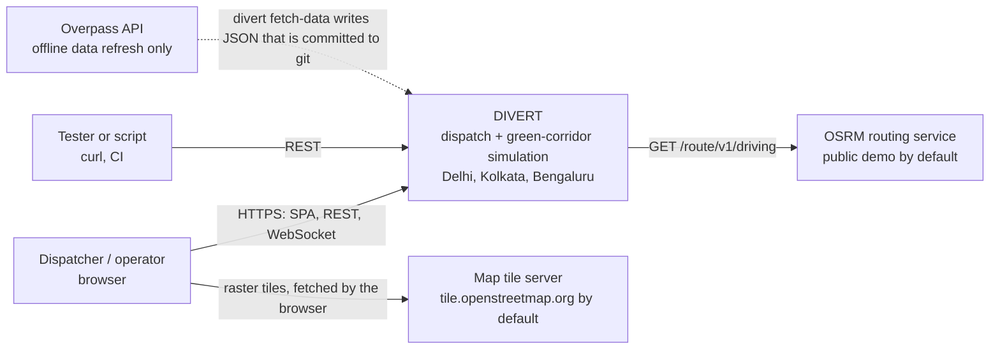
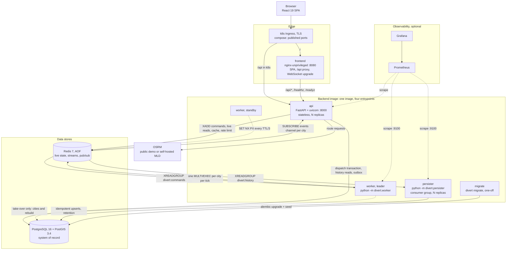
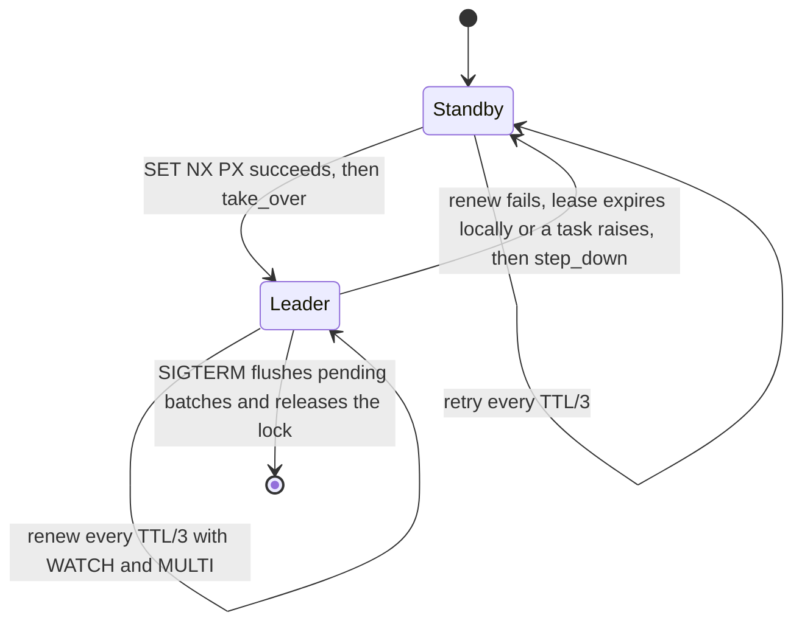
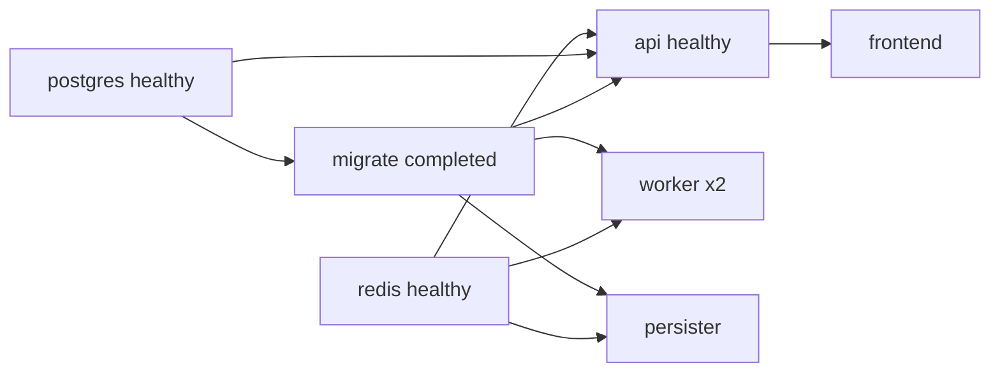

# 03 · Architecture

**What this covers:** how DIVERT is built and run. It gives C4-style context and container views, what each component owns, the process and concurrency model, the docker compose and Kubernetes topologies, how far each part scales, what happens when each part fails, and the observability and security set-up. Every number comes from code or config, and a path plus symbol name says where. Exhaustive detail lives in [architecture.md](../architecture.md), [deployment.md](../deployment.md) and [runbook.md](../runbook.md). The data stores are covered in [Data stores](05-data-stores.md), and the reasons behind the design in [Decisions](04-decisions.md).

## 1. Design rules

These four rules come from [architecture.md](../architecture.md) and the module docstrings. The code enforces them.

| # | Rule | Where it is enforced |
|---|---|---|
| 1 | **One job per data store.** PostgreSQL + PostGIS is the system of record. Redis holds hot, rebuildable state and messaging. OSRM routes. | `backend/src/divert/store/redis_store.py` module docstring |
| 2 | **One writer per piece of state.** The api writes the dispatch transaction. The worker leader is the only writer of live Redis state. The persister writes the history derived from the simulation. | `backend/src/divert/worker.py` module docstring, `backend/src/divert/store/live.py` `write_city_batch` |
| 3 | **At-least-once delivery with idempotent consumers.** This covers the outbox, consumer groups, deterministic event ids and forward-only status changes. | `services/outbox.py`, `store/events.py` `event_id`, `db/repositories/history.py` `HistoryWriter` |
| 4 | **No database calls on the simulation hot path, and no read-modify-write of shared state.** | `worker.py` `Worker.tick_once`, `services/simulation.py` `SimulationEngine` (pure, no I/O) |

## 2. System context (C4 level 1)



- **OSRM** is called only by the api, on the dispatch request path. The default is `https://router.project-osrm.org` (`backend/src/divert/config.py` `Settings.osrm_url`). That server is for fair use only. See [ADR-009](04-decisions.md#adr-009-osrm-with-a-redis-route-cache-and-no-straight-line-fallback).
- **Tiles** are fetched by the browser, not by DIVERT (`frontend/src/config.ts` `config.tiles`). The nginx CSP allows `img-src https:` for this.
- **Overpass** is never called at runtime. `divert fetch-data` (`backend/src/divert/cities/osm.py`) writes the snapshot files, which are then committed. See [ADR-010](04-decisions.md#adr-010-committed-real-osm-snapshot-files-rather-than-live-fetching).

## 3. Containers (C4 level 2)



In compose the browser talks only to nginx on :8080, and nginx proxies `/api`. In Kubernetes the Ingress sends `/api` straight to the `divert-api` Service and `/` to the frontend (`infra/k8s/base/ingress.yaml`), so nginx's `/api` proxy is bypassed there.

## 4. Components and responsibilities

| Component | Entrypoint | Owns (sole writer of) | Reads | Also writes | State |
|---|---|---|---|---|---|
| **api** | `uvicorn divert.main:create_app --factory` (`backend/src/divert/main.py` `create_app`) | New `incidents` + `dispatches` rows; `incident_events` `reported`, `dispatched`, `cancel_requested`; `outbox` rows; unit `AVAILABLE → DISPATCHED` (`db/repositories/incidents.py` `IncidentRepository.create_dispatch`, `mark_cancelled`) | Reference data (per-process cache, `services/reference.py` `ReferenceCache`, TTL `reference_cache_ttl_s` = 300 s); history and analytics from PG; live state, `divert:sim:clock` and the heartbeat from Redis | `divert:commands` via the outbox; `PUBLISH incident_updated`; OSRM cache keys; rate-limit counters | Stateless. In-memory: reference cache, WebSocket hub, in-flight post-commit tasks |
| **worker (leader)** | `python -m divert.worker` (`worker.py` `Worker`) | Every live Redis key: vehicles, routes, claims, vclaims, active signals, city tick, finished set. Also the heartbeat, `divert:sim:clock`, all `XADD divert:history` and all acks on `divert:commands` | `divert:commands` (group `worker`); PG only on take-over: cities (`ReferenceRepository.list_cities`), ended and active dispatches (`db/repositories/history.py` `ended_dispatch_ids`, `active_dispatches`) | Pub/sub `tick`, `vehicle_added`, `vehicle_removed`, `incident_updated` | In-memory `SimulationEngine`, mirrored to Redis every tick, so any instance can take over |
| **worker (standby)** | same | Nothing | `divert:worker:leader` (tries `SET NX PX`) | Nothing | None |
| **persister** | `python -m divert.persister` (`persister.py` `Persister`) | History applied from the worker's events: incident status after DISPATCHED, dispatch arrival and end, unit `ON_SCENE` / `AVAILABLE`, `signal_preemptions`, `vehicle_positions`, worker `incident_events` (`db/repositories/history.py` `HistoryWriter`); `divert:history:dlq`; retention deletes | `divert:history` (group `persister`) | Acks on `divert:history` | Stateless |
| **migrate** | `divert migrate` (`cli.py` `main`) | Schema (Alembic) and reference data: `cities`, `stations`, `signals`, `units` inserts, deactivations (`db/seed.py` `seed_city`) | Snapshot JSON files | None | One-off job |
| **frontend / nginx** | `nginxinc/nginx-unprivileged:1.27-alpine` (`frontend/Dockerfile`) | Static SPA files | None | None | Stateless |
| **postgres** | `postgis/postgis:16-3.4` | System of record | n/a | n/a | **Stateful** (volume `pgdata`) |
| **redis** | `redis:7-alpine` | Hot state and messaging | n/a | n/a | **Stateful but rebuildable** (volume `redisdata`, AOF) |
| **osrm** | `ghcr.io/project-osrm/osrm-backend:v5.27.1`, compose profile `osrm` | Routing graph (read-only volume) | n/a | n/a | Stateless at runtime |
| **prometheus** | `prom/prometheus:v2.55.1`, profile `observability` | Metrics TSDB, `--storage.tsdb.retention.time=15d` | `/metrics` endpoints | n/a | Stateful (volume `prometheus`) |
| **grafana** | `grafana/grafana:11.3.1`, profile `observability` | Provisioned "DIVERT overview" dashboard | Prometheus | n/a | Stateful (volume `grafana`) |

Unit status therefore has several writers, each for one transition: the api (`AVAILABLE → DISPATCHED`), the persister (`DISPATCHED → ON_SCENE`, `→ AVAILABLE` only while `current_dispatch_id` still points at the ended dispatch) and the seed (`AVAILABLE → OUT_OF_SERVICE` at a deactivated station).

## 5. Process and concurrency model

Every Python service is **asyncio, with one event loop per process**. uvicorn runs without `--workers`, so one api container means one process. Scale by adding replicas.

### 5.1 api

| Concurrent activity | Code | Cadence / bound |
|---|---|---|
| HTTP and WebSocket handlers | `api/v1/*` | One task per request |
| Outbox relay (every replica) | `services/outbox.py` `OutboxRelay.run` | Every `outbox_relay_interval_s` = 2 s; rows older than `outbox_relay_min_age_s` = 2 s; batch 100 (`OutboxRelay.__init__` `batch`) |
| Post-commit XADD + PUBLISH | `services/dispatch.py` `DispatchService._spawn`, `_after_commit` | One task per dispatch or cancel. On shutdown, `drain` waits up to 5 s |
| Pub/sub reader per city | `api/ws_hub.py` `CityHub._reader` | One subscription per city per process, started by the first WebSocket client. Reconnect backoff starts at 0.5 s, doubles, caps at 10 s |
| WebSocket sender and receiver | `api/v1/stream.py` `_forward`, `_receive` | Two tasks per client. Per-client queue `ws_queue_size` = 256 |

The api holds **two Redis clients** (`store/redis_store.py` `create_redis`):

- A **request-path client**: socket and connect timeouts of `redis_request_timeout_s` (0.5 s), no retries (`Retry(NoBackoff(), 0)`), and every call wrapped in `RedisGuard`.
- A **patient client** for pub/sub: timeouts of `redis_socket_timeout_s` (5 s) and `retry_on_timeout=True`.

### 5.2 worker: one leader plus a standby



- **Lease.** `store/locks.py` `LeaderLock`. The key is `divert:worker:leader`, the TTL is `leader_lock_ttl_ms` = 5000, and the token is `<instance>:<16 hex>`. The leader counts itself valid only until `last renewal + TTL − TTL/5` (`LeaderLock.margin_s`), so it stops writing about 1 s before the key can expire. **There are no fencing tokens.** The overlap window is bounded but not excluded (see the module docstring).
- **Take-over** (`Worker.take_over`) loads the cities from PG, creates the `worker` consumer group, resumes the sim clock and the per-city tick counter, restores vehicles from Redis, then rebuilds from PG any active dispatch that Redis lost.
- **While leading**, `Worker._lead` runs three tasks on one loop:
  - `renew`, every TTL/3 ≈ 1.67 s.
  - `commands`: `XREADGROUP`, count 100, block `command_block_ms` = 200. Every TTL (5 s) it also sweeps with `XAUTOCLAIM`, taking commands that have been idle for at least the TTL.
  - `ticks`: every `sim_tick_s` = 0.5 s on a drift-corrected schedule. An overrun increments `divert_tick_overruns_total`.
  If any task fails, or the lease is lost, the worker steps down and drops its in-memory state.
- **One leader simulates all cities.** Nothing shards the work by city. The key layout would allow it, but it is not implemented ([architecture.md](../architecture.md) §9).

### 5.3 persister

`Persister.run` loops:

1. `XAUTOCLAIM` messages idle for at least `persister_retry_idle_ms` = 5000, count `persister_batch` = 200.
2. `XREADGROUP`, count 200, blocking `persister_block_ms` = 1000.
3. One PG transaction for the batch, then `XACK`.
4. If the batch fails, retry one message at a time.
5. Every `retention_interval_s` = 3600 s, run retention under `pg_try_advisory_xact_lock(0x0D17E28)` (`RETENTION_LOCK_KEY`).
6. Refresh the stream-lag metrics.

### 5.4 Consumer groups

| Stream | Group | Consumers | Consumer name | Ack timing | Redelivery |
|---|---|---|---|---|---|
| `divert:commands` | `worker` | The leader only | `DIVERT_INSTANCE_ID`, or `hostname-pid` (`logging.py` `default_instance_id`) | In the same `MULTI/EXEC` as the command's effects (`CityBatch.acks`) | New leader: `XAUTOCLAIM` with min idle = lease TTL |
| `divert:history` | `persister` | All persister replicas | Same rule | After the PG `COMMIT` | `XAUTOCLAIM` after 5 s idle; DLQ after `persister_max_retries` = 5 deliveries |

In k8s, `DIVERT_INSTANCE_ID` is the pod name (`infra/k8s/base/worker.yaml`, `persister.yaml`). In compose the name is `<container id>-<pid>`, so every container recreation adds a new consumer to the group. Nothing removes old consumers (no `XGROUP DELCONSUMER` in the code), so `XINFO GROUPS` shows them piling up. This is harmless, because their pending entries are auto-claimed.

## 6. Deployment topologies

### 6.1 docker compose (development and testing)

Source: `docker-compose.yml`. All backend services share one image (`x-backend`), the `x-backend-env` environment plus an optional `.env`, `restart: unless-stopped` (except migrate), and json-file log rotation of 10m × 3.

| Service | Command / image | Host port (env override) | Profile | Health check | depends_on | Replicas | Limits |
|---|---|---|---|---|---|---|---|
| postgres | `postgis/postgis:16-3.4` with `shared_buffers=256MB`, `max_connections=200`, `log_min_duration_statement=500` | 5432 (`DIVERT_PG_PORT`) | default | `pg_isready` every 5 s, timeout 3 s, 20 retries, start 10 s | none | 1 | 2 CPU, 1g |
| redis | `redis:7-alpine` with `--appendonly yes --appendfsync everysec --maxmemory 512mb --maxmemory-policy noeviction` | 6379 (`DIVERT_REDIS_PORT`) | default | `redis-cli ping` every 5 s, timeout 3 s, 20 retries | none | 1 | 1 CPU, 640m |
| migrate | `divert migrate` | none | default | disabled | postgres healthy | 1, `restart: "no"` | 1 CPU, 512m |
| api | `uvicorn … --proxy-headers --forwarded-allow-ips * --no-access-log` | 8000 (`DIVERT_API_PORT`) | default | `GET /readyz` == 200 every 10 s, timeout 3 s, 6 retries, start 15 s | postgres + redis healthy, migrate completed | 1 | 1 CPU, 512m |
| worker | `python -m divert.worker` | none | default | `GET :9100/metrics` every 15 s, timeout 3 s, 3 retries, start 15 s | postgres + redis healthy, migrate completed | **2** | 1 CPU, 512m; `stop_grace_period` 15 s |
| persister | `python -m divert.persister` | none | default | same as worker | same | 1 | 1 CPU, 384m; `stop_grace_period` 20 s |
| frontend | nginx image; `DIVERT_API_UPSTREAM=api:8000`; build args `VITE_TILE_URL*` | 8080 (`DIVERT_WEB_PORT`) | default | `wget /healthz` (through the proxy) every 15 s, timeout 3 s, 3 retries | api healthy (`restart: true`) | 1 | 0.5 CPU, 128m |
| osrm | `osrm-routed --algorithm mld --max-table-size 1000 /data/divert-cities.osrm` | 5000 (`DIVERT_OSRM_PORT`) | `osrm` | `wget /nearest/...` every 15 s, timeout 5 s, 10 retries | none | 1 | 2 CPU, 4g |
| prometheus | `prom/prometheus:v2.55.1`, 15 d retention | 9090 (`DIVERT_PROMETHEUS_PORT`) | `observability` | none | none | 1 | none |
| grafana | `grafana/grafana:11.3.1` | 3000 (`DIVERT_GRAFANA_PORT`) | `observability` | none | prometheus | 1 | none |



> **Known gap: self-hosted OSRM has not been run.** `infra/osrm/data/` is empty (it is gitignored and filled by `infra/osrm/prepare.sh`). If the `osrm` profile is started without that data, the container exits with "Required files are missing" and restarts in a loop. The api defaults to the public demo server.

### 6.2 Kubernetes base (`infra/k8s/base`, kustomize)

| Resource | Key settings |
|---|---|
| Namespace `divert` | `namespace.yaml` |
| ConfigMap `divert-config` | Production-flavoured settings, e.g. `DIVERT_RATE_LIMIT_PER_MIN=120`, `DIVERT_TRUST_PROXY_HEADERS=true`, `DIVERT_OSRM_TIMEOUT_S=5`, `DIVERT_OSRM_URL=http://osrm.divert.svc.cluster.local:5000` |
| Job `divert-migrate` | Argo CD `PreSync` hook; `backoffLimit` 3, `activeDeadlineSeconds` 600, `ttlSecondsAfterFinished` 3600 |
| Deployment `divert-api` | 2 replicas; rolling update `maxUnavailable 0`, `maxSurge 1`; topology spread by hostname; grace 30 s. Readiness `/readyz` (period 5 s, timeout 3 s, threshold 3); liveness `/healthz` (10 s / 3 s / 6); startup `/healthz` (2 s × 30). Requests 250m / 256Mi, limits 1 / 512Mi |
| Service `divert-api` | Port 80 → `http` (8000) |
| HPA `divert-api` | 2..10 replicas on CPU 65 %; scale-down stabilisation 300 s |
| PDB `divert-api` | `minAvailable: 1` |
| Deployment `divert-worker` | **2 replicas**; `maxUnavailable 1`, `maxSurge 0`; preferred pod anti-affinity by hostname; grace 20 s. Startup, liveness and readiness all on `:9100/metrics`. `DIVERT_INSTANCE_ID` = pod name |
| PDB `divert-worker` | `minAvailable: 1` |
| Deployment `divert-persister` | 2 replicas; grace 30 s; probes on `:9100/metrics`; requests 100m / 192Mi, limits 1 / 384Mi |
| PDB `divert-persister` | `minAvailable: 1` |
| Deployment `divert-frontend` | 2 replicas; `runAsUser 101`; readiness `/`, liveness `/nginx-health`; `DIVERT_API_UPSTREAM=divert-api.$(POD_NAMESPACE).svc.cluster.local:80` |
| Service `divert-frontend` | Port 80 → 8080 |
| Ingress `divert` | Class `nginx`; TLS secret `divert-tls`; host `divert.example.org`; `/api` → api, `/` → frontend. Annotations: `proxy-read-timeout` and `proxy-send-timeout` 3600 (WebSockets), `proxy-body-size` 1m, `ssl-redirect` true |

Backend pods run as uid/gid 10001 with `runAsNonRoot`, `readOnlyRootFilesystem`, `allowPrivilegeEscalation: false`, all capabilities dropped and seccomp `RuntimeDefault`. Prometheus discovery relies on `prometheus.io/*` pod annotations.

> **Known gaps in the k8s base:**
>
> - **No evidence it has ever been applied to a cluster.** There are no overlays, the image names are placeholders (`ghcr.io/example/divert-*:2.0.0`), the host is `divert.example.org`, and CI (`.github/workflows/ci.yml`) does not render or validate the manifests. [deployment.md](../deployment.md) says the base was checked with `kubeconform`; that check is not automated.
> - **The ConfigMap points at an OSRM Service that does not exist.** It names `osrm.divert.svc.cluster.local:5000`, but the base has no OSRM manifest.
> - **Several things are expected from elsewhere.** PostgreSQL and Redis are expected to be managed services. The `divert-secrets` Secret is a template only (`secret.template.yaml`). There is no NetworkPolicy, Prometheus or Grafana in the base.
> - **The frontend container does not set `readOnlyRootFilesystem`.**

## 7. Scalability

| Component | How it scales | Bottleneck / limit | Watch |
|---|---|---|---|
| api | Horizontally (stateless); HPA 2..10 on CPU | Each replica opens 1 pub/sub subscription per city and fans every tick out to its WebSocket clients. Each replica's DB pool can open `db_pool_size` + `db_max_overflow` = 10 + 10 connections | `divert_http_request_duration_seconds`, `divert_ws_clients`, CPU |
| worker | **Not horizontally.** One leader simulates every city; the standby is idle | One CPU-bound event loop; tick cost is roughly O(vehicles × route vertices). Sharding by city is suggested in [architecture.md](../architecture.md) §9 but **not implemented** | `divert_tick_duration_seconds` p95 against the 0.5 s period; `divert_tick_overruns_total` |
| persister | Horizontally via the consumer group | PG write throughput. Retention runs on one replica at a time (advisory lock) | `divert_persister_lag_seconds`, `divert_history_stream_lag` |
| frontend | Horizontally | none in practice | none |
| PostgreSQL | Vertically. A read replica for analytics is suggested in [deployment.md](../deployment.md) but not wired | Connections. In k8s at HPA max, (10 api + 2 persister + 2 worker + 1 migrate) × 20 = up to 300 pooled connections. Size `max_connections` for that or put PgBouncer in front ([deployment.md](../deployment.md)). Compose sets `max_connections=200` | slow-query log (500 ms in compose) |
| Redis | Vertically. **Redis Cluster is not supported**: the tick `MULTI/EXEC` mixes per-city keys with the global streams | Single primary; compose `maxmemory 512mb` with `noeviction` | memory, stream lengths |
| OSRM | Self-host it | The public demo is fair use only, with no SLA | `divert_osrm_errors_total`, `divert_osrm_request_duration_seconds` |

**Hard limits found in code:**

| Limit | Value | Where |
|---|---|---|
| WebSocket clients per city, per api process | 500; more get close code 1013 | `config.py` `ws_max_clients_per_city`, `api/ws_hub.py` `HubFull` |
| WebSocket per-client queue | 256 messages, then forced resync (close 1013) | `ws_queue_size`, `CityHub._fan_out` |
| `divert:history` length | approx. 1,000,000 entries (`MAXLEN ~`) | `store/redis_store.py` `STREAM_HISTORY_MAXLEN` |
| `divert:commands` length | approx. 100,000 | `STREAM_COMMANDS_MAXLEN` |
| `divert:history:dlq` length | approx. 100,000 | `store/streams.py` `dead_letter` |
| Simulation time scale | at most 100× | `config.py` `sim_time_scale` (`le=100`) |
| Tick period | above 0 and at most 5 s | `sim_tick_s` |
| Candidate stations per dispatch | 1..10 (default 3) | `candidate_stations` |
| Units per station | 1..20 (default 2) | `units_per_station` |
| History page size | 1..200 (default 50) | `api/v1/history.py` `list_incidents` |
| Event id length | 64 characters (longer ids are hashed) | `store/events.py` `_MAX_EVENT_ID` |
| Ids used in Redis keys | `^[A-Za-z0-9_.-]{1,64}$` | `store/redis_store.py` `_ID_RE` |
| Request body via Ingress | 1 MiB | `ingress.yaml` `proxy-body-size` |

## 8. Reliability: failure modes

The full narrative is in [architecture.md](../architecture.md) §8 and the operator steps in [runbook.md](../runbook.md). The table below was re-checked against the code.

| Failure | Observed behaviour | Recovery mechanism | Data-loss risk |
|---|---|---|---|
| OSRM down, slow or rate-limited | `POST /incidents` returns **503** `routing_unavailable` after `osrm_retries` = 2 retries (timeout 8 s, backoff 0.25 s doubling with jitter). Cached routes still work | Automatic when OSRM answers again (`services/routing.py` `OsrmRouter._fetch`) | None: nothing is written before routing succeeds |
| Redis blip at dispatch commit | 201 returned; the post-commit `XADD` fails | Outbox relay re-sends rows unsent for at least 2 s, every 2 s (`OutboxRelay.relay_once`) | None |
| Redis down for minutes | api stays **ready** (`/readyz` = PG only, `degraded: true`); dispatches still 201 (circuit breaker + outbox); history and analytics work; live REST returns 503 `live_state_unavailable` (`Retry-After: 5`); WebSockets close 1013; **no ticks** (the leader cannot renew its lease) | Circuit trial after `redis_circuit_cooldown_s` = 5 s; relay drains the backlog; a leader resumes from AOF or rebuilds from PG | None for committed data. AOF `everysec` can lose about 1 s of writes if Redis itself crashes |
| Redis restarts **empty** (no AOF, or failover to an empty replica) | Vehicles vanish from the map. The leader's renewal fails because the lock key is gone | The leader steps down, re-acquires and runs `take_over`, which calls `_rebuild_from_pg` with each active dispatch's route, speeds, corridor and last position, plus the simulated `elapsed_s` | Unpersisted `divert:history` entries and DLQ entries are lost (positions and pre-emptions in that window). Lifecycle events are re-derived by the rebuild (deterministic ids) |
| Redis reaches `maxmemory` (`noeviction`) | Write commands fail. Reads still work | The worker keeps each city's failed batch and merges it into the next tick (`Worker._flush`, `store/live.py` `merge_batches`). The api fails open or falls back as in an outage | None while the leader survives. Pending batches live only in the leader's memory |
| Redis blip during a tick | That city's batch is not written | Retried, merged into the next tick | None |
| Worker leader crash or hang | Map frozen; simulated time frozen | The standby acquires the lock when the key expires: within about TTL + TTL/3 (5 s + 1.67 s) of the last renewal. Un-acked commands are reclaimed with `XAUTOCLAIM`. The tick counter resumes from `divert:{city}:tick` | None (state is mirrored every tick, in the same transaction as its events) |
| Worker graceful stop (SIGTERM) | Brief pause | `Worker.shutdown` flushes and releases the lock; the standby takes over at its next poll (≤ 1.67 s) | None |
| Two leaders (pause longer than the lease) | Bounded overlap | The local margin (TTL/5) stops the old leader first. Whole-field writes and deterministic event ids keep state consistent. **No fencing tokens** | Duplicate events, de-duplicated by the persister |
| PostgreSQL down | `POST` returns 5xx; `/readyz` returns **503** (k8s takes api pods out of rotation); the live simulation continues; history buffers in `divert:history` | Persister catches up after recovery | None while the backlog stays under about 1,000,000 entries |
| PostgreSQL down **during a leader change** | No ticks. `take_over` needs PG (cities and rebuild), fails, and is retried every TTL/3 | Automatic once PG returns | None |
| Persister crash | History lags; the live map is unaffected | Other replicas take over its pending entries with `XAUTOCLAIM` after 5 s; on restart it continues from the group | None |
| Persisters (or PG) down for a long time | `divert:history` grows | Catch-up after recovery | **Yes, beyond about 1,000,000 entries.** `MAXLEN ~` trims the oldest entries even if they were never read. A trimmed terminal event leaves its dispatch active in PG and its unit busy, and nothing reconciles this automatically (known gap) |
| Poison history event | Blocks nothing (per-message fallback) | Moved to `divert:history:dlq` on a schema violation (`BadEvent`) or after 5 deliveries; `divert dlq --replay` re-queues | None, but replay is manual |
| api replica crash, including between COMMIT and XADD | Clients reconnect WebSockets to another replica and get a fresh snapshot | The relay on any replica sends the unsent outbox row | None |
| Command lost after `sent_at` was stamped (e.g. inside the AOF 1 s window) | The dispatch is active in PG but no vehicle moves | Only a later leader take-over rebuilds it. **There is no periodic PG-vs-Redis reconciliation (known gap)**; see [runbook.md](../runbook.md) "A unit looks stuck" | None in PG; the live run is delayed |
| api container or pod recreated with a new IP | none | nginx re-resolves `DIVERT_API_UPSTREAM` every 10 s (`resolver … valid=10s`) | None |
| Slow WebSocket client, or Redis pub/sub reconnect | Client closed with 1013 | Browser reconnects with backoff from 0.5 s to 15 s (`frontend/src/config.ts` `config.ws`) and gets a fresh snapshot | None |

## 9. Observability

### 9.1 Metrics

All metrics use the `divert_` namespace (`backend/src/divert/metrics.py`). The api serves them on `GET /metrics` (port 8000). The worker and persister serve them on `:DIVERT_METRICS_PORT/metrics` (9100). Default `prometheus_client` process metrics are also exposed.

| Metric | Type | Labels | Emitted by |
|---|---|---|---|
| `divert_http_requests_total` | counter | method, route, status | api (`api/middleware.py` `RequestContextMiddleware`; `/metrics` excluded) |
| `divert_http_request_duration_seconds` | histogram | method, route | api |
| `divert_dispatches_total` | counter | city, service, outcome (`created`, `invalid`, `no_unit_available`, `routing_unavailable`) | api (`DispatchService.create_incident`) |
| `divert_dispatch_duration_seconds` | histogram | none | api, successful creates only |
| `divert_osrm_request_duration_seconds` | histogram | outcome (HTTP status or `transport_error`) | api |
| `divert_osrm_errors_total` | counter | kind (`transport`, `http_<code>`, `bad_json`, OSRM code) | api |
| `divert_active_vehicles` | gauge | city | worker (per tick); api (`HLEN` at scrape) |
| `divert_active_signals` | gauge | city | worker |
| `divert_tick_duration_seconds` | histogram | none | worker |
| `divert_tick_overruns_total` | counter | none | worker |
| `divert_preemptions_total` | counter | city, state | worker |
| `divert_preemption_conflicts_total` | counter | city | worker |
| `divert_worker_is_leader` | gauge | none | worker |
| `divert_worker_heartbeat_age_seconds` | gauge | none | api (at scrape) |
| `divert_worker_commands_total` | counter | type, outcome (`applied`, `rejected`) | worker |
| `divert_history_events_total` | counter | type | worker |
| `divert_persister_events_total` | counter | type, outcome (`ok`, `duplicate`, `retry`, `dlq`) | persister |
| `divert_persister_lag_seconds` | gauge | none | persister (now − ts of the last persisted event) |
| `divert_history_stream_lag` / `divert_history_stream_pending` | gauge | none | persister, api |
| `divert_dlq_messages_total` | counter | stream | persister |
| `divert_outbox_backlog` | gauge | none | api (PG count at each scrape) |
| `divert_outbox_relayed_total` | counter | path (`inline`, `relay`) | api |
| `divert_ws_clients` | gauge | city | api |
| `divert_rate_limited_total` | counter | scope | api |
| `divert_redis_circuit_open` / `divert_redis_circuit_trips_total` | gauge / counter | guard | api |

Scraping: in compose, `infra/observability/prometheus.yml` uses DNS service discovery for `api:8000`, `worker:9100` and `persister:9100` every 15 s. In k8s it relies on pod annotations, and no Prometheus is shipped.

### 9.2 Logs

`backend/src/divert/logging.py` `JsonFormatter` prints one JSON object per line on stdout. JSON is the default; set `DIVERT_LOG_JSON=false` for plain text.

```json
{"ts": "2026-11-17T06:30:00.123+00:00", "level": "INFO", "logger": "divert.access", "msg": "request",
 "service": "api", "request_id": "3f2a…", "method": "POST", "path": "/api/v1/cities/delhi/incidents",
 "route": "/api/v1/cities/{city}/incidents", "status": 201, "duration_ms": 412.7}
```

- Fields: `ts`, `level`, `logger`, `msg`, `service` (`api`, `worker`, `persister`, `cli`), `request_id` when one is set, every `extra=` field, and `exc` on exceptions.
- **Request ids.** `api/middleware.py` `RequestContextMiddleware` accepts an incoming `X-Request-ID` that matches `^[A-Za-z0-9._-]{1,64}$`; otherwise it generates `uuid4().hex`. It echoes the id in the response header and stores it in a contextvar (`request_id_var`) so every log line of that request carries it. nginx always sets `X-Request-ID: $request_id` on proxied requests.
- **Access log.** One `request` line per HTTP request, except `/healthz`, `/readyz` and `/metrics`. uvicorn's own access log is off (`--no-access-log`).
- **No distributed tracing.** The request id is not copied into outbox commands or stream events. To follow a request across services, correlate by `incident_id` / `dispatch_id`.

### 9.3 Grafana

The dashboard "DIVERT overview" (`infra/observability/grafana/dashboards/divert-overview.json`, uid `divert-overview`) refreshes every 10 s with a default range of 1 h. It is provisioned read-only into the folder `DIVERT`. Its 14 panels:

- **Time series:** dispatches/min by outcome, active vehicles, tick duration p95, OSRM latency p95, OSRM errors/min, pre-emptions/min, HTTP p95 by route, WebSocket clients.
- **Stats:** persister lag, history stream lag, outbox backlog, heartbeat age, leader count, DLQ messages.

> **Not implemented: alerting.** No Prometheus alert rules are shipped. [deployment.md](../deployment.md) lists suggested alerts: no leader, heartbeat older than 10 s, persister lag over 60 s, outbox backlog, DLQ growth, OSRM errors, tick p95.

## 10. Security posture

| Control | Behaviour | Where | Caveat |
|---|---|---|---|
| Optional API key | When `DIVERT_API_KEY` is set, `POST` and `DELETE /incidents` need `X-API-Key`, compared with `hmac.compare_digest`; otherwise 401 with `WWW-Authenticate: ApiKey` | `api/deps.py` `require_api_key`; `api/v1/incidents.py` `MUTATING` | **Reads, WebSockets, `/metrics` and `/docs` are unauthenticated.** A wrong key is rejected before the rate limiter runs, so failed key attempts are not counted |
| Rate limit | Fixed 60 s window, `INCR` + `EXPIRE 120`, mutating endpoints only; `rate_limit_per_min` = 60 (k8s ConfigMap: 120); 429 with `Retry-After` | `api/ratelimit.py` `check_rate_limit`, `rate_limit_mutations` | Keyed by the `X-API-Key` header value if one is sent, otherwise by client IP. **Fails open** when Redis is down. With no key configured, a client can change the header value to get a new bucket |
| Client IP | `X-Forwarded-For` is used only if `DIVERT_TRUST_PROXY_HEADERS=true` | `api/deps.py` `client_id` | compose and k8s run uvicorn with `--proxy-headers --forwarded-allow-ips *`, so uvicorn may already take the client address from `X-Forwarded-For` even when the flag is false |
| CORS | Explicit origins only (a `*` fails settings validation); credentials allowed; methods `GET, POST, DELETE, OPTIONS`; headers `Content-Type, X-API-Key, X-Request-ID`; exposes `X-Request-ID, Retry-After` | `main.py` `create_app`, `config.py` `Settings._no_wildcard_cors` | Unused when the SPA is served same-origin through nginx |
| nginx security headers | CSP `default-src 'self'; script-src 'self'; style-src 'self' 'unsafe-inline'; img-src 'self' data: https:; connect-src 'self' ws: wss:; …; frame-ancestors 'none'`, plus `X-Content-Type-Options nosniff`, `X-Frame-Options DENY`, `Referrer-Policy strict-origin-when-cross-origin`, `Permissions-Policy geolocation=(), camera=(), microphone=()`, and `server_tokens off` | `frontend/nginx/default.conf.template` | No HSTS header from nginx; TLS ends at the Ingress (`ssl-redirect`) |
| Non-root containers | Backend runs as uid 10001 (`backend/Dockerfile`); frontend uses `nginx-unprivileged` as `USER 101`; k8s sets `runAsNonRoot`, drops all capabilities, uses seccomp `RuntimeDefault` and a read-only root FS (backend) | Dockerfiles, `infra/k8s/base/*.yaml` | Frontend k8s container has no `readOnlyRootFilesystem` |
| Secrets | `database_url`, `redis_url` and `api_key` are `SecretStr` (`config.py`). k8s expects a `divert-secrets` Secret created out of band (template only). compose reads an uncommitted `.env` | `config.py`, `secret.template.yaml`, `.env.example` | compose defaults are dev-only: PG `divert/divert`, Grafana `change-me`, Redis with **no AUTH** on a published port 6379, PG published on 5432. `VITE_API_KEY` is baked into the JS bundle and is not a secret (`frontend/src/config.ts`) |
| Input hardening | City path `^[a-z0-9_-]{1,32}$`; every id put into a Redis key is checked against `_ID_RE`; `statement_timeout` 15 s per DB connection | `api/deps.py` `CityId`, `store/redis_store.py` `_check`, `db/session.py` `create_engine` | none |

## Related

- [Decisions](04-decisions.md): why these components and patterns were chosen.
- [Data stores](05-data-stores.md): tables, Redis keys, streams and what is rebuildable.
- [Data flows](06-data-flows.md) and [Runtime workflows](07-runtime-workflows.md): step-by-step paths through these components.
- [Configuration](11-configuration.md): every setting quoted here.
- [Backend codebase](09-codebase-backend.md) and [Frontend codebase](10-codebase-frontend.md).
- Reference: [architecture.md](../architecture.md), [deployment.md](../deployment.md), [runbook.md](../runbook.md), [api.md](../api.md).
