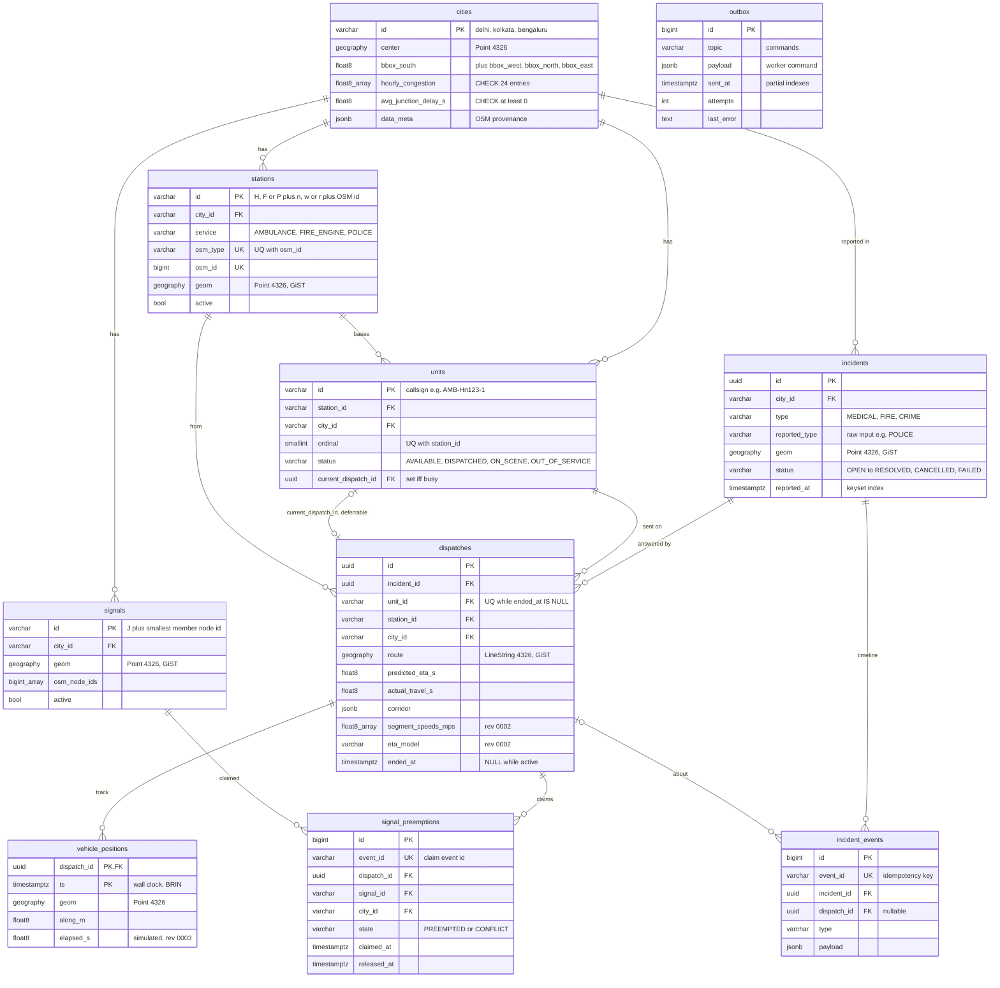

# 05 · Data stores

**What this covers:** every place DIVERT keeps data, and what happens to that data if the store is lost.

- **PostgreSQL + PostGIS:** the schema, indexes, constraints, which service writes and reads each table, the migration history and the retention policy.
- **Redis:** the full keyspace, the streams and consumer groups, the pub/sub channels and message types, the leader lock and heartbeat, the simulation clock, the OSRM route cache and the rate-limit keys.
- **City snapshot files:** the format of the committed reference JSON.
- **Durable vs rebuildable:** what is lost if each store is wiped, and how it comes back.

Per-column detail stays in [data-model.md](../data-model.md), and the exact wire contract in [api.md](../api.md).

## 1. Overview

| Store | Role | Durability | Source of truth for the definition |
|---|---|---|---|
| PostgreSQL 16 + PostGIS 3.4 | System of record: reference data, incident history, analytics, transactional outbox | WAL on volume `pgdata`; managed PITR expected in production ([deployment.md](../deployment.md)) | `backend/src/divert/db/models.py`, `backend/src/divert/migrations/versions/` |
| Redis 7 | Hot, rebuildable live state; streams; pub/sub; leader lock; caches; rate limits | AOF `appendfsync everysec`, `maxmemory 512mb`, `maxmemory-policy noeviction` (`docker-compose.yml` service `redis`) | `backend/src/divert/store/redis_store.py` (every key) |
| City snapshot JSON | Reference data input (OSM stations and junctions, plus hand-set traffic profile) | Committed to git | `backend/src/divert/cities/loader.py` `parse_snapshot` |
| OSRM data (self-hosted only) | Routing graph | Rebuilt by `infra/osrm/prepare.sh`; gitignored; **not yet prepared** | `infra/osrm/README.md` |

## 2. PostgreSQL

### 2.1 Conventions

- **Spatial columns** are `geography(Point|LineString, 4326)`, so distances and buffers are in metres. Every spatial column has a GiST index.
- **Enumerations** are `VARCHAR + CHECK`, not native enums (`backend/src/divert/db/base.py` `str_enum`). The CHECK constraints are named `ck_<table>_<column>`, for example `ck_units_status`.
- **Constraint and index names** are deterministic (`db/base.py` `NAMING_CONVENTION`: `pk_`, `fk_`, `uq_`, `ck_`, `ix_`).
- **Timestamps** are `timestamptz`, and every session runs with `timezone=UTC`.
- **Connections** (`db/session.py` `create_engine`):
  - asyncpg driver; pool of `db_pool_size` = 10 plus `db_max_overflow` = 10 per process.
  - `pool_timeout` 10 s, `pool_pre_ping`, `pool_recycle` 1800 s.
  - Per-connection `statement_timeout` = `db_statement_timeout_ms` = 15,000.
  - `application_name` is `divert-api`, `divert-worker`, `divert-persister` or `divert-seed`.
- **Reference rows are never deleted**, because history points at them. A newer snapshot deactivates them instead (`db/seed.py`).

### 2.2 Entity-relationship diagram



`outbox` has no foreign keys. It is a delivery queue, not part of the domain graph.

### 2.3 Tables

**Reference data.** These tables are written by `divert migrate` / `divert seed` (`db/seed.py` `seed_city`). The exception is `units.status`, which changes at runtime.

| Table | Purpose | Key columns | Indexes | Constraints | Writers | Readers |
|---|---|---|---|---|---|---|
| `cities` | One row per city: bbox, centre, zoom, timezone, 24 hourly congestion factors, average junction delay, OSM provenance | `id` | `pk_cities` | `ck_cities_hourly_24` (`array_length = 24`), `ck_cities_bbox` (south < north, west < east), `ck_cities_junction_delay` (≥ 0) | seed | api (`ReferenceCache`, 300 s TTL), worker (take-over) |
| `stations` | Bases: hospitals → AMBULANCE (named only), fire stations → FIRE_ENGINE, police → POLICE | `id`, `(osm_type, osm_id)` | `ix_stations_geom` **GiST**, `ix_stations_city_service`, `uq_stations_osm_type_osm_id` | `ck_stations_osm_type` (node, way, relation), `ck_stations_service`, FK → cities `RESTRICT` | seed (upsert, deactivate) | api (KNN `geom <-> point`, availability) |
| `units` | One row per vehicle: `units_per_station` = 2 per active station | `id` (callsign `AMB`/`FIRE`/`PCR`-`<station>`-`<n>`, `domain/enums.py` `CALLSIGN_PREFIX`) | `ix_units_free_by_station` **partial** `WHERE status = 'AVAILABLE'`, `ix_units_city_status`, `uq_units_station_id_ordinal` | `ck_units_busy_has_dispatch`: `(status IN ('DISPATCHED','ON_SCENE')) = (current_dispatch_id IS NOT NULL)`; `ck_units_ordinal` (≥ 1); `ck_units_status`; FK `current_dispatch_id` → dispatches **`DEFERRABLE INITIALLY DEFERRED`**, `ON DELETE SET NULL` | seed (insert missing; `AVAILABLE → OUT_OF_SERVICE` at deactivated stations), api (`→ DISPATCHED` under `FOR UPDATE SKIP LOCKED`), persister (`→ ON_SCENE`, `→ AVAILABLE`) | api |
| `signals` | Junction-level signals: OSM `traffic_signals` nodes clustered within 40 m | `id` = `J<smallest member node id>` | `ix_signals_geom` **GiST**, `ix_signals_city_id` | FK → cities | seed | api (corridor: `ST_DWithin(geom, route, 30 m)`), lists |

**History.** These tables are append-mostly and keyed for idempotency.

| Table | Purpose | Key columns | Indexes | Constraints | Writers | Readers |
|---|---|---|---|---|---|---|
| `incidents` | One row per report; one timestamp column per status transition | `id` uuid | `ix_incidents_city_reported` `(city_id, reported_at DESC, id DESC)` (keyset), `ix_incidents_city_status`, `ix_incidents_geom` **GiST** | `ck_incidents_type`, `ck_incidents_status` | api (insert as `DISPATCHED`; cancel), persister (forward-only status changes) | api (history, analytics), worker (rebuild join) |
| `dispatches` | One unit sent to one incident: the **whole trip** (`status` DISPATCHED -> ... -> COMPLETED / FAILED, open until the unit is back in service); route geometry, corridor, per-segment speeds and predicted vs actual of the RESPONSE leg | `id` uuid | `ix_dispatches_route` **GiST**, `uq_dispatches_active_unit` **partial unique** `(unit_id) WHERE ended_at IS NULL`, `ix_dispatches_active_city` **partial** `WHERE ended_at IS NULL`, `ix_dispatches_city_dispatched`, `ix_dispatches_incident_id` | `ck_dispatches_non_negative`, `ck_dispatches_end_reason` (CLEARED, CANCELLED, FAILED), FK → incidents `CASCADE` | api (insert), persister (forward-only `status`, `arrived_at`, `actual_travel_s`, `est_time_saved_s`, `ended_at`, `end_reason`; all `COALESCE` = first write wins) | api, worker (`active_dispatches`, `ended_dispatch_ids`) |
| `dispatch_legs` | One row per leg: RESPONSE (seq 0) / TRANSPORT / RETURN with origin, destination (+ kind, station), route, speeds, corridor, `route_choice`, `hospital_choice`, prediction of record vs actual (simulated), `started/ended_trip_s`, `end_reason`, `reroutes` | `id`; `uq_dispatch_legs_dispatch_id_seq` | `ix_dispatch_legs_route` **GiST**, `ix_dispatch_legs_destination_station` | `ck_dispatch_legs_seq`, `ck_dispatch_legs_non_negative`, `ck_..._kind`, `ck_..._destination_kind`, `ck_..._end_reason`; FK -> dispatches `CASCADE`, -> stations `RESTRICT` | api (RESPONSE, in the dispatch transaction); LegPlanner (TRANSPORT / RETURN, in one transaction with the outbox row of its `leg_planned` command); persister (`started_at`, `ended_at`, `actual_travel_s`, `end_reason`, re-routes; first write wins) | api (incident detail, analytics), LegPlanner (a re-issued request is answered from the row), worker (`active_dispatches` rebuild per leg) |
| `signal_preemptions` | Every claim (PREEMPTED or CONFLICT) with lane, approach bearing, ETA at claim and the design section 4.6 detail (`leg_seq`, `movement`, `lane_index` / `lanes_total`, `free_left`, `required_lead_s`, `transition_s`, `queue_clear_s`, `green_at`, `crossed_at`, `waited_s`, `outcome`, `phase_state_at_claim`); `released_at` closes it | `id`; `event_id` unique (the **claim** event id) | `uq_signal_preemptions_event_id`, `ix_signal_preemptions_dispatch_id`, `ix_signal_preemptions_signal_claimed`, `ix_signal_preemptions_city_claimed` | `ck_signal_preemptions_not_normal` (`state <> 'NORMAL'`), `ck_..._state`, `ck_..._lane` (L, R, C), `ck_..._movement`, `ck_..._outcome`, `ck_..._phase_state_at_claim` | persister | api (detail, analytics) |
| `incident_events` | Append-only timeline and audit trail | `id`; `event_id` unique | `uq_incident_events_event_id`, `ix_incident_events_incident_ts` | FK → incidents and dispatches `CASCADE` | api (`rep:`, `dsp:`, `cxr:` events), persister (every worker event except positions) | api (timeline) |
| `vehicle_positions` | Sampled track, one row every `position_sample_s` = 5 simulated seconds, on every leg (`leg_seq`; `along_m` / `elapsed_s` are per leg) | PK `(dispatch_id, ts)` | `ix_vehicle_positions_ts_brin` **BRIN** on `ts` | FK → dispatches `CASCADE` | persister (insert; retention delete) | api (tracks), worker (latest row per active dispatch via `LATERAL`, for rebuild) |
| `outbox` | Transactional outbox for worker commands ([ADR-003](04-decisions.md#adr-003-transactional-outbox-for-worker-commands)) | `id` identity | `ix_outbox_unsent` **partial** `(id) WHERE sent_at IS NULL`, `ix_outbox_sent_at` **partial** `WHERE sent_at IS NOT NULL` | none | api (insert in the dispatch or cancel transaction; relay sets `sent_at`, `attempts`, `last_error`), persister (retention delete) | api (relay, `divert_outbox_backlog`) |

**Advisory locks.**

- `SEED_LOCK_KEY = 0x0D17E27` (`cli.py`): a blocking `pg_advisory_xact_lock`, so only one seeder runs at a time.
- `RETENTION_LOCK_KEY = 0x0D17E28` (`persister.py`): `pg_try_advisory_xact_lock`, so only one persister runs retention at a time.

The key spatial and locking queries are written out in [data-model.md](../data-model.md) "Key queries".

### 2.4 Migration history

Alembic scripts live in `backend/src/divert/migrations/versions/`. Head is `0004_trip_legs` (the compose `migrate` service applies it on `docker compose up`).

| Revision | File | Adds |
|---|---|---|
| `0001_initial` | `20261117_0001_initial_schema.py` | `CREATE EXTENSION IF NOT EXISTS postgis`; all ten tables; the GiST indexes (stations, signals, incidents, dispatches.route); the BRIN index on `vehicle_positions.ts`; partial indexes `ix_units_free_by_station`, `uq_dispatches_active_unit`, `ix_dispatches_active_city`, `ix_outbox_unsent`; every CHECK; and the deferrable FK `fk_units_current_dispatch_id_dispatches`, added after `dispatches` exists because the two tables reference each other. Downgrade leaves the PostGIS extension installed on purpose |
| `0002_dispatch_rebuild` | `20261117_0002_dispatch_rebuild.py` | `dispatches.segment_speeds_mps double[] NOT NULL DEFAULT '{}'` and `dispatches.eta_model varchar(32)`, so the worker can rebuild a vehicle from PG; `ix_dispatches_city_dispatched` for analytics windows; `ix_outbox_sent_at` (partial) for the retention sweep |
| `0003_position_elapsed` | `20261117_0003_position_elapsed.py` | `vehicle_positions.elapsed_s double` (nullable): simulated seconds since dispatch, so a rebuild after fail-over does not count wall-clock gaps as travel time. Older rows fall back to a wall-clock estimate (`worker.py` `Worker._vehicle_from_pg`) |
| `0004_trip_legs` | `20261117_0004_trip_legs.py` | `dispatch_legs`; unit statuses + TRANSPORTING / AT_HOSPITAL / RETURNING (and the busy CHECK); incident statuses + TRANSPORTING / AT_HOSPITAL, `hospital_station_id`, `transport_started_at`, `at_hospital_at`; `dispatches.status`; `signal_preemptions` section 4.6 columns, lane `C`; `vehicle_positions.leg_seq`; `stations.emergency` (CHECK yes/no) and `healthcare`. **Backfill:** a RESPONSE leg (seq 0) per existing dispatch from its own columns (+ `route_choice` from its `dispatched` event), `dispatches.status` from `ended_at` / `end_reason` / `arrived_at`, preemption detail from the stage A release payloads (`outcome` from the release reason otherwise). **Downgrade** maps the new statuses to ON_SCENE and lane C to NULL first, so the old CHECKs hold. Proven on a copy of the dev database and on a fresh one: upgrade, `alembic check`, downgrade 0003, upgrade, `alembic check` (`tests/integration/test_migration_0004.py` covers the backfill) |

Every revision is reversible. CI runs `divert migrate`, then `alembic upgrade head && alembic check`, then `alembic downgrade base && alembic upgrade head` (`.github/workflows/ci.yml` job `backend-integration`). `tests/integration/test_migrations.py::test_models_match_migration` fails if the ORM and the migrations drift.

### 2.5 Retention policy

| Data | Rule | Who and when | Code |
|---|---|---|---|
| `vehicle_positions` | Delete rows with `ts` older than `position_retention_days` = 30 days | Persister, every `retention_interval_s` = 3600 s, one replica at a time (advisory lock), in batches of 10,000 inside one transaction | `persister.py` `Persister.retention_once`, `db/repositories/history.py` `prune_positions` |
| `outbox` | Delete **relayed** rows (`sent_at IS NOT NULL`) older than `outbox_retention_days` = 7 days. Unsent rows are never pruned | Same job | `prune_outbox` |
| `incidents`, `dispatches`, `signal_preemptions`, `incident_events` | **Kept forever.** No retention exists | none | none |
| Reference rows | Never deleted; deactivated by seed | `divert seed` | `db/seed.py` |

Because `vehicle_positions.ts` is the wall clock, the BRIN index makes the range delete cheap. [deployment.md](../deployment.md) suggests partitioning by month if retention grows beyond a few months. That is not implemented.

## 3. Redis

### 3.1 Configuration and clients

- **Server (compose):** `--appendonly yes --appendfsync everysec --maxmemory 512mb --maxmemory-policy noeviction`. Live state and streams must never be evicted, and the caches carry their own TTLs.
- **Clients** (`store/redis_store.py` `create_redis`), both with `decode_responses=True` and `health_check_interval=30`:
  - The **request-path client** (api) has 0.5 s timeouts, no retries, and is wrapped in `RedisGuard`.
  - The **patient client** (worker, persister, api pub/sub, CLI) has 5 s timeouts and `retry_on_timeout`.
- **Topology:** a single primary. Redis Cluster is **not supported** ([ADR-002](04-decisions.md#adr-002-redis-for-hot-rebuildable-state)).
- **Hash tags:** every per-city key carries the hash tag `{<city>}`, for example `divert:{delhi}:vehicles`, so one city's live keys share a slot. The streams are global.
- **Id validation:** every id put into a key must match `^[A-Za-z0-9_.-]{1,64}$` (`_ID_RE`), or key building raises `ValueError`.

### 3.2 Keyspace

| Key pattern | Type | Writer | Readers | TTL / bound | Purpose |
|---|---|---|---|---|---|
| `divert:{<city>}:vehicles` | HASH vehicle_id → JSON | Worker leader (tick `MULTI/EXEC`) | api `read_vehicles` (`/vehicles`, WebSocket snapshot, `HLEN` in `/metrics`); new leader `_restore_from_redis` | None. Field `HDEL`'d when the vehicle ends | Live vehicle; one field per vehicle, never a shared blob |
| `divert:{<city>}:route:<vehicle>` | STRING JSON | Worker leader | api `read_vehicle_routes` (`MGET`); new leader | None. `DEL` when the vehicle ends | Static per dispatch: route, corridor, destination |
| `divert:{<city>}:claims:<signal>` | HASH vehicle_id → claim JSON | Worker leader | New leader (`HGET` per claim); ops (`runbook.md`) | None. Field `HDEL`'d on release | Per-vehicle claim on one signal |
| `divert:{<city>}:vclaims:<vehicle>` | SET of signal ids | Worker leader (`SADD`, `SREM`, `DEL` on release-all) | **No production reader** (tests and ops only). Restore uses the `claims` list inside the vehicle JSON | None | Index of the signals a vehicle holds |
| `divert:{<city>}:signals:active` | HASH signal_id → JSON | Worker leader | api `read_active_signals` (`/signals/active`, snapshot); new leader (`HKEYS`, so its first tick deletes stale entries) | None. Field `HDEL`'d when no vehicle claims the signal | Resolved non-NORMAL signals only |
| `divert:{<city>}:tick` | HASH `tick`, `sim_ts`, `wall_ts` | Worker leader, only on ticks that emit a `tick` message | api `read_tick` (`/vehicles`, snapshot); new leader `last_tick_no` (keeps WebSocket tick numbers monotonic) | None | Last tick written for the city |
| `divert:{<city>}:finished` | ZSET dispatch_id → wall epoch | Worker leader (`ZADD`, then `ZREMRANGEBYSCORE` older than `finished_dispatch_ttl_s` = 86,400 s) | New leader `read_finished` | Members trimmed after 24 h. The key itself has no TTL | Makes a redelivered `start_dispatch` for an ended dispatch a no-op |
| `divert:{<city>}:junctions` | HASH signal_id → JSON `{legs, approach_bearings, source}` | Worker leader (`HSET` in the tick transaction, for every junction whose geometry was fixed since the last tick: `JunctionRegistry.take_new_geometry`) | New leader `_seed_geometry` -> `JunctionRegistry.seed` | none (bounded by the city's junctions) | Junction geometry: the approach -> phase mapping stays the same across failovers instead of being re-derived from the next first approach |
| `divert:worker:leader` | STRING `<instance>:<16 hex>` | Any worker `SET NX PX 5000`; owner renews with `PEXPIRE` and deletes on release (`store/locks.py` `LeaderLock`) | Workers; ops (`GET`) | **PX 5000** (`leader_lock_ttl_ms`) | Leader lease |
| `divert:worker:heartbeat` | HASH `instance`, `ts`, `tick`, `vehicles`, `sim_ts`, `leader_since` | Leader, after every tick (non-transactional pipeline, `Worker._heartbeat`) | api `/readyz` (fresh if at most `heartbeat_max_age_s` = 10 s old), `/metrics` | **EXPIRE 3600** | Liveness of the simulation |
| `divert:sim:clock` | STRING epoch seconds | Leader, every tick, **only when `sim_time_scale` ≠ 1** | New leader `_load_sim_clock`; api `DispatchService.sim_clock` (both only when the scale ≠ 1) | None, never deleted | Simulated "now", so congestion uses the simulated hour and survives fail-over |
| `divert:commands` | STREAM, group `worker` | api: outbox fast path and relay; worker LegPlanner (`leg_planned`, `route_replaced`, after its PG transaction) (`XADD MAXLEN ~ 100000`) | Worker leader: `XREADGROUP`, `XAUTOCLAIM`; `XACK` in the tick transaction | approx. 100,000 entries (`STREAM_COMMANDS_MAXLEN`) | `start_dispatch` / `cancel_dispatch` / `leg_planned` (idempotent per dispatch + seq) / `route_replaced` (per dispatch + seq + re-route no) |
| `divert:history` | STREAM, group `persister` | Worker leader (`XADD MAXLEN ~ 1000000` in the tick transaction); `divert dlq --replay` (no MAXLEN) | Persister (`XREADGROUP`, `XAUTOCLAIM`, `XACK`); api `/metrics` (`XINFO GROUPS`) | approx. 1,000,000 (`STREAM_HISTORY_MAXLEN`) | History events |
| `divert:history:dlq` | STREAM | Persister `dead_letter` (`MAXLEN ~ 100000`); `divert dlq --replay` removes entries (`XDEL`) | `divert dlq` (`XRANGE`) | approx. 100,000 | Poison history events |
| `divert:events:<city>` | PUB/SUB channel (no hash tag) | Worker leader (inside the tick transaction); api (`incident_updated` after commit) | api `CityHub`: one subscription per city per process | n/a | WebSocket fan-out |
| `divert:osrm:driving:<sha256(coords)[:32]>` | STRING, the raw OSRM JSON | api `OsrmRouter._store` (only `code == "Ok"`) | api `OsrmRouter._cached` | **EX `osrm_cache_ttl_s` = 3600** | Route cache; coords are `lng,lat;lng,lat` at 6 decimals |
| `divert:rl:mutate:<sha256(client)[:16]>:<epoch // 60>` | STRING counter | api `check_rate_limit` (`INCR` + `EXPIRE` in `MULTI`) | api | **EXPIRE 120** (`WINDOW_S * 2`) | Fixed one-minute window for POST/DELETE; client = `X-API-Key` value or IP |

Two notes from the running compose stack:

- With nothing in flight, the per-city `vehicles`, `route`, `claims`, `vclaims` and `signals:active` keys do not exist. Redis drops an empty hash or set. Only `tick` and `finished` remain per city.
- `divert:sim:clock` can remain from an earlier run with a scale other than 1. It is ignored while the scale is 1. **If the scale is changed back, a new leader resumes from that old value.**

### 3.3 Value shapes

| Value | Fields | Produced by |
|---|---|---|
| Live vehicle (`vehicles` hash field) | `id`, `dispatch_id`, `incident_id`, `city`, `service`, `station_id`, `incident_type`, `status` (`EN_ROUTE`, `ON_SCENE`), `pos` [lat, lng], `heading`, `along_m`, `distance_m`, `speed_mps`, `eta_s`, `predicted_eta_s`, `elapsed_s`, `scene_s`, `travel_s`, `preempted_passed`, `passed` [signal ids], `samples`, `started_at`, `destination`, `claims` [signal ids] | `services/simulation.py` `Vehicle.live_json` |
| Route document (`route:<vehicle>`) | `dispatch_id`, `route` {`points`, `segment_speeds_mps`, `distance_m`, `osrm_distance_m`, `osrm_duration_s`}, `corridor` [{`signal_id`, `name`, `pos`, `along_m`, `offset_m`, `lane`, `approach_bearing`}], `destination` | `Vehicle.route_json`, `domain/route.py` `Route.to_json`, `CorridorSignal.to_json` |
| Claim (`claims:<signal>` field) | `signal_id`, `vehicle_id`, `dispatch_id`, `service`, `event_id` (`clm:…`), `state` (`PREEMPTED`, `CONFLICT`), `eta_s`, `eta_at_claim_s`, `lane` (`L`, `R`), `approach_bearing`, `pos`, `claimed_at`, `conflicts` | `Claim.to_json` |
| Active signal (`signals:active` field) | `signal_id`, `state`, `pos`, `vehicle_id` and `service` (the winner), `lane`, `approach_bearing`, `eta_s`, `claimants` [{`vehicle_id`, `service`, `eta_s`, `state`}] | `SimulationEngine._resolve_city` |

### 3.4 Streams and consumer groups

Every stream entry has **one field, `data`**, holding a JSON object that starts with `type` and `v` (`store/events.py` `SCHEMA_VERSION` = 1). Consumers ignore unknown types, and a breaking change bumps `v`. An entry that cannot be decoded is treated as poison.

| Stream | Group | Producer | Consumer behaviour |
|---|---|---|---|
| `divert:commands` | `worker`, created by the leader at take-over (`ensure_group`, `MKSTREAM`, id `0`) | api outbox | The leader reads 100 at a time, blocking 200 ms. Every 5 s it `XAUTOCLAIM`s entries idle for at least 5000 ms. Acks go into the same tick transaction as the effects. A rejected command is acked in the next tick, or at once if its city is unknown (`Worker._apply_command`) |
| `divert:history` | `persister`, created by each persister at startup | Worker leader | Batch of 200, blocking 1000 ms. `XAUTOCLAIM` idle for at least 5000 ms. Ack after the PG `COMMIT`. DLQ on `BadEvent` or after 5 deliveries (`XPENDING` count) |
| `divert:history:dlq` | none | Persister | Manual: `divert dlq` lists, `divert dlq --replay [--id ID]` moves entries back in one `MULTI/EXEC` (`cli.py` `dead_letters`) |

**Commands** (`services/dispatch.py` `start_command`, `cancel_incident`). The relay adds `outbox_id` to each one (`services/outbox.py` `publish`).

| `type` | Fields |
|---|---|
| `start_dispatch` | `command_id` = `start:<dispatch hex>`, `city`, `incident_id`, `dispatch_id`, `vehicle_id`, `station_id`, `service`, `incident_type`, `destination` [lat, lng], `route` (as in the route document), `corridor`, `predicted_eta_s`, `created_at`, `outbox_id` |
| `cancel_dispatch` | `command_id` = `cancel:<dispatch hex>`, `city`, `incident_id`, `dispatch_id`, `vehicle_id`, `reason` (`cancelled by operator`), `created_at`, `outbox_id` |

**History events** (`store/events.py` `HistoryEventType`, emitted by `services/simulation.py`):

- Every event carries the envelope `type`, `v`, `event_id`, `ts` (wall clock, ISO, ms), `city`, `incident_id`, `dispatch_id`, `vehicle_id`.
- Event ids come from `event_id(prefix, …)`, with dashes stripped from UUIDs.
- `claim fields` below means `signal_id`, `claim_event_id`, `state`, `lane`, `approach_bearing`, `eta_at_claim_s`, `claimed_at`.

| `type` | `event_id` | Extra fields | PostgreSQL effect ([ADR-007](04-decisions.md#adr-007-deterministic-event-ids-an-idempotent-persister-and-a-dlq)) |
|---|---|---|---|
| `en_route` | `enr:<dispatch>` | `station_id`, `service`, `predicted_eta_s`, `distance_m` | Incident → `EN_ROUTE`, `en_route_at` |
| `vehicle_position` | `pos:<dispatch>:<n>` | `pos`, `speed_mps`, `along_m`, `elapsed_s`, `sample` | `vehicle_positions` row keyed `(dispatch_id, ts)`; no `incident_events` row |
| `preemption_claimed` | `clm:<dispatch>:<signal>` | claim fields + `eta_s` | `signal_preemptions` insert |
| `preemption_conflict` | `cfl:<dispatch>:<signal>:<n>` | claim fields + `winner`, `eta_s` | That row's state → `CONFLICT` |
| `preemption_released` | `rel:<dispatch>:<signal>` | claim fields + `released_at`, `reason` (`passed`, `arrived`, `cleared`, `cancelled`, `failed`) | `released_at` (earliest wins; the row is inserted if missing) |
| `arrived` | `arr:<dispatch>` | `pos`, `travel_s`, `predicted_eta_s`, `est_time_saved_s`, `preempted_passed` | Dispatch `arrived_at`, `actual_travel_s`, `est_time_saved_s`; incident `ON_SCENE`; unit `ON_SCENE` |
| `cleared` | `clr:<dispatch>` | `scene_s` | Dispatch ended `CLEARED`; incident `RESOLVED`; unit `AVAILABLE` if still on this dispatch |
| `cancelled` | `cxl:<dispatch>` | `reason` | Ended `CANCELLED`; incident `CANCELLED`; unit freed |
| `failed` | `fail:<dispatch>` | `reason` | Ended `FAILED`; incident `FAILED` + `failure_reason`; unit freed |

The api writes three more `incident_events` itself, inside its transactions: `rep:<incident>` (`reported`), `dsp:<dispatch>` (`dispatched`) and `cxr:<incident>` (`cancel_requested`).

**DLQ record** (`store/streams.py` `dead_letter`): `type` = `dead_letter`, `v` 1, `source_stream`, `source_id`, `reason` (≤ 2000 chars), `deliveries`, `dead_at`, `raw` (the original `data` JSON).

### 3.5 Pub/sub channel and WebSocket messages

`divert:events:<city>` carries the messages below. The api relays them unchanged to every WebSocket client of that city ([api.md](../api.md) has the full contract).

| `type` | Published by | Fields |
|---|---|---|
| `tick` | Worker, once per tick per city, **only when the city has vehicles or something was removed** | `city`, `tick`, `sim_ts`, `ts`, `vehicles` (compact form: `Vehicle.tick_json`), `signals` (every non-NORMAL signal) |
| `vehicle_added` | Worker, at the start and again at every later leg | `city`, `vehicle` (`Vehicle.added_json`), `route` [[lat, lng]], `corridor`, `destination` |
| `vehicle_removed` | Worker, when the unit is back in service (end of the RETURN leg) or failed | `city`, `vehicle_id`, `dispatch_id`, `incident_id`, `reason` (`back_in_service`, `failed`) |
| `leg_changed` | Worker, when a TRANSPORT / RETURN leg starts | `city`, `vehicle_id`, `dispatch_id`, `incident_id`, `phase`, `leg`, `destination`, `destination_info`, `predicted_eta_s`, `route`, `corridor`, `hospital` |
| `route_replaced` | Worker, when a re-route is applied | `city`, `vehicle_id`, `dispatch_id`, `incident_id`, `leg`, `reroute_no`, `reason`, `saved_s`, `route`, `corridor` |
| `incident_updated` | api (status `DISPATCHED` or `CANCELLED`, with the full `incident`) and worker (`EN_ROUTE` + `eta_s`, `ON_SCENE` + `travel_s`, `TRANSPORTING` / `AT_HOSPITAL` + `hospital`, `RESOLVED`, `CANCELLED`, `FAILED` + `reason`; a refused cancel re-sends the real status with `reason`) | `city`, `incident_id`, `dispatch_id`, `vehicle_id`, `status`, `ts`, extras |
| `snapshot` | api only, on WebSocket connect (`api/v1/stream.py` `build_snapshot`) | `city`, `tick`, `sim_ts`, `vehicles` (with `route` and `corridor`), `signals` |
| `pong` | api only, in reply to `{"type": "ping"}` | none |

Pub/sub is fire-and-forget. After a reconnect, or when a client's queue (256 messages) overflows, the hub closes the client with 1013 so it reconnects and gets a fresh snapshot (`api/ws_hub.py` `CityHub`).

### 3.6 Locks, heartbeat, sim clock, caches, rate limits

| Mechanism | Key | Detail |
|---|---|---|
| Leader lock | `divert:worker:leader` | `SET NX PX 5000`; renewed every TTL/3 with `WATCH` + `GET` + `MULTI PEXPIRE`; released with `WATCH` + `DEL`. Only the owner of the token can renew or release. Local validity is `renewal + TTL − TTL/5`. **No fencing token** |
| Heartbeat | `divert:worker:heartbeat` | Written after each tick with `EXPIRE 3600`. `/readyz` calls the worker `ok` if `ts` is at most 10 s old, otherwise `stale`, or `missing` if the key is absent |
| Sim clock | `divert:sim:clock` | Written only when `DIVERT_SIM_TIME_SCALE` ≠ 1. The leader advances `sim_now` by `sim_tick_s × sim_time_scale` per tick. The api predicts ETAs at the city-local hour of this clock and falls back to wall time |
| OSRM route cache | `divert:osrm:driving:*` | Read and written through the request-path guard; a failure is treated as a cache miss. TTL 3600 s |
| Rate limit | `divert:rl:mutate:*` | `INCR` + `EXPIRE 120` in one `MULTI`. Allowed while the count ≤ `rate_limit_per_min` (60). Fails open |

## 4. City reference snapshot JSON

Files live at `backend/src/divert/cities/data/<city>.json`: `delhi.json` (195 KB), `kolkata.json` (50 KB), `bengaluru.json` (219 KB). They are produced by `divert fetch-data` (`cities/osm.py`) and validated by `cities/loader.py` `parse_snapshot`.

```json
{
  "id": "delhi",
  "name": "Delhi",
  "timezone": "Asia/Kolkata",
  "center": [28.6139, 77.209],
  "bbox": {"south": 28.4, "west": 76.84, "north": 28.88, "east": 77.35},
  "zoom": 12,
  "traffic": {"hourly_congestion": [0.55, "... 24 factors ..."], "avg_junction_delay_s": 35},
  "meta": {"source": "OpenStreetMap via Overpass API", "endpoints": ["..."], "queries": ["..."],
           "fetched_at": "2026-11-16T20:41:07+00:00", "osm_base": "2026-11-16T20:39:38Z",
           "licence": "ODbL - (c) OpenStreetMap contributors", "cluster_radius_m": 40,
           "counts": {"traffic_signal_nodes": 1276, "signals": 500,
                      "stations": {"AMBULANCE": 847, "FIRE_ENGINE": 42, "POLICE": 242}},
           "traffic_profile_note": "... approximations, not OSM data ..."},
  "stations": [{"id": "Hn249132373", "service": "AMBULANCE", "name": "Paras Hospital, Gurgaon",
                "pos": [28.450969, 77.087553], "osm": "node/249132373"}],
  "signals": [{"id": "J10146564372", "name": null, "pos": [28.722548, 77.165113],
               "osm": [10146564372, 10146564373, 10146564374]}]
}
```

| Field | Rule |
|---|---|
| `stations[].id` | `H`, `F` or `P` (service) + `n`, `w` or `r` (OSM element type) + OSM id (`cities/osm.py` `extract_stations`) |
| `stations[].name` | Required for AMBULANCE (unnamed hospitals are skipped). May be `null` otherwise |
| `stations[].osm` | `"<type>/<id>"`, split into `osm_type` and `osm_id` on seed |
| `signals[].id` | `J` + smallest member node id; `osm` lists every member node clustered within 40 m |
| `pos`, `center` | `[lat, lng]`; station positions rounded to 6 decimal places |
| `traffic` | **Not OSM data:** hand-set approximations (`meta.traffic_profile_note`) |
| Validation | Unique ids per kind; every station, signal and the centre must lie inside the bbox (`SnapshotError`). The DB also requires 24 congestion factors, an ordered bbox and a delay of at least 0 |

| City | bbox (S, W, N, E) | Zoom | Junction delay (s) | Signal nodes → junctions | Stations: AMB / FIRE / POLICE (total) | Units at 2 per station |
|---|---|---|---|---|---|---|
| Delhi | 28.40, 76.84, 28.88, 77.35 | 12 | 35 | 1276 → 500 | 847 / 42 / 242 (1131) | 2262 |
| Kolkata | 22.45, 88.25, 22.65, 88.50 | 13 | 40 | 67 → 28 | 294 / 7 / 44 (345) | 690 |
| Bengaluru | 12.83, 77.46, 13.14, 77.78 | 12 | 40 | 1385 → 576 | 1086 / 22 / 134 (1242) | 2484 |

**Seeding** (`cli.py` `seed_all`, `db/seed.py` `seed_city`):

- Runs under advisory lock `0x0D17E27`.
- Upserts cities, stations (by `(osm_type, osm_id)`) and signals (by `id`).
- Inserts only the units that are missing (`ON CONFLICT (station_id, ordinal) DO NOTHING`), so it never resets a live unit's status.
- Deactivates stations and signals that are gone from the snapshot, and moves their `AVAILABLE` units to `OUT_OF_SERVICE`.
- Ends with `ANALYZE` on the reference tables.
- Running it twice changes nothing.

## 5. Durable vs rebuildable

| Data | Store | Durable? | If it is wiped | How it comes back |
|---|---|---|---|---|
| Incidents, dispatches, pre-emptions, timeline, positions | PostgreSQL | **Yes: system of record** | History and analytics are lost. Active dispatches can no longer be rebuilt | Only from a backup (PITR). Nothing else holds it |
| Outbox rows | PostgreSQL | Yes | Unsent commands are lost (relayed rows are pruned after 7 days anyway) | Not rebuildable |
| Cities, stations, signals, units | PostgreSQL | Yes, but derivable | Dispatch is impossible | `divert migrate` / `divert seed` from the committed JSON. Unit status resets to `AVAILABLE`. RESTRICT FKs prevent wiping these while history references them |
| Live vehicles, routes, claims, vclaims, active signals | Redis | **No: rebuildable** | Map empties. The leader's lock key is gone too, so it steps down and re-acquires | `Worker.take_over` → `_rebuild_from_pg`: every active dispatch on its current leg (the last started `dispatch_legs` row: route, speeds, corridor) at its last position (`leg_seq`, simulated `elapsed_s`), or stopped at the end of that leg (dwell resumed, the next leg re-requested - answered from its PG row if it was already planned) |
| Junction geometry (`divert:{city}:junctions`) | Redis | No: rebuildable | Junctions get their geometry again from the next approach / OSRM bearings (phases may map differently than before) | Re-cached by the leader as junctions are used |
| Planned legs (`dispatch_legs` + outbox) | PostgreSQL | Yes | - | A lost `leg_planned` command is re-sent: by the outbox relay (unsent row) or by the planner answering the re-issued request from the row |
| City tick counter | Redis | Rebuildable | WebSocket tick numbers restart from 0 | Next ticks |
| Finished set (24 h) | Redis | Rebuildable | Idempotency for redelivered `start_dispatch` is lost. Low risk, because the commands stream is wiped with it | Refilled as dispatches end |
| Leader lock, heartbeat | Redis | Rebuildable | A short re-election; `/readyz` reports the worker `missing` until the next tick | Next acquire or tick |
| Sim clock | Redis | Rebuildable | With a scale other than 1, simulated time restarts from wall time | Next tick |
| `divert:commands` entries | Redis | Partly | Commands not yet applied are lost | The outbox re-sends only rows with `sent_at IS NULL`. Dispatches still active in PG are rebuilt at the take-over |
| `divert:history` entries not yet persisted | Redis | **No** | Positions and pre-emption events in that window are lost | Lifecycle events (`en_route`, `arrived`, endings) are re-emitted by the rebuilt vehicles with the same deterministic ids |
| `divert:history:dlq` | Redis | **No** | Dead-lettered events are lost for good | none |
| OSRM route cache, rate-limit counters | Redis | Cache only | More OSRM calls; rate windows reset | Refilled on demand |
| Snapshot JSON | git | Yes | n/a | `divert fetch-data` (network) |
| OSRM graph | volume `infra/osrm/data` | Rebuildable | Self-hosted OSRM cannot start | `infra/osrm/prepare.sh` |
| Prometheus TSDB, Grafana state | volumes | Operational only (15 d retention) | Metrics history is lost; the dashboard is re-provisioned from git | Automatic |

## Related

- [Architecture](03-architecture.md): who reads and writes each store, and the failure modes.
- [Decisions](04-decisions.md): why PostgreSQL, Redis, the outbox, streams and per-vehicle claims.
- [Data flows](06-data-flows.md): lineage of data through these stores.
- [Runtime workflows](07-runtime-workflows.md): the dispatch, tick, persister and rebuild steps.
- [Configuration](11-configuration.md): every `DIVERT_*` setting quoted here.
- [Glossary](12-glossary.md): id formats.
- Reference: [data-model.md](../data-model.md), [api.md](../api.md), [data-sources.md](../data-sources.md), [runbook.md](../runbook.md).
