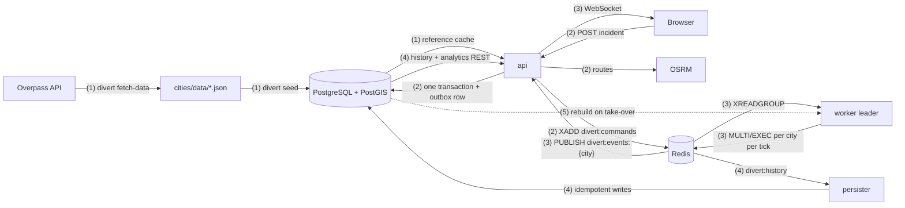
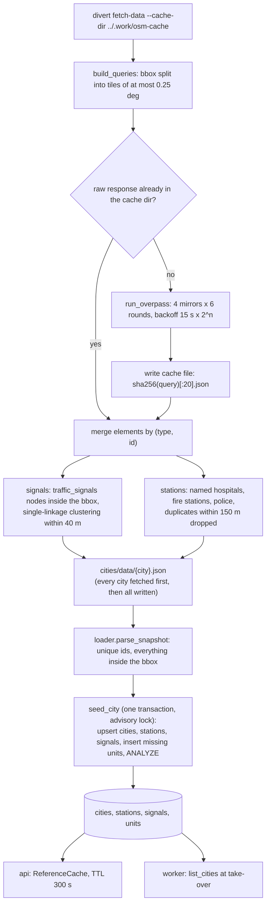
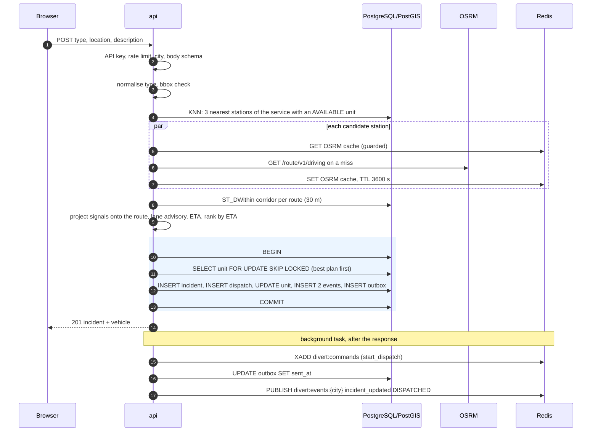
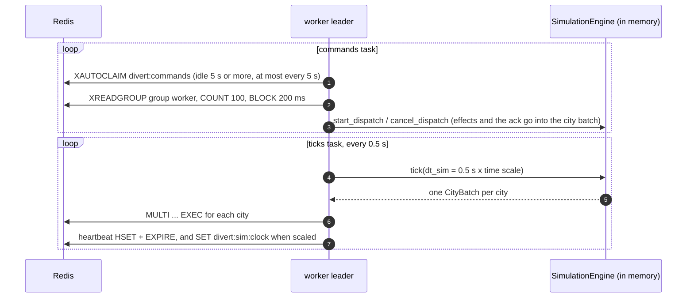
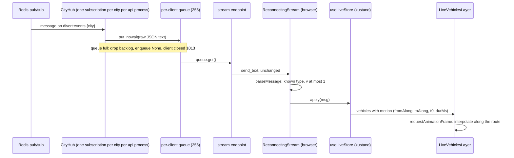
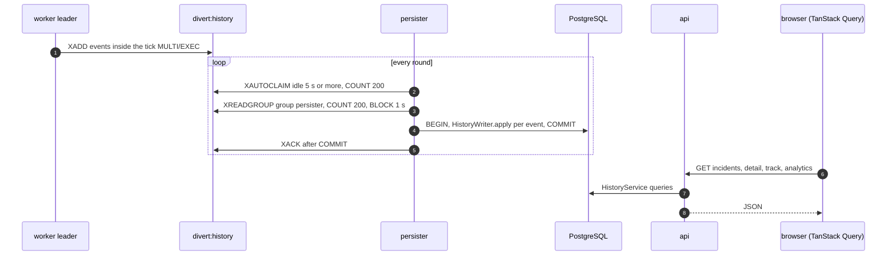
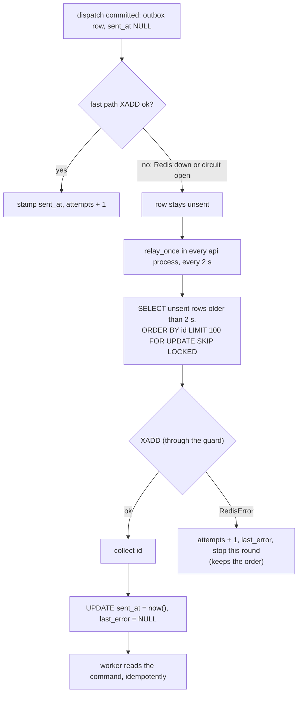
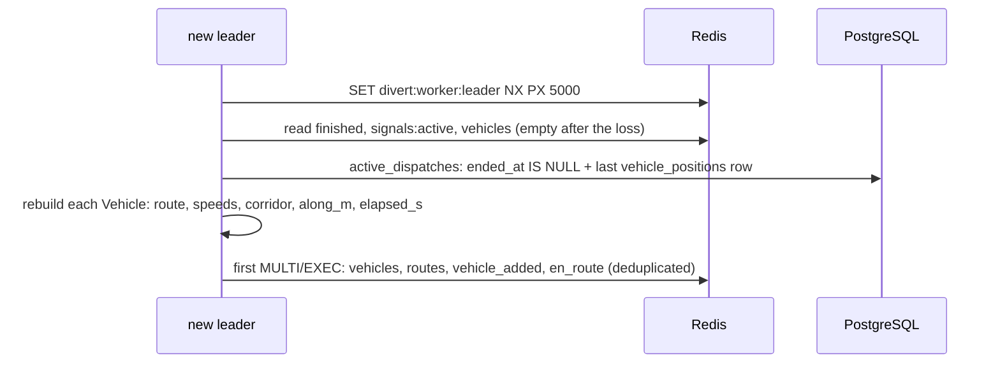
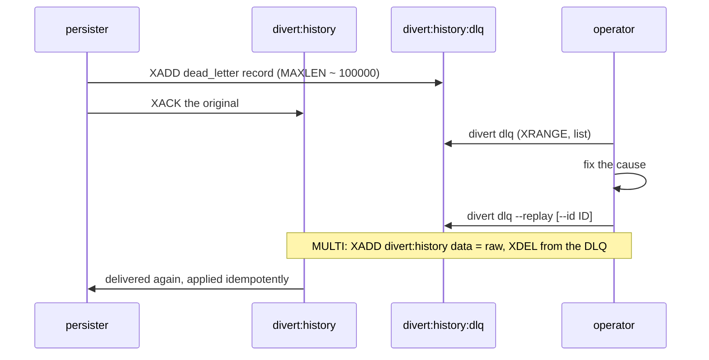

# 06 - Data flows

## What this covers

This page traces data through DIVERT hop by hop: what moves, where it goes, and how its
shape changes on the way. There are five flows:

1. reference data (OpenStreetMap to the in-process caches);
2. the incident write path (HTTP to one PostgreSQL transaction to the commands stream);
3. the live path (worker tick to the browser map);
4. the history path (history stream to the History and Analytics tabs);
5. the recovery flows (outbox relay, rebuild from PostgreSQL, DLQ replay).

The last sections list frequencies, batch sizes and retention limits, plus the known gaps.
Every number points to the code that sets it. For the step-by-step behaviour of each
process, including error branches, see [Runtime workflows](07-runtime-workflows.md). For
where each store fits, see [Data stores](05-data-stores.md).

**Conventions used on every hop**

| Rule | Where |
|---|---|
| Coordinates are always `[lat, lng]` (WGS84). Only the OSRM URL and GeoJSON use `lng,lat`. | `services/routing.py` `_coords`, `db/repositories/incidents.py` `geojson_to_latlng` |
| Every JSON message (command, history event, pub/sub, WebSocket) starts with `type` and `v` (schema version 1). | `store/events.py` `message`, `SCHEMA_VERSION` |
| Every Redis stream entry has exactly one field, `data`, holding the JSON text. | `store/streams.py` `FIELD`, `xadd_json` |
| `ts` fields are wall-clock ISO 8601 UTC. Durations (`elapsed_s`, `travel_s`, `scene_s`) are simulated seconds. | `services/simulation.py` `_iso`, `docs/simulation-model.md` section 8 |
| History events carry a deterministic `event_id` (the idempotency key in PostgreSQL), at most 64 chars. | `store/events.py` `event_id` |

## Overview

---

## 1. Reference data

Cities, stations, junction signals and units. This data changes only when someone runs
`divert fetch-data` (network) and then `divert seed`.

### Steps

1. **Tiling.** `cities/osm.py` `build_queries` splits each city bbox (`CITY_PROFILES`) into
   tiles of at most `TILE_DEG` = 0.25 degrees: Delhi 6, Bengaluru 4, Kolkata 1. Each tile
   query asks for `node["highway"="traffic_signals"]` (`out body`) and
   `nwr["amenity"="hospital"|"fire_station"|"police"]` (`out center`), with
   `[timeout:240]`.
2. **Mirrors and retries.** `run_overpass` POSTs to the four `OVERPASS_ENDPOINTS` in
   turn, for `rounds` = 6, sleeping `backoff_s` = 15 s x 2^attempt between rounds. A
   reply is accepted only if it has an `elements` list and no error or timeout `remark`.
   If every attempt fails it raises `OverpassError` and nothing is written.
3. **Cache.** With `--cache-dir`, `_cached_overpass` stores each raw reply as
   `<sha256(query)[:20]>.json` (`endpoint`, `payload`). A later run reuses a cached file
   instead of querying again. That makes long fetches resumable, but it also means
   **a cached query is never refreshed** until you delete its file (see
   [Engineering workflows](08-engineering-workflows.md#refreshing-osm-data)).
4. **Merge and filter.** `build_city` merges tile results by OSM `(type, id)`, so tile
   borders neither duplicate nor split elements, then drops anything outside the bbox.
5. **Junction clustering.** `cluster_signals` joins signal nodes within
   `CLUSTER_RADIUS_M` = 40 m (single linkage, grid accelerated). One junction gets the id
   `J<smallest member node id>`, the centroid position and the most common member name.
   All member node ids are kept.
6. **Station rules.** `extract_stations` maps `hospital` to AMBULANCE (prefix `H`, named
   hospitals only), `fire_station` to FIRE_ENGINE (`F`) and `police` to POLICE (`P`).
   Ways and relations use their Overpass centre. The same named facility within
   `_DUPLICATE_STATION_M` = 150 m is kept once. The id is prefix + first letter of the OSM
   type + OSM id, e.g. `Hn249132373`.
7. **Write.** If a city has no signals or no stations, the run fails. `fetch_cities`
   builds every requested city first, then writes all files (all or nothing per run).
8. **Validate.** `cities/loader.py` `parse_snapshot` rejects duplicate ids and any station,
   signal or centre outside the bbox (`SnapshotError`).
9. **Seed.** `cli.py` `seed_all` takes `pg_advisory_xact_lock(SEED_LOCK_KEY)` and calls
   `db/seed.py` `seed_city` per city in one transaction, then runs
   `ANALYZE cities, stations, units, signals`. See the seed rules below.
10. **Cache.** The api keeps a per-process `ReferenceCache` (`services/reference.py`) of
    `CityReference(city, stations, signals)` for `reference_cache_ttl_s` = 300 s, with one
    `asyncio.Lock` per city so a cold cache loads once. The worker does not use that
    cache: it loads cities with `ReferenceRepository.list_cities` at take-over, and
    reloads if a command names a configured city it has not loaded yet
    (`Worker._apply_command`).

**Unit availability is never cached.** KNN and `GET /api/v1/cities/{city}` read unit
status from PostgreSQL on every call (`ReferenceRepository.nearest_stations_with_free_units`,
`station_availability`).

### Seed rules (`db/seed.py` `seed_city`)

| Table | Natural key | On re-seed |
|---|---|---|
| `cities` | `id` | upsert every column, `data_meta` = the snapshot `meta` |
| `stations` | `(osm_type, osm_id)` | upsert; stations missing from the snapshot are set `active = false` (never deleted) and their AVAILABLE units become `OUT_OF_SERVICE` |
| `signals` | `id` (`J...`) | upsert; missing ones set `active = false` |
| `units` | `(station_id, ordinal)` | insert only the missing ones (`units_per_station` = 2 per active station); an existing unit's status is never reset |

### Payload at each hop

| Hop | Shape | Field names | Code |
|---|---|---|---|
| Overpass request | Overpass QL text, one per tile | `[out:json][timeout:240]`, `node["highway"="traffic_signals"](S,W,N,E)`, `nwr["amenity"="..."]`, `out center` | `cities/osm.py` `build_queries` |
| Overpass reply | JSON | `osm3s.timestamp_osm_base`, `elements[]`: `type`, `id`, `lat`, `lon`, `tags`, `center` | `run_overpass` |
| Cache file | JSON | `endpoint`, `payload` | `_cached_overpass` |
| Signal in snapshot | object | `id`, `name`, `pos`, `osm` (member node ids) | `cluster_signals` |
| Station in snapshot | object | `id`, `service`, `name`, `pos`, `osm` (`"node/123"`) | `extract_stations` |
| Snapshot file | JSON | `id`, `name`, `timezone`, `center`, `bbox` (`south`, `west`, `north`, `east`), `zoom`, `traffic` (`hourly_congestion` x24, `avg_junction_delay_s`), `meta` (`source`, `endpoints`, `queries`, `fetched_at`, `osm_base`, `licence`, `cluster_radius_m`, `counts`, `traffic_profile_note`), `stations[]`, `signals[]` | `build_city` |
| Domain objects | frozen dataclasses | `CitySnapshot(city, stations, signals, meta)` | `cities/loader.py` |
| `cities` row | table | `id`, `name`, `timezone`, `center`, `bbox_south`, `bbox_west`, `bbox_north`, `bbox_east`, `zoom`, `hourly_congestion`, `avg_junction_delay_s`, `data_meta` | `seed_city` |
| `stations` row | table | `id`, `city_id`, `service`, `name`, `osm_type`, `osm_id`, `geom`, `active` | `seed_city` |
| `signals` row | table | `id`, `city_id`, `name`, `geom`, `osm_node_ids`, `active` | `seed_city` |
| `units` row | table | `id` (callsign `AMB-`, `FIRE-` or `PCR-` + station id + `-n`), `station_id`, `city_id`, `service`, `ordinal` | `seed.callsign`, `CALLSIGN_PREFIX` |
| api cache | in memory | `CityReference(city, stations, signals)` | `services/reference.py` |
| REST to browser | JSON | `GET /api/v1/cities/{city}`: city summary, `traffic`, `stations[]` (`id`, `name`, `service`, `location`, `osm`, `total_units`, `free_units`), `signals[]` (`id`, `name`, `location`, `osm_node_ids`) | `api/v1/cities.py` `get_city` |

### Committed snapshot (from each file's `meta.counts`)

| City | Signal nodes | Junctions | Ambulance bases | Fire stations | Police stations | Tiles | `meta.fetched_at` |
|---|---|---|---|---|---|---|---|
| Delhi | 1,276 | 500 | 847 | 42 | 242 | 6 | 2026-11-16T20:41:07Z |
| Kolkata | 67 | 28 | 294 | 7 | 44 | 1 | 2026-11-16T20:34:27Z |
| Bengaluru | 1,385 | 576 | 1,086 | 22 | 134 | 4 | 2026-11-16T20:37:14Z |

Units are not OSM data. With `units_per_station` = 2 the seed creates about two units per
active station (derived, not measured).

**Not real data:** the `traffic` block (hourly congestion, average junction delay) is a
hand-set approximation (`cities/osm.py` module docstring, `meta.traffic_profile_note`).
The unit fleet is a modelling assumption. See [Domain rules](02-domain-rules.md).

---

## 2. Incident write path

From `POST /api/v1/cities/{city}/incidents` to a committed dispatch and a command on
`divert:commands`. The 201 never waits on Redis.

### Steps

1. **Edge checks** (FastAPI dependencies, in this order): API key `require_api_key`
   (`api/deps.py`), rate limit `rate_limit_mutations` (`api/ratelimit.py`), city lookup
   `get_city` (reference cache), body schema `IncidentCreate` (`schemas/incidents.py`).
2. **Normalise.** `DispatchService.create_incident` calls `normalize_incident_type`
   (strip, upper-case, aliases `HEALTH`/`AMBULANCE` -> MEDICAL, `POLICE` -> CRIME) and
   then `city.bbox.contains(location)`. The service is `SERVICE_FOR_INCIDENT[type]`.
3. **Sim clock.** `DispatchService.sim_clock` reads `divert:sim:clock` only when
   `sim_time_scale` != 1, through the guard; otherwise or on failure it uses wall time.
4. **KNN.** `ReferenceRepository.nearest_stations_with_free_units` returns up to
   `candidate_stations` = 3 active stations of the service that have an AVAILABLE unit,
   ordered by `geom <-> point` on the GiST index, with `ST_Distance` as `distance_m`.
5. **Routing.** `asyncio.gather` routes every candidate concurrently through
   `OsrmRouter.route` (`services/routing.py`): Redis cache, then OSRM with
   `osrm_timeout_s` = 8 s (connect at most 3 s) and `osrm_retries` = 2. `parse_osrm_route`
   turns the reply into a `Route`. A candidate that raises `RoutingError` is dropped.
6. **Corridor.** Per route, `ReferenceRepository.corridor_candidates` selects active
   signals with `ST_DWithin(signal.geom, route, corridor_m = 30)`, ordered by
   `ST_LineLocatePoint`. `build_corridor` then computes the exact `along_m` and `offset_m`
   (`project_onto_polyline`), the approach bearing 5 m before the junction
   (`APPROACH_LOOKBACK_M`) and the lane advisory (`lane_advisory`, maneuver within
   `LANE_MATCH_WINDOW_M` = 40 m).
7. **ETA and ranking.** `KinematicEtaModel.estimate` (`services/eta.py`) at the sim-clock
   hour. Plans sort by `(eta_s, distance_m, station id)`.
8. **Transaction** (`db/session.py` `transaction`): for each plan in order,
   `ReferenceRepository.lock_free_unit` locks one AVAILABLE unit of that station
   (`ORDER BY ordinal LIMIT 1 FOR UPDATE SKIP LOCKED`). The first plan that gets a unit
   wins. `IncidentRepository.create_dispatch` writes the rows below and returns the
   outbox id.
9. **After commit** (`DispatchService._after_commit`, a background task):
   `OutboxRelay.send_now` XADDs the command through the guard, then stamps
   `outbox.sent_at` in its own transaction. Then it publishes `incident_updated`.
   Failures are logged only; the relay retries unsent rows.

### Rows written in the one transaction

| Table | Rows | Values |
|---|---|---|
| `incidents` | 1 insert | `status` DISPATCHED, `type`, `reported_type` (raw, first 32 chars), `geom`, `description`, `reported_at` = `dispatched_at` = now |
| `dispatches` | 1 insert | `route` (LineString), `distance_m`, `predicted_eta_s`, `corridor` (JSONB), `segment_speeds_mps`, `eta_model` (`kinematic-v1`), `dispatched_at` |
| `units` | 1 update | `status` DISPATCHED, `current_dispatch_id`, `status_changed_at`, only `WHERE status = 'AVAILABLE'` |
| `incident_events` | 2 inserts | `rep:<incident hex>` type `reported`; `dsp:<dispatch hex>` type `dispatched` |
| `outbox` | 1 insert | `topic` = `commands`, `payload` = the start command, `sent_at` NULL |

The partial unique index `uq_dispatches_active_unit` (`db/models.py` `Dispatch`) backs up
the row lock: a unit can have only one dispatch with `ended_at IS NULL`.

### Payload at each hop

| # | Hop | Shape | Field names |
|---|---|---|---|
| 1 | Browser to api | HTTP JSON body | `type`, `location`, `description` (optional); headers `X-API-Key` (optional), `X-Request-ID` (optional) |
| 2 | Schema | `IncidentCreate` | `type` (max 32 chars), `location` (lat -90..90, lng -180..180), `description` (max 1000), unknown fields rejected |
| 3 | Normalised | enums | `IncidentType` (MEDICAL, FIRE, CRIME) and `ServiceType` (AMBULANCE, FIRE_ENGINE, POLICE) |
| 4 | KNN result | `StationCandidate` | `station`, `free_units`, `distance_m` |
| 5 | OSRM request | HTTP GET | `/route/v1/driving/{lng},{lat};{lng},{lat}` with `overview=full`, `geometries=geojson`, `steps=true`, `annotations=distance,duration,speed`, `alternatives=false` |
| 6 | Parsed route | `Route` | `points`, `cumulative`, `segment_speeds_mps`, `maneuvers`, `osrm_distance_m`, `osrm_duration_s` |
| 7 | Corridor | `CorridorCandidate` then `CorridorSignal` | `signal`, `offset_m`; then `signal_id`, `name`, `pos`, `along_m`, `offset_m`, `lane`, `approach_bearing` |
| 8 | Plan | `Plan` | `candidate`, `route`, `corridor`, `eta_s` |
| 9 | Command | `start_dispatch` JSON (`start_command`) | `type`, `v`, `command_id` (`start:<dispatch hex>`), `city`, `incident_id`, `dispatch_id`, `vehicle_id`, `station_id`, `service`, `incident_type`, `destination`, `route` (`points`, `segment_speeds_mps`, `distance_m`, `osrm_distance_m`, `osrm_duration_s`), `corridor[]`, `predicted_eta_s`, `created_at` |
| 10 | Stream entry | `XADD divert:commands MAXLEN ~ 100000` | field `data` = the command plus `outbox_id` (`services/outbox.py` `publish`) |
| 11 | Pub/sub | `incident_updated` | `city`, `incident_id`, `dispatch_id`, `vehicle_id`, `status` = DISPATCHED, `ts`, `incident` |
| 12 | Response | HTTP 201 JSON | `incident` (all incident fields), `vehicle` (`id`, `dispatch_id`, `service`, `status`, `station` (`id`, `name`, `location`, `straight_line_m`), `route`, `distance_m`, `eta_s`, `eta_model`, `corridor`) |

For the full field list and error bodies, see [../api.md](../api.md).

---

## 3. Live path

### 3a. Worker: commands in, one transaction per city per tick out

`Worker._lead` runs three tasks side by side: `renew`, `commands` and `ticks`. A command
changes engine memory at once, but nothing reaches Redis until the next tick writes it,
together with the command's XACK. See [Runtime workflows](07-runtime-workflows.md#2-one-simulation-tick).

**Order of operations inside one `MULTI/EXEC`** (`store/live.py` `write_city_batch`):

| Step | Commands | Purpose |
|---|---|---|
| 1. Deletions | `HDEL vehicles`, `DEL route:*`, `HDEL claims:*`, `DEL vclaims:*`, `HDEL signals:active` | vehicles and claims that ended |
| 2. Sets | `HSET vehicles`, `SET route:*`, `HSET claims:*`, `SADD vclaims:*` | one whole field or member per vehicle or claim |
| 3. Removals and state | `SREM vclaims:*`, `HSET signals:active`, `ZADD finished` + `ZREMRANGEBYSCORE` (older than 86,400 s), `HSET tick` | resolved signals, ended dispatches, tick counter |
| 4. Events and acks | `XADD divert:history MAXLEN ~ 1000000` per event, `XACK divert:commands worker` | history and acks commit with the state they describe |
| 5. Fan-out | `PUBLISH divert:events:{city}` per message, then the `tick` message | only sent if the transaction commits |

All per-city keys use the hash tag `{city}`, but the streams are global. That is why the
tick transaction needs a single-primary Redis (see Known gaps).

### Live keys written (payload)

| Key | Type | Value fields | Code |
|---|---|---|---|
| `divert:{city}:vehicles` | HASH, field = vehicle id | `id`, `dispatch_id`, `incident_id`, `city`, `service`, `station_id`, `incident_type`, `status`, `pos`, `heading`, `along_m`, `distance_m`, `speed_mps`, `eta_s`, `predicted_eta_s`, `elapsed_s`, `scene_s`, `travel_s`, `preempted_passed`, `passed`, `samples`, `started_at`, `destination`, `claims` | `Vehicle.live_json` |
| `divert:{city}:route:{vehicle}` | STRING | `dispatch_id`, `route` (as in the command), `corridor`, `destination` | `Vehicle.route_json` |
| `divert:{city}:claims:{signal}` | HASH, field = vehicle id | `signal_id`, `vehicle_id`, `dispatch_id`, `service`, `event_id`, `state`, `eta_s`, `eta_at_claim_s`, `lane`, `approach_bearing`, `pos`, `claimed_at`, `conflicts` | `Claim.to_json` |
| `divert:{city}:vclaims:{vehicle}` | SET | signal ids the vehicle holds | `write_city_batch` |
| `divert:{city}:signals:active` | HASH, field = signal id | `signal_id`, `state`, `pos`, `vehicle_id`, `service`, `lane`, `approach_bearing`, `eta_s`, `claimants[]` (`vehicle_id`, `service`, `eta_s`, `state`) | `SimulationEngine._resolve_city` |
| `divert:{city}:tick` | HASH | `tick`, `sim_ts`, `wall_ts` | `write_city_batch` |
| `divert:{city}:finished` | ZSET | dispatch id, score = wall time it ended | `write_city_batch` |
| `divert:worker:heartbeat` | HASH, EXPIRE 3600 s | `instance`, `ts`, `tick`, `vehicles`, `sim_ts`, `leader_since` | `Worker._heartbeat` |
| `divert:sim:clock` | STRING | sim epoch seconds (only when `sim_time_scale` != 1) | `Worker._heartbeat` |

### 3b. API to browser

1. `api/ws_hub.py` `CityHub._reader` keeps one pub/sub subscription per city per api
   process and fans every message out to bounded queues (`ws_queue_size` = 256). The api
   never parses these messages; it forwards the JSON text as is.
2. `api/v1/stream.py` sends a `snapshot` first, built from Redis **after** subscribing, so
   nothing published in between is lost. Then it forwards the queue.
3. `frontend/src/api/stream.ts` `ReconnectingStream` drops unknown types and messages with
   `v` greater than `STREAM_SCHEMA_VERSION`.
4. `frontend/src/store/live.ts` `useLiveStore.apply` changes the store:
   - `snapshot` replaces vehicles and signals;
   - `tick` replaces the vehicle set and the signal set, and gives each vehicle a
     `motion` from its drawn position to the new `along_m`. The expected tick interval
     is smoothed (0.7 old + 0.3 measured) and clamped to 150..2000 ms. A backward jump of
     more than 1 m, or a new dispatch id, snaps instead of animating;
   - `vehicle_added` adds the route, corridor and destination;
   - `vehicle_removed` deletes the vehicle;
   - `incident_updated` records the status in `incidentStatus` and the activity feed
     (40 items).
   Messages for another city are ignored.
5. `frontend/src/features/map/LiveVehiclesLayer.tsx` draws vehicles imperatively. A
   `requestAnimationFrame` loop places each vehicle along its route by cumulative
   haversine distance (`frontend/src/lib/geo.ts`), so React does not re-render at 60 fps.
6. `frontend/src/api/useCityStream.ts` reacts to messages: on `incident_updated` or
   `vehicle_removed` it invalidates the incidents, city and analytics queries (debounced
   700 ms). On `tick` or `snapshot` it fetches routes for vehicles that have none, via
   `GET /vehicles?include_route=true` (cooldown 5 s).

### WebSocket messages (payload)

| `type` | Producer | Field names |
|---|---|---|
| `snapshot` | api `build_snapshot` | `city`, `tick`, `sim_ts`, `vehicles[]` (the `PUBLIC_FIELDS` of `api/v1/vehicles.py` plus `route` points and `corridor`), `signals[]` |
| `tick` | worker `SimulationEngine.tick` | `city`, `tick`, `sim_ts`, `ts`, `vehicles[]` (`id`, `dispatch_id`, `incident_id`, `service`, `status`, `pos`, `heading`, `speed_mps`, `eta_s`, `along_m`, `distance_m`, `preempted_passed`), `signals[]` (the complete non-NORMAL set) |
| `vehicle_added` | worker `SimulationEngine._announce` | `city`, `vehicle` (tick fields + `station_id`, `incident_type`, `predicted_eta_s`, `started_at`), `route` (points), `corridor`, `destination` |
| `vehicle_removed` | worker `SimulationEngine._end` | `city`, `vehicle_id`, `dispatch_id`, `incident_id`, `reason` (`cleared`, `cancelled`, `failed`) |
| `incident_updated` | worker (`EN_ROUTE`, `ON_SCENE`, `RESOLVED`, `CANCELLED`, `FAILED`) and api (`DISPATCHED`, `CANCELLED`) | `city`, `incident_id`, `status`, `ts`; worker adds `dispatch_id`, `vehicle_id` and one of `eta_s`, `travel_s`, `reason`; api adds `incident` (the API's DISPATCHED message also has `dispatch_id` and `vehicle_id`) |
| `pong` | api `_receive` | none (reply to the client's `{"type": "ping"}`) |

A `tick` is published only for a city that has vehicles, plus one final tick when its
last vehicle or signal is removed (`SimulationEngine.tick`). The tick number is one
engine-wide counter, so per city it is monotonic but not dense.

---

## 4. History path

1. The worker appends events in the tick transaction (section 3a step 4).
2. `persister.py` `Persister.process_once` takes stale pending messages with XAUTOCLAIM
   (`persister_retry_idle_ms` = 5000) and new ones with XREADGROUP (`persister_batch` =
   200, `persister_block_ms` = 1000, blocking only if nothing was reclaimed).
3. The batch is applied in one transaction by `db/repositories/history.py`
   `HistoryWriter.apply`, then acked. If the batch fails, each message is retried alone,
   and poison messages go to the DLQ (section 5c and
   [Runtime workflows](07-runtime-workflows.md#9-persister)).
4. Reads: `services/history.py` `HistoryService` wraps
   `db/repositories/incidents.py` and `db/repositories/analytics.py`.

### History events and their PostgreSQL effect

Every event has the envelope `type`, `v`, `event_id`, `ts`, `city`, `incident_id`,
`dispatch_id`, `vehicle_id`. Every event except `vehicle_position` is also inserted into
`incident_events` (`ON CONFLICT (event_id) DO NOTHING`); its `payload` is the event minus
`type`, `v`, `event_id`, `ts`, `city`, `incident_id`, `dispatch_id` (`_ENVELOPE`). If that
insert is a duplicate, the event's other effects are skipped too.

| Event (`event_id` format) | Extra fields | PostgreSQL effect |
|---|---|---|
| `en_route` (`enr:<dispatch>`) | `station_id`, `service`, `predicted_eta_s`, `distance_m` | incident EN_ROUTE, `en_route_at` |
| `vehicle_position` (`pos:<dispatch>:<n>`) | `pos`, `speed_mps`, `along_m`, `elapsed_s`, `sample` | `vehicle_positions` row keyed by `(dispatch_id, ts)`, including `elapsed_s` (migration 0003) |
| `preemption_claimed` (`clm:<dispatch>:<signal>`) | `signal_id`, `claim_event_id`, `state`, `lane`, `approach_bearing`, `eta_at_claim_s`, `claimed_at`, `eta_s` | `signal_preemptions` row keyed by `claim_event_id` |
| `preemption_conflict` (`cfl:<dispatch>:<signal>:<n>`) | claim fields + `winner`, `eta_s` | that row's `state` = CONFLICT |
| `preemption_released` (`rel:<dispatch>:<signal>`) | claim fields + `released_at`, `reason` | that row's `released_at` (earliest kept; inserted with the claim data if missing) |
| `arrived` (`arr:<dispatch>`) | `pos`, `travel_s`, `predicted_eta_s`, `est_time_saved_s`, `preempted_passed` | dispatch `arrived_at`, `actual_travel_s`, `est_time_saved_s`; incident ON_SCENE; unit ON_SCENE if still DISPATCHED on this dispatch |
| `cleared` (`clr:<dispatch>`) | `scene_s` | dispatch `ended_at`, `end_reason` CLEARED; incident RESOLVED; unit AVAILABLE if still on this dispatch |
| `cancelled` (`cxl:<dispatch>`) | `reason` | dispatch ended CANCELLED; incident CANCELLED; unit AVAILABLE |
| `failed` (`fail:<dispatch>`) | `reason` | dispatch ended FAILED; incident FAILED + `failure_reason`; unit AVAILABLE |

Dispatch and signal UUIDs appear without hyphens in event ids. Status updates only move
forward (`_FORWARD_FROM`) and never leave a terminal status, and timestamps use
`COALESCE`, so replays and out-of-order retries change nothing.

### Read side (PostgreSQL to the History and Analytics tabs)

| Endpoint | Tables read | Frontend hook (`frontend/src/api/queries.ts`) | Where shown |
|---|---|---|---|
| `GET /api/v1/cities/{city}/incidents` (status, type, from, to, limit 1..200, keyset `cursor`) | `incidents` | `useIncidentHistory` (`useInfiniteQuery`, `next_cursor`); `useRecentIncidents` (limit 30, refetch 30 s) | History table; Live incidents panel |
| `GET /api/v1/incidents/{id}` | `incidents`, `dispatches` + `stations`, `signal_preemptions`, `incident_events` | `useIncidentDetail` | History detail drawer |
| `GET /api/v1/incidents/{id}/track?max_points=` | `vehicle_positions` (evenly thinned) | `useTrack` (`max_points` 1000) | Track replay |
| `GET /api/v1/cities/{city}/analytics/summary?from=&to=` (default last 24 h, at most 366 days) | `incidents`, `dispatches`, `signal_preemptions` | `useAnalytics` (stale 15 s) and `useQueries` for every city | Analytics tab |

The default TanStack Query settings (`frontend/src/app/queryClient.ts`): `staleTime`
10 s, no refetch on window focus, up to 2 retries except for 4xx answers. Response
times in analytics use simulated travel time, so they stay meaningful at any time scale
(`db/repositories/analytics.py` module docstring). Field-level detail: [../api.md](../api.md).

---

## 5. Recovery flows

### 5a. Outbox relay after a Redis outage

The row is the source of truth; delivery is at least once. A duplicate start is only
acked (`SimulationEngine.start_dispatch` checks `finished` and `find_dispatch`). Code:
`services/outbox.py` `OutboxRelay.relay_once`; started per api process in `main.py`
`lifespan`. Details: [Runtime workflows](07-runtime-workflows.md#8-outbox-relay).

### 5b. Redis lost its data: the next leader rebuilds from PostgreSQL

What feeds the rebuild (`db/repositories/history.py` `active_dispatches`,
`worker.py` `Worker._vehicle_from_pg`):

| PostgreSQL source | Becomes |
|---|---|
| `dispatches.route` (GeoJSON) + `segment_speeds_mps` (migration 0002) | `Route.build(points, speeds)` |
| `dispatches.corridor` | `CorridorSignal` list, sorted by `along_m` |
| last `vehicle_positions.along_m` | `along_m` (capped at the route length) |
| last `vehicle_positions.elapsed_s` (migration 0003) | `elapsed_s`; falls back to (last `ts` - `dispatched_at`) x time scale when NULL |
| `arrived_at`, `actual_travel_s` | ON_SCENE vehicle with `travel_s`; `scene_s` = wall time since arrival x scale, capped at `scene_time_s` |
| corridor signals more than 20 m behind | `passed` |
| `elapsed_s` / `position_sample_s` | `samples` counter, so position event ids continue |

### 5c. DLQ replay

DLQ record fields (`store/streams.py` `dead_letter`): `type` = `dead_letter`, `v`,
`source_stream`, `source_id`, `reason` (max 2000 chars), `deliveries`, `dead_at`, `raw`
(the original `data` text). Replay is in `cli.py` `dead_letters`.

---

## 6. Frequencies, batch sizes and volumes

All values are defaults from `backend/src/divert/config.py` `Settings` unless another
symbol is named. Override with `DIVERT_<NAME>` (see [Configuration](11-configuration.md)).

| What | Value | Code |
|---|---|---|
| Tick interval (wall) | 0.5 s (`sim_tick_s`, max 5) | `Worker._lead.ticks` |
| Simulated seconds per tick | `sim_tick_s` x `sim_time_scale` (scale 1, max 100) | `Worker.tick_once` |
| Position sample | every 5 simulated s per moving vehicle (`position_sample_s`), at most one per tick | `SimulationEngine._sample` |
| Tick transactions | one `MULTI/EXEC` per city per tick that has something to write | `Worker._flush` |
| Heartbeat | every tick; key expires after 3600 s | `Worker._heartbeat` |
| Lease TTL / renewal / local validity | 5000 ms / every TTL/3 (about 1.67 s) / TTL - TTL/5 = 4 s | `leader_lock_ttl_ms`, `LeaderLock.margin_s` |
| Standby retry | every TTL/3 | `Worker.run` |
| Command read | `COUNT 100`, `BLOCK 200 ms` (`command_block_ms`) | `Worker.process_commands` |
| Command reclaim | XAUTOCLAIM, idle at least 5000 ms, at most every 5 s | `Worker.process_commands` |
| Outbox relay | every 2 s, rows older than 2 s, 100 rows per round | `outbox_relay_interval_s`, `outbox_relay_min_age_s`, `OutboxRelay(batch=100)` |
| Persister batch | 200 messages, block 1000 ms, reclaim after 5000 ms idle | `persister_batch`, `persister_block_ms`, `persister_retry_idle_ms` |
| DLQ threshold | 5 deliveries, or immediately for a schema violation (`BadEvent`) | `persister_max_retries` |
| Retention sweep | every 3600 s; deletes in batches of 10,000 | `retention_interval_s`, `prune_positions`, `prune_outbox` |
| Position retention | 30 days | `position_retention_days` |
| Relayed outbox retention | 7 days | `outbox_retention_days` |
| `divert:commands` trim | `MAXLEN ~ 100000` | `STREAM_COMMANDS_MAXLEN` |
| `divert:history` trim | `MAXLEN ~ 1000000` | `STREAM_HISTORY_MAXLEN` |
| `divert:history:dlq` trim | `MAXLEN ~ 100000` | `streams.dead_letter` |
| Finished-dispatch ZSET | entries older than 86,400 s removed | `finished_dispatch_ttl_s` |
| OSRM cache TTL | 3600 s | `osrm_cache_ttl_s` |
| Reference cache TTL | 300 s per api process | `reference_cache_ttl_s` |
| Rate-limit window | 60 s, key TTL 120 s, 60 mutations per minute | `api/ratelimit.py` `WINDOW_S`, `rate_limit_per_min` |
| WebSocket queue / clients | 256 messages per client / 500 clients per city per process | `ws_queue_size`, `ws_max_clients_per_city` |
| Browser ping | every 20 s | `frontend/src/config.ts` `config.ws.pingIntervalMs` |
| Browser reconnect | 0.5 s to 15 s, exponential with jitter | `frontend/src/api/stream.ts` `backoffDelay` |
| `/readyz` poll in the UI | every 10 s | `frontend/src/api/queries.ts` `useReady` |

**Derived volumes** (arithmetic from the values above, not measurements):

- Per moving vehicle at time scale 1: 2 live-state writes per second and 1 position
  event every 5 s (0.2 per second). At time scale 10, a tick covers 5 simulated seconds,
  so every tick emits a position event (2 per second).
- The history stream trims at about 1,000,000 entries. With 50 moving vehicles at scale 1
  (about 10 position events per second), that is roughly 28 hours of backlog before
  trimming starts. See Known gaps.
- A vehicle spends `scene_time_s` = 120 simulated seconds ON_SCENE: 2 minutes at scale 1,
  12 seconds at scale 10.

---

## 7. Known gaps and caveats

| Gap | Effect | Source |
|---|---|---|
| **Redis Cluster is not supported.** | The tick `MULTI/EXEC` touches the per-city keys and the global `divert:history` and `divert:commands` streams. Moving to Cluster would need per-city streams. | `store/live.py` module docstring, `docs/architecture.md` section 9 |
| **One leader simulates every city.** | One process ticks all cities; sharding by city is a future option only. | `worker.py`, `docs/architecture.md` section 9 |
| **No fencing tokens on the leader lease.** | A paused leader may overlap briefly with the next one. Whole-field writes and deterministic event ids limit the damage. | `store/locks.py` module docstring |
| **History can be trimmed before it is persisted** (derived from code, not stated in the docs). | `XADD ... MAXLEN ~` drops the oldest entries even if the persister has not read them; trimmed pending entries are skipped (`read_group`, `autoclaim`). A persister outage longer than the stream holds loses those events. | `store/redis_store.py` `STREAM_HISTORY_MAXLEN`, `store/streams.py` |
| Scene time is not sampled. | After a rebuild from PostgreSQL, `scene_s` is estimated from wall time (an upper bound). | `Worker._vehicle_from_pg` |
| `est_time_saved_s` is an estimate. | Pre-empted junctions passed x the city's average junction delay. | `SimulationEngine._arrive` |
| Traffic profiles and the unit fleet are not measured data. | ETAs are relative, not calibrated. | `cities/osm.py` docstring, `docs/data-sources.md` |
| Default map tiles are OpenStreetMap's public tiles, for development only. | Production needs a keyed or self-hosted tile source. | `frontend/src/config.ts`, `.env.example` |

## Related

- [Architecture](03-architecture.md)
- [Decisions](04-decisions.md)
- [Data stores](05-data-stores.md)
- [Runtime workflows](07-runtime-workflows.md)
- [Engineering workflows](08-engineering-workflows.md)
- [Backend codebase](09-codebase-backend.md)
- [Frontend codebase](10-codebase-frontend.md)
- [Configuration](11-configuration.md)
- [Glossary](12-glossary.md)
- [../api.md](../api.md), [../data-model.md](../data-model.md), [../data-sources.md](../data-sources.md), [../simulation-model.md](../simulation-model.md)
