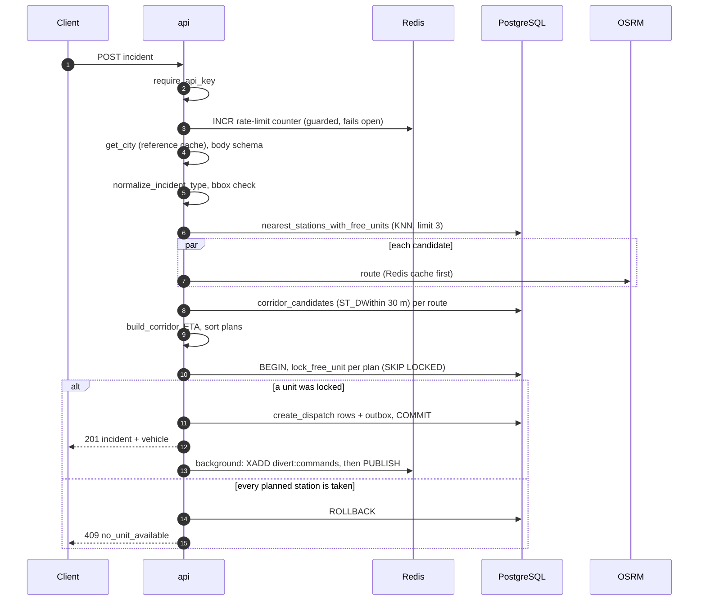
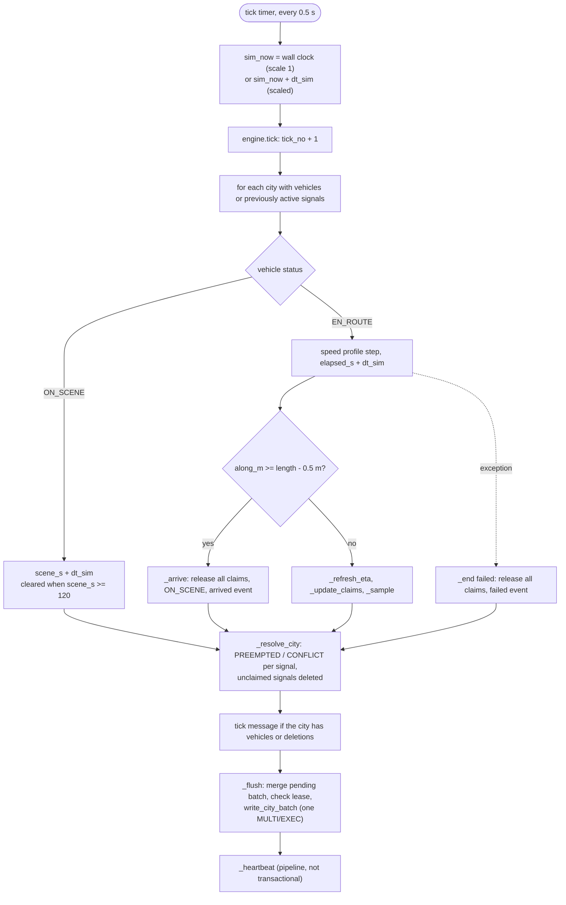
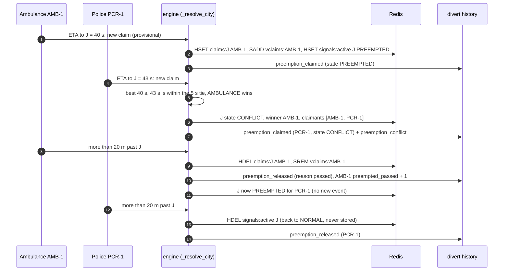
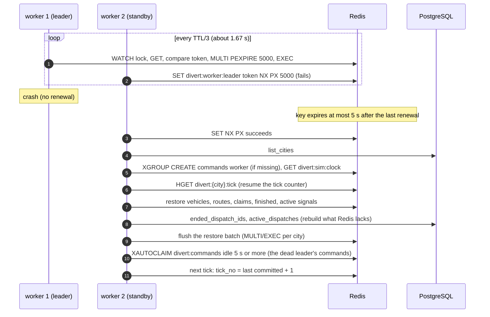
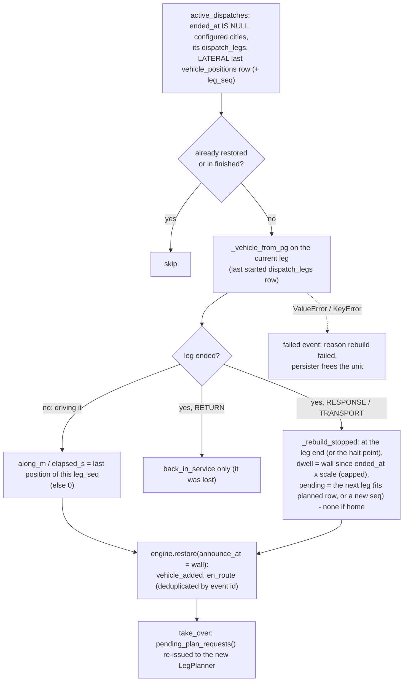
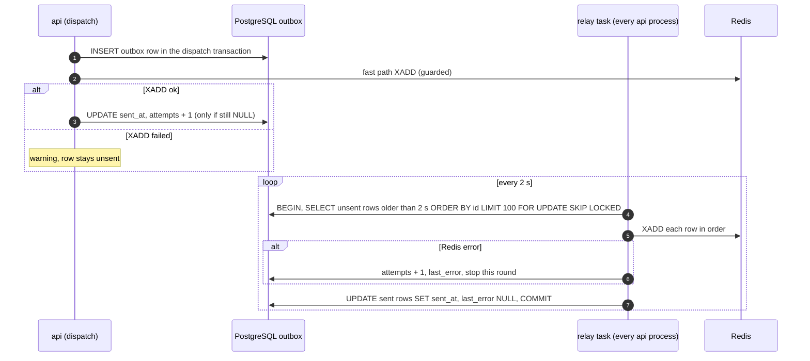
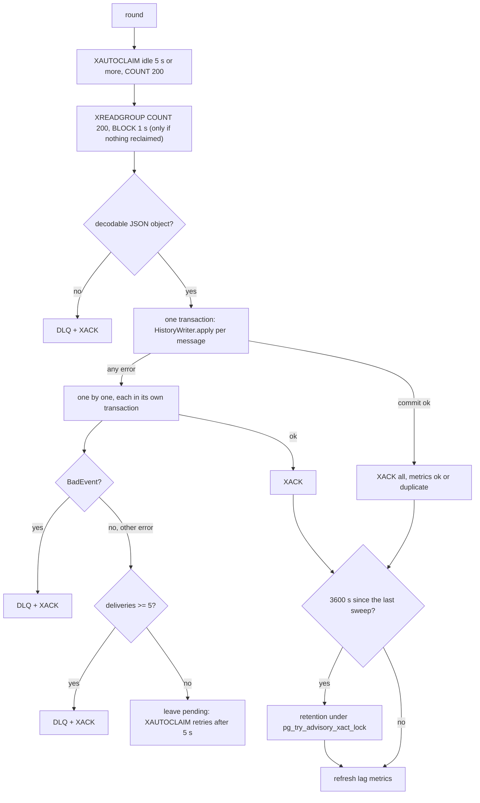
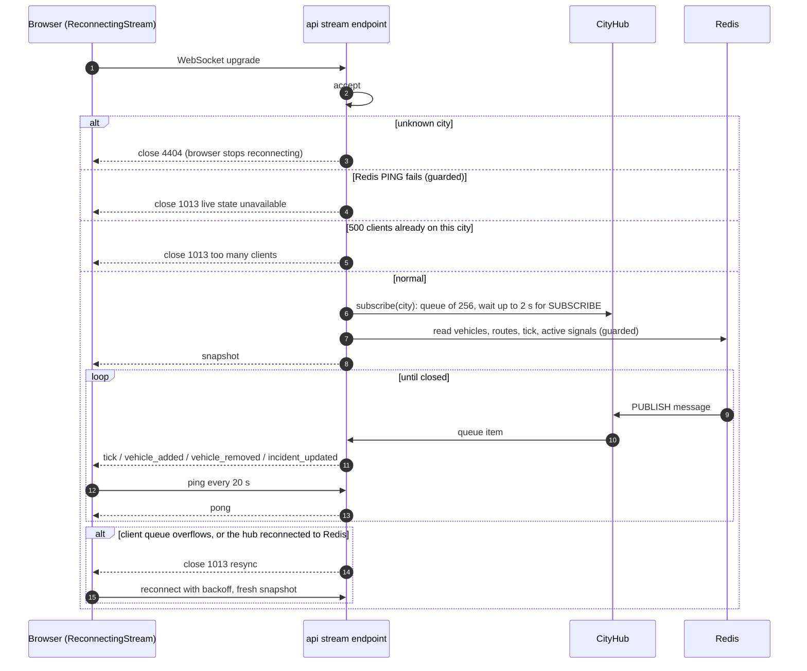
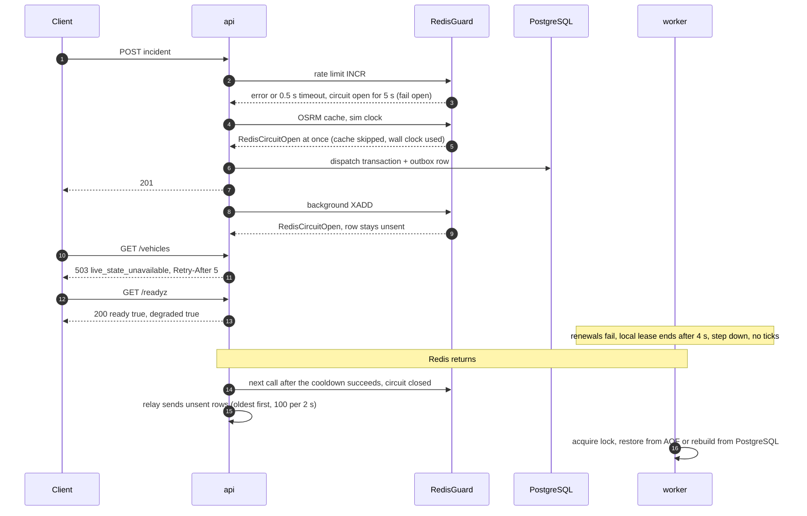

# 07 - Runtime workflows

## What this covers

This page describes, step by step, what the running system does: dispatching an incident,
one simulation tick, signal pre-emption, arrival, cancel, leader election and failover,
the rebuild from PostgreSQL, the outbox relay, the persister, a WebSocket session, and
the behaviour while Redis is down. Each workflow has a sequence diagram, code pointers
(path plus function) and its error branches. Paths are relative to
`backend/src/divert/` unless they start with `frontend/`. For how the data changes shape
between hops, see [Data flows](06-data-flows.md). For the rules themselves (thresholds,
priorities), see [Domain rules](02-domain-rules.md).

| # | Workflow | Main code |
|---|---|---|
| 1 | [Create incident / dispatch](#1-create-incident--dispatch) | `services/dispatch.py` `DispatchService.create_incident` |
| 2 | [One simulation tick](#2-one-simulation-tick) | `worker.py` `Worker.tick_once`, `services/simulation.py` `SimulationEngine.tick` |
| 3 | [Pre-emption](#3-pre-emption-claim-conflict-release) | `services/simulation.py`, `services/preemption.py` |
| 4 | [Arrival, dwell, next leg, back in service](#4-arrival-dwell-next-leg-back-in-service) | `SimulationEngine._leg_arrived`, `_dwell`, `_start_leg`, `_finish` |
| 5 | [Cancel](#5-cancel) | `DispatchService.cancel_incident`, `SimulationEngine.cancel_dispatch` |
| 6 | [Leader election and failover](#6-leader-election-and-failover) | `worker.py` `Worker.run`, `store/locks.py` `LeaderLock` |
| 7 | [Rebuild from PostgreSQL](#7-rebuild-from-postgresql) | `Worker._rebuild_from_pg`, `_vehicle_from_pg` |
| 8 | [Outbox relay](#8-outbox-relay) | `services/outbox.py` `OutboxRelay` |
| 9 | [Persister](#9-persister) | `persister.py` `Persister` |
| 10 | [WebSocket session](#10-websocket-session) | `api/v1/stream.py`, `api/ws_hub.py`, `frontend/src/api/stream.ts` |
| 11 | [Behaviour while Redis is down](#11-behaviour-while-redis-is-down) | `store/guard.py` `RedisGuard` |
| 12 | [Leg planning and re-routing](#12-leg-planning-and-re-routing) | `services/planner.py` `LegPlanner`, `SimulationEngine.apply_leg_planned` / `apply_route_replaced` |

---

## 1. Create incident / dispatch

`POST /api/v1/cities/{city}/incidents` with `{"type", "location": [lat, lng], "description"?}`.



### Steps

1. **API key.** `api/deps.py` `require_api_key`: enforced only when `DIVERT_API_KEY` is
   set; compares `X-API-Key` with `hmac.compare_digest`.
2. **Rate limit.** `api/ratelimit.py` `rate_limit_mutations`: fixed 60 s window
   (`WINDOW_S`), `rate_limit_per_min` = 60, keyed by the `X-API-Key` value if sent, else
   the client address (`X-Forwarded-For` only if `trust_proxy_headers`). Redis
   `INCR` + `EXPIRE 120` in one transaction. **Fails open** on any Redis error.
3. **City.** `api/deps.py` `get_city`: must be in `DIVERT_CITIES` and in the reference
   cache (`services/reference.py` `ReferenceCache.city`, PostgreSQL on a cache miss).
4. **Body schema.** `schemas/incidents.py` `IncidentCreate`.
5. **Type, then bbox.** `DispatchService.create_incident`: `normalize_incident_type`
   (`domain/enums.py`), then `city.bbox.contains(location)`. Nothing is created before
   these pass (regression guarantee 1).
6. **Plans.** `DispatchService._plans`: KNN (`candidate_stations` = 3), concurrent OSRM
   routes (`services/routing.py` `OsrmRouter.route`), corridor per route, ETA at the
   sim-clock hour (`DispatchService.sim_clock`), sort by `(eta_s, distance_m, station id)`.
7. **Transaction.** `DispatchService._dispatch`: `ReferenceRepository.lock_free_unit` per
   plan in ETA order (next-best station when the best one's units were just taken), then
   `IncidentRepository.create_dispatch`.
8. **Response.** 201 with `incident` and `vehicle` (route, ETA, corridor).
9. **After commit** (background, `DispatchService._after_commit`): `OutboxRelay.send_now`
   (XADD + stamp `sent_at`), then PUBLISH `incident_updated` DISPATCHED. The response
   never waits for this.
10. **Worker.** Reads the command, starts the vehicle; the next tick writes it (workflow 2).

### Error branches

Checks run in the order above. FastAPI resolves the route dependencies (`MUTATING` in
`api/v1/incidents.py`: API key, then rate limit) before the endpoint's own parameters.

| HTTP | `error.code` | Trigger | Raised in | What is written |
|---|---|---|---|---|
| 401 | `unauthorized` | `DIVERT_API_KEY` set; header missing or wrong | `require_api_key` | nothing |
| 429 | `rate_limited` | more than 60 mutations in the current minute; `Retry-After` header and `details.retry_after_s` | `rate_limit_mutations` | only the Redis counter `divert:rl:mutate:<digest>:<window>` |
| 404 | `city_not_found` | city not configured or not seeded | `get_city` | nothing |
| 422 | `validation_error` | path not matching `^[a-z0-9_-]{1,32}$`; unknown body field; `type` over 32 chars; `location` out of range; `description` over 1000 chars | FastAPI, `api/errors.py` `_validation` | nothing |
| 422 | `invalid_incident` | unknown type (`details.valid_types`) or point outside the city bbox (`details.bbox`) | `DispatchService.create_incident` | nothing (metric only) |
| 409 | `no_unit_available` | (a) KNN finds no station of the service with an AVAILABLE unit, before any routing; (b) inside the transaction every planned station's units are locked or taken | `_plans` / `_dispatch` | nothing; (b) rolls back |
| 503 | `routing_unavailable` | every candidate raised `RoutingError`: transport error, HTTP 429/500/502/503/504 after `osrm_retries` = 2, `NoRoute`, bad JSON. `details.errors` lists up to 5 | `_plans` | nothing |
| 500 | `internal_error` | anything unexpected: PostgreSQL unreachable, a non-routing exception from a route call, or `RuntimeError` if the locked unit was not AVAILABLE | `api/errors.py` `_unhandled` | nothing; the transaction rolls back |
| 201 | none | success, also while Redis is down | | rows + outbox row; XADD and PUBLISH happen later (or via the relay) |

Notes:

- The OSRM retry backoff is 0.25 s x 2^(attempt-1) x (1 + random) (`OsrmRouter._fetch`).
  Only replies with code `Ok` are cached.
- `docs/api.md` says validation happens "before any database, routing or Redis access".
  That holds inside `DispatchService`, but at the HTTP layer the rate limiter (Redis) and
  the city lookup (reference cache, PostgreSQL on a miss) run first.
- There is no PostgreSQL-specific error handler, so a database outage gives
  `500 internal_error`.

---

## 2. One simulation tick

The worker leader runs `ticks()` inside `Worker._lead` every `sim_tick_s` = 0.5 s.



### Steps

1. **Schedule.** `ticks()` keeps a fixed schedule (`next_at += period`). If a tick runs
   late, it counts `divert_tick_overruns_total` and restarts the schedule from now (no
   burst of catch-up ticks).
2. **Clock.** `Worker.tick_once`: `dt_sim = sim_tick_s x sim_time_scale`. At scale 1 the
   sim clock is the wall clock; otherwise it advances by `dt_sim` per tick.
3. **Advance.** `SimulationEngine.tick` increments the engine-wide `tick_no`, then calls
   `_advance` for each vehicle:
   - ON_SCENE: `scene_s += dt`; at `scene_time_s` = 120 it calls `_end(..., "cleared")`.
   - EN_ROUTE: `_motion_profile` (rebuilt when the congestion factor or the set of
     signals PREEMPTED for this vehicle changes), `SpeedProfile.step`, `elapsed_s += dt`.
     Arrival when `along_m >= length - ARRIVAL_TOLERANCE_M` (0.5 m,
     `services/speed_model.py`). Otherwise `_refresh_eta` (ETA to the destination and to
     each corridor signal ahead), `_update_claims`, `_sample` (position event every 5
     simulated seconds), and the vehicle's live JSON.
4. **Resolve.** `_resolve_city` resolves every claimed signal (workflow 3) and deletes
   active signals nobody claims any more.
5. **Tick message.** Built only if the city has vehicles, or has signal or vehicle
   deletions this tick.
6. **Write.** `Worker._flush`, per city: merge any batch left from a failed write
   (`store/live.py` `merge_batches`), raise `LeadershipLost` if the local lease is no
   longer valid, then `write_city_batch`: one `MULTI/EXEC` with state, history events,
   command acks and pub/sub (order in [Data flows](06-data-flows.md#3a-worker-commands-in-one-transaction-per-city-per-tick-out)).
7. **Heartbeat.** `Worker._heartbeat`: `HSET divert:worker:heartbeat` + `EXPIRE 3600`,
   plus `SET divert:sim:clock` when scaled.
8. **Metrics.** `divert_tick_duration_seconds`, `divert_active_vehicles{city}`,
   `divert_active_signals{city}`, `divert_history_events_total{type}`,
   `divert_preemptions_total`, `divert_preemption_conflicts_total`.

### Error branches

| Failure | What happens | Code |
|---|---|---|
| Exception while stepping one vehicle | That vehicle ends FAILED (`reason` = `simulation error: ...`), all its claims are released; other vehicles carry on | `SimulationEngine.tick` |
| ETA not finite or negative | `ValueError` in `_refresh_eta`, handled as above | `_refresh_eta` |
| Redis write fails | The whole batch is kept and merged into the next tick's write; nothing is half-applied | `Worker._flush` |
| Local lease expired | `LeadershipLost`: the worker steps down and drops its memory (workflow 6) | `Worker._flush` |
| Heartbeat write fails | Warning only; `/readyz` reports the worker `stale` after 10 s | `Worker._heartbeat` |
| Tick overrun | Counted; next tick runs immediately | `Worker._lead.ticks` |

---

## 3. Pre-emption: claim, conflict, release

Claims belong to a vehicle id, never to a vehicle type. Rules are in
`services/preemption.py` `PreemptionRules` (defaults from `config.py`):

| Rule | Value | Setting |
|---|---|---|
| Claim when the ETA to the signal is at most | 45 s | `preempt_lead_s` |
| or the signal is at most this far ahead along the route | 600 m | `preempt_distance_m` |
| Release when the vehicle is more than this far past the signal | 20 m | `preempt_release_past_m` |
| ETAs within this window of the best count as a tie | 5 s | `conflict_tie_s` |
| Tie break | AMBULANCE > FIRE_ENGINE > POLICE, then vehicle id | `domain/enums.py` `SERVICE_PRIORITY` |
| Junction speed cap: pre-empted for this vehicle / otherwise | 35 km/h / 15 km/h | `services/speed_model.py` `JUNCTION_PREEMPTED_MPS`, `JUNCTION_NORMAL_MPS` |



### Steps

1. **Claim.** `SimulationEngine._update_claims` checks each corridor signal not yet
   passed. `PreemptionRules.should_claim` decides. A new `Claim` gets the event id
   `clm:<dispatch>:<signal>`, a provisional state and `conflicts = -1` (marks "new").
2. **Resolve, same tick.** `_resolve_city` groups claims by signal and calls
   `preemption.resolve`: lowest ETA wins, tie window 5 s, then service priority, then
   vehicle id. The signal's state is PREEMPTED with one claimant, CONFLICT with two or
   more. For each claim:
   - new: emit `preemption_claimed` with the resolved state;
   - just became CONFLICT: `conflicts += 1`, emit `preemption_conflict`
     (`cfl:<dispatch>:<signal>:<n>`, with `winner`);
   - write the claim (`HSET divert:{city}:claims:{signal}`) and the signal entry (winner's
     position, lane, bearing, ETA and all claimants).
3. **Every tick after that.** Each claim's `eta_s` is refreshed and resolution runs again.
   A CONFLICT claim can become PREEMPTED when the winner passes. That emits no event, so
   the `signal_preemptions` row keeps `CONFLICT` (it means "was contested").
4. **Speed effect.** The motion profile treats only signals PREEMPTED for this vehicle as
   35 km/h junctions; every other corridor signal is 15 km/h.
5. **Release.** More than 20 m past: `_release(..., reason="passed")` deletes the claim
   field and set member and emits `preemption_released` (`rel:<dispatch>:<signal>`). If the
   claim was PREEMPTED, `preempted_passed` goes up by one (used for time saved).
6. **Release all.** `_release_all` on arrival (`reason` = `arrived`) and on
   cleared/cancelled/failed (`_end`), and it deletes the vehicle's `vclaims` set.
7. **Back to NORMAL.** A signal with no claimants is removed from
   `divert:{city}:signals:active`. NORMAL is never stored or streamed.
8. **Persist.** The persister writes `signal_preemptions` (workflow 9).

### Edge cases

| Case | Behaviour | Code |
|---|---|---|
| Claimed and released in the same tick | No history event (the claim was never resolved) | `_release` (`conflicts < 0`) |
| Vehicle error mid-route | FAILED, every claim released (regression guarantee 2) | `SimulationEngine.tick` |
| Active signal left in Redis by a dead leader | Loaded at take-over with `mark_known_active_signals`; deleted on the first tick if nobody claims it | `Worker._restore_from_redis` |
| Large time scale (derived from code) | One tick covers `0.5 x scale` simulated seconds. A junction passed within one tick is marked passed without ever being claimed | `_update_claims` |

---

## 4. Arrival, dwell, next leg, back in service

A dispatch is a sequence of legs (design section 1): RESPONSE -> [TRANSPORT] -> RETURN. The
engine ends a leg, dwells, and starts the next leg once the dwell is over **and** the
LegPlanner's plan has arrived ([workflow 12](#12-leg-planning-and-re-routing)). The unit is
freed only when the RETURN leg ends.

```mermaid
sequenceDiagram
    autonumber
    participant E as engine (leader)
    participant L as LegPlanner (leader)
    participant R as Redis
    participant P as persister
    participant PG as PostgreSQL
    E->>E: along_m reaches length - 0.5 m: _leg_arrived (release all claims)
    E->>R: tick write: leg_ended ARRIVED, arrived (or arrived_hospital), incident_updated
    E->>L: plan_request (next seq, TRANSPORT or RETURN, origin = here, start = end of dwell)
    L->>PG: ONE tx: dispatch_legs row + outbox row (leg_planned)
    L->>R: XADD leg_planned
    loop each tick while dwelling
        E->>E: dwell_s + dt_sim
    end
    R->>E: leg_planned (applied once per dispatch + seq)
    E->>E: dwell over: cleared / handover_complete, returning (unit released)
    E->>E: _start_leg: new route, prediction of record, leg_started, leg_changed, vehicle_added
    E->>E: RETURN arrives home: _finish
    E->>R: back_in_service, vehicle_removed (back_in_service), HDEL vehicle, ZADD finished
    P->>PG: dispatch COMPLETED, ended_at, end_reason; unit AVAILABLE
```

### Steps

1. **Arrive.** `SimulationEngine._leg_arrived`: `_release_all(reason="arrived")`, status
   ON_SCENE (stopped), `travel_s = elapsed_s` (simulated), `leg_ended` (`ARRIVED`, travel
   and predicted time of the leg).
2. **RESPONSE arrival.** `arrived` (`arr:<dispatch>`, `travel_s`, `est_time_saved_s =
   preempted_passed x avg_junction_delay_s`), `incident_updated` ON_SCENE, phase
   ON_SCENE, dwell = `DIVERT_SCENE_TIME_<SERVICE>_S`; next leg = TRANSPORT for an ambulance
   on MEDICAL (not cancelled), else RETURN (`next_leg_kind`).
3. **TRANSPORT arrival.** `arrived_hospital` (`ahs:`), `incident_updated` AT_HOSPITAL,
   phase AT_HOSPITAL, dwell = `DIVERT_HOSPITAL_HANDOVER_S`; next leg RETURN.
4. **Request.** `_request_leg` fixes the next `seq`, stores it as the vehicle's `pending`
   leg (in its live JSON, so a new leader re-issues it) and puts a `plan_request` in the
   batch; the worker hands it to the planner after the write (`Worker._flush`). A RETURN
   from within 30 m of the unit's own station is not requested: it is home.
5. **Dwell.** Each tick adds `dt_sim`. When it is over, `_dwell_done` (guarded, once):
   scene -> `cleared` + incident RESOLVED (FIRE / CRIME); hospital -> `handover_complete`
   + RESOLVED (MEDICAL); then `_release_unit`: phase RETURNING, `returning` event (unit
   RETURNING in PG). A MEDICAL unit on scene is released only after the transport.
6. **Start.** `apply_leg_planned` keeps the plan (`ready`) until the dwell is over;
   `_start_leg` then switches route / corridor / destination, resets the per-leg state,
   re-predicts the ETA at departure (the prediction of record, in `leg_started`), and
   publishes `leg_changed` + `vehicle_added`. TRANSPORT also emits `transport_started`
   (incident TRANSPORTING, `hospital_station_id`). Dwell over without a plan: the vehicle
   waits in place (`planning: true`).
7. **Back in service.** RETURN arrived (or released at its own station): `_finish` emits
   `back_in_service` (`end_reason` CLEARED or CANCELLED, `trip_s`) and removes the
   vehicle (`vehicle_removed` reason `back_in_service`).
8. **Persist.** `HistoryWriter`: `_arrived` (dispatch fields, incident / unit / dispatch
   ON_SCENE), `_transport_started`, `arrived_hospital`, `returning` (unit + dispatch
   RETURNING), `_leg_started` / `_leg_ended` (the `dispatch_legs` row), `_back_in_service`
   (dispatch COMPLETED + `ended_at`, unit AVAILABLE only while it points at this dispatch).

### Error branches

| Case | Behaviour |
|---|---|
| Planner slow / OSRM down | The vehicle waits where it stopped; `leg_plan_failed` per retry (2 s doubling to 60 s); never a straight line |
| Persister lagging | The unit stays busy in PostgreSQL a little longer; new dispatches may get 409 if it was the only free unit |
| Leader failover while dwelling / waiting | Restored from Redis with its dwell and `pending` leg; the new leader re-issues the request (answered from `dispatch_legs` if it was planned). Rebuilt from PostgreSQL: at the end of the last started leg, dwell = wall time since `ended_at` x scale (capped) |
| Incident already CANCELLED | `cleared` / `handover_complete` cannot move it to RESOLVED (terminal); the unit still drives back |

---

## 5. Cancel

`DELETE /api/v1/cities/{city}/incidents/{incident_id}`. The result depends on the phase
(design section 1).

```mermaid
sequenceDiagram
    autonumber
    participant C as Client
    participant A as api
    participant PG as PostgreSQL
    participant R as Redis
    participant W as worker leader
    participant P as persister
    C->>A: DELETE incident
    A->>PG: BEGIN, SELECT incident FOR UPDATE
    alt TRANSPORTING or AT_HOSPITAL
        A-->>C: 409 cannot_cancel_transport (patient on board)
    else CANCELLED or RESOLVED
        A-->>C: 200 current body (idempotent, nothing written)
    else FAILED
        A-->>C: 409 invalid_state
    else DISPATCHED, EN_ROUTE or ON_SCENE
        A->>PG: incident CANCELLED, event cancel_requested, outbox cancel_dispatch, COMMIT
        A-->>C: 200 incident CANCELLED
        A->>R: background: XADD cancel_dispatch, PUBLISH incident_updated CANCELLED
        R->>W: XREADGROUP
        W->>W: _cancel: driving -> release claims, brake to a halt point; on scene -> end dwell
        W->>W: returning; plan_request RETURN (from the halt point / the scene)
        W->>R: tick write: cancelled, leg_ended, returning, incident_updated
        P->>PG: unit + dispatch RETURNING (the unit is freed when the RETURN leg ends)
    end
```

### Steps

1. Same edge checks as a POST. `DispatchService.cancel_incident` locks the incident.
2. TRANSPORTING / AT_HOSPITAL: `409 cannot_cancel_transport` (`details.status`). CANCELLED
   or RESOLVED: the current body, `200` (the unit is returning or back). FAILED: 409
   `invalid_state`.
3. Otherwise: `mark_cancelled` (incident CANCELLED, `cxr:` event, the `cancel_dispatch`
   outbox row for the open dispatch), commit, background XADD + PUBLISH.
4. Worker `SimulationEngine.cancel_dispatch` -> `_cancel`:
   - **driving the RESPONSE leg**: `cancelled` event, `leg_ended` CANCELLED, every claim
     released (outcome CANCELLED), `emergency = False` (it never claims again),
     `halt_at_m = along + v^2 / (2 x 3.0)`; the unit is released (`returning`) and a RETURN
     is requested from the halt point; the vehicle brakes to a stop there (`_halted`);
   - **on scene**: the dwell ends; a pending TRANSPORT is superseded (`leg_ended`
     SUPERSEDED, `plan_cancel` to the planner); RETURN from the scene;
   - **patient on board / already released** (the PG check raced the worker):
     `cancel_rejected` + `incident_updated` with the real status; the persister restores it;
   - **never started**: `cancelled` + `back_in_service` (CANCELLED); the dispatch is marked
     finished so a late start is ignored.
5. The RETURN leg ends -> `back_in_service` (`end_reason` CANCELLED): dispatch COMPLETED,
   unit AVAILABLE.

### Error branches

| HTTP | Code | Trigger | Written |
|---|---|---|---|
| 401 / 429 / 404 `city_not_found` | as in workflow 1 | | nothing (429: rate-limit counter only) |
| 422 | `validation_error` | `incident_id` is not a UUID | nothing |
| 404 | `not_found` | unknown incident, or one from another city | nothing |
| 409 | `cannot_cancel_transport` | incident TRANSPORTING or AT_HOSPITAL | nothing |
| 409 | `invalid_state` | incident FAILED | nothing |
| 200 | none | already CANCELLED or RESOLVED | nothing new |
| 200 | none | cancelled now | incident, event, outbox row |

Races and gaps:

- PostgreSQL trails the worker by up to one persister round: a cancel the API accepted can
  reach a vehicle that already picked up its patient -> `cancel_rejected`, status restored.
- No leader running: the incident shows CANCELLED at once; the unit stays busy until a
  leader processes the command and the vehicle has driven back.

---

## 6. Leader election and failover

Run two or more workers. Exactly one leads; the others wait as hot standbys.



### Steps

1. **Start.** `worker.py` `amain` builds a `Worker` (instance id = `DIVERT_INSTANCE_ID`
   or `hostname-pid`) and calls `Worker.run`.
2. **Elect.** `Worker.try_lead` -> `LeaderLock.acquire`: `SET divert:worker:leader
   <owner>:<random hex> NX PX 5000` (`leader_lock_ttl_ms`). If that fails, `renew()` checks
   whether we already own it. A standby gets `False` and waits TTL/3 before trying again.
3. **Local lease.** After each successful acquire or renew, the lease is valid locally
   until start + TTL - TTL/5 (`LeaderLock._stamp`, `margin_s`), i.e. 4 s. The leader
   stops writing **before** its key can expire.
4. **Take over.** `Worker.take_over`:
   1. load cities from PostgreSQL;
   2. ensure the `worker` consumer group on `divert:commands`;
   3. load the sim clock (`divert:sim:clock`, scaled runs only);
   4. set `engine.tick_no` to the highest `divert:{city}:tick` (`store/live.py`
      `last_tick_no`), so WebSocket tick numbers stay monotonic;
   5. `_restore_from_redis` (vehicles, routes, claims, finished dispatches, active
      signals), dropping vehicles whose dispatch already ended in PostgreSQL or whose route
      is missing;
   6. `_rebuild_from_pg` (workflow 7);
   7. flush the restore batch and log `became leader` with `restored`, `rebuilt`, `tick`.
5. **Lead.** `Worker._lead` runs `renew` (every TTL/3), `commands` and `ticks` until one
   fails, the lease is lost or `stop` is set.
6. **Reclaim commands.** The first `process_commands` after take-over runs `XAUTOCLAIM`
   (min idle `leader_lock_ttl_ms` = 5000 ms), then every 5 s. These are commands the dead
   leader read but whose tick never committed. Re-applying them is safe (idempotent).
7. **Step down.** On lease loss, a Redis error or any exception, `Worker.step_down` drops
   the engine and pending batches and sets `divert_worker_is_leader` to 0. The loop goes
   back to step 2.
8. **Graceful stop.** SIGTERM/SIGINT set `stop`. `Worker.run` then calls `step_down()` and
   `shutdown()`, which releases the lock (`LeaderLock.release`: WATCH, compare, DEL), so
   the standby takes over at its next attempt (within TTL/3).

### Timings

| Event | Bound | Source |
|---|---|---|
| Crash to take-over | key expiry (at most 5 s after the last renewal) + standby retry (at most about 1.67 s) | `leader_lock_ttl_ms`, `Worker.run` |
| Graceful hand-over | at most one standby retry period (about 1.67 s) | `LeaderLock.release` |
| Simulated time during a leader gap | frozen (no ticks) | `docs/simulation-model.md` section 8 |

### Error branches and gaps

| Case | Behaviour | Code |
|---|---|---|
| PostgreSQL down during take-over (derived from code) | `take_over` raises; `Worker.run` logs the error and steps down, but on the next attempt `acquire` finds its own token and renews it, so it keeps the key and retries `take_over` every TTL/3. No ticks until PostgreSQL answers | `Worker.run`, `LeaderLock.acquire` |
| Unrecoverable live vehicle in Redis | Dropped (its keys deleted) with a warning | `_restore_from_redis` |
| Invalid `start_dispatch` command | Rejected and acked; if the ids are valid UUIDs, a `failed` event (`reason` = `invalid start command`) frees the unit | `Worker._fail_unstarted` |
| Unknown command type or unknown city | Rejected and acked (`divert_worker_commands_total{outcome="rejected"}`) | `Worker._apply_command` |
| A unit's stale vehicle still present at a new start | Old vehicle ended FAILED (`superseded by a new dispatch`) | `SimulationEngine.start_dispatch` |
| Two leaders after a pause longer than the TTL | Bounded overlap; **no fencing tokens**. Whole-field writes and deterministic event ids limit the effect | `store/locks.py` docstring |
| Graceful stop does not flush (code observation) | `Worker.run` calls `step_down()` before `shutdown()`, so `shutdown()` finds no engine and skips its flush. Effects applied since the last tick are lost from memory; their commands are still un-acked and the next leader reclaims them | `Worker.run`, `Worker.shutdown` |
| Windows | `loop.add_signal_handler` is not supported (the `NotImplementedError` is suppressed), so Ctrl+C ends the process without releasing the lock; the standby waits for the key to expire | `worker.py` `amain` |

Known gap: **one leader simulates every city**; sharding by city is described as a
future option only (`docs/architecture.md` section 9).

---

## 7. Rebuild from PostgreSQL

Runs at every take-over, after the restore from Redis. It rebuilds only the active
dispatches Redis does not have, for example after Redis restarted without its AOF.



### Steps

1. **Query.** `db/repositories/history.py` `active_dispatches` joins `dispatches`
   (`ended_at IS NULL`, with `status`) with `incidents` (type, status, location), the
   station (home), every `dispatch_legs` row of the dispatch (`LegRepository.legs_of`) and
   a LATERAL subquery for the newest `vehicle_positions` row (`along_m`, `ts`,
   `elapsed_s`, `leg_seq`, position).
2. **Skip** dispatches the engine already has (`find_dispatch`) or that are in the
   finished set.
3. **Rebuild the vehicle on its current leg** (`Worker._vehicle_from_pg`): the last
   started leg's `Route.build(points, segment_speeds_mps)`, corridor, destination (+ kind,
   station), `predicted_eta_s`, `emergency`; `phase` from `dispatches.status`; `next_seq`
   after the highest existing leg; `cancelled` from the incident status.
4. **Driving it:** `along_m` / `elapsed_s` from the last position **of that leg**
   (`leg_seq`), `passed` = corridor entries behind, `samples` continue the sequence; claims
   start empty and are re-made at the next tick (same deterministic claim ids).
5. **Leg ended:** a RETURN leg -> only `back_in_service` was lost (emitted). A RESPONSE /
   TRANSPORT leg -> `_rebuild_stopped`: stopped at its end (or where it halted after a
   cancel), dwell resumed (wall time since `ended_at` x scale, capped at the target), phase
   AT_HOSPITAL for an arrived TRANSPORT leg, and `pending` = the next leg: the already
   planned, not started row of that kind (same seq: the planner re-sends it) or a new seq;
   none when it is within 30 m of its station.
6. **Announce** (`SimulationEngine.restore(v, announce_at=wall)`) and, after the drain,
   `take_over` hands `pending_plan_requests()` to the new planner.
7. **On failure** (`ValueError`, `KeyError`): a `failed` event with `reason` =
   `rebuild failed: ...`, so the persister ends the dispatch and frees the unit.

**Why `elapsed_s` (migration `0003_position_elapsed`):** simulated time is frozen while
no leader ticks. A wall-clock difference would count that freeze (times the scale) as
travel time and inflate `actual_travel_s`. Tests:
`tests/integration/test_resilience.py::test_rebuild_after_a_no_leader_freeze_keeps_simulated_travel_time`,
`tests/integration/test_pipeline.py::test_new_leader_rebuilds_from_postgres_when_redis_lost_live_state`.

Caveat (derived): positions are persisted every 5 simulated seconds and through the
persister, so a rebuilt vehicle can resume a few seconds behind where it was.

---

## 8. Outbox relay

Every api process runs one relay task (`main.py` `lifespan`, `OutboxRelay.run`).



### Steps

1. **Fast path.** `OutboxRelay.send_now` right after commit: XADD through the guard; on
   success, stamp `sent_at` in a separate transaction (`WHERE sent_at IS NULL`). Never
   raises. Metric `divert_outbox_relayed_total{path="inline"}`.
2. **Relay round.** `OutboxRelay.relay_once`: rows with `sent_at IS NULL` and
   `created_at` older than `outbox_relay_min_age_s` = 2 s, oldest first, 100 per round,
   `FOR UPDATE SKIP LOCKED` (so several api replicas never send the same row twice in one
   round). `services/outbox.py` `publish` adds `outbox_id` to the payload and XADDs to
   `divert:commands` (`MAXLEN ~ 100000`).
3. **Stamp** the sent rows (`sent_at`, `attempts + 1`, `last_error` NULL) in the same
   transaction. Metric `divert_outbox_relayed_total{path="relay"}`.
4. **Backlog metric.** `divert_outbox_backlog` is refreshed when `/metrics` is scraped
   (`api/v1/health.py` `_refresh`).
5. **Retention.** The persister deletes rows sent more than 7 days ago (workflow 9).

### Error branches

| Case | Behaviour |
|---|---|
| Redis down or circuit open | The first row gets `attempts + 1` and `last_error`; the round stops to keep order; retried in 2 s |
| Unknown topic (`KeyError`) | Row gets `attempts + 1`, is skipped, stays unsent |
| api crash between commit and XADD | Another round (any replica) sends it after 2 s |
| XADD ok but stamping fails | The row is sent again later; the duplicate command is harmless (worker is idempotent) |
| Relay round raises | `outbox relay round failed` logged; next round in 2 s |

---

## 9. Persister

`python -m divert.persister`. Scale out freely: replicas share the `persister` consumer
group on `divert:history`.



### Steps

1. **Setup.** `Persister.setup`: create the consumer group if missing.
2. **Read.** `Persister.process_once`: XAUTOCLAIM (`persister_retry_idle_ms` = 5000,
   `persister_batch` = 200), then XREADGROUP (`persister_batch`, `persister_block_ms` =
   1000, no block if something was reclaimed). The consumer name is the instance id.
3. **Undecodable** entries go straight to the DLQ.
4. **Batch.** All good messages in one transaction through `HistoryWriter.apply`. XACK
   only after COMMIT. Metric `divert_persister_events_total{outcome="ok"|"duplicate"}`.
5. **Fallback.** If the batch fails, `Persister._one_by_one` retries each message in its
   own transaction:
   - `BadEvent` (unknown type, bad timestamp or UUID, missing `event_id`, bad fields,
     a position for an unknown dispatch) goes to the DLQ at once;
   - any other error: read the delivery count (`XPENDING`); at `persister_max_retries` =
     5 deliveries, DLQ; otherwise leave it pending for XAUTOCLAIM to retry
     (`outcome="retry"`).
6. **DLQ.** `store/streams.py` `dead_letter` copies the message to `divert:history:dlq`
   with its reason, then the original is acked. Metric `divert_dlq_messages_total`.
7. **Retention.** `Persister.retention_once`, when more than `retention_interval_s` = 3600 s
   have passed since the last sweep (`_last_retention` starts at 0, so normally the first
   round after start-up runs it). It takes `pg_try_advisory_xact_lock(RETENTION_LOCK_KEY)`
   so only one persister prunes, then deletes `vehicle_positions` older than 30 days and
   sent `outbox` rows older than 7 days, 10,000 rows at a time, in one transaction.
8. **Metrics.** `divert_persister_lag_seconds` (now minus the newest persisted event's
   `ts`), `divert_history_stream_lag`, `divert_history_stream_pending`.

### Error branches

| Case | Behaviour |
|---|---|
| Redis error | Logged; wait 1 s; next round |
| Other exception in a round | `persister round failed` logged; wait 1 s |
| Persister crash | Its pending messages are reclaimed by any replica after 5 s idle |
| **PostgreSQL down for more than about 20-25 s** (derived from code, not in the docs) | Every message read fails and stays pending; XAUTOCLAIM re-delivers it every 5 s, raising its delivery count; at the 5th delivery it is dead-lettered. So history events from such an outage end up in `divert:history:dlq`. After PostgreSQL is back, replay them with `divert dlq --replay`. `docs/architecture.md` says history simply "buffers in the stream" |
| Persister down for very long | The stream trims at about 1,000,000 entries; older unread events are lost (see [Data flows](06-data-flows.md#7-known-gaps-and-caveats)) |

Note: `store/events.py` says consumers must ignore unknown message types. The persister
does not ignore them: `HistoryWriter.apply` raises `BadEvent`, so they go to the DLQ.

Replay: `uv run divert dlq` lists, `uv run divert dlq --replay [--id ID]` moves entries
back onto `divert:history` (`cli.py` `dead_letters`, one `MULTI` of XADD + XDEL per
entry). Replays are safe because every write is idempotent on `event_id`.

---

## 10. WebSocket session

`GET /api/v1/cities/{city}/stream`.



### Steps

1. **Accept, then check.** `api/v1/stream.py` `stream`: accept; the city must be in
   `DIVERT_CITIES` and in the reference cache, else close 4404.
2. **Fail fast.** `ctx.guard.call(ctx.redis.ping)`; on error close 1013.
3. **Subscribe.** `CityHub.subscribe` creates the client queue (`ws_queue_size` = 256),
   starts the city's reader task if needed, and waits up to 2 s for the `SUBSCRIBE` to be
   active. More than `ws_max_clients_per_city` = 500 raises `HubFull`, close 1013.
4. **Snapshot.** `build_snapshot` reads Redis through the guard, after subscribing, so no
   message is lost in between. A Redis error closes 1013.
5. **Forward and receive.** `_forward` sends queue items as text. `_receive` answers
   `{"type": "ping"}` with `pong` and ignores anything else.
6. **Slow client.** `CityHub._fan_out`: when a queue is full it is emptied and gets
   `None`; `_forward` then closes 1013 (`resync: reconnect for a fresh snapshot`).
7. **Redis reconnect.** `CityHub._reader` re-subscribes with backoff 0.5 s doubling to
   10 s, then sends `None` to every client (messages may have been missed): all close 1013.
8. **Browser.** `frontend/src/api/stream.ts` `ReconnectingStream`: pings every 20 s;
   reconnects with exponential backoff and equal jitter from 0.5 s to 15 s
   (`backoffDelay`); resets the attempt counter on each `snapshot`; reconnects at once on
   the browser `online` event; stops for good on 4404. `useCityStream` is mounted once in
   `frontend/src/app/App.tsx`, so the stream is open on every tab.

### Close codes

| Code | Reason text | When |
|---|---|---|
| 4404 | `unknown city` | city not configured or not seeded (`CLOSE_UNKNOWN_CITY`) |
| 1013 | `live state unavailable` | Redis PING or snapshot read failed (`CLOSE_TRY_AGAIN`) |
| 1013 | `too many clients` | 500 clients on this city in this api process |
| 1013 | `resync: reconnect for a fresh snapshot` | client queue overflowed, or the hub reconnected to Redis |
| 1000 | `client closed` | the browser called `stop()` (city change, unmount) |

nginx keeps WebSockets open up to `proxy_read_timeout 3600s`
(`frontend/nginx/default.conf.template`); the 20 s ping keeps proxies from idling the
connection out.

---

## 11. Behaviour while Redis is down

Redis holds live state and messaging only; PostgreSQL stays the system of record. On
the api request path every Redis call goes through `store/guard.py` `RedisGuard`: a hard
deadline of `redis_request_timeout_s` = 0.5 s, and after any failure a circuit breaker
that skips Redis for `redis_circuit_cooldown_s` = 5 s. The next call after the cooldown is
a trial. The request-path client has short socket timeouts and no retries
(`store/redis_store.py` `create_redis(request_path=True)`). Workers, the persister and
the WebSocket hub use the patient client (5 s socket timeout, `retry_on_timeout`).



### What each part does

| Part | While Redis is down | Code |
|---|---|---|
| Rate limiter | Fails open (request allowed) | `api/ratelimit.py` |
| OSRM cache | Skipped; OSRM called directly | `OsrmRouter._cached`, `_store` |
| Sim clock for the ETA | Falls back to wall time | `DispatchService.sim_clock` |
| `POST` / `DELETE` | Still 201 / 200; the command waits in the outbox; PUBLISH skipped | `DispatchService._after_commit` |
| `/vehicles`, `/signals/active` | `503 live_state_unavailable`, `Retry-After: 5` | `api/errors.py` `_redis` |
| New WebSocket | Closed 1013 at once | `api/v1/stream.py` |
| Open WebSockets | Hub reader retries with backoff; on reconnect every client gets 1013 and re-snapshots | `CityHub._reader` |
| `/readyz` | 200 while PostgreSQL answers, with `degraded: true`, `checks.redis: "error: ..."`, `checks.worker.status: "unknown"` | `api/v1/health.py` `readyz` |
| `/metrics` | Skips Redis-backed gauges while the circuit is open | `api/v1/health.py` `_refresh` |
| History and analytics | Work (PostgreSQL only) | `api/v1/history.py`, `analytics.py` |
| Outbox relay | Each round records `attempts`/`last_error` on the first row and stops | `OutboxRelay.relay_once` |
| Worker | Cannot renew; after the 4 s local lease it raises `LeadershipLost` and drops memory; retries every TTL/3. Simulated time is frozen; the map freezes | `Worker._flush`, `Worker.run` |
| Persister | Logs `redis error in persister`, waits 1 s, retries | `Persister.run` |

### Catch-up when Redis returns

1. The api's next guarded call after the cooldown succeeds and closes the circuit (log
   `redis reachable again; circuit closed`, gauge `divert_redis_circuit_open` 0).
2. The relay sends the unsent outbox rows, oldest first, 100 per round every 2 s
   (`divert_outbox_backlog` falls to 0).
3. A worker acquires the lock once the old key has expired and takes over: it resumes
   vehicles from Redis (AOF) and rebuilds from PostgreSQL whatever is missing.
4. Browsers reconnect and get a fresh snapshot.

Tested by `tests/integration/test_resilience.py::test_dispatch_and_history_keep_working_while_redis_is_down`
(two POSTs, each under 3.0 s with a 0.3 s deadline) and
`::test_websocket_is_refused_quickly_while_redis_is_down` (close 1013 within 5 s).

## 12. Leg planning and re-routing

`services/planner.py` `LegPlanner` - asyncio tasks inside the **leader** worker (one
planner per leadership term; closed on step-down). The engine stays pure: it only puts
`plan_request`, `reroute_request` and `plan_cancel` messages in its tick batches.

```mermaid
sequenceDiagram
    autonumber
    participant E as engine
    participant W as worker (_flush)
    participant L as LegPlanner task
    participant O as OSRM
    participant PG as PostgreSQL
    participant R as Redis
    E->>W: batch.plan_requests [plan_request seq n]
    W->>R: MULTI/EXEC of the tick (vehicle.pending in its live JSON)
    W->>L: submit (one task per dispatch + seq)
    L->>PG: dispatch_legs (dispatch, n) exists? -> re-send its command
    L->>PG: TRANSPORT: 6 nearest eligible hospitals (KNN)
    L->>O: alternatives per destination (concurrently)
    L->>PG: corridor candidates per route (ST_DWithin)
    L->>L: score (crowd-aware; RETURN with the phase replay, in a thread); choose hospital / route
    L->>PG: ONE tx: INSERT dispatch_legs ON CONFLICT DO NOTHING + INSERT outbox (leg_planned)
    L->>R: XADD divert:commands (send_now stamps sent_at)
    R->>E: leg_planned -> apply_leg_planned (dispatch + seq)
```

### Steps

1. `submit` spawns `_plan_with_retries` per (dispatch, seq); a running task for the same
   key is not duplicated; `plan_cancel` cancels it.
2. The loop runs while the engine still wants that plan (`EngineView.wants`: the vehicle
   exists, `pending.seq` matches, nothing applied yet).
3. `plan`: a row already in `dispatch_legs` -> its stored command is re-sent (a re-issued
   request after failover never plans twice). Otherwise TRANSPORT routes the
   `DIVERT_HOSPITAL_CANDIDATES` nearest eligible hospitals and `choose_hospital` picks one
   (confirmed ED within `max(180 s, 1.25 x best)`); RETURN routes to the unit's station.
   Candidates are scored at the leg's expected start (`start_at` = end of the dwell).
4. One transaction writes the leg and the outbox row (`insert_leg_with_command`); a
   concurrent planner losing the unique `(dispatch_id, seq)` race re-sends the stored row.
5. `_send`: XADD (fast path stamps `sent_at`); while Redis is unreachable it retries with
   the same backoff and stops once the API's outbox relay has sent the row or the leader no
   longer waits for it.
6. Any failure (OSRM, PostgreSQL, no hospital): `LEG_PLAN_FAILURES` metric, the engine's
   `plan_failed` (`leg_plan_failed` event, `plan_error` on the vehicle), sleep `2 s x
   2^(n-1)` capped at 60 s, retry - unlimited.

**Re-routing** (emergency legs): `SimulationEngine._check_reroute` runs every tick of a
driving emergency vehicle; triggers: a new FIRE / CRIME zone whose segments are ahead on
its route, or more than 25 % and 60 s behind the plan (`legs.is_behind_plan`). It picks
the re-route point ~15 s ahead (`reroute_origin_m`), sets a 60 s cool-down and emits a
`reroute_request`. `LegPlanner.reroute` routes from that point, scores, and if the best
saves >= `DIVERT_REROUTE_MIN_SAVING_S` (60 s) writes a `route_replaced` command to the
outbox and XADDs it; otherwise `reroute_answered` lets the next evaluation happen after
the cool-down. `apply_route_replaced` (dispatch + seq + re-route no, at most
`DIVERT_REROUTE_MAX_PER_LEG` = 2) splices the new route in (`legs.splice`), releases the
claims not on the new path (`REROUTED`) and emits `rerouted` + WS `route_replaced`.

### Error branches

| Case | Behaviour |
|---|---|
| Leader lost while planning | The planner is closed with the term; the new leader re-issues every pending request (`pending_plan_requests`) |
| Redis down for the planner | The leg + outbox row are committed; the relay or a later retry delivers; the leader applies it once |
| Vehicle already past the re-route point | `route_replaced` is ignored (returns False); the leg continues |
| Duplicate `leg_planned` / `route_replaced` | Ignored (keys do not match the vehicle's pending seq / next re-route no) |

---

## Related

- [Data flows](06-data-flows.md)
- [Domain rules](02-domain-rules.md)
- [Architecture](03-architecture.md)
- [Decisions](04-decisions.md)
- [Data stores](05-data-stores.md)
- [Engineering workflows](08-engineering-workflows.md)
- [Backend codebase](09-codebase-backend.md)
- [Configuration](11-configuration.md)
- [Glossary](12-glossary.md)
- [../api.md](../api.md), [../runbook.md](../runbook.md), [../architecture.md](../architecture.md), [../simulation-model.md](../simulation-model.md)
