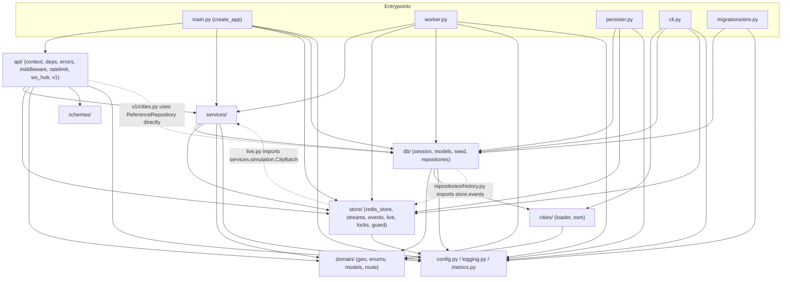

# 09 · Backend codebase

**What this covers:** how the Python package `divert` (in `backend/`) is laid out, the layering rules and where the real imports break them, a reference table for every module, the four entrypoints, the cross-cutting conventions (dependency injection, errors, logging, metrics, Redis keys, database sessions), a map of every test file, and step-by-step recipes for the changes people make most often. For what the system does, read [Specification](01-specification.md) and [Domain rules](02-domain-rules.md) first. For how the processes interact at runtime, see [Runtime workflows](07-runtime-workflows.md).

Facts here were checked against the code. Code pointers use `path` + symbol name.

---

## 1. Annotated tree

Python 3.12 only (`backend/pyproject.toml` `requires-python = ">=3.12,<3.13"`). The package uses a `src/` layout and is built with hatchling. `uv` manages the virtualenv and the lock file.

```text
backend/
├── pyproject.toml            deps, `divert` console script, ruff / mypy / pytest config (see 11-configuration)
├── uv.lock                   locked dependency set (CI and the Docker build use `uv sync --frozen`)
├── alembic.ini               Alembic config: script_location = divert:migrations, file template, prepend_sys_path = src
├── Dockerfile                one image for api / worker / persister / migrate (multi-stage uv build, uid 10001)
├── .dockerignore             keeps tests/, scripts/, caches and *.md out of the image
├── scripts/
│   └── fetch_osm_data.py     thin wrapper around divert.cities.osm.main (same as `divert fetch-data`)
├── src/divert/
│   ├── __init__.py           package docstring + __version__ = "2.0.0"
│   ├── config.py             Settings (pydantic-settings, DIVERT_ prefix) + cached get_settings()
│   ├── logging.py            JSON log formatter, request-id contextvar, configure_logging(), DNS-noise filter
│   ├── metrics.py            every Prometheus metric (namespace "divert"), one registry per process
│   ├── main.py               API entrypoint: create_app() factory + lifespan (builds AppContext)
│   ├── worker.py             simulation worker entrypoint (`python -m divert.worker`): leader lock, commands, ticks
│   ├── persister.py          history persister entrypoint (`python -m divert.persister`): stream -> PostgreSQL
│   ├── cli.py                `divert` command: migrate | seed | fetch-data | dlq
│   ├── api/
│   │   ├── context.py        AppContext dataclass: the per-process object graph the API uses
│   │   ├── deps.py           FastAPI dependencies: CtxDep, SessionDep, CityDep, require_api_key, client_id
│   │   ├── errors.py         ApiError + exception handlers -> {"error": {...}, "request_id"} bodies
│   │   ├── middleware.py     RequestContextMiddleware: X-Request-ID in/out, HTTP metrics, access log
│   │   ├── ratelimit.py      fixed-window rate limit for POST/DELETE (Redis INCR + EXPIRE), fails open
│   │   ├── ws_hub.py         CityHub: one Redis pub/sub subscription per city per process, bounded client queues
│   │   └── v1/
│   │       ├── router.py     api_router (prefix /api/v1) that includes every v1 module below
│   │       ├── health.py     /healthz, /readyz, /metrics (no /api/v1 prefix)
│   │       ├── cities.py     GET /cities, GET /cities/{city} (stations with free units, signals)
│   │       ├── incidents.py  POST /cities/{city}/incidents (dispatch), DELETE .../{incident_id} (cancel)
│   │       ├── vehicles.py   GET /cities/{city}/vehicles (live, Redis) + public_vehicle() field filter
│   │       ├── signals.py    GET /cities/{city}/signals/active (live, Redis)
│   │       ├── history.py    GET /cities/{city}/incidents, /incidents/{id}, /incidents/{id}/track (PostgreSQL)
│   │       ├── analytics.py  GET /cities/{city}/analytics/summary (PostgreSQL)
│   │       └── stream.py     WebSocket /cities/{city}/stream: snapshot, then forwarded pub/sub messages
│   ├── schemas/
│   │   └── incidents.py      IncidentCreate request body (extra="forbid", [lat, lng] tuple)
│   ├── domain/               pure: no I/O, no framework imports
│   │   ├── enums.py          IncidentType, ServiceType, UnitStatus, IncidentStatus, SignalState, Lane + lookup tables
│   │   ├── geo.py            haversine geodesy: LatLng, BBox, distances, bearings, interpolation, projection
│   │   ├── models.py         frozen value objects: City, TrafficProfile, Station, Signal, Unit, candidates
│   │   ├── hospitals.py      TRANSPORT hospital eligibility + choose_hospital (ED preference within tolerance)
│   │   └── route.py          Route (OSRM route reduced to points/speeds/maneuvers), CorridorSignal, lane_advisory()
│   ├── services/
│   │   ├── dispatch.py       DispatchService: validate -> KNN -> OSRM -> corridor -> ONE transaction -> post-commit
│   │   ├── routing.py        OsrmRouter: OSRM HTTP client with Redis cache, retries, metrics; parse_osrm_route()
│   │   ├── speed_model.py    vehicle kinematics: caps, braking envelope, SpeedProfile.step/time_from (pure)
│   │   ├── eta.py            EtaModel protocol + KinematicEtaModel (pure)
│   │   ├── preemption.py     PreemptionRules (claim/release) + resolve() for contested signals (pure)
│   │   ├── simulation.py     SimulationEngine + Vehicle + CityBatch: one tick for every city (pure, no I/O)
│   │   ├── outbox.py         OutboxRelay: post-commit XADD fast path + background relay with SKIP LOCKED
│   │   ├── reference.py      ReferenceCache: per-process TTL cache of cities/stations/signals
│   │   ├── history.py        HistoryService: history list/detail/track and analytics read side
│   │   ├── legs.py           trip legs (pure): PendingLeg, LegPlan, leg_planned / route_replaced commands, splice, re-route arithmetic, is_home
│   │   ├── obey.py           non-emergency (RETURN) motion shared by the engine and the ETA replay: decide_stop, replay
│   │   └── planner.py        LegPlanner (asyncio tasks of the leader): hospital + route + corridor, PG leg + outbox, XADD, retries, re-routes
│   ├── store/                Redis
│   │   ├── redis_store.py    EVERY Redis key builder + stream/group names + create_redis()
│   │   ├── events.py         message vocabularies (CommandType, HistoryEventType, StreamMessageType), event_id(), message()
│   │   ├── streams.py        Redis Streams helpers: xadd_json, consumer groups, autoclaim, ack, DLQ, lag
│   │   ├── live.py           write_city_batch() (one MULTI/EXEC per city) + live-state readers
│   │   ├── locks.py          LeaderLock: SET NX PX lease with compare-and-set renewal
│   │   └── guard.py          RedisGuard: per-call deadline + circuit breaker for the API request path
│   ├── db/                   PostgreSQL 16 + PostGIS 3.4
│   │   ├── base.py           DeclarativeBase with a constraint naming convention; str_enum(); utc_now_column()
│   │   ├── models.py         ORM tables: reference, history, outbox (kept in sync with migrations by a test)
│   │   ├── session.py        create_engine(), create_sessionmaker(), transaction() context manager
│   │   ├── geo_sql.py        LatLng <-> PostGIS geography expressions (WKT, ST_Y/ST_X)
│   │   ├── seed.py           idempotent seed of cities/stations/signals/units from the snapshots
│   │   └── repositories/
│   │       ├── reference.py  ReferenceRepository: KNN stations, corridor (ST_DWithin), SKIP LOCKED unit lock
│   │       ├── incidents.py  IncidentRepository: dispatch/cancel writes + history read models, keyset cursor
│   │       ├── history.py    HistoryWriter (persister, idempotent), worker rebuild reads, retention prunes
│   │       ├── legs.py       LegRepository: dispatch_legs insert (+ outbox command), get, legs_of
│   │       └── analytics.py  summary(): per-city aggregates computed in SQL
│   ├── cities/
│   │   ├── loader.py         load + validate committed snapshots (CitySnapshot, SnapshotError)
│   │   ├── osm.py            Overpass fetcher + CITY_PROFILES (bbox, centre, zoom, congestion) per city
│   │   └── data/             delhi.json, kolkata.json, bengaluru.json: committed OSM snapshots (large)
│   └── migrations/
│       ├── env.py            async Alembic environment (asyncpg); URL from Settings unless the caller set one
│       ├── filters.py        include_object(): ignore PostGIS-owned reflected tables (shared with the drift test)
│       ├── script.py.mako    template for new revisions
│       └── versions/         0001_initial, 0002_dispatch_rebuild, 0003_position_elapsed, 0004_trip_legs
└── tests/
    ├── conftest.py           autouse fixture: strip DIVERT_* env (keeps DIVERT_TEST_*), clear the settings cache
    ├── support.py            shared helpers: city(), straight_route(), route_through(), corridor_at(), start_cmd(), engine(), Clock
    ├── unit/                 no external services (fakeredis, respx); see section 6
    ├── integration/          real PostGIS + Redis; conftest.py builds a throw-away database; helpers.py
    └── network/              opt-in public OSRM smoke test
```

Snapshot sizes, from the JSON files: Delhi 1,131 stations and 500 junction signals, Kolkata 345 and 28, Bengaluru 1,242 and 576.

---

## 2. Layering

### 2.1 The intended rule

Dependencies point downwards only.

| Layer | Packages | May import | Must not |
|---|---|---|---|
| Domain | `domain/` | stdlib only | anything with I/O or a framework |
| Pure services | `services/speed_model.py`, `eta.py`, `preemption.py`, `simulation.py` | domain, `store/events.py` (message vocabulary only) | Redis, PostgreSQL, HTTP |
| Adapters | `db/` (PostgreSQL), `store/` (Redis), `cities/` (snapshots, Overpass) | domain, `config`, `metrics` | services, api |
| I/O services | `services/dispatch.py`, `routing.py`, `outbox.py`, `reference.py`, `history.py` | domain, pure services, adapters | api |
| Entrypoints | `main.py` + `api/`, `worker.py`, `persister.py`, `cli.py`, `migrations/` | everything below | each other |
| Cross-cutting | `config.py`, `logging.py`, `metrics.py` | stdlib + libraries | application code |

`domain/` holds: it imports only other `domain/` modules (checked with `grep -rnE '^\s*(from divert|import divert)'`).

### 2.2 The actual import graph

Built from every `from divert...` import in `backend/src/divert` (including function-level imports). Solid arrows follow the rule. Dashed arrows are the violations listed in 2.3.



### 2.3 Layering violations found

| # | Where | What | Impact | Possible fix |
|---|---|---|---|---|
| 1 | `store/live.py` | imports `divert.services.simulation.CityBatch` at module level (no `TYPE_CHECKING` guard) | An adapter depends on the service layer. With `services/dispatch.py -> store/live.py` this makes a package-level cycle `services <-> store`. There is no module-level cycle, because `services/simulation.py` does not import `store/live.py`. | Move `CityBatch` to `domain/` or `store/`. |
| 2 | `db/repositories/history.py` | imports `divert.store.events.HistoryEventType` | The PostgreSQL adapter depends on the Redis package. `store/events.py` itself is pure (enums, `hashlib`), so this is a misplaced vocabulary, not an I/O dependency. | Move the message vocabularies to `domain/`. |
| 3 | `api/v1/cities.py` | calls `ReferenceRepository(session).station_availability()` directly | An endpoint bypasses the service layer. | Add a method to `ReferenceCache` or a small service. |
| 4 | `api/v1/vehicles.py`, `signals.py`, `stream.py`, `health.py` | call `store/live.py` readers directly | Deliberate: live reads are thin pass-throughs. Every call goes through `ctx.guard.call(...)`. | None needed. Keep the guard. |
| 5 | `db/seed.py` | imports `divert.cities.loader.CitySnapshot` | An adapter depends on another adapter. Acceptable: `cities/` depends only on `domain/`. | None needed. |

`services/outbox.py` uses the ORM table `db.models.Outbox` directly instead of a repository. `db/repositories/incidents.py` `IncidentRepository.create_dispatch` writes the outbox topic as the literal `"commands"` instead of `store.events.OUTBOX_TOPIC_COMMANDS`. Both are minor inconsistencies, not layering breaks.

---

## 3. Module reference

"Collaborators" lists the main modules each one calls or is called by.

### 3.1 Entrypoints and cross-cutting

| File | Responsibility | Key classes / functions | Collaborators |
|---|---|---|---|
| `main.py` | Builds the FastAPI app and its per-process object graph | `create_app(settings, *, router, redis, eta_model, background)`, inner `lifespan` | `api/*`, `services/*`, `store/guard`, `store/redis_store.create_redis`, `db/session` |
| `worker.py` | Leader election, command consumption, tick loop, take-over (Redis resume + PostgreSQL rebuild) | `Worker` (`try_lead`, `take_over`, `step_down`, `process_commands`, `tick_once`, `run`, `_lead`, `shutdown`), `LeadershipLost`, `amain`, `main` | `services/simulation`, `services/preemption`, `services/eta`, `store/live`, `store/locks`, `store/streams`, `db/repositories/history`, `db/repositories/reference` |
| `persister.py` | Consumes `divert:history`, writes PostgreSQL idempotently, dead-letters poison messages, runs retention | `Persister` (`setup`, `process_once`, `_one_by_one`, `retention_once`, `refresh_stream_metrics`, `run`), `RETENTION_LOCK_KEY = 0x0D17E28`, `amain`, `main` | `db/repositories/history.HistoryWriter`, `store/streams`, `metrics` |
| `cli.py` | `divert` console script | `main`, `run_migrations`, `alembic_config`, `seed_all`, `dead_letters`, `SEED_LOCK_KEY = 0x0D17E27` | Alembic, `db/seed`, `cities/loader`, `cities/osm`, `store/streams` |
| `config.py` | All runtime settings from the environment | `Settings`, `get_settings()` (`lru_cache`) | everyone; see [Configuration](11-configuration.md) |
| `logging.py` | JSON logs with request ids | `request_id_var`, `JsonFormatter`, `configure_logging`, `default_instance_id`, `quiet_abandoned_dns_lookups` | `api/middleware`, `api/errors`, every entrypoint |
| `metrics.py` | Prometheus metric objects | `HTTP_REQUESTS`, `DISPATCHES`, `TICK_DURATION`, `PERSISTED`, `OUTBOX_BACKLOG`, `REDIS_CIRCUIT_OPEN`, ... (section 5.4) | api, services, store, worker, persister |

### 3.2 API (`api/`, `schemas/`)

| File | Responsibility | Key classes / functions | Collaborators |
|---|---|---|---|
| `api/context.py` | Holds the per-process dependencies | `AppContext` (settings, engine, sessionmaker, redis, guard, eta_model, reference, outbox, dispatch, hub) | built by `main.create_app` |
| `api/deps.py` | FastAPI dependencies | `get_ctx`/`CtxDep`, `get_session`/`SessionDep`, `CityId` (path regex `^[a-z0-9_-]{1,32}$`), `get_city`/`CityDep`, `require_api_key`, `client_id` | `services/reference` (via ctx), `api/errors` |
| `api/errors.py` | One error body shape for every failure | `ApiError`, `error_body`, `install_error_handlers` | `services/dispatch.DispatchError`, `logging.request_id_var` |
| `api/middleware.py` | Request id, HTTP metrics, access log | `RequestContextMiddleware` (pure ASGI) | `logging`, `metrics` |
| `api/ratelimit.py` | Per-minute fixed window on mutating calls | `WINDOW_S = 60`, `check_rate_limit`, `rate_limit_mutations` | `store/redis_store.rate_limit`, `ctx.guard` |
| `api/ws_hub.py` | WebSocket fan-out | `CityHub` (`subscribe`, `unsubscribe`, `_fan_out`, `_reader`, `close`), `HubFull`, `Item` | Redis pub/sub `divert:events:{city}` |
| `api/v1/router.py` | Mounts v1 modules under `/api/v1` | `api_router` | every `api/v1` module |
| `api/v1/health.py` | Liveness, readiness, metrics | `healthz`, `readyz` (PostgreSQL check, 2.0 s timeout), `metrics` (refreshes gauges, 2.0 s timeout) | `store/live.heartbeat_age_s`, `store/streams.group_lag`, `ctx.outbox.backlog` |
| `api/v1/cities.py` | Reference data | `list_cities`, `get_city`, `city_summary` | `ctx.reference`, `ReferenceRepository.station_availability` |
| `api/v1/incidents.py` | Dispatch and cancel | `create_incident`, `cancel_incident`, `MUTATING` dependency list | `ctx.dispatch` |
| `api/v1/vehicles.py` | Live vehicles | `list_vehicles`, `public_vehicle`, `PUBLIC_FIELDS` | `store/live` readers |
| `api/v1/signals.py` | Live non-NORMAL signals | `active_signals` | `store/live.read_active_signals` |
| `api/v1/history.py` | History list/detail/track, HTTP parsing only | `list_incidents`, `get_incident`, `get_track`, `parse_statuses`, `parse_types` | `services/history.HistoryService` |
| `api/v1/analytics.py` | Analytics summary | `summary` | `services/history.HistoryService.analytics_summary` |
| `api/v1/stream.py` | Live WebSocket | `stream`, `build_snapshot`, `_forward`, `_receive`, `CLOSE_UNKNOWN_CITY = 4404`, `CLOSE_TRY_AGAIN = 1013` | `api/ws_hub`, `store/live`, `store/events` |
| `schemas/incidents.py` | Request body validation | `IncidentCreate` (`type` max 32 chars, `location` `[lat, lng]`, `description` max 1000) | `api/v1/incidents` |

### 3.3 Domain (`domain/`)

| File | Responsibility | Key classes / functions | Collaborators |
|---|---|---|---|
| `domain/enums.py` | Shared enumerations and lookup tables | `IncidentType`, `ServiceType`, `UnitStatus`, `IncidentStatus`, `SignalState`, `Lane`, `SERVICE_FOR_INCIDENT`, `INCIDENT_TYPE_ALIASES`, `SERVICE_PRIORITY`, `CALLSIGN_PREFIX`, `normalize_incident_type` | everyone |
| `domain/geo.py` | Spherical geodesy (`EARTH_RADIUS_M = 6_371_008.8`) | `LatLng`, `BBox`, `haversine_m`, `initial_bearing_deg`, `destination_point`, `cumulative_distances`, `interpolate_by_distance`, `bearing_at_distance`, `project_onto_polyline` | routing, dispatch, simulation, osm |
| `domain/models.py` | Immutable reference objects that repositories return | `TrafficProfile` (24 factors in (0, 1.5]), `City`, `Station`, `StationAvailability`, `Signal`, `Unit`, `StationCandidate`, `CorridorCandidate` | repositories, services |
| `domain/route.py` | Route and corridor values | `Route` (`build`, `to_json`, `from_json`, `intersections`, `source`), `Maneuver` (+ `exit`, `name`), `Intersection`, `CorridorSignal` (+ `pass_no`, `movement`, `free_left`, `legs`, `junction_bearings`, `advice`, `key`), `corridor_key` | routing, corridor, dispatch, simulation |
| `domain/movement.py` | Turn classification (design §3) | `classify_turn`, `class_distance`, `junction_movement` -> `JunctionMovement`, `approach_speed_mps`, `turning_left_before` (free left) | corridor |
| `domain/lanes.py` | Lane model (design §3) | `road_class`, `lanes_per_direction`, `target_lane`, `side_for`, `plan_lanes(LaneInput..., emergency=)` -> `LaneAdvice` | corridor, route |
| `domain/signal_plan.py` | Synthetic fixed-time split-phase plans (design §4.1) | `PhasePlan` (`status`, `next_green_at`, `last_green_end`, `expected_wait_s`), `phase_at`, `PhaseStatus`, `Stage`, `JunctionGeometry` (`from_osrm`, `synthetic`, `phase_for`) | junctions, preemption, eta |

### 3.4 Services (`services/`)

| File | Responsibility | Key classes / functions | Collaborators |
|---|---|---|---|
| `services/dispatch.py` | The dispatch and cancel use cases | `DispatchService` (`create_incident`, `cancel_incident`, `sim_clock`, `drain`), `Router` protocol, `build_corridor`, `start_command`, `Plan`, errors `DispatchError`, `InvalidIncident`, `NotFound`, `NoUnitAvailable`, `InvalidState`, `RoutingUnavailable` | `ReferenceRepository`, `IncidentRepository`, `OsrmRouter` (as `Router`), `EtaModel`, `OutboxRelay`, `ReferenceCache`, `RedisGuard` |
| `services/routing.py` | OSRM client | `OsrmRouter` (`route`, `alternatives`, `aclose`), `parse_osrm_routes`, `parse_osrm_route`, `detour_vias`, `is_duplicate`, `RoutingError`, `RETRYABLE_STATUS`, `MANEUVER_SNAP_M = 250.0` | httpx, Redis cache key `osrm_route_cache(scope=base URL + params)` |
| `services/corridor.py` | Corridor with passes, movements, lane advice | `build_corridor(route, candidates, within_m=, emergency=)`, `project_passes` | domain movement/lanes; dispatch |
| `services/traffic.py` | Traffic model seam (design §2) | `TrafficModel` (protocol), `ModelledTraffic` (class-aware congestion x incident zones), `UNCONGESTED`, `FREE_FLOW`, `class_factor`, `city_factor`, `crowd_index`, `contention_junctions`, `ZONE_RULES` | eta, route_choice, simulation, dispatch |
| `services/route_choice.py` | Crowd-aware scoring (design §2) | `score_route`, `make_candidate`, `Candidate`, `choose` -> `Choice` (`to_json` = `route_choice`), `within_length`, `turn_delay_s`, `junction_delay_s` | eta, traffic; dispatch |
| `services/junctions.py` | Junction control (design §4.1/4.3/4.5) | `JunctionControl` (`status`, `serve`, `release`, `adopt`, `state`, `next_green_at`, `is_starved`), `JunctionRegistry` (`get`, `phase_of`, `drop_idle`) | simulation |
| `services/speed_model.py` | Kinematics shared by ETA and motion | `PROFILES`, `VehicleProfile`, `SpeedProfile` (`allowed_speed`, `step`, `time_from`), `build_profile`, `segment_cap_mps`, `junction_cap_mps`, constants | `eta`, `simulation` |
| `services/eta.py` | ETA seam | `EtaModel` (protocol), `EtaQuery`, `EtaEstimate`, `KinematicEtaModel` (`name = "kinematic-v3"` since stage 5B - non-emergency RETURN legs are replayed tick by tick against the fixed signal plans; `kinematic-v2` in stage 5A; `kinematic-v1` before), `congestion_at`, `plan_profile` | `speed_model`; used by dispatch and simulation |
| `services/preemption.py` | Claim/release/conflict rules (design §4.2/4.4/4.5) | `PreemptionRules` (`from_settings`, `should_claim`, `box_m`, `stop_line_m`, `is_past`, `must_cross`), `transition_s`, `queue_clear_s`, `required_lead` -> `Lead`, `Claimant`, `resolve_junction` -> `Resolution`, `queued_green_times`, `speed_advisory` -> `Advisory` | `simulation` |
| `services/simulation.py` | The engine the worker drives | `SimulationEngine` (`start_dispatch`, `cancel_dispatch`, `restore`, `tick`, `drain`, `ack`), `Vehicle`, `Claim`, `CityBatch`, `SimConfig`, `VehicleStatus`, `CommandError` | `eta`, `preemption`, `speed_model`, `store/events` |
| `services/outbox.py` | Transactional outbox delivery | `OutboxRelay` (`send_now`, `relay_once`, `backlog`, `run`), `publish`, `TOPIC_STREAMS` | `db.models.Outbox`, `store/streams.xadd_json`, `RedisGuard` |
| `services/reference.py` | Per-process reference cache | `ReferenceCache` (`cities`, `reference`, `city`, `invalidate`) | `ReferenceRepository` |
| `services/history.py` | History and analytics read side | `HistoryService`, `IncidentFilter`, `HistoryQueryError`, `MAX_ANALYTICS_RANGE` (366 days), `DEFAULT_ANALYTICS_RANGE` (1 day) | `IncidentRepository`, `repositories/analytics` |

### 3.5 Redis adapter (`store/`)

| File | Responsibility | Key classes / functions | Collaborators |
|---|---|---|---|
| `store/redis_store.py` | Key builders, stream names, client factory | `vehicles`, `vehicle_route`, `claims`, `vehicle_claims`, `active_signals`, `city_tick`, `finished_dispatches`, `events_channel`, `osrm_route_cache`, `rate_limit`, `create_redis`, `STREAM_*`, `GROUP_*`, `LEADER_LOCK`, `WORKER_HEARTBEAT`, `SIM_CLOCK` | everyone that touches Redis |
| `store/events.py` | Message vocabularies | `SCHEMA_VERSION = 1`, `CommandType`, `HistoryEventType`, `StreamMessageType`, `OUTBOX_TOPIC_COMMANDS`, `event_id`, `message` | dispatch, simulation, worker, persister, stream |
| `store/streams.py` | Streams plumbing | `FIELD = "data"`, `StreamMessage`, `xadd_json`, `ensure_group`, `read_group`, `autoclaim`, `delivery_counts`, `ack`, `dead_letter`, `group_lag`, `to_str`, `dumps` | worker, persister, outbox, cli |
| `store/live.py` | Live state writer and readers | `write_city_batch`, `merge_batches`, `read_vehicles`, `read_vehicle_routes`, `read_active_signals`, `read_claims`, `read_tick`, `read_finished`, `heartbeat_age_s`, `read_sim_clock`, `last_tick_no` | worker (write), api (read) |
| `store/locks.py` | Worker leader lease | `LeaderLock` (`acquire`, `renew`, `release`, `current_owner`, `is_held`, `margin_s` = TTL / 5) | worker |
| `store/guard.py` | Request-path Redis protection | `RedisGuard` (`call`, `is_open`, `state`), `RedisCircuitOpen` | api, dispatch, outbox, routing cache |

### 3.6 PostgreSQL adapter (`db/`), cities, migrations

| File | Responsibility | Key classes / functions | Collaborators |
|---|---|---|---|
| `db/base.py` | ORM base | `Base`, `NAMING_CONVENTION`, `str_enum` (VARCHAR + CHECK, not a native enum), `utc_now_column` | `db/models` |
| `db/models.py` | Tables | `City`, `Station`, `Unit`, `Signal`, `Incident`, `Dispatch`, `SignalPreemption`, `IncidentEvent`, `VehiclePosition`, `Outbox` | repositories, migrations, drift test |
| `db/session.py` | Async engine and sessions | `create_engine`, `create_sessionmaker`, `transaction` | every PostgreSQL user |
| `db/geo_sql.py` | Geography helpers | `point_wkt`, `linestring_wkt`, `geog_point`, `geog_line`, `lat_of`, `lng_of`, `dedupe_consecutive` | repositories, seed |
| `db/seed.py` | Idempotent reference seed | `seed_city`, `SeedReport`, `callsign` (`{prefix}-{station_id}-{ordinal}`), `CHUNK = 1000` | `cli.seed_all` |
| `db/repositories/reference.py` | Spatial reference queries | `ReferenceRepository` (`list_cities`, `get_city`, `load_city_reference`, `station_availability`, `nearest_stations_with_free_units`, `corridor_candidates`, `lock_free_unit`, ...), `CityReference` | dispatch, reference cache, worker |
| `db/repositories/incidents.py` | API writes + history reads | `IncidentRepository` (`create_dispatch`, `lock_incident`, `active_dispatch`, `mark_cancelled`, `list_incidents`, `get_incident`, `incident_detail`, `track`), `NewDispatch`, `encode_cursor`, `decode_cursor`, `is_terminal` | dispatch, history service |
| `db/repositories/history.py` | Persister writes, rebuild reads, retention | `HistoryWriter.apply`, `BadEvent`, `ActiveDispatch`, `active_dispatches`, `ended_dispatch_ids`, `prune_positions`, `prune_outbox` | persister, worker |
| `db/repositories/analytics.py` | Aggregates | `summary(session, city_id, start, end)` | history service |
| `cities/loader.py` | Snapshot loading | `load_snapshot`, `parse_snapshot`, `available_cities`, `CitySnapshot`, `SnapshotError`, `DATA_DIR` | seed, cli, tests |
| `cities/osm.py` | Overpass fetch (network) | `CITY_PROFILES`, `OVERPASS_ENDPOINTS`, `STATION_KINDS`, `CLUSTER_RADIUS_M = 40.0`, `TILE_DEG = 0.25`, `build_queries`, `run_overpass`, `cluster_signals`, `extract_stations`, `build_city`, `fetch_cities`, `main` | `cli fetch-data`, `scripts/fetch_osm_data.py` |
| `migrations/env.py` | Alembic runtime | `_url`, `_configure` (`compare_type=True`, `transaction_per_migration=True`), `run_migrations_online` | `db/models`, `migrations/filters` |

---

## 4. Entrypoints

One image runs four roles. The Docker `CMD` is the API. Compose and k8s override the command for the other roles.

| Role | Command | Code |
|---|---|---|
| api | `uvicorn divert.main:create_app --factory --host 0.0.0.0 --port 8000 --proxy-headers --no-access-log` | `main.create_app` |
| worker | `python -m divert.worker` | `worker.main` -> `amain` |
| persister | `python -m divert.persister` | `persister.main` -> `amain` |
| migrate | `divert migrate` | `cli.main` |

### 4.1 `create_app` and the lifespan

`create_app()` (`main.py`) builds the app synchronously and does the I/O setup in `lifespan`. Its keyword arguments exist for tests: `router` (an OSRM stand-in), `redis` (one client for everything), `eta_model`, and `background=False` (no outbox relay task).

App construction:
1. `FastAPI(title="DIVERT", version=__version__, lifespan=lifespan)`.
2. `CORSMiddleware`: `allow_origins=cfg.cors_origins`, credentials on, methods `GET, POST, DELETE, OPTIONS`, headers `Content-Type, X-API-Key, X-Request-ID`, exposes `X-Request-ID, Retry-After`.
3. `RequestContextMiddleware` (added last, so it runs outermost).
4. `install_error_handlers(app)`.
5. `health.router` (no prefix) and `api_router` (`/api/v1`).

Lifespan startup:
1. `configure_logging("api", ...)` and `quiet_abandoned_dns_lookups(loop)`.
2. `create_engine(cfg, application_name="divert-api")` and a sessionmaker.
3. Two Redis clients. The request-path client comes from `create_redis(cfg, request_path=True)`: socket timeouts of `redis_request_timeout_s` and no client retries. The pub/sub client for the WebSocket hub is the default, patient client. An injected `redis` replaces both.
4. `RedisGuard(timeout_s=redis_request_timeout_s, cooldown_s=redis_circuit_cooldown_s)`.
5. `OsrmRouter` (unless a router was injected), which caches routes in Redis through the guard.
6. `eta_model or KinematicEtaModel()`, `ReferenceCache(ttl_s=reference_cache_ttl_s)`, `OutboxRelay(...)`.
7. `app.state.ctx = AppContext(...)`, including `DispatchService` and `CityHub(queue_size=ws_queue_size, max_clients=ws_max_clients_per_city)`.
8. If `background`, start `outbox.run(stop)` as a task. Every API replica runs the relay. `FOR UPDATE SKIP LOCKED` keeps replicas from double-sending.

Lifespan shutdown, in order: stop and cancel the relay, `dispatch.drain()` (waits up to 5 s for post-commit work), `hub.close()`, `osrm.aclose()`, close Redis clients the app owns, `engine.dispose()`.

### 4.2 `python -m divert.worker`

`worker.amain`:
1. `configure_logging("worker")`.
2. Start the Prometheus HTTP server on `metrics_port`, unless it is 0. If the port is taken, it logs a warning and carries on.
3. Create the engine (`divert-worker`) and a patient Redis client.
4. Install SIGINT/SIGTERM handlers (skipped on Windows, where `add_signal_handler` raises `NotImplementedError`).
5. Run `Worker(cfg, redis, sessionmaker).run(stop)`.

`Worker.run` tries `try_lead()` every `leader_lock_ttl_ms / 3000` seconds. While leading, `_lead` runs three tasks: `renew`, `commands` (blocking read of `command_block_ms`) and `ticks` (every `sim_tick_s`). On SIGTERM, `shutdown()` flushes pending batches and releases the lock for an instant hand-over. On Windows no signal handler is installed, so a Ctrl+C on a local leader skips that hand-over. A standby then takes over after the lease expires. See [Runtime workflows](07-runtime-workflows.md) for take-over and the tick.

`Worker.__init__` takes `eta_model`, `instance_id` and `wall_clock` for tests. `amain` passes none of them, so production always runs `KinematicEtaModel` and the real clock.

### 4.3 `python -m divert.persister`

`persister.amain` follows the same pattern (service name `persister`, engine `divert-persister`). `Persister.run`:
1. `setup()` creates the consumer group `persister` on `divert:history`.
2. In a loop: `process_once(block_ms=persister_block_ms)`.
3. Every `retention_interval_s`, `retention_once()`, guarded by `pg_try_advisory_xact_lock(RETENTION_LOCK_KEY)` so that one persister prunes at a time.
4. `refresh_stream_metrics()`.

The consumer name is `instance_id`, or `hostname-pid` by default.

### 4.4 `divert` CLI (`cli.py`)

Installed as a console script (`[project.scripts] divert = "divert.cli:main"`). It reads `get_settings()`, so it uses the same `DIVERT_*` variables as the services.

| Command | What it does | Notes |
|---|---|---|
| `divert migrate [--no-seed]` | `alembic upgrade head` (`run_migrations`, synchronous because `env.py` runs its own event loop), then `seed_all` | The compose `migrate` service and the k8s `divert-migrate` Job run this. |
| `divert seed [--city ID ...]` | `seed_all`: upsert each city from `cities/data/<id>.json` under `pg_advisory_xact_lock(SEED_LOCK_KEY)`, then `ANALYZE cities, stations, units, signals` | Defaults to `DIVERT_CITIES`. Prints one `SeedReport` line per city. |
| `divert fetch-data [ID ...] [--cache-dir DIR]` | Delegates to `cities.osm.main`: re-fetches snapshots from Overpass | Network. Writes nothing if Overpass fails. The Makefile passes `--cache-dir ../.work/osm-cache`. |
| `divert dlq [--replay] [--id ID ...]` | Lists `divert:history:dlq`, or moves entries back to `divert:history` (XADD + XDEL in one transaction) | Run after fixing the cause. |

The module docstring's first line lists only `migrate | seed | fetch-data`. The `dlq` subcommand also exists.

---

## 5. Cross-cutting conventions

### 5.1 Dependency injection

- **One object graph per process.** The lifespan builds `AppContext` (`api/context.py`) and stores it on `app.state.ctx`. Nothing is a module-level singleton except `get_settings()` (an `lru_cache`) and the Prometheus metrics.
- **Dependencies** (`api/deps.py`):

  | Dependency | Gives | Notes |
  |---|---|---|
  | `CtxDep` | `AppContext` | `get_ctx` takes an `HTTPConnection`, so it works for HTTP and WebSocket. `stream.py` reads `ws.app.state.ctx` directly. |
  | `SessionDep` | `AsyncSession` | One per request, no transaction opened (reads autobegin). Writes open their own transaction in the service. |
  | `CityDep` | `domain.models.City` | The city must be in `DIVERT_CITIES` and in the reference cache. Otherwise 404 `city_not_found` with `details.cities`. |
  | `require_api_key` | none | Enforced only when `DIVERT_API_KEY` is non-empty. Constant-time compare (`hmac.compare_digest`). |
  | `rate_limit_mutations` | none | In `api/ratelimit.py`. Keyed by the `X-API-Key` value, else `client_id()`. |

- **Mutating endpoints** use `dependencies=MUTATING` (`api/v1/incidents.py`), which is `[Depends(require_api_key), Depends(rate_limit_mutations)]`.
- **Seams for tests:** `create_app(router=..., redis=..., eta_model=..., background=False)`, `Worker(..., eta_model=..., instance_id=..., wall_clock=...)`, `Persister(..., instance_id=...)`. Services take collaborators as constructor arguments, never from globals.

### 5.2 Error model (`api/errors.py`)

Every 4xx/5xx body has the same shape:

```json
{"error": {"code": "no_unit_available", "message": "...", "details": {}}, "request_id": "5b1d3c0e..."}
```

| Source | HTTP | `error.code` | Headers |
|---|---|---|---|
| `ApiError(status, code, message, details, headers)` raised anywhere | given | given | given |
| `DispatchError` subclasses (`services/dispatch.py`) | `InvalidIncident` 422, `NotFound` 404, `NoUnitAvailable` 409, `InvalidState` 409, `RoutingUnavailable` 503, base 400 | `invalid_incident`, `not_found`, `no_unit_available`, `invalid_state`, `routing_unavailable`, `bad_request` | none |
| `RequestValidationError` | 422 | `validation_error`, `details.errors` = `[{loc, msg, type}]` | none |
| Starlette `HTTPException` (e.g. unknown route) | its status | `http_<status>` | its headers |
| `RedisError` escaping a handler (only the live reads: vehicles, active signals) | 503 | `live_state_unavailable` | `Retry-After: 5` |
| Any other exception | 500 | `internal_error` (logged with traceback) | none |

Raised by dependencies: 404 `city_not_found` (`get_city`), 401 `unauthorized` with `WWW-Authenticate: ApiKey` (`require_api_key`), 429 `rate_limited` with `details.limit_per_min`, `details.retry_after_s` and `Retry-After` (`rate_limit_mutations`). History filters raise 422 `validation_error`. Unknown incident ids raise 404 `not_found`.

The WebSocket uses close codes instead: 4404 unknown city, 1013 try again.

Rule of thumb: services raise domain errors (`DispatchError`, `HistoryQueryError`). Endpoint modules translate them to `ApiError`, or let the installed handler do it.

### 5.3 Logging and request ids

- `configure_logging(service, level, json_logs)` (`logging.py`) replaces the root handlers with one stdout handler. Each entrypoint calls it with `api`, `worker`, `persister` or `cli`. It raises `uvicorn.access`, `httpx` and `httpcore` to at least WARNING.
- `JsonFormatter` writes one JSON object per line: `ts`, `level`, `logger`, `msg`, `service`, `request_id` (when set), every `extra=` field, and `exc`. With `DIVERT_LOG_JSON=false` a plain text format is used instead.
- `RequestContextMiddleware` sets `request_id_var` for each HTTP or WebSocket scope. It keeps an incoming `X-Request-ID` that matches `^[A-Za-z0-9._-]{1,64}$`, else it generates `uuid4().hex`. It echoes the id on HTTP responses. nginx sends `X-Request-ID $request_id` on proxied calls.
- Error bodies include `request_id`. Tasks created during a request (for example the post-commit XADD) copy the context, so their logs carry the same id.
- The access log is logger `divert.access`, one line per request, skipping `/healthz`, `/readyz` and `/metrics`. Uvicorn runs with `--no-access-log`.
- Convention: a short constant message plus structured `extra={...}`, for example `log.warning("publish failed", extra={"city": city_id, "error": repr(exc)})`.

### 5.4 Metrics (`metrics.py`)

All metrics live in one module, namespace `divert`. Each process exposes its own registry: the API on `GET /metrics` (port 8000), the worker and persister on `:DIVERT_METRICS_PORT/metrics` (9100 in compose and k8s).

| Process | Metrics it updates |
|---|---|
| api | `http_requests_total`, `http_request_duration_seconds` (label `route` = route template, `unmatched` if none), `dispatches_total`, `dispatch_duration_seconds`, `osrm_request_duration_seconds`, `osrm_errors_total`, `outbox_backlog`, `outbox_relayed_total`, `ws_clients`, `rate_limited_total`, `redis_circuit_open`, `redis_circuit_trips_total`. Refreshed on each scrape by `health._refresh`: `worker_heartbeat_age_seconds`, `history_stream_lag`, `history_stream_pending`, `active_vehicles` |
| worker | `tick_duration_seconds`, `tick_overruns_total`, `preemptions_total`, `preemption_conflicts_total`, `worker_is_leader`, `worker_commands_total`, `history_events_total`, `active_vehicles`, `active_signals` |
| persister | `persister_events_total` (outcome ok / duplicate / retry / dlq), `persister_lag_seconds`, `dlq_messages_total`, `history_stream_lag`, `history_stream_pending` |

To add a metric, declare it in `metrics.py` with `namespace=NS` and import the object where it is updated. Keep label sets small and bounded (city, service, type, outcome).

### 5.5 Redis keys in one place (`store/redis_store.py`)

No module builds a Redis key by hand. Rules:
- Every id segment is checked by `_check` against `^[A-Za-z0-9_.-]{1,64}$`. A bad id raises `ValueError`.
- Per-city keys carry the hash tag `{<city>}`, so one city's tick stays in one Cluster slot (`tests/unit/test_redis_keys.py` `test_per_city_keys_share_one_cluster_slot`). Streams and channels are global. **Redis Cluster is not supported as deployed**: the tick transaction also writes the global `divert:history` stream and acks `divert:commands` (docs/architecture.md section 9).
- Client-derived parts are hashed: OSRM coordinates (`sha256[:32]`) and rate-limit clients (`sha256[:16]`).

| Builder / constant | Key | Type |
|---|---|---|
| `vehicles(city)` | `divert:{city}:vehicles` | HASH vehicle -> JSON |
| `vehicle_route(city, vehicle)` | `divert:{city}:route:{vehicle}` | STRING JSON |
| `claims(city, signal)` | `divert:{city}:claims:{signal}` | HASH vehicle -> claim JSON |
| `vehicle_claims(city, vehicle)` | `divert:{city}:vclaims:{vehicle}` | SET of signal ids |
| `active_signals(city)` | `divert:{city}:signals:active` | HASH signal -> state JSON |
| `city_tick(city)` | `divert:{city}:tick` | HASH tick, sim_ts, wall_ts |
| `finished_dispatches(city)` | `divert:{city}:finished` | ZSET, trimmed to `finished_dispatch_ttl_s` |
| `events_channel(city)` | `divert:events:{city}` | pub/sub channel |
| `osrm_route_cache(profile, coords)` | `divert:osrm:{profile}:{digest}` | STRING, TTL `osrm_cache_ttl_s` |
| `rate_limit(scope, client, window)` | `divert:rl:{scope}:{digest}:{window}` | STRING counter, EXPIRE 120 s |
| `STREAM_COMMANDS` / `STREAM_HISTORY` / `STREAM_HISTORY_DLQ` | `divert:commands` / `divert:history` / `divert:history:dlq` | streams (MAXLEN ~ 100,000 / 1,000,000) |
| `LEADER_LOCK`, `WORKER_HEARTBEAT`, `SIM_CLOCK` | `divert:worker:leader`, `divert:worker:heartbeat`, `divert:sim:clock` | STRING, HASH (EXPIRE 3600 s), STRING |

The full keyspace, with owners and lifetimes, is in [Data stores](05-data-stores.md).

`create_redis(settings, request_path=False)` sets `decode_responses=True`, so every value is `str`. Every request-path call must go through `ctx.guard.call(lambda: ...)`. `RedisGuard` bounds each call by `timeout_s` and opens the circuit for `cooldown_s` after any failure. Every error it raises is a `RedisError`, so callers keep one `except RedisError`.

### 5.6 Async SQLAlchemy sessions (`db/session.py`)

- `create_engine` uses asyncpg with: `pool_size`, `max_overflow`, `pool_timeout` from settings; `pool_pre_ping=True`; `pool_recycle=1800`; and server settings `application_name` (`divert-api`, `divert-worker`, `divert-persister`, `divert-seed`), `timezone=UTC`, and `statement_timeout` (`db_statement_timeout_ms`, unless 0).
- `create_sessionmaker` sets `expire_on_commit=False` and `autoflush=False`.
- Write with `async with transaction(sessionmaker) as s:`. It commits on success and rolls back on error.
- Repositories take a session and never commit. They run inside the caller's transaction (for example `IncidentRepository.create_dispatch` inside `DispatchService._dispatch`). They return domain objects or plain dicts, never ORM instances.
- Spatial work stays in PostGIS on `geography` columns. Coordinates cross the boundary as `LatLng` through `db/geo_sql.py`.
- The worker reads PostgreSQL only when it takes over (city list, rebuild). The tick loop never touches PostgreSQL.

---

## 6. Tests map

Run from `backend/`. `uv run pytest` runs unit and integration tests. pytest `addopts` adds `-m 'not network'`, and integration tests skip themselves when PostgreSQL or Redis cannot be reached. Markers are strict (`--strict-markers`). `asyncio_mode = "auto"`, with session-scoped event loops. See [Engineering workflows](08-engineering-workflows.md) for commands and CI.

### 6.1 Fixtures

| Fixture | Defined in | Scope | Gives |
|---|---|---|---|
| `_isolated_settings` (autouse) | `tests/conftest.py` | function | Removes every `DIVERT_*` env var except `DIVERT_TEST_*` and clears `get_settings` |
| `fake_redis` | `tests/unit/conftest.py` | function | `fakeredis.aioredis.FakeRedis(decode_responses=True)` |
| `clock` | `tests/unit/conftest.py` | function | `tests.support.Clock` (starts at `T0` = 2026-11-17 06:30 UTC, 12:00 IST) |
| `make_worker` | `tests/unit/conftest.py` | function | Factory for `UnitWorker`: the real `Worker` with PostgreSQL replaced by the snapshots, plus `send()` and `run_until()` |
| `test_settings` | `tests/integration/conftest.py` | session | `Settings` on `DIVERT_TEST_DATABASE_URL` / `DIVERT_TEST_REDIS_URL` |
| `seeded_db` | `tests/integration/conftest.py` | session | DROPs and recreates the test database, `alembic upgrade head`, seeds every city. Skips if PostgreSQL is unreachable. |
| `engine`, `sessionmaker` | `tests/integration/conftest.py` | session | On the seeded database |
| `session` | `tests/integration/conftest.py` | function | A session in a transaction that is always rolled back |
| `redis` | `tests/integration/conftest.py` | function | Real Redis (default db 15), `FLUSHDB` before and after. Skips if unreachable. |
| `clean_db` | `tests/integration/conftest.py` | function | Frees every unit, truncates `outbox`, deletes incidents (cascades), before and after |

Helpers (not fixtures): `tests/support.py` (`city`, `straight_route`, `route_through`, `corridor_at`, `start_cmd`, `engine`, `Clock`). `tests/unit/conftest.py` (`unit_settings`, `history`, `claim_keys`, `live_vehicles`, `active_signals`). `tests/integration/helpers.py`:
- `StubRouter`: a straight line at 12 m/s, optionally failing.
- `api()`: the real app under its lifespan, with an httpx `ASGITransport` client that drains post-commit work after every response.
- `Clock`, `drain_persister`, `run_pipeline` (drives worker ticks and persister rounds), `signal_near_center`, `scalar`, `rows`.

### 6.2 Test files

| File | Covers | Marker | Fixtures / helpers |
|---|---|---|---|
| `unit/test_city_data.py` | Committed snapshots are valid and traceable to OSM; parser rejects bad input | none | `tmp_path`; parametrized over `CITY_PROFILES` |
| `unit/test_config_and_enums.py` | Settings from env (CSV lists, `SecretStr`), defaults, wildcard CORS rejected, incident-type aliases | none | `monkeypatch` |
| `unit/test_geo.py` | Haversine, bearings, interpolation, projection, `BBox` against closed forms | none | none |
| `unit/test_osm_fetch.py` | Query tiling, 40 m signal clustering, station rules, Overpass fallback, no write on failure | none | `respx`, `tmp_path`, `monkeypatch` |
| `unit/test_preemption.py` | `should_claim`, 20 m release point, `resolve` tie-break by priority then id | none | none |
| `unit/test_redis_keys.py` | Key shapes, id validation, one Cluster slot per city, per-vehicle fields | none | fakeredis inline |
| `unit/test_regressions.py` | The prototype's three bugs: POLICE alias and reject-before-create, release of all claims on arrival/error/cancel, no read-modify-write and one MULTI/EXEC per city per tick | none | `fake_redis`, `make_worker`, `clock` |
| `unit/test_resilience.py` | `RedisGuard` deadline, circuit and half-open trial; sim clock for dispatch ETAs; tick counter across leaders; DNS-noise filter | none | `fake_redis`, `make_worker`, `clock`, `caplog` |
| `unit/test_routing.py` | OSRM request shape, retries, cache, non-OK codes, maneuver location, lane advisory | none | `fake_redis`, `respx` |
| `unit/test_simulation_engine.py` | Idempotent start, invalid commands, cancel-before-start, lifecycle events with deterministic ids, conflicts, `Vehicle.restore` | none | `clock` |
| `unit/test_speed_eta.py` | Vehicle profiles, segment caps, braking envelope, analytic time, congestion by local hour, simulated arrival within 10 % of the ETA | none | none |
| `unit/test_store_and_api_bits.py` | `merge_batches`, `write_city_batch` atomicity, `event_id`, fixed-window rate limit, API-key check, poison message to DLQ | none | `fake_redis` |
| `unit/test_worker_leader.py` | Lease acquire/renew/release, local expiry before the key, standby take-over, reclaiming un-applied commands, failed tick write retried merged | none | `fake_redis`, `make_worker`, `clock`, `monkeypatch` |
| `integration/test_api_reads.py` | `/cities`, history keyset pagination and filters, live endpoints, `/readyz` `/metrics` `/healthz`, WebSocket snapshot then live messages | `integration` + `clean_db` | `test_settings`, `redis`, `api()`; the WebSocket test is synchronous and uses Starlette `TestClient` |
| `integration/test_dispatch_api.py` | POLICE alias, 422 creates nothing, OSRM failure 503 writes nothing, 409 no unit, concurrent dispatches never share a unit, idempotent cancel, rate limit + API key | `integration` + `clean_db` | `test_settings`, `redis`, `sessionmaker`, `StubRouter` |
| `integration/test_migrations.py` | Tables and PostGIS, spatial and time indexes, geography types, no ORM drift, downgrade to base and up again | `integration` | `engine` |
| `integration/test_pipeline.py` | API -> outbox -> worker -> history -> persister lifecycle, cancel frees the unit, outbox relay after a Redis blip, concurrent relays send once, DLQ and retries, retention, rebuild from PostgreSQL | `integration` + `clean_db` | `test_settings`, `redis`, `sessionmaker`, `run_pipeline` |
| `integration/test_reference_repo.py` | KNN and corridor against brute force, free-unit filter, `SKIP LOCKED` contention, GiST index use | `integration` | `session`, `sessionmaker`, `city_id` param |
| `integration/test_resilience.py` | ETA at the simulation clock, dispatch and history with Redis down, WebSocket refused quickly with Redis down, rebuild after a no-leader freeze | `integration` + `clean_db` | `test_settings`, `redis`, `sessionmaker`; `dead_url` parametrized over a blackhole (`10.255.255.1`) and a refused (`127.0.0.1:1`) Redis URL; Starlette `TestClient` for the WebSocket case |
| `integration/test_seed.py` | Seed matches the snapshots, re-seed is idempotent and keeps live unit status, vanished station deactivated | `integration` | `seeded_db`, `session`, `test_settings` |
| `network/test_osrm_public_smoke.py` | One real public-OSRM route per city through `OsrmRouter`, the speed model and the corridor builder (3 requests) | `network` | none |

Not covered by automated tests: the real OSRM container (`--profile osrm`), Redis Cluster, the k8s manifests (no cluster apply in CI), and the frontend against a real browser.

---

## 7. Where to change X

Each recipe lists the files to edit, the tests to update, and the docs to keep in step.

### 7.1 Add a city

City ids must be lowercase and at most 32 characters. Three checks apply: the API path regex `^[a-z0-9_-]{1,32}$` (`api/deps.CityId`), the Redis id regex in `store/redis_store._check`, and the frontend hash regex `^[a-z][a-z0-9_-]{0,31}$` (`frontend/src/store/ui.ts` `parseHash`).

1. Add an entry to `CITY_PROFILES` in `backend/src/divert/cities/osm.py`: `name`, `timezone`, `bbox`, `center` (inside the bbox), `zoom`, and `traffic` with 24 `hourly_congestion` factors in (0, 1.5] (validated by `domain/models.TrafficProfile`) plus `avg_junction_delay_s`.
2. Fetch the snapshot: `cd backend && uv run divert fetch-data <id> --cache-dir ../.work/osm-cache` (network, Overpass). Commit `cities/data/<id>.json`.
3. Enable it: add the id to the `cities` default in `config.py`, `DIVERT_CITIES` in `.env.example` and `infra/k8s/base/configmap.yaml`.
4. Seed: `uv run divert seed --city <id>` (or `divert migrate`).
5. Restart the api and worker processes. Settings are read once per process (`get_settings` is cached and `Settings` is frozen), and both `api/deps.get_city` and `Worker._load_cities` filter on `DIVERT_CITIES`. If the city is seeded after the processes start with the new setting, the API still sees it within `reference_cache_ttl_s` (300 s by default), and the worker loads it on its first command for that city (`Worker._apply_command` reloads cities it does not know yet).
6. Self-hosted OSRM: add the bbox to `BBOX` in `infra/osrm/prepare.sh` and rebuild the data.
7. Frontend (fallback only, the real list comes from `GET /api/v1/cities`): `CITY_IDS` in `frontend/src/api/types.ts` and `FALLBACK_NAMES` in `features/city-switcher/CitySwitcher.tsx`.
8. Tests: `unit/test_city_data.py` picks the city up from `CITY_PROFILES`. Add it to the hard-coded lists in `integration/test_reference_repo.py` (`city_id` fixture params) and `network/test_osrm_public_smoke.py`.
9. Caveat: `Lane` advisories assume left-hand traffic (`domain/enums.Lane`, `domain/route.lane_advisory`). A right-hand-traffic city needs that logic changed.
10. Docs: [01](01-specification.md) scope, [data-sources.md](../data-sources.md).

### 7.2 Add an incident type or alias

**Alias only** (a new spelling for an existing type):
1. Add `"SPELLING": IncidentType.X` to `INCIDENT_TYPE_ALIASES` in `domain/enums.py`. Keys are upper case. Lookup strips the input and upper-cases it.
2. Update the description in `schemas/incidents.py` `IncidentCreate.type`.
3. Tests: add a case to `unit/test_config_and_enums.py` `test_incident_type_aliases`.
4. No database change: the raw spelling is stored in `incidents.reported_type` (max 32 characters).

**New type** (and possibly a new service):
1. `domain/enums.py`: add to `IncidentType`, `SERVICE_FOR_INCIDENT` and `INCIDENT_TYPE_ALIASES`. For a new service, also add to `ServiceType`, `SERVICE_PRIORITY` (conflict tie-break) and `CALLSIGN_PREFIX`.
2. New service only: add a `VehicleProfile` to `PROFILES` in `services/speed_model.py`. Map an OSM amenity in `STATION_KINDS` in `cities/osm.py`, re-fetch the snapshots and re-seed. Without stations, dispatch returns 409.
3. Database: enum columns are VARCHAR + CHECK (`db/base.str_enum`), so a new value needs an Alembic migration that replaces the CHECK constraint (`incidents.type`, and for a service `stations.service`, `units.service`, `dispatches.service`). Constraint names follow `NAMING_CONVENTION` in `db/base.py`. `integration/test_migrations.py` `test_models_match_migration` catches drift.
4. Frontend: `INCIDENT_TYPES`, `SERVICE_TYPES` and `SERVICE_FOR_TYPE` in `src/api/types.ts`; `TYPE_COLOR`, `SERVICE_COLOR` and `SERVICE_GLYPH` in `src/lib/theme.ts`; `TYPE_LABEL` and `SERVICE_LABEL` in `src/lib/format.ts`. The `Record<IncidentType, ...>` types make `tsc` list every map you missed.
5. Tests: `unit/test_config_and_enums.py` `test_every_incident_type_has_a_service`, `unit/test_speed_eta.py` `test_vehicle_profiles_match_the_spec`.
6. Docs: [02](02-domain-rules.md), [api.md](../api.md), [12](12-glossary.md).

### 7.3 Tune pre-emption thresholds or the speed model

**Thresholds are settings**, read by the worker when it takes over (`Worker.take_over` builds `PreemptionRules`):

| Setting | Default | Read by |
|---|---|---|
| `DIVERT_PREEMPT_LEAD_S` | 45.0 | worker |
| `DIVERT_PREEMPT_DISTANCE_M` | 600.0 | worker |
| `DIVERT_PREEMPT_RELEASE_PAST_M` | 20.0 | worker |
| `DIVERT_CONFLICT_TIE_S` | 5.0 | worker |
| `DIVERT_CORRIDOR_M` | 30.0 (max 200) | api (corridor chosen at dispatch time) |

Steps:
1. Set the variables in `.env`, or in the k8s ConfigMap.
2. Restart the workers. A running leader keeps the rules it built at take-over.
3. `DIVERT_CORRIDOR_M` changes only new dispatches. The corridor is stored with the dispatch.
4. `PreemptionRules` has its own dataclass defaults (45, 600, 20, 5) that `tests/support.engine()` uses. Change both the `config.py` default and the dataclass if you change a default.
5. The tie-break order lives in `SERVICE_PRIORITY` (`domain/enums.py`).

**The speed model is code** (`services/speed_model.py`):
- `EMERGENCY_ADVANTAGE = 1.3`
- `JUNCTION_PREEMPTED_MPS` = 35 km/h, `JUNCTION_NORMAL_MPS` = 15 km/h
- `BRAKE_MPS2 = 3.0`
- `ARRIVAL_SPEED_MPS = 1.0`, `MIN_SEGMENT_SPEED_MPS = 1.0`, `ARRIVAL_TOLERANCE_M = 0.5`
- `PROFILES`: ambulance 80 km/h at 2.0 m/s², fire engine 60 km/h at 1.0 m/s², police 90 km/h at 2.5 m/s²

Both the ETA (`KinematicEtaModel`) and the motion (`SimulationEngine._motion_profile`) call `build_profile`, so they stay consistent by construction.

**Congestion is data.** Hourly factors and `avg_junction_delay_s` sit in the snapshot JSON (`traffic`), come from `CITY_PROFILES`, and are seeded into `cities`. To change them:
1. Edit the profile and re-fetch, or edit the JSON.
2. Run `divert seed`. Cities are upserted.
3. The API sees the change after the reference cache TTL. The worker sees it at the next take-over.

Tests: `unit/test_speed_eta.py` (profiles, caps, `test_simulated_arrival_within_10pct_of_dispatch_eta`), `unit/test_preemption.py` (`test_release_point_is_20m_past`), `unit/test_config_and_enums.py` `test_defaults_match_spec`.

Suggestion, not current practice: if the model's behaviour changes, also change `KinematicEtaModel.name`, so `dispatches.eta_model` keeps old and new predictions apart in analytics.

Docs: [02](02-domain-rules.md), [simulation-model.md](../simulation-model.md), [11](11-configuration.md).

### 7.4 Add a REST endpoint

1. Pick or create a module in `api/v1/` with `router = APIRouter(tags=[...])`. A new module must be added to the tuple in `api/v1/router.py`. Paths are relative to `/api/v1`.
2. Take dependencies as parameters: `city: CityDep` (validates the city), `ctx: CtxDep`, `session: SessionDep`. For POST/DELETE, add `dependencies=MUTATING` (API key and rate limit). Document the error codes in `responses=`.
3. Keep the handler thin, as `api/v1/history.py` does: parse, call a service, map errors. Put SQL in `db/repositories/` and the use case in `services/`. Live reads go through `store/live.py` wrapped in `ctx.guard.call(...)`. A `RedisError` then becomes a 503 automatically.
4. Request bodies: a pydantic model in `schemas/` with `ConfigDict(extra="forbid")`. Coordinates are always `[lat, lng]`.
5. Errors: raise `ApiError(status, code, message, details)`, or a `DispatchError` subclass from the service.
6. CORS only allows `GET, POST, DELETE, OPTIONS` (`main.create_app`). A PUT or PATCH endpoint needs `allow_methods` updated.
7. Metrics and the access log come for free: `RequestContextMiddleware` labels by route template.
8. Tests: an integration test using `async with api(test_settings, redis) as (app, client)` from `tests/integration/helpers.py`, with `pytestmark = [pytest.mark.integration, pytest.mark.usefixtures("clean_db")]`.
9. Frontend: add the call to `frontend/src/api/client.ts`, its types to `src/api/types.ts`, and a hook to `src/api/queries.ts` (see [Frontend codebase](10-codebase-frontend.md) section 7).
10. Docs: [api.md](../api.md).

### 7.5 Add a WebSocket message type

1. Add the type to `StreamMessageType` in `store/events.py`. Build payloads with `message(type, **fields)`, which always puts `type` and `v` first.
2. Produce it:
   - From the worker: append to `self.batch(city).publish` in `services/simulation.py`. `store/live.write_city_batch` publishes it inside the city's MULTI/EXEC, so it is sent only if the state change commits.
   - From the API: `DispatchService._publish` (best effort, through the guard).
3. Nothing changes in `api/v1/stream.py`. `CityHub` forwards every message on `divert:events:{city}` as raw text. Only change `build_snapshot` if the new data must also be in the initial snapshot.
4. Compatibility: clients ignore unknown types. A breaking change to an existing message bumps `SCHEMA_VERSION` here and `STREAM_SCHEMA_VERSION` in `frontend/src/api/types.ts`. The frontend drops messages with a newer `v`.
5. Frontend (required, or the message is dropped): add the type to `KNOWN_TYPES` in `src/api/stream.ts`, an interface and a union member in `src/api/types.ts`, and a `case` in `useLiveStore.apply` (`src/store/live.ts`). Add side effects to `src/api/useCityStream.ts` if needed.
6. Tests: `integration/test_api_reads.py` `test_websocket_snapshot_then_live_messages`, frontend `src/api/stream.test.ts` and `src/store/live.test.ts`.
7. Docs: [api.md](../api.md) WebSocket table, [07](07-runtime-workflows.md).

### 7.6 Add a database column

1. Model: edit the class in `db/models.py`.
2. Migration: add a revision in `migrations/versions/`. Its `down_revision` is the current head (`"0003_position_elapsed"` today) and its file name follows `alembic.ini` `file_template` (`%Y%m%d_<rev>_<slug>`). From `backend/`, against a migrated database: `uv run alembic revision --autogenerate -m "..."`, then review the result (`env.py` sets `compare_type=True`).
3. Write `downgrade()`. CI runs `alembic upgrade head && alembic check`, then `alembic downgrade base && alembic upgrade head`.
4. Keep it backward compatible for one release: nullable, or with a server default. `0003_position_elapsed` is the pattern: it added the nullable `vehicle_positions.elapsed_s`.
5. Writers:
   - API-written columns: `NewDispatch` and `IncidentRepository.create_dispatch` (or `mark_cancelled`) in `db/repositories/incidents.py`, fed by `services/dispatch.py`.
   - Worker-produced columns: add the field to the history event in `services/simulation.py`, then persist it in `HistoryWriter` (`_position`, `_preemption`, `_arrived`, `_ended`) in `db/repositories/history.py`. That module is the persister path.
6. Readers: `IncidentRepository.incident_detail` / `track`, `repositories/analytics.summary`. If the worker needs the column to rebuild a vehicle, also `active_dispatches` (`db/repositories/history.py`) and `Worker._vehicle_from_pg`.
7. Tests: `integration/test_migrations.py` `test_models_match_migration` fails if the model and the migration differ. Extend `integration/test_pipeline.py` for persisted values.
8. Docs: [data-model.md](../data-model.md), [05](05-data-stores.md).

### 7.7 Add a history event type

1. Add it to `HistoryEventType` in `store/events.py`. The name must fit `incident_events.type` (`String(48)`).
2. Emit it in `services/simulation.py` with `self._history(v, HistoryEventType.X, event_id("<prefix>", v.dispatch_id, ...), wall, **fields)`. Use a new, unique, deterministic prefix. Prefixes in use: `pos`, `enr`, `clm`, `cfl`, `rel`, `arr`, `clr`, `cxl`, `fail`, plus the API-written `rep`, `dsp`, `cxr`. `event_id` hashes ids longer than 64 characters. The event is XADDed to `divert:history` inside the city's MULTI/EXEC.
3. Persist it. `HistoryWriter.apply` (`db/repositories/history.py`) already inserts every non-position event into `incident_events` (payload = fields minus the envelope, `ON CONFLICT (event_id) DO NOTHING`), so it shows up in the timeline with no schema change. Add a `case` in its `match` only for side effects (status changes, other tables).
4. Rollout order: deploy the persister before the worker. An older persister raises `BadEvent` for an unknown type and dead-letters it. Re-queue with `divert dlq --replay` after upgrading.
5. `history_events_total` counts the new type automatically.
6. Frontend: add it to `TimelineType` in `src/api/types.ts` and a label in `src/features/history/IncidentDrawer.tsx`. Unknown types still render, because the type is `TimelineType | (string & {})`.
7. Tests: `unit/test_simulation_engine.py` `test_lifecycle_events_and_deterministic_ids`, `integration/test_pipeline.py` `test_full_lifecycle_is_persisted`.
8. Docs: [05](05-data-stores.md), [06](06-data-flows.md), [data-model.md](../data-model.md).

### 7.8 Swap in an ML ETA model (`EtaModel` protocol)

The seam is `services/eta.py`:

```python
class EtaModel(Protocol):
    name: str
    def estimate(self, query: EtaQuery) -> EtaEstimate: ...
```

`EtaQuery` carries `route`, `service`, `city`, `corridor`, `along_m`, `speed_mps` and `at` (simulation time, for the city-local congestion hour). `EtaEstimate` returns `to_destination_s` and `to_signals_s` (signal id -> seconds, for corridor signals still ahead).

Constraints from the code:
- **Synchronous and fast.** It is called for every candidate station during dispatch (`DispatchService._plans`) and for every live vehicle on every tick (`SimulationEngine._refresh_eta`). Ticks run every `DIVERT_SIM_TICK_S` (0.5 s). Do no I/O. Load weights in `__init__`.
- **It drives pre-emption.** `to_signals_s` decides when a vehicle claims a signal (`PreemptionRules.should_claim`: ETA <= lead) and who wins a conflict (`resolve`). A signal missing from `to_signals_s` counts as ETA 0, which means "claim now". Return every corridor signal ahead.
- **It must return a finite, non-negative ETA.** Otherwise `_refresh_eta` raises `ValueError` and the vehicle is FAILED (all its claims are released).
- **It does not move vehicles.** Motion uses `speed_model.build_profile`, so a learned model gives up the guarantee tested in `unit/test_speed_eta.py` `test_simulated_arrival_within_10pct_of_dispatch_eta`.
- `name` is stored in `dispatches.eta_model` (`String(32)`). Use a new name per model version.

Steps:
1. Implement the protocol in a new module under `services/`. Training data: `dispatches.predicted_eta_s` vs `actual_travel_s`, and `vehicle_positions`.
2. Wire it in both places. **No setting selects the model today.**
   - API: `main.create_app`, where `eta_model or KinematicEtaModel()`.
   - Worker: `worker.amain`, which builds `Worker(cfg, redis, sessionmaker)` without `eta_model`.
3. Tests: inject it with `create_app(eta_model=...)` and `make_worker(eta_model=...)`.
4. Watch `divert_tick_duration_seconds` and `divert_tick_overruns_total`, and analytics `eta_mape`.
5. Docs: [02](02-domain-rules.md), [04](04-decisions.md).

---

## Related

- [Specification](01-specification.md), [Domain rules](02-domain-rules.md), [Glossary](12-glossary.md)
- [Architecture](03-architecture.md), [Decisions](04-decisions.md), [Data stores](05-data-stores.md)
- [Data flows](06-data-flows.md), [Runtime workflows](07-runtime-workflows.md), [Engineering workflows](08-engineering-workflows.md)
- [Frontend codebase](10-codebase-frontend.md), [Configuration](11-configuration.md)
- Reference: [api.md](../api.md), [data-model.md](../data-model.md), [simulation-model.md](../simulation-model.md), [architecture.md](../architecture.md)
