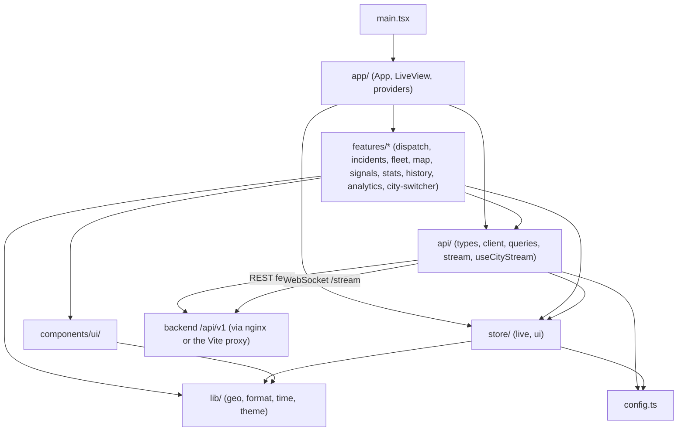
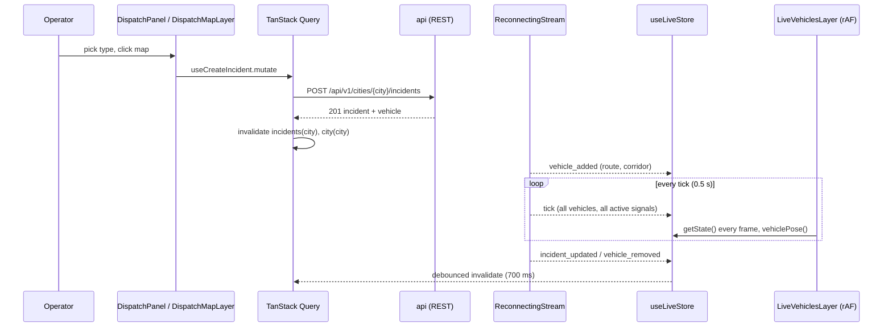
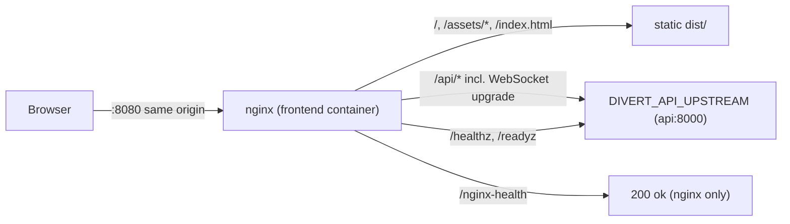

# 10 · Frontend codebase

**What this covers:** the ops console in `frontend/`:
- how its folders are organised
- how state is split between TanStack Query (REST) and zustand (live stream and UI)
- how the WebSocket client reconnects and resynchronises
- how the map draws and animates vehicles
- hash routing, theming, build-time configuration
- testing, and how the image is built and served by nginx
- recipes for common changes

The REST and WebSocket contract it consumes is in [api.md](../api.md). The live data path end to end is in [Data flows](06-data-flows.md).

Stack (`frontend/package.json`): React 19, TypeScript ~6.0 (strict), Vite 8, Tailwind 3, Leaflet 1.9 with react-leaflet 5, zustand 5, TanStack Query 5, clsx. Tests use vitest 5, Testing Library and jsdom. Node >= 22.12.

---

## 1. Annotated tree

```text
frontend/
├── package.json             scripts: dev, build (tsc -b && vite build), typecheck, lint, format(:check), test(:watch), check:ui
├── package-lock.json        locked deps (CI: npm ci)
├── index.html               SPA shell: #root, title, light/dark theme-color, loads /src/main.tsx
├── vite.config.ts           dev proxy (/api with WebSocket, /readyz, /healthz -> DIVERT_DEV_API), build (fonts never inlined) + vitest config
├── tsconfig.json            project references -> tsconfig.app.json (src) + tsconfig.node.json (config files)
├── eslint.config.js         flat config: typescript-eslint strict type-checked, jsx-a11y, react-hooks, prettier; scripts/*.mjs as plain Node
├── .prettierrc.json         no semicolons, single quotes, trailing commas, width 100
├── tailwind.config.ts       colour tokens + CSS variables from src/lib/palette.ts, z-index names from src/lib/zIndex.ts, Noto Sans stack
├── postcss.config.js        tailwindcss + autoprefixer
├── Dockerfile               node:22-alpine build -> nginx-unprivileged:1.27-alpine runtime on :8080
├── nginx/default.conf.template   nginx config rendered at start (envsubst): SPA, /api proxy, CSP
├── public/favicon.svg       plain primary-blue square with a white "D" (system font)
├── scripts/                 dev tooling, not shipped
│   ├── clickability.mjs     `npm run check:ui`: real-browser check that nothing covers a control (section 4.1)
│   └── ui-check-mocks.mjs   deterministic API + WebSocket mocks for it
├── .ui-check/               check:ui screenshots + results.json (gitignored)
└── src/
    ├── main.tsx             entry: Leaflet CSS, Noto Sans 400/500/600 (@fontsource), index.css, <StrictMode><Providers><App/></Providers></StrictMode>
    ├── index.css            Tailwind layers, focus outline, Leaflet chrome (map isolation), marker styles, dark tile filter
    ├── config.ts            build-time config (VITE_*), apiUrl(), wsUrl(), API key get/set (localStorage)
    ├── vite-env.d.ts        typing of the VITE_* variables
    ├── app/                 application shell
    │   ├── App.tsx          header (tabs, city switcher, status, key), hash routing, tab panels, one live stream
    │   ├── LiveView.tsx     Live tab layout: dispatch + stats | map | incidents + fleet
    │   ├── ApiKeyButton.tsx header dialog to set or clear the X-API-Key (stored in localStorage)
    │   ├── providers.tsx    QueryClientProvider (accepts an injected client for tests)
    │   └── queryClient.ts   makeQueryClient(): default staleTime, retry and refetch policy
    ├── api/                 talking to the backend
    │   ├── types.ts         TypeScript mirror of docs/api.md: REST bodies, stream messages, close codes
    │   ├── client.ts        request<T>(), ApiError, buildQuery(), the `api` object, describeError()
    │   ├── queries.ts       queryKeys + TanStack Query hooks (useCity, useIncidentHistory, useCreateIncident, ...)
    │   ├── stream.ts        ReconnectingStream (WebSocket with backoff + ping), parseMessage(), backoffDelay()
    │   └── useCityStream.ts hook: stream -> live store, debounced query invalidation, route back-fill
    ├── store/               zustand stores
    │   ├── live.ts          live state from the stream: vehicles (+ motion, current-leg route, dwell), signals, incident statuses, feed;
    │   │                    nextJunction(), dwellElapsedS(), routeIsStale()
    │   └── ui.ts            UI state: tab, city, dispatch type, pending pin, selection, layers, dark tiles, focus, routePreview
    ├── lib/                 framework-free helpers
    │   ├── geo.ts           haversine geodesy (same model as backend domain/geo.py), interpolateAlong, splitAt
    │   ├── format.ts        formatters + labels: TYPE/SERVICE/STATUS, PHASE, LEG, MOVEMENT, JUNCTION_STATE, OUTCOME, RANK, formatSignedPct
    │   ├── movement.ts      SVG path of the arrow glyph for each junction movement (movementPath)
    │   ├── time.ts          time-zone helpers (city-local days -> UTC instants), RANGE_PRESETS 24h/7d/30d/90d
    │   ├── palette.ts       the palette (LIGHT, DARK, SERVICE/SIGNAL/JUNCTION/LEG/MAP_PALETTE): single source of colour
    │   ├── zIndex.ts        the one z-index scale (Z_INDEX -> Tailwind z-map ... z-skip)
    │   ├── theme.ts         SERVICE_COLOR, TYPE_COLOR, SERVICE_GLYPH, SIGNAL/JUNCTION/LEG_COLOR, legColor(), legDash(),
    │   │                    CHART_NEUTRAL, STATUS_TONE, PHASE_TONE, DISPATCH_STATUS_TONE
    │   └── useNow.ts        Date.now() refreshed on an interval
    ├── components/ui/       shared presentational components
    │   ├── Panel.tsx        Panel (titled section), EmptyState, Spinner, Stat
    │   ├── Button.tsx       Button variants
    │   ├── Badges.tsx       StatusBadge, TypeBadge, ServiceDot, PhaseChip, DispatchStatusBadge, LegTag (leg + line sample)
    │   ├── MovementIcon.tsx stroked arrow for a movement (decorative, always next to text)
    │   ├── LaneDiagram.tsx  n lanes from the left kerb, target lane filled
    │   ├── Segmented.tsx    radio group styled as a segmented control (arrow-key navigation)
    │   ├── toast.ts         zustand toast store + `toast.info/success/warning/error`, TOAST_TTL_MS, MAX_TOASTS, clear()
    │   └── Toaster.tsx      renders the toasts (top centre of the content area, click-through except the close button)
    ├── features/            one folder per feature (pure helpers in a sibling .ts: react-refresh lint rule)
    │   ├── city-switcher/   CitySwitcher (cities from GET /cities, fallback to CITY_IDS)
    │   ├── dispatch/        DispatchPanel (type, description, submit), DispatchMapLayer (click to place), nearest.ts (preview)
    │   ├── incidents/       IncidentsPanel (list, hospital, cancel / blocked cancel), useLiveIncidents, merge.ts (+ canCancel)
    │   ├── fleet/           FleetPanel (vehicle cards), LiveRouteWhy (selected vehicle), fleetText.ts (claimView, laneByText, ...)
    │   ├── route-choice/    RouteChoiceExplainer ("Why this route"), routeChoice.ts (previewRoutes, candidateNotes)
    │   ├── map/             LiveMap (+ legend), LiveVehiclesLayer, LegLayers (hospital, free left, route preview), legData.ts,
    │   │                    ReferenceLayers, MapHelpers, icons
    │   ├── signals/         ActiveSignalsLayer (five junction states, click popup), signalText.ts (labels, popup model + HTML)
    │   ├── stats/           StatsPanel (live counters + last 24 h), ConnectionStatus (stream, sim clock, /readyz)
    │   ├── history/         HistoryView (filters, keyset pages), IncidentDrawer (+ drawerText.ts), TrackReplay + replay.ts
    │   └── analytics/       AnalyticsView (per-city cards, charts incl. trip-leg metrics), Charts.tsx (BarList, PercentileBars)
    └── test/                test infrastructure (not shipped)
        ├── setup.ts         jest-dom matchers + Testing Library cleanup after each test
        ├── render.tsx       renderWithProviders(): fresh QueryClient (no retries) + Toaster
        └── fixtures.ts      DELHI city, incident(), ROUTE, vehicleDoc(), tick(), SUMMARY, medicalDetail() (3 legs), mockFetch(), urlOf()
```

Test files sit next to the code they test (`*.test.ts` / `*.test.tsx`). See section 4.

---

## 2. Architecture

### 2.1 Folders and dependency direction

- `app/` composes features into the shell and the three tabs.
- `features/<name>/` holds one area of the UI: its components, hooks and pure helpers.
- Shared code lives in `api/` (backend I/O), `store/` (client state), `lib/` (pure helpers), `components/ui/` (presentational building blocks) and `config.ts`.

Rule: shared folders never import from `features/` or `app/`. A grep of `api/`, `store/`, `lib/` and `components/` for `../features` and `../app` finds nothing. Features may use each other's map building blocks:
- `features/map/LiveMap.tsx` composes `dispatch/DispatchMapLayer` and `signals/ActiveSignalsLayer`.
- `dispatch`, `signals` and `history` import `map/icons`.
- `history/TrackReplay` imports `map/MapHelpers`.



### 2.2 State management: why two libraries

| Kind of state | Lives in | Why |
|---|---|---|
| Server state from REST: city reference data, incident lists and history, incident detail and track, analytics, `/readyz` | **TanStack Query** (`api/queries.ts`) | Request/response data needs caching, de-duplication, background refetch, cancellation (`signal`), pagination (`useInfiniteQuery` with the keyset cursor) and invalidation after mutations. |
| Live state pushed by the WebSocket: vehicles with their motion, active signals, tick and sim clock, live incident statuses, activity feed, connection status | **zustand** `useLiveStore` (`store/live.ts`) | A push source, not a request. Each `snapshot` replaces the state wholesale, and `tick` arrives every 0.5 s. The map's `requestAnimationFrame` loop reads `useLiveStore.getState()` 60 times a second and subscribes imperatively (`useLiveStore.subscribe`), so React does not re-render per frame. Components select narrow slices (`useLiveStore((s) => s.vehicles)`). |
| UI state: tab, city, armed incident type, pending pin, selected vehicle, layer toggles, dark basemap, map focus requests, route preview (alternatives of the selected vehicle while "Why this route" is hovered) | **zustand** `useUiStore` (`store/ui.ts`) | Shared between the map (imperative Leaflet code) and panels without prop drilling. The tab and city are mirrored to the URL hash (2.5). Changing tab, city or selection clears the route preview. |
| Toasts | zustand `useToasts` (`components/ui/toast.ts`) | Fire-and-forget from anywhere. `TOAST_TTL_MS`: info and success 3.5 s, warning 6 s, error 10 s. At most 3 are kept (`MAX_TOASTS`). `App` calls `clear()` when the tab or city changes. |

How the two sides are bridged:
- **Stream to queries.** `api/useCityStream.ts` invalidates `incidents(city)`, `city(city)` (unit availability) and `['analytics', city]` when an `incident_updated` or `vehicle_removed` arrives, debounced by `INVALIDATE_DEBOUNCE_MS = 700`.
- **Queries to the stream.** Vehicles that arrive without a route (first seen in a `tick`, for example after a resync) are back-filled from `GET /vehicles?include_route=true`. The wait is at least 1 s, with a `ROUTE_REFETCH_COOLDOWN_MS = 5_000` cooldown.
- **Merging.** `features/incidents/useLiveIncidents.ts` lays the live statuses over the (slightly stale) REST list. `merge.ts` `laterStatus` lets statuses only move forward, matching the backend rule.

Query defaults (`app/queryClient.ts` `makeQueryClient`):
- `staleTime: 10_000`, `refetchOnWindowFocus: false`.
- Queries retry up to 2 times, but never on a 4xx `ApiError`. Mutations never retry.

Per-hook overrides in `api/queries.ts`:

| Hook | Override |
|---|---|
| `useReady` | refetch every 10 s, no retry |
| `useCities` | stale after 1 h |
| `useCity` | stale after 30 s, keeps the previous data only for the same city |
| `useRecentIncidents` | limit 30, refetch every 30 s |
| `useIncidentHistory` | infinite query over `next_cursor`, keeps the previous page set |
| `useTrack` | `max_points` 1000 |
| `useAnalytics` | stale after 15 s, keeps the previous data |

Keys come from the `queryKeys` factory. Mutations (`useCreateIncident`, `useCancelIncident`) invalidate the incident lists and the city in `onSettled`.

### 2.3 WebSocket client (`api/stream.ts`, `api/useCityStream.ts`)

`App` mounts `useCityStream(cityId)` once for the selected city, on every tab, so the header status and sim clock always work. The hook:
1. Calls `useLiveStore.getState().reset(city)`.
2. Opens `ReconnectingStream` on `wsUrl('/api/v1/cities/{city}/stream')`.
3. Feeds every parsed message to `useLiveStore.apply`.
4. Stops the stream on unmount or city change.

`ReconnectingStream` behaviour:

| Aspect | Behaviour (code) |
|---|---|
| Status | `idle -> connecting -> open`. Then `reconnecting` (with `attempt`, `retryInMs`), `closed` after `stop()`, or `unknown_city`. Stored in `useLiveStore.connection` and shown by `features/stats/ConnectionStatus.tsx`. |
| Backoff | `backoffDelay(attempt, 500, 15_000)`: `exp = min(max, initial x 2^attempt)`, delay = `exp/2 + random x exp/2` ("equal jitter"). The values come from `config.ws` in `config.ts`. |
| Backoff reset | `attempt` returns to 0 when a `snapshot` arrives (a healthy session), not merely on `open`. |
| Keep-alive | Sends `{"type":"ping"}` every 20 s (`pingIntervalMs`). The server answers `pong`, which the store ignores. |
| Network back | On the browser `online` event, a pending retry fires immediately. |
| Close 4404 (`WS_CLOSE_UNKNOWN_CITY`) | Stops for good, status `unknown_city`. |
| Close 1013 (`WS_CLOSE_TRY_AGAIN`) or any other close | Reconnects with backoff. The server sends 1013 for too many clients, a slow consumer, missed messages after a Redis reconnect, or live state unavailable (`backend api/v1/stream.py`, `api/ws_hub.py`). |
| Parsing | `parseMessage` drops non-strings, bad JSON, types outside `KNOWN_TYPES` (`snapshot`, `tick`, `vehicle_added`, `leg_changed`, `route_replaced`, `vehicle_removed`, `incident_updated`, `pong`) and any `v` greater than `STREAM_SCHEMA_VERSION` (1). |

**Snapshot reset.** Every successful connect starts with a `snapshot`. `apply('snapshot')` replaces `vehicles` and `signals` wholesale and clears `lastTickAt`, so a reconnect cannot leave stale vehicles behind. Messages whose `city` differs from the store's city are ignored. A `tick` carries the complete vehicle list and the complete non-NORMAL signal set: vehicles missing from it are dropped, and signals missing from it are NORMAL.

**Trip legs in the store** (`store/live.ts`). A vehicle stays live for its whole trip (RESPONSE, dwell, TRANSPORT, handover, RETURN) until `vehicle_removed` (`back_in_service` or `failed`). The backend publishes `leg_changed` and the re-sent `vehicle_added` before the tick of a new leg.

| Message | Store effect |
|---|---|
| `leg_changed` | Phase, leg, `destination_info`, hospital and predicted ETA are set. The route and corridor of the new leg are swapped in (`routeSeq` = leg seq). The motion restarts at the leg start. The dwell clock is cleared. A feed entry is added ("AMB-1 transport leg to Vimhans"). |
| `vehicle_added` of the same leg | Keeps the motion and the route array identity (`sameRoute`), so the map does not redraw it. A different dispatch or leg resets the motion. |
| `route_replaced` | Splices in the re-routed leg route without restarting the motion. A message for another leg is ignored. |
| `tick` | Copies the trip-leg fields (`phase`, `leg`, `destination_info`, `planning`, `next_movement`, `speed_advisory_mps`) only when present (older servers omit them). If its leg is newer than `routeSeq`, the stale route is dropped and the vehicle snaps; `vehiclesMissingRoute` then lists it and `useCityStream` back-fills it from `/vehicles`. `mergeRoutes` never takes an older leg's document. |
| stop (`status` `ON_SCENE`) | Records `dwellSinceSim` on the simulation clock (`sim_ts`, or the snapshot's `dwell_s`). `dwellElapsedS()` gives the dwell time the fleet card shows. |

`nextJunction(v)` prefers the server's `next_movement` (movement, lane index of total, advice text, `lane_by_m = advise_at_m - along_m`) and falls back to the first corridor entry ahead for older servers.

### 2.4 Map rendering (`features/map`, `features/signals`, `features/dispatch`)

`LiveMap` renders a react-leaflet `MapContainer` with `preferCanvas`, so vector layers (polylines, circle markers, rectangles) share one canvas. React renders only the structure. Everything that changes often is drawn imperatively inside `useEffect`:

| Layer | Technique | Notes |
|---|---|---|
| `BaseTiles` (`MapHelpers.tsx`) | `TileLayer` | Light: the standard tiles, unfiltered. Dark basemap: `VITE_TILE_URL_DARK`, or the light tiles with the `.tiles-dark` filter. |
| `FitToBBox`, `FocusController` | `useMap()` effects | Fits the city bbox and restricts panning to the bbox plus 35 %. A `ResizeObserver` refits until the user moves the map. `flyTo` handles `useUiStore.focus` requests. |
| `CityBoundsLayer`, `SignalsLayer`, `StationsLayer` (`ReferenceLayers.tsx`) | `L.rectangle` / `L.circleMarker` in a `layerGroup` on the **canvas** | No DOM node per marker, so hundreds of signals and over a thousand stations stay smooth. Radius depends on zoom. Tooltips are created lazily. Stations are hollow when no unit is free. |
| `IncidentsLayer` | react-leaflet `Marker` + `divIcon` | Active incidents only. |
| `LiveVehiclesLayer` | Imperative `L.marker` with a `divIcon` (DOM) + three canvas polylines per route (faded dashed "travelled", white casing, "remaining") | The current leg in its style (`legData.legLineStyles`): RESPONSE solid in the service colour, TRANSPORT solid violet, RETURN dashed grey. Redrawn when the route array or the leg kind changes. A vehicle on TRANSPORT gets a violet patient badge (`.veh.has-patient`). Re-synced only when `vehicles` changes (`useLiveStore.subscribe`). Moved by a `requestAnimationFrame` loop. |
| `LegExtrasLayer` (`LegLayers.tsx`) | Imperative markers | The destination hospital of every vehicle that is TRANSPORTING or AT_HOSPITAL (white square, violet border, "H", tooltip with the emergency-department tag). A "free left" tag at corridor junctions still ahead whose slip road bypasses the signal (never claimed). |
| `RoutePreviewLayer` (`LegLayers.tsx`) | Canvas polylines + permanent labels | `useUiStore.routePreview`: the alternatives of the selected vehicle's route as thin dashed grey lines labelled "Route B", only while "Why this route" is hovered or focused. |
| `ActiveSignalsLayer` | Imperative `L.marker` per active signal, updated in place each tick | Each junction state has its own shape (shape first, colour second): TRANSITIONING = hollow green ring + "green in n s", PREEMPTED = solid green dot that blinks on/off (static with reduced motion), QUEUED = amber diamond + "queued (n)", RECOVERING = hollow grey ring + "recovering, n s". An approach arrow (hidden while recovering) and a short hover tooltip. A click opens a popup (`signalText.popupModel` / `popupHtml`, values escaped): state and hint, countdowns (transition left, held green, back to plan), green extended or red truncated, the plan (phases, cycle), and the claimant queue (order, vehicle, movement, rank, state, expected green, ETA). The popup is refreshed while open and is never wider than the map. Its scroll height is fitted to the room above the marker (`fitPopupAbove`), because the map's max bounds can stop auto-pan near the city edge; so the title and close button stay inside the map on a phone. While a popup is open, the map's own controls (layers, legend) are hidden (`.map-popup-open > .map-controls`), so they never cover it. A legacy `CONFLICT` reads as QUEUED. Never re-created, so the blink does not restart. |
| `DispatchMapLayer` | `useMapEvents` + react-leaflet `Marker` / `Polyline` | A click inside the bbox sets the pending pin (outside: a warning, nothing sent). The pin is draggable. A straight-line preview goes to the nearest station of the armed service (`nearest.ts`, haversine; the server ranks by routed ETA). |

**Interpolation between ticks** (`store/live.ts`, `lib/geo.ts`):
1. Each `tick` stores a `Motion` per vehicle: `fromAlong` (where it is drawn now), `toAlong` (the new `along_m`), and `durMs`.
2. `durMs` is the measured tick interval: an exponential average `0.7 x previous + 0.3 x measured`, clamped to 150..2000 ms, starting at `DEFAULT_TICK_MS = 500`.
3. Every frame, `vehiclePose(v, now)` interpolates `along` linearly in time. `interpolateAlong(route, cum, along)` turns it into a position and heading by **cumulative haversine distance** along the route. That is the same spherical model as the backend: `EARTH_RADIUS_M = 6_371_008.8` in both `lib/geo.ts` and `backend/src/divert/domain/geo.py`. The cumulative distances `cum` are computed once per route.
4. A backward jump snaps instead of animating. That is a new `along_m` more than 1 m behind the drawn position, a different `dispatch_id` (for example after a worker failover), or a new leg (`along_m` restarts at 0 on every leg).
5. The travelled/remaining split (`splitAt`) is recomputed at most every `SPLIT_EVERY_MS = 120` ms, and only after more than 1 m of movement.

The history replay (`features/history/TrackReplay.tsx` + `replay.ts`) uses the same idea on recorded samples.
- **Within a leg:** routes are keyed by `legKey(dispatch_id, leg_seq)`, because `along_m` restarts on every leg. Between two samples of the same leg that have `along_m`, the vehicle follows that leg's route. Otherwise (a leg change, or an older payload without legs) it moves in a straight line.
- **Older payloads:** `drawableLegs()` uses `legs[]`, or falls back to the dispatch route as the RESPONSE leg.
- **Leg spans:** `legSpans()` places the legs on the replay time axis. That axis is wall-clock time, so dwells show as stops. The spans drive the leg bar and its "jump to leg" buttons.
- **Drawing:** `travelledByLeg()` draws the travelled path in each leg's style.

### 2.5 Hash routing `#/{tab}/{city}`

There is no router library. `store/ui.ts` defines:
- `TABS = ['live', 'history', 'analytics']`
- `parseHash()`: the tab must be in `TABS`; the city must match `^[a-z][a-z0-9_-]{0,31}$`
- `formatHash()`

The UI store's initial `tab` and `city` come from `location.hash` at module load. The defaults are `live` and `config.defaultCity` (`delhi`).

`useHashRoute` in `app/App.tsx` syncs both ways:
- A `hashchange` event (a link or a manual edit) updates the store.
- Store changes are written back with `history.replaceState`. So switching tabs or cities in the UI does **not** add browser history entries.

An unknown city in the hash passes `parseHash`. `GET /cities/{city}` then fails (the app shows "Could not load ..." with a Retry button), and the stream stops with status `unknown_city` (close 4404). Changing city resets the pending pin and the selection (`setCity`). `LiveView` and `HistoryView` are keyed by city id, so their local state resets.

### 2.6 Styling, theme and layers

The console is meant to look like a plain civic operations tool: light by default, flat panels, one muted primary colour, status colours only for status.

**Palette (`lib/palette.ts`, the single source).** `tailwind.config.ts` turns it into CSS variables (`--c-page: 245 246 248`, ...) on `:root` and into Tailwind tokens that use them (`rgb(var(--c-x) / <alpha-value>)`, so `bg-fg/10` works). Components use only the tokens, never raw hex or Tailwind's grey/rose scales.

| Token | Light | Dark | Use |
|---|---|---|---|
| `page` | `#f5f6f8` | `#141517` | page background |
| `surface` | `#ffffff` | `#1c1e21` | panels, header, drawer, popover, toasts |
| `subtle` | `#eef1f4` | `#25282c` | table header, stat tiles, hover |
| `line` | `#d7dbe0` | `#33373d` | 1 px panel borders and dividers |
| `field` | `#8c959f` | `#6b737c` | input borders (>= 3:1) |
| `fg` / `muted` | `#1f2328` / `#57606a` | `#e4e6e9` / `#a0a7af` | text / secondary text |
| `primary` (+ `-hover`, `-active`, `-subtle`) | `#1f4e79` (`#183f62`, `#12304b`, `#e7eef6`) | `#2a5f94` (`#2f6aa3`, `#245281`, `#1f2d3d`) | primary buttons, selected segment, selected row |
| `accent` | `#1f4e79` | `#8ab4e0` | primary as text: selected tab underline, links, focus outline |
| `ok` / `warn` / `bad` / `info` (+ `-subtle`) | `#1e6b34` / `#8a5a00` / `#b42318` / `#1f4e79` | `#6cc082` / `#d9a441` / `#f08c84` / `#8ab4e0` | status text and badge backgrounds only |
| `transport` (+ `-subtle`) | `#5b2ca6` (`#f1ecfa`) | `#b9a3ee` (`#2a2438`) | TRANSPORTING / AT_HOSPITAL chips and the "to {hospital}" line |

- **Dark mode** follows `prefers-color-scheme` (the same variables, redefined in a media query; neutral charcoal, no navy or neon). There is no separate theme switch. The map's **Dark basemap** toggle (`useUiStore.darkTiles`, `localStorage` key `divert.darkTiles`) defaults to the OS scheme when nothing is stored; `TrackReplay` honours it too.
- **Map colours** are the same in both themes (they sit on the tiles): `SERVICE_PALETTE` ambulance `#0072b2`, fire engine `#d55e00`, police `#3d4451` (Okabe-Ito based); `SIGNAL_PALETTE` NORMAL `#6e7781`, PREEMPTED `#1a7f37`, CONFLICT `#bf8700`; `MAP_PALETTE` pending pin `#1f2328`, service-area outline `#1f4e79`. `index.css` reads the signal and map ones as `--map-*` variables. `lib/theme.ts` re-exports them (`SERVICE_COLOR`, `TYPE_COLOR`, `SIGNAL_COLOR`, `MAP_COLOR`) with `SERVICE_GLYPH`, `CHART_NEUTRAL` and `STATUS_TONE` (badge classes). Shape and label are always the second cue next to colour (glyphs per service, a diamond for a conflict).
- **Trip legs and junction states** (`LEG_PALETTE`, `JUNCTION_PALETTE`, design section 6):
  - **Legs:** RESPONSE is drawn in the service colour.
  - **TRANSPORT** is a solid violet `#6c35c2`. Its CIE76 ΔE is at least 20 from every service colour, including the ambulance blue, under normal vision and protan, deutan and tritan simulation (21.3 at worst). A white glyph on it reaches 7.2:1.
  - **RETURN** is a dashed grey `#6e7781`; the dash, not the colour, says "not an emergency".
  - **Junction states** reuse the three tested signal colours and differ by shape and fill: TRANSITIONING = hollow green ring, PREEMPTED = solid green dot, QUEUED = amber diamond, RECOVERING = hollow grey ring.
  - **Legend:** the live map's legend is a `<details>`. It is open from `xl`, where the map has room, and collapsed below; it lists the services, the three leg styles, the destination hospital, the four junction shapes, the free left and a normal signal.
- **`lib/palette.test.ts`** keeps it honest: WCAG AA (4.5:1) for every text/background pair in light and dark, 3:1 for input borders, the focus outline, white glyphs on service colours and service colours on light surfaces, and a minimum CIE76 ΔE of 20 between service colours and between signal colours under normal, protan, deutan and tritan vision (Machado 2009 simulation). The old blue/violet pair failed this for deuteranopia (ΔE 1.7).

**Type.** Self-hosted **Noto Sans** 400/500/600 (`@fontsource/noto-sans`, imported in `main.tsx`; its subsets include Latin and Devanagari, while Bengali would need the separate Noto Sans Bengali family). The files are emitted to `/assets` (never inlined: `vite.config.ts` `assetsInlineLimit`), so the nginx CSP `font-src 'self'` holds. Fallback: Segoe UI, Roboto, Helvetica, Arial, sans-serif. Body text is 14 px. Labels are sentence case with normal letter-spacing, no weight above 600, figures use `tabular-nums`; monospace is kept for identifiers (vehicle ids, signal ids, request ids).

**Shapes and effects.** 4 px corners (`rounded`), 1 px `border-line` instead of rings or glows, `shadow` is at most `0 1px 2px` (popover, drawer, toasts). No gradients, blur or decorative animation. The only animation is the pre-empted signal blink; the connection dot is static. Focus: one global `:focus-visible` outline (2 px `accent`, offset 2 px; `focus-inset` for full-width rows and tabs).

**Branding.** The header shows a text wordmark "DIVERT" (600) and the subtitle "Emergency dispatch console" (hidden below `sm`). The favicon is a plain `#1f4e79` square with a white "D" in a system font. Page title "DIVERT – Emergency dispatch console".

**Z-index scale (`lib/zIndex.ts`, Tailwind `z-<name>`).** One scale, lower never covers higher. Do not use numeric `z-[…]` classes.

| Layer | Value | Used by |
|---|---|---|
| `map` | 0 | `.leaflet-container` is `isolation: isolate`, so Leaflet's own 200-1000 stay inside each map |
| `map-overlay` | 10 | layer toggles and legend over the live map |
| `sticky` | 20 | sticky History table header |
| `header` | 100 | the app header (`relative z-header`); its API-key popover (`z-popover`) paints inside it |
| `popover` | 200 | header popovers |
| `drawer` | 300 | modal incident drawer and backdrop |
| `toast` | 400 | notifications |
| `skip` | 500 | focused "Skip to content" link |

**Layout rules that keep every control clickable.**
- `<main>` scrolls (`overflow-y-auto`) inside a `relative` wrapper below the header, so the header (tabs, city, API key) is always reachable.
- Live: from `lg` the three columns fill the content area and the side columns scroll; below `lg` the panels stack at their natural height (map `55vh`, min 18 rem) and `<main>` scrolls. Never give the stacked layout a fixed height with `min-h-0` children: the grid rows then shrink to the viewport and later panels paint over earlier ones (the bug fixed in Stage 5-UI).
- Toasts sit at the top centre of the content area (never over the header), let clicks through (`pointer-events: none`) except on their close button, are short-lived and are cleared on tab or city change.
- History hides the coordinates column below `xl` so the Details buttons stay in view on tablets.

### 2.7 Configuration (`config.ts`)

All configuration is build-time (`import.meta.env.VITE_*`), plus two browser-local values (the API key and the dark-tile preference). The full table is in [Configuration](11-configuration.md) section 3.
- `apiUrl(path)` prefixes `VITE_API_BASE_URL`. Empty means same origin.
- `wsUrl(path)` derives `ws://` / `wss://` from that base, or from the page's protocol and host.
- `getApiKey()` prefers `localStorage['divert.apiKey']` (set by `ApiKeyButton`) over `VITE_API_KEY`. `request()` sends `X-API-Key` only on non-GET requests.

### 2.8 Errors

`api/client.ts` `request<T>()` turns every non-2xx answer into an `ApiError(status, code, message, details, requestId)`, using the backend's `{"error": {...}, "request_id"}` body when present. Otherwise the code is `http_<status>`. A network failure becomes `status 0`, `code 'network_error'`. An `AbortError` (query cancellation) is re-thrown as is.

`describeError()` maps known codes to operator-friendly text (`no_unit_available`, `routing_unavailable`, `invalid_incident`, `unauthorized`, `rate_limited` with `retry_after_s`, `network_error`, `cannot_cancel_transport`, `invalid_state`). Toasts can show the request id for support.

### 2.9 Trip legs in the UI (design section 6)

The backend contract is in [api.md](../api.md) ("Trip legs", the live vehicle fields, `leg_changed` / `route_replaced`) and the design is [trip-legs-and-dynamic-preemption.md](../design/trip-legs-and-dynamic-preemption.md).

| Where | What it shows | Code |
|---|---|---|
| Live map | The current leg of each vehicle: RESPONSE solid service colour, TRANSPORT solid violet with a patient badge, RETURN dashed grey. The destination hospital is highlighted. Free-left junctions are tagged. Junction states have their own shapes and a click popup (2.4). | `LiveVehiclesLayer`, `LegLayers`, `ActiveSignalsLayer` |
| Fleet card | Each vehicle card shows:<ul><li>a phase chip (Responding, On scene, Transporting, At hospital, Returning)</li><li>the leg (with a sample of its line) and destination</li><li>the next movement as an arrow plus text ("Right in 75 m at ITO crossing")</li><li>how the junction treats it: changing to green, green held, queued (position n), not claimed yet, obeys the signal (RETURN), or slip road</li><li>the advice text</li><li>a lane diagram with "Be in lane n within x m" (or "Stay in lane n", or "Single lane: traffic pulls left")</li><li>the speed advisory ("Slow to 18 km/h: green expected on arrival", or stop at the stop line)</li><li>"Planning route…" with the planner's last error</li><li>the dwell time "of" the configured dwell on scene or at the hospital (simulated)</li></ul>The selected vehicle also shows "Why this route" for its current leg (incident detail `legs[].route_choice`). | `FleetPanel`, `fleetText.ts`, `LiveRouteWhy`, `MovementIcon`, `LaneDiagram` |
| "Why this route" | The reason, then each candidate:<ul><li>distance, travel time and cost</li><li>crowd index and signals</li><li>right turns, contested junctions and incident zones</li><li>the busiest road</li></ul>Hovering or focusing it publishes the alternatives' geometries as a route preview, which the map draws faint and dashed. **The backend records candidate costs but not their geometry** (`route_choice.candidates[].route` is not sent today), so the explainer says the alternatives cannot be drawn. The frontend draws them as soon as the field is present. | `RouteChoiceExplainer`, `routeChoice.ts` |
| Incidents panel | TRANSPORTING and AT_HOSPITAL chips, with the destination hospital. While a patient is on board, Cancel is `aria-disabled` with a tooltip and an explanatory toast on click. A 409 `cannot_cancel_transport` (a race with the worker) gets a "Cannot cancel" toast. A live `incident_updated` with `reason` "cancel refused: ..." restores the real status even after a CANCELLED. | `IncidentsPanel`, `merge.ts` |
| History drawer | <ul><li>Summary times including transport started and at hospital.</li><li>Response and call-to-hospital in simulated seconds, as the analytics compute them.</li><li>The trip status per dispatch.</li><li>One card per leg: destination, distance, emergency or "obeys signals", corridor junctions (free lefts), pre-emptions, re-routes, predicted vs actual bars, and the error (`eta_error_pct` = (actual − predicted) / actual) against ±10 %. Each card has "Why this route", previewed on the replay map.</li><li>The hospital: its emergency-department tag, why it was chosen, and the hospitals considered.</li><li>Pre-emptions with leg, movement, lane n of m, green extended / red truncated, outcome and waited time.</li><li>The timeline grouped by leg.</li><li>The replay across all legs, with a leg bar and jump buttons.</li></ul> | `IncidentDrawer`, `drawerText.ts`, `TrackReplay`, `replay.ts` |
| Analytics | <ul><li>City cards add transports, call-to-hospital p50 and re-routes.</li><li>"Pre-emption outcomes": green extended, red truncated, free-left passes, re-routes, the extension vs truncation split, and the outcome bars.</li><li>"Patient transport": p50 / p90 of transport, call-to-hospital and handover-to-back-in-service, plus the hospital distribution.</li><li>"ETA accuracy by leg": MAPE and worst error per leg kind, scaled to 10 %.</li><li>"Dispatches by status (whole trip)".</li></ul>Each panel is left out when an older server does not send its fields. | `AnalyticsView` |

Older servers keep working: every trip-leg field is optional in `api/types.ts`, the phase falls back to the legacy two-value status, and the next junction falls back to the corridor.

---

## 3. Data flow on the Live tab



---

## 4. Testing

**Tooling.** vitest in `jsdom` (`vite.config.ts` `test`), with `@testing-library/react`, `@testing-library/user-event` and `@testing-library/jest-dom`.
- `src/test/setup.ts` registers the jest-dom matchers and runs `cleanup()` after each test.
- `restoreMocks` and `unstubGlobals` reset spies and stubbed globals between tests.
- Only `src/**/*.test.{ts,tsx}` files run.

**Helpers** (`src/test/`):
- `renderWithProviders(ui)`: a fresh `QueryClient` (no retries, `staleTime: Infinity`), the `Toaster`, and the client returned for assertions.
- `fixtures.ts`:
  - `DELHI` (a `CityDetail`), `incident()`, `ROUTE`, `vehicleDoc()`, `tick()`, `SUMMARY`
  - `mockFetch(routes)`, which replaces global `fetch` with a router over regexes and returns the spy
  - `urlOf()`
- Live state is seeded through the real store: `useLiveStore.getState().reset('delhi')` and then `apply({type: 'snapshot', ...})`.

| Test file | Covers |
|---|---|
| `api/client.test.ts` | `buildQuery`, JSON POST, `X-API-Key` on mutations only, history filter encoding, error body to `ApiError`, `describeError` messages |
| `api/stream.test.ts` | `parseMessage` (known types, newer `v` dropped), `backoffDelay` doubling with equal jitter, connect, forward and ping, reconnect with backoff and reset after a snapshot, no reconnect on 4404, `stop()` (with fake timers and an injected `WebSocketImpl`) |
| `store/live.test.ts` | Snapshot replaces state, other-city messages ignored, haversine interpolation between ticks, snap on a backward jump, tick replaces the signal set, `vehicle_added` / `vehicle_removed`, missing-route detection and merge, `incident_updated`, `nextSignal` |
| `lib/geo.test.ts` | Haversine (IUGG radius, backend distances), bearings, cumulative distances, interpolation and clamping, `splitAt`, projection onto the polyline, bbox and nearest item (values cross-checked against the backend) |
| `lib/format.test.ts` | Distance, duration and clock formatters (city time zone), seconds between instants, and `lib/time.ts` (zone offset, city-local midnight, a DST zone, day ranges) |
| `features/dispatch/DispatchPanel.test.tsx` | Asks for a map click, nearest-station preview, re-targeting by type, 201 selects the vehicle, out-of-bbox refused without an API call |
| `features/fleet/FleetPanel.test.tsx` | Empty state; callsign, station, ETA, next signal and claim state, estimated time saved |
| `features/history/HistoryView.test.tsx` | Keyset paging, status filter, opening the detail drawer, day filters sent as city-local midnight instants (`TrackReplay` is mocked) |
| `features/history/replay.test.ts` | `prepareReplay` / `frameAt` road-following replay |
| `features/incidents/merge.test.ts` | Forward-only status merge of REST and live data; also `parseHash` / `formatHash` round-trip (hash routing) |
| `features/analytics/AnalyticsView.test.tsx` | Per-city cards and the selected city's charts |
| `lib/palette.test.ts` | WCAG AA contrast of every text/background token pair (light and dark, including `transport`), 3:1 for borders, focus and service colours, colour-blind separation (ΔE >= 20) of service and signal colours and of the TRANSPORT violet from every service colour and RETURN, junction states on the three signal colours, CSS variable generation |
| `store/live.legs.test.ts` | Dwell clock on the simulation time, `leg_changed` (route swap, motion restart, hospital, feed), the re-sent `vehicle_added` keeps route identity and motion, a tick on a newer leg drops the stale route and `mergeRoutes` refuses an older leg, `route_replaced` (splice, other leg ignored), back in service, TRANSPORTING with hospital, `nextJunction` (server movement, "be in lane by", corridor fallback) |
| `lib/movement.test.ts` | Arrow paths: straight symmetric, lefts left / rights right, a glyph for every movement, U-turn to the right, roundabout |
| `features/fleet/FleetPanel.test.tsx` | Older-server card; phase chip, leg and destination, next movement, queued claim with position, advice text, lane diagram, "be in lane", speed advisory; planning (with error), handover dwell, RETURN obeys signals; the selected vehicle's "Why this route" previews the alternative on hover and clears on leave; `laneByText` |
| `features/signals/signalText.test.ts` | State mapping and marker classes (legacy CONFLICT = queued), labels and countdowns of all four active states, claimant order, popup model (rows, claimant queue with movement, rank, lane n of m, expected green), HTML escaping |
| `features/map/LegLayers.test.ts` | Destination hospitals (TRANSPORTING / AT_HOSPITAL only), free-left junctions ahead, leg line styles |
| `features/incidents/IncidentsPanel.test.tsx` | Transport statuses with the hospital, blocked cancel (aria-disabled, tooltip, description, toast), 409 `cannot_cancel_transport` toast with the request id, `canCancel` |
| `features/history/IncidentDrawer.test.tsx` | Three legs with predicted vs actual and errors, free lefts and pre-emptions per leg, hospital choice, "Why this route" preview on the replay map, pre-emption table (leg, movement, lane, outcome, green / red), timeline grouped by leg; helpers (`legErrorPct`, `tripTimes`, `timelineLegs`, `payloadSummary`, the pre-legs fallback) |
| `features/history/replay.test.ts` | (also) replay across legs: per-leg routes, `along_m` restarting per leg, leg spans, travelled path per leg |
| `features/analytics/AnalyticsView.test.tsx` | (also) transport times, hospitals, ETA accuracy by leg, pre-emption outcomes, green vs red split, dispatches by status; panels left out for an older server |

**Not tested:**
- **No functional end-to-end tests in CI.** The real-browser `check:ui` (4.1) only checks that controls are reachable; it is run by hand, not in CI.
- Nothing that needs Leaflet's canvas: `LiveMap`, `LiveVehiclesLayer`, `ReferenceLayers`, `ActiveSignalsLayer`, `DispatchMapLayer`, `TrackReplay`. jsdom has no canvas. Their logic is covered through `store/live.ts`, `lib/geo.ts` and `replay.ts`.
- The `App` shell, including the `useHashRoute` effect (`parseHash` / `formatHash` are tested), `useCityStream` as a whole (its parts are tested), `StatsPanel`, `ConnectionStatus`, `ApiKeyButton`.
- The Leaflet parts of the trip-leg UI (leg lines, patient badge, hospital marker, free-left tags, junction shapes and popup, route preview, replay leg bar) need a canvas: their logic is unit-tested (`legData`, `signalText`, `replay`), their look and reachability only by `check:ui` screenshots.
- The nginx configuration, pixel-level visual regressions, and accessibility beyond the `jsx-a11y` lint rules and the palette contrast test.

CI (`.github/workflows/ci.yml`, job `frontend`, Node 22) runs `npm ci`, `format:check`, `lint` (zero warnings), `typecheck`, `test` and `build`. The `docker` job then builds the image (without pushing).

### 4.1 UI clickability check (`npm run check:ui`)

A dev-only regression check for overlapping UI (`scripts/clickability.mjs`). jsdom has no layout engine, so it cannot see one panel painting over another; this drives a real browser instead. `playwright-core` is a devDependency used only here: it drives the locally installed Microsoft Edge (falls back to Chrome, then a Playwright Chromium if one was installed with `npx playwright-core install chromium`) and downloads no browser. Nothing of it is in the bundle or the nginx image.

For every city (Delhi, Kolkata, Bengaluru) and viewport (360x740, 768x1024, 1024x768, 1280x800, 1440x900, 1920x1080) it opens Live, History and Analytics and, for every visible button, link, tab, radio, checkbox and input, asserts that `document.elementFromPoint(centre)` is the control or inside it. Controls already on screen are tested where they are; controls clipped by a scroll area are scrolled into view first, and one that cannot be is reported as unreachable. It repeats the check in these states:
- with the transporting ambulance selected and its "Why this route" open (alternatives drawn on the map)
- with a queued junction's popup open (closed again afterwards)
- after a dispatch (map click + Dispatch, success toast visible), and after switching to History right after it
- with a toast raised in History (API-key Save)
- with the API-key popover open (its own controls)
- with the History drawer open (dialog controls), and with a "Why this route" open and hovered inside it

That makes 11 states per city and viewport, 198 in all. The mocks (`scripts/ui-check-mocks.mjs`) carry every trip-leg state:
- a TRANSPORT leg with a patient, a free left and the destination hospital
- a RESPONSE leg with a speed advisory and a queued claim
- a unit on scene
- a unit at the hospital planning its RETURN leg
- a RETURN leg
- one junction in each state
- history details with three legs, a hospital choice and route choices with geometries
- the trip-leg analytics It also records any Content-Security-Policy violation reported in the browser console (for example a font or script the CSP blocks). Screenshots and `results.json` go to `frontend/.ui-check/` (gitignored). It exits 1 on any covered or unreachable control or CSP violation.

```bash
npm run build && npm run check:ui                        # mock mode: vite preview of dist/, API + WebSocket mocked (scripts/ui-check-mocks.mjs), tiles stubbed
npm run check:ui -- --url http://localhost:8080         # the running stack (POST/DELETE still mocked: no real incidents)
npm run check:ui -- --url http://localhost:8080 --mock-api   # the deployed bundle + nginx CSP, with the whole API mocked
npm run check:ui -- --cities delhi --viewports 1440x900,360x740 --dark --real-tiles --headed
```

Stage 5-UI result: before the fix the running stack failed 66 checks in 40 of 144 states (stacked Live panels painting over the Dispatch panel below `lg`; bottom-right toasts covering Zoom out and the History Details buttons). After the fix: 0 failures in all 144 states, in mock mode and against the rebuilt :8080 image (`--mock-api`), with no CSP violations.

---

## 5. Build and serving

### 5.1 Image (`frontend/Dockerfile`)

1. **Build stage** `node:22-alpine`:
   1. `npm ci` (npm cache mount).
   2. Copy the sources. `.dockerignore` drops `node_modules`, `dist`, `.env*` and logs.
   3. Declare `ARG VITE_API_BASE_URL`, `VITE_TILE_URL`, `VITE_TILE_URL_DARK`, `VITE_TILE_ATTRIBUTION` (all empty by default) and export them as `ENV`.
   4. `npm run build`, which is `tsc -b && vite build`, so a type error fails the image. The output goes to `dist/` with source maps, target ES2022.
2. **Runtime stage** `nginxinc/nginx-unprivileged:1.27-alpine`:
   - `ENV DIVERT_API_UPSTREAM=api:8000`, `NGINX_ENTRYPOINT_LOCAL_RESOLVERS=1`, `NGINX_ENVSUBST_FILTER=^(DIVERT_API_UPSTREAM|NGINX_LOCAL_RESOLVERS)$`
   - The template goes to `/etc/nginx/templates/`, `dist` to `/usr/share/nginx/html`
   - `EXPOSE 8080`, `USER 101`
   - `HEALTHCHECK` with `wget /nginx-health` every 15 s, timeout 3 s. Compose replaces it with `/healthz` through the proxy.

`VITE_API_KEY` is not a Dockerfile `ARG`, so it cannot be baked into the image without editing the Dockerfile.

### 5.2 nginx (`frontend/nginx/default.conf.template`)



- **envsubst at start.** The image entrypoint renders the template. Only `DIVERT_API_UPSTREAM` and `NGINX_LOCAL_RESOLVERS` are substituted, so nginx's own `$variables` survive.
- **Runtime DNS for the upstream.** `set $api_upstream http://${DIVERT_API_UPSTREAM}` plus `proxy_pass $api_upstream` and `resolver ${NGINX_LOCAL_RESOLVERS} valid=10s`. The API name is resolved per request and re-resolved every 10 s, which has three effects:
  - nginx starts even when the API does not exist yet
  - it follows a recreated API container or pod
  - it spreads requests over every address of a scaled service

  The resolver applies no search domains, so k8s sets a fully qualified name.
- **WebSocket.** `Upgrade` and `Connection` come from a `map`. `proxy_http_version 1.1`, read/send timeouts 3600 s, `proxy_buffering off`.
- **Request id.** `X-Request-ID $request_id` is sent upstream, so API logs and error bodies carry nginx's id.
- **Caching.** `/assets/*` (content-hashed) is `immutable` for one year. `/index.html` is `no-cache`, so a deploy shows up immediately. Unknown paths fall back to `index.html`.
- **Security headers** on every location: `Content-Security-Policy` (`script-src 'self'`, `style-src 'self' 'unsafe-inline'`, `img-src 'self' data: https:` for tiles, `connect-src 'self' ws: wss:`, `frame-ancestors 'none'`, ...), `X-Content-Type-Options: nosniff`, `X-Frame-Options: DENY`, `Referrer-Policy`, `Permissions-Policy`. nginx drops inherited `add_header` lines in locations that declare their own, so those locations repeat them.
- Because the browser only talks to its own origin, no API host is baked into the bundle and CORS is not needed.

In development, `npm run dev` (port 5173) proxies `/api` (WebSocket included), `/readyz` and `/healthz` to `DIVERT_DEV_API` (default `http://localhost:8000`). The dev server sends no CSP.

---

## 6. Conventions

- **Coordinates are `[lat, lng]` tuples** (`LatLng` in `api/types.ts`) everywhere, matching the API. Leaflet takes the same order.
- **`api/types.ts` mirrors [api.md](../api.md) field for field.** Shared enums are `as const` arrays plus derived union types (`INCIDENT_TYPES`, `SERVICE_TYPES`, `INCIDENT_STATUSES`). Lookup maps are typed `Record<Union, ...>`, so a new enum value makes `tsc` list every map that needs an entry.
- **Imperative Leaflet in effects.** Create layers in a `useEffect`, keep handles in a closure `Map`, and clean up in the effect's return. Read high-frequency state with `getState()` and `subscribe`, not with hooks.
- **Accessibility.** Tabs use `role="tablist"` / `tab` / `tabpanel`, there is a skip link, panels are `section`s labelled by their heading, and `Segmented` is a radio group with arrow keys. `eslint-plugin-jsx-a11y` is enforced.
- **Formatting and labels** come from `lib/format.ts`. Colours come from `lib/theme.ts`. Times are shown in the city's time zone (`CityDetail.timezone`).

---

## 7. Recipes

### 7.1 Add a panel

1. Create `src/features/<name>/<Name>Panel.tsx`. Wrap it in `Panel` from `components/ui/Panel.tsx` (`title`, optional `actions`, and an `id` so the heading labels the section). Use `EmptyState`, `Spinner` and `Stat` for common states.
2. Read data:
   - live data with narrow selectors: `useLiveStore((s) => s.vehicles)`
   - REST data through a hook in `api/queries.ts`
   - UI state through `useUiStore`

   Use `useMemo` for derived lists. Do not subscribe to the whole store.
3. Place it in `app/LiveView.tsx`. The grid is `lg:grid-cols-[17rem,minmax(0,1fr),19rem]` (`xl`: 19rem / 21rem): the left `aside` has dispatch and stats, the centre has the map, the right `aside` has incidents and fleet. Below `lg` everything stacks at natural height and `<main>` scrolls; keep `min-h-0` / fixed heights behind `lg:` (2.6). For the other tabs, add it inside `HistoryView` or `AnalyticsView`. Style it with the palette tokens and `Panel`; run `npm run check:ui` afterwards.
4. Test with `renderWithProviders(<NamePanel city={DELHI} />)`. Seed live state with `useLiveStore.getState().reset('delhi')` and then `apply({type: 'snapshot', ...})`. Stub REST with `mockFetch([...])`. `FleetPanel.test.tsx` is the model.

### 7.2 Add a tab

1. Add the id to `TABS` in `src/store/ui.ts`. The `Tab` type and `parseHash` follow automatically.
2. Add its label to `TAB_LABEL` in `src/app/App.tsx`. It is a `Record<Tab, string>`, so `tsc` insists.
3. Add a render branch in `App`'s `<main>` (currently a nested ternary over `tab`). Key the view by `data.id` if it holds per-city local state.
4. The live stream already runs on every tab (`useCityStream` in `App`). Deep links work as `#/<tab>/<city>`.
5. Add a test that renders the view with `renderWithProviders`.

### 7.3 Add an API call (with its types)

1. Types: add the request and response interfaces to `src/api/types.ts`, mirroring [api.md](../api.md). Use `LatLng` for coordinates and `IsoTime` for timestamps.
2. Client: add a method to the `api` object in `src/api/client.ts`:

   ```ts
   thing: (city: string, q: ThingQuery = {}, signal?: AbortSignal) =>
     request<ThingResponse>(v1(`/cities/${enc(city)}/thing`) + buildQuery({ ...q }), { signal }),
   ```

   For writes, use `{ method: 'POST' | 'DELETE', body }`. `request` then adds `Content-Type` and the API key. Only `GET`, `POST` and `DELETE` exist, which matches the backend CORS methods.
3. Hook: add a key to `queryKeys` and a `useQuery` / `useMutation` hook in `src/api/queries.ts`. Pass `signal` for cancellation. Invalidate related keys in `onSettled` for mutations.
4. Errors: new backend error codes get a friendly message in `describeError` (`client.ts`).
5. If the live stream should refresh it, add its key to the debounced invalidation in `src/api/useCityStream.ts`.
6. Tests: a case in `src/api/client.test.ts` using `mockFetch` and `urlOf`.

### 7.4 Consume a new WebSocket message

The backend side is in [Backend codebase](09-codebase-backend.md) section 7.5.

1. `src/api/types.ts`: add `interface XMessage extends Envelope<'x'> { city: CityId; ... }` and add it to the `StreamMessage` union.
2. `src/api/stream.ts`: add `'x'` to `KNOWN_TYPES`. **Without this, `parseMessage` silently drops the message.**
3. `src/store/live.ts`: add any new state to `LiveState` and `initial`, and a `case 'x':` in `apply`. Keep it a pure state update, and return early for messages that change nothing.
4. `src/api/useCityStream.ts`: add side effects if needed, for example `scheduleInvalidate()` for REST views.
5. Tests: `stream.test.ts` (the type is accepted) and `live.test.ts` (`apply` produces the expected state).
6. Bump `STREAM_SCHEMA_VERSION` only together with the backend `store/events.SCHEMA_VERSION`, for breaking changes. Clients drop messages with a newer `v`.

---

## Related

- [Backend codebase](09-codebase-backend.md): the server side of every contract used here
- [Configuration](11-configuration.md): `VITE_*`, `DIVERT_WEB_*` and nginx variables
- [Data flows](06-data-flows.md), [Runtime workflows](07-runtime-workflows.md): the live path and WebSocket behaviour end to end
- [Engineering workflows](08-engineering-workflows.md): running the dev server, tests and CI
- [Domain rules](02-domain-rules.md), [Glossary](12-glossary.md)
- Reference: [api.md](../api.md), [frontend/README.md](../../frontend/README.md), [deployment.md](../deployment.md)
