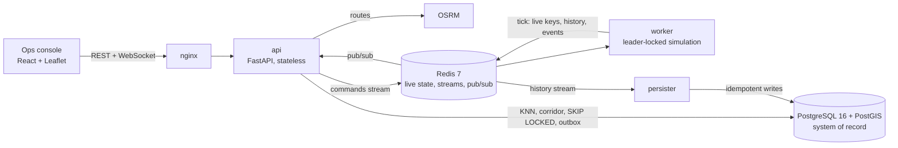

# DIVERT knowledge bank

**What this covers:** everything an engineer or tester needs to understand DIVERT without reading the code first: what it must do, how it is built, how data moves through it, how its processes run, how the code is laid out, and how to configure and work on it. Every fact here was checked against the code. Code pointers use `path` + symbol name, so they survive line changes.

DIVERT dispatches the nearest free emergency unit to an incident, drives it along a real street route in a live simulation, and pre-empts traffic signals ahead of it. It covers **Delhi, Kolkata and Bengaluru**, using real OpenStreetMap stations and junctions.

## Contents

| # | Document | Read it to learn |
|---|---|---|
| 01 | [Specification](01-specification.md) | Purpose, scope, cities, numbered functional and non-functional requirements traced to code and tests, acceptance criteria |
| 02 | [Domain rules](02-domain-rules.md) | Incident types, vehicle profiles, the speed and ETA model, pre-emption rules, lane advice, lifecycle state machines |
| 03 | [Architecture](03-architecture.md) | Components, deployment topologies, scaling, failure modes, observability, security |
| 04 | [Decisions](04-decisions.md) | Why each major design choice was made (ADRs), with the alternatives considered |
| 05 | [Data stores](05-data-stores.md) | PostgreSQL schema, Redis keyspace and streams, snapshot format, what is durable vs rebuildable |
| 06 | [Data flows](06-data-flows.md) | End-to-end lineage: reference data, incident write path, live path, history path, recovery |
| 07 | [Runtime workflows](07-runtime-workflows.md) | Step-by-step: dispatch, tick, pre-emption, arrival, cancel, failover, rebuild, outbox, persister, WebSocket, Redis outage |
| 08 | [Engineering workflows](08-engineering-workflows.md) | Local setup, dev modes, Makefile, testing, CI, migrations, data refresh, test releases, troubleshooting |
| 09 | [Backend codebase](09-codebase-backend.md) | Annotated tree, layering, module reference, tests map, "where to change X" recipes |
| 10 | [Frontend codebase](10-codebase-frontend.md) | Annotated tree, state management, stream client, map rendering, testing, recipes |
| 11 | [Configuration](11-configuration.md) | Every setting and env var, compose and k8s config, tool config, test vs production settings |
| 12 | [Glossary](12-glossary.md) | Terms and ID formats |

## Reading paths

| You are | Read in this order |
|---|---|
| New backend engineer | 01 → 03 → 06 → 07 → 09 → 08 → 05 |
| New frontend engineer | 01 → 03 → 06 (live and history paths) → 10 → 11 |
| Tester / QA | 01 (requirements and acceptance criteria) → 02 → 07 → 08 (dev mode "full docker compose") |
| Ops / deployment | 03 → 05 → 11 → 07 (failover, Redis outage) → [runbook](../runbook.md) |
| Reviewing the design | 04 → 03 → 05 |

## Relationship to the other docs

The files in `docs/` are the detailed references; this bank explains and connects them.

| Reference doc | Holds |
|---|---|
| [api.md](../api.md) | Exact REST and WebSocket contract |
| [data-model.md](../data-model.md) | Per-column database detail |
| [simulation-model.md](../simulation-model.md) | Derivation of the motion and ETA model |
| [architecture.md](../architecture.md) | Original architecture write-up |
| [data-sources.md](../data-sources.md) | OSM data provenance and licence |
| [deployment.md](../deployment.md), [runbook.md](../runbook.md) | Deploying and operating |
| [vision.md](../vision.md) | Product vision |

## Keeping it accurate

- The code is the source of truth. If a page here disagrees with the code, fix the page in the same change as the code.
- Update the matching page when you change a threshold, setting, key, table, event type or endpoint. The "Where to change X" recipes in [09](09-codebase-backend.md) list the pages to touch.
- Map data © OpenStreetMap contributors, ODbL.
